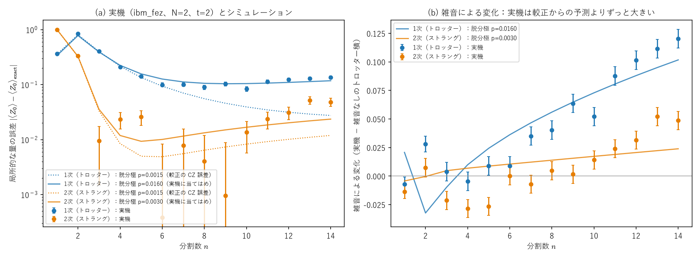
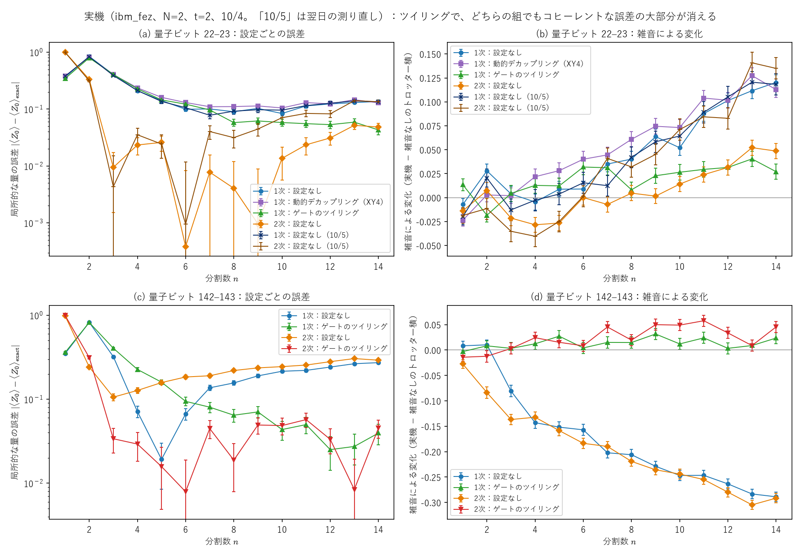
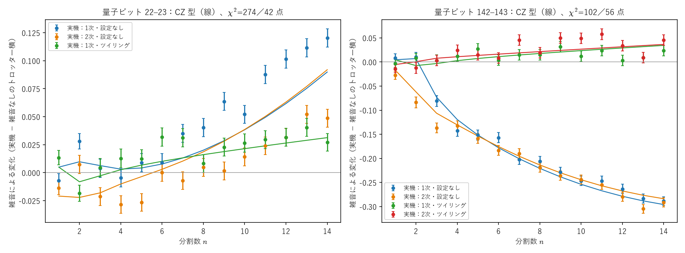
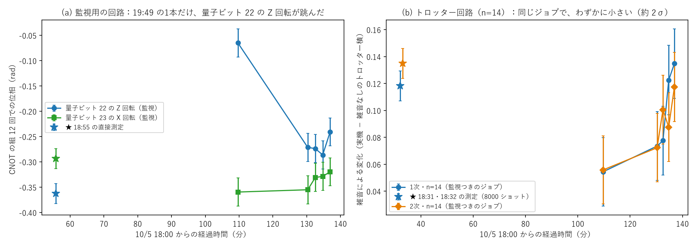
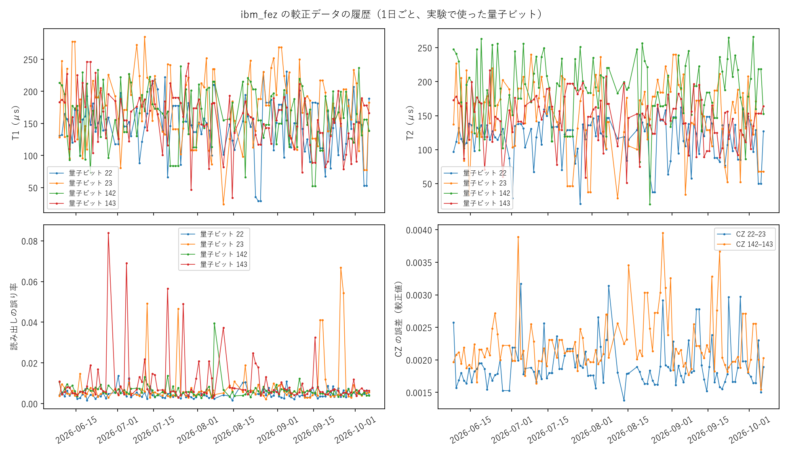
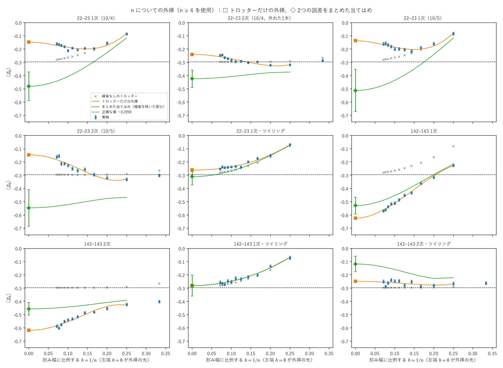
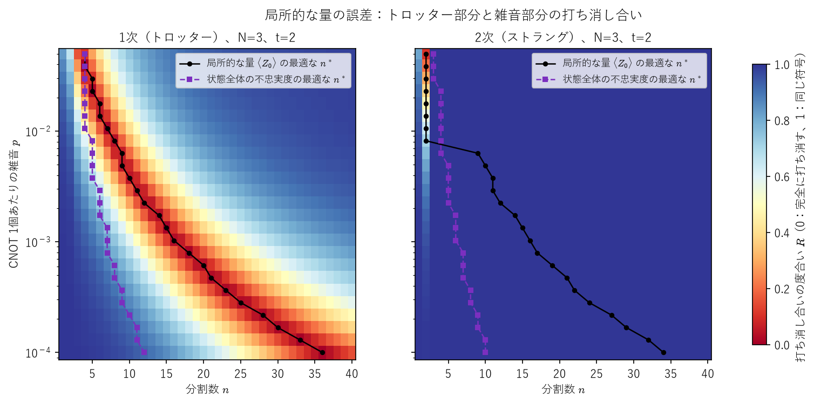

# A-5 トロッター誤差と雑音の綱引き ―最適な分割数を予測して測る

> **作成** 2026-10-04　**更新** 2026-10-27
> テーマ A-5（トロッター誤差と雑音の綱引き）の計算一式の説明。シミュレーションの結果、IBM の実機の測定、
> ツイリング・監視用の回路・外挿、雑音のベイズモデルまでの結果（結果 1〜31）と、ファイルの一覧。

`docs/research_ideas.md` のテーマ A-5 の計算一式です。ノートブックは作らず、**ライブラリ＋テスト（反例探し）＋CSV** で進めています。理論は[行列の指数関数と交換子のノート](../../研究ノート/04_群論・代数/matrix_exponential_commutator_bch_trotter.md)の Part VI。用語（イジング模型、CNOT による ZZ、確率的な誤差とコヒーレントな誤差、ツイリング）の解説は[トロッター実験を読むための翻訳](../../研究ノート/05_量子力学/trotter_experiment_translation.md)。

## 問い

トロッター分解は分割数 $n$ を増やすほど誤差が減る（1次で $\propto1/n$、ストラング分解で $\propto1/n^2$）。しかし実機では $n$ に比例してゲートが増え、雑音が積み重なる。**最適な $n$ はどこにあり、何で決まるか。** 誤差を $\frac a{n^q}+b\,p\,n$（$p$ は CNOT 1個あたりの雑音）とモデル化すると、$n^*=\big(\frac{qa}{bp}\big)^{1/(q+1)}$ と予測できる。

## 模型

$N$ スピンの横磁場イジング模型（開いた鎖）$H=\sum_iZ_iZ_{i+1}+\sum_iX_i$、初期状態 $|00\cdots0\rangle$、時刻 $t=2$。1ステップに ZZ の項ごとに CNOT 2個、各 CNOT の後に2量子ビットの脱分極雑音（強さ $p$）。密度行列で正確に計算（雑音のサンプリングなし）。誤差は2通りで測る：

- `infidelity`：状態全体の不忠実度 $1-\langle\psi_{\text{exact}}|\rho|\psi_{\text{exact}}\rangle$
- `local_err`：局所的な量の誤差 $|\langle Z_0\rangle_\rho-\langle Z_0\rangle_{\text{exact}}|$（実機で測りやすい）

## ファイル

| ファイル | 中身 |
|---|---|
| `trotter_noise.py` | 模型、トロッター積、脱分極雑音、誤差の上限、1点の計算 `run_point` |
| `sweep.py` | 条件を変えて計算し、`results/*.csv` と `*.meta.json`（実行の記録）に出力 |
| `analyze.py` | CSV から実際の $n^*$ とモデルの予測を求め、`*_optimum.csv` に出力（指標：`infidelity`・`trace_dist`・`local_err`） |
| `large_n.py` | 大きな $N$ 用の状態ベクトル計算（ZZ は位相、横磁場は1量子ビットの回転、正確な時間発展は `expm_multiply`、雑音は軌跡法）。$N=20$ で雑音なし1点が約40秒 |
| `aer_check.py` | Qiskit Aer の密度行列シミュレータで、実際の回路（CNOT・RZ・CNOT、雑音は CNOT ごと）から最適な $n^*$ を求める（独立した検証） |
| `summary_figures.py` | まとめの記事用の図（誤差の曲線、$n^*$ と $p$）を既存の CSV から作る |
| `article_draft.md` | まとめの記事の下書き（技術ブログ・研究会の発表向け） |
| `hardware.py` | IBM の実機に回路を送り、読み出しの補正つきで $\langle Z_0\rangle$ を測る（投げる前に CZ の数を確認、`--dry-run` あり）。結果は `results/hardware_*.csv` と実行記録 `*.json` |
| `hardware_analyze.py` | 実機の結果とシミュレーションを比べる図と、実効的な脱分極の強さの当てはめ |
| `backend_noise_sim.py` | 実機の較正データから作った雑音モデル（`AerSimulator.from_backend`）で、同じ変換済みの回路を計算 |
| `noise_model_fits.py` | 1組のパラメータで実機の1次・2次を同時に説明する雑音モデルを探す（脱分極・回転角のずれ・余分な $Z$ 回転） |
| `hardware_zprobe.py` | 実機で、CNOT の組（理想では恒等）のくり返しで各量子ビットにたまる余分な $Z$ 回転を、$X$・$Y$ 基底の測定から直接測る（`--x-axis` で標的の $X$ 軸まわりの回転も、`--qubits` で量子ビットの組も指定できる） |
| `hardware_compare.py` | 実機の結果を、量子ビットの組・実行時の設定（なし・動的デカップリング・ゲートのツイリング）・次数ごとに比べる図と表 |
| `hardware_monitor.py` | 監視用の回路（チェック標準）の試運転：1本のジョブに監視用の回路・トロッター回路・読み出しの較正を混ぜ、時間をおいて何本か投げる。利用時間の上限つき |
| `hardware_monitor_plot.py` | 監視用の回路の結果を、実際の実行時刻に沿って描く |
| `calibration_history.py` | 実機の較正データの履歴（1日ごとの T1・T2・読み出し・CZ の誤差）を API で集め、CSV と図にする（実機の時間は使わない） |
| `extrapolation.py` | $n$ についての外挿（トロッターだけ／2つの誤差をまとめて）を実機のデータに当て、正確な値と比べる |
| `noise_model_jax.py` | 雑音のモデリング（[実験計画](../../docs/a5_modeling_plan.md) の S1）：JAX で書いた前向き計算（CNOT ごとのコヒーレントな誤差 15 項＋脱分極、ツイリング、直接の測定の回路）と、正解の分かる合成データ。自動微分でき、NUTS・SVI・SBI の共通の部品 |
| `a5_data.py` | 実機のデータ（トロッター回路 21 ジョブ 152 点、直接の測定と監視用の回路の位相 42 点）を1つの形にまとめる読み込みと、同じ構造の合成データ（制御 \|1⟩ の直接の測定を加えることもできる） |
| `s2_fit.py` | 雑音のベイズモデル（誤差の形 F1〜F5、ジョブごとの揺らぎ、事前分布の幅、較正の値を使った事前分布）を NUTS（NumPyro）で当てはめる |
| `s2_map.py` | 同じモデルの事後分布の山（MAP）を、多くの出発点から探す（NUTS の出発点と質量行列の初期値に使う） |
| `s2_batch.py` | MAP 探索 → NUTS を、計画（`--plan`）のリストどおりに順番に回す（留守中に回す用） |
| `s2_report.py` | 当てはめのまとめ：収束の診断、正解の取り戻し、制御の状態ごとの回転、PSIS-LOO による比較、スタッキング（`results/s2/s2_report.md`） |
| `coherent_fits.py` | CNOT ごとのコヒーレントな誤差のモデルを、ツイリングなし・ありの実機のデータに同時に当てはめる（ツイリングありでは、同じ誤差をパウリ通路に置き換える）。Z の直接測定は当てはめに使わず、予測と比べる |
| `cancellation_map.py` | 局所的な量の打ち消し合いの度合いを $(n,p)$ の平面で計算し、CSV と図（`figures/`）に出力 |
| `exponents.py` | `analyze` の結果から、$n^*\propto p^s$ の指数 $s$ を指標・次数ごとに当てはめ、`*_exponents.csv` に出力 |
| `tests/test_trotter_noise.py` | 反例探し（下の表） |
| `results/` | 計算結果の CSV |

```bash
uv run pytest experiments/a5_trotter_noise -q
uv run python experiments/a5_trotter_noise/sweep.py --qubits 2 3 4 5 6 --ps 0 0.001 0.002 0.005 0.01 0.02 --nmax 40 --out experiments/a5_trotter_noise/results/sweep_N2-6.csv
uv run python experiments/a5_trotter_noise/analyze.py experiments/a5_trotter_noise/results/sweep_N2-6.csv
```

## テスト（反例探し）

| テスト | 主張 | 結果 |
|---|---|---|
| `test_trotter_bound_random_hermitian` | ランダムなエルミート行列400組で、誤差 ≤ 上限（1次：$\frac{t^2}{2n}\lVert[A,B]\rVert$、2次：$\frac{t^3}{n^2}(\frac{\lVert[M,[M,O]]\rVert}{12}+\frac{\lVert[O,[O,M]]\rVert}{24})$） | 反例なし。誤差/上限の最大は 1次 0.997、2次 0.948（上限はほぼぎりぎりまで達する） |
| `test_trotter_bound_single_step_is_tight_order` | 1ステップの誤差の次数が 2（1次）・3（2次） | 成立 |
| `test_telescoping_inequality` | $\lVert U^n-V^n\rVert\le n\lVert U-V\rVert$（$\lVert U\rVert,\lVert V\rVert\le1$） | 反例なし |
| `test_depolarizing_is_cptp_like` | 雑音の通路がトレース・エルミート性・正定値性を保つ | 成立 |
| `test_matches_qiskit_synthesis` | 自前のトロッター積が Qiskit の `LieTrotter`・`SuzukiTrotter` と一致（N=2,3） | 成立 |
| `test_optimal_n_decreases_with_noise` | 雑音を強くすると $n^*$ は増えない（N=2） | 成立 |
| `test_strang_needs_fewer_steps` | ストラング分解の $n^*$ と最小誤差はトロッター分解以下（N=2） | 成立 |
| `test_global_infidelity_follows_model` | 不忠実度では、予測 $n^*$ が実際と2以内で合い、$q\approx2\times$次数（N=2〜5） | 成立（N=3 の1次だけ $q\approx2.4$〜$2.5$） |
| `test_local_observable_order_symmetry` | $\langle Z_0\rangle$ は A と B の順を入れ替えても同じ | 反例なし |
| `test_known_counterexamples_local_observable` | **見つかった反例を固定**（下の結果 3・4） | 反例が存在することを確認 |
| `test_local_error_decomposition_identity` | 局所的な量の誤差 = \|トロッター部分 + 雑音部分\|（符号つき） | 成立 |
| `test_noise_does_not_always_shrink_toward_zero` | **反例の固定**：「雑音は ⟨Z_0⟩ を必ず 0 に近づける」は成り立たない | 反例あり（N=5、2次、p=0.02、n=3） |
| `test_lie_local_optimum_is_a_cancellation_point` | 1次・局所的な量の最適点は、2つの部分が逆符号で3割未満まで打ち消し合う点 | 成立（N=3、p=0.001〜0.02） |
| `test_first_order_coefficient_formula` | 導出した1次の係数 $c_1$ の式が、数値（誤差 × $n/t$）と一致 | 成立（ランダムな積状態・観測量） |
| `test_layden_condition_gives_zero_first_order` | $O$ が ZZ の項と交換し、初期状態が計算基底なら $c_1=0$ | 反例なし |
| `test_time_reversal_hypothesis_is_false` | **反例の固定**：「すべて実数なら $c_1=0$」は成り立たない | 反例あり（実数の積状態で $c_1\approx0.014$） |
| `test_small_c1_of_real_states_is_specific_to_N3_t2` | 実数の状態で $c_1$ が小さかったのは $N=3$・$t=2$ の偶然（共通の零点が $t=1.9$〜$2.2$ にある、他の時刻では5倍以上） | 成立 |
| `test_exponent_depends_on_metric` | モデルの $n^*\propto p^s$ の指数が、指標・次数で予想どおり（0.04 以内） | 成立 |
| `test_lie_has_cancellation_valley_strang_does_not` | 1次には打ち消し合いの谷がある、2次は $n\ge3$ で打ち消し合わない | 成立 |
| `test_large_n_statevector_matches_dense` | 大きな $N$ 用のゲートの形の計算が、密度行列側の行列と一致 | 成立 |
| `test_trajectories_match_density_matrix` | 軌跡法の平均が、密度行列の値と 4σ 以内で一致（N=3） | 成立 |
| `test_aer_circuit_gives_same_optimum` | Qiskit Aer（実際の回路、雑音は CNOT ごと）でも最適な $n^*$ が同じ（N=4） | 成立 |

## ここまでの結果（2026年10月4日、`results/sweep_N2-6_optimum.csv`）

1. **状態全体の不忠実度は、モデルどおり**：$q\approx2$（1次）・$4$（2次）で、予測 $n^*$ は実際とほぼ一致。不忠実度は誤差の2乗なので、$n^*\propto p^{-1/3}$（1次）・$p^{-1/5}$（2次）になる。
2. **$n^*$ は系の大きさ $N$ にほとんどよらず、最小誤差だけが $N$ とともに悪くなる**（不忠実度、$N\ge4$）。例：$p=0.001$ の1次で $n^*=11$〜$12$（N=4〜8）、最小誤差は 0.074（N=4）→ 0.172（N=8）。2次では $n^*=7$（N=4〜8）。N=3 だけは例外的（1次で $n^*=7$）。N=7・8 は `results/sweep_N7-8.csv`（密度行列で約4分）。
3. **局所的な量 $\langle Z_0\rangle$ では、1次でも誤差が $1/n^2$ で減る**。A と B の順を入れ替えても $\langle Z_0\rangle$ が変わらない対称性があり（テストで確認）、1次の誤差が打ち消し合うため。
4. **局所的な量では、素朴なモデルに反例がある**：
   - ストラング分解で、$p\ge0.01$ のとき $n^*=2$（予測は約 7.5、N=3〜6）。小さい $n$ ではトロッター誤差そのものが $n$ について単調でなく、$n=2$ でたまたま小さくなる（N=3 で $n=2$ のとき −0.017、$n=3$ のとき −0.051）。
   - 「ストラング分解の $n^*$ はトロッター分解以下」も、N=3・$p=0.005$ で破れる（9 対 10）。
   - 1次の最小誤差がとても小さく出る（0.0002 など）のは、トロッター誤差と雑音の効果が符号つきで打ち消し合うため。CSV の `z_trotter_part`（雑音なしのトロッター積の誤差）と `z_noise_part`（雑音による変化）に分けて記録したところ、1次の最適点（N=3 で $n=17,9,5$ など）は、2つが逆符号で互いの大きさの3割未満まで打ち消し合う点だった。つまり、この量の「最適な $n$」は綱引きの釣り合いではなく、偶然の打ち消し合いで決まっている。実機でこの量だけを見ると、最適な $n$ を誤って選ぶおそれがある。
   - 「雑音は $\langle Z_0\rangle$ を必ず 0 に近づける」も成り立たない（720 条件中 18 件の反例。雑音なしの値が 0 に近いとき）。

## 実機（IBM Quantum、2026年10月4日）

`hardware.py` で `ibm_fez`（Heron、量子ビット 22–23、較正の CZ 誤差 0.15%、読み出し誤差 約 0.5%）に、$N=2$・$t=2$ の回路を送り、$\langle Z_0\rangle$ を測った。読み出しの誤差は、全 0・全 1 の較正の回路で補正した。回路の変換は最適化レベル1までにし、CZ の数が $2(N-1)n$ のまま（回路がまとめられていない）ことを投げる前に確かめた。利用時間はパイロット 7 秒＋本番 65 秒×2＝137 秒。続く追加の測定（下の「雑音の正体を絞り込む」「別の量子ビットの組での再現」「翌日の測り直し」）を含めて、合計 **586 秒**（Open Plan の 10 分のうち）。

> **翌日の測り直しによる訂正（10月5日）**：下の表と 2・5 の「2次は雑音に強い」「1つの $p$ で1次と2次を説明できない」は、10月4日の2次の実行1本だけに見られた揺らぎによるもので、翌日に1次と2次を続けて測ると、雑音の効き方は同じだった（下の 15）。2次の最小の誤差が小さい（$n=6$ で 0.001 前後）ことは翌日も再現した。

| | 1次（トロッター） | 2次（ストラング） |
|---|---|---|
| 実機の最適な $n^*$（局所的な量） | 10 | 6（$n=6$〜$9$ で統計誤差 ±0.008 以内） |
| 最小の誤差 | 0.084 ± 0.008 | 0.0004 ± 0.008 |
| 較正の CZ 誤差（$p=0.0015$）の脱分極からの予測 $n^*$ | 14（外れ） | 6（当たり） |
| 実機に合う脱分極の強さ $p_{\text{eff}}$（次数ごとに当てはめ） | 0.016（較正の約 11 倍） | 0.003（約 2 倍） |



**分かったこと**

1. 実機では2次の分解が1次より約 10 倍正確だった（シミュレーションと同じ向き、差は実機のほうが大きい）。
2. **1つの「脱分極の強さ」では、1次と2次を同時に説明できない**（同じ量子ビット、1ステップの CZ の数も同じなのに、必要な $p$ が 5 倍違う）。2次の $n=3$〜$5$ では、雑音による変化が**負**（約 −0.027、3σ）で、脱分極なら必ず正になるはずなので、これも脱分極では説明できない。
3. **較正データから作った雑音モデル**（`backend_noise_sim.py`：`AerSimulator.from_backend`。ゲートの脱分極、ゲート中の T1・T2 の緩和、読み出し）でも説明できない。雑音による変化を、1次で実機の約 1/5.5、2次で約 1/2 にしか見積もらず、1次と2次の差も、負の変化も出ない。
4. 1組のパラメータで両方を説明するモデルを探した（`noise_model_fits.py`、28点、統計誤差の範囲で合えば $\chi^2\approx28$）：脱分極だけ $\chi^2=461$、回転角のずれ（ZZ・横磁場）486（改善なし）、量子ビットごとの余分な $Z$ 回転 335（量子ビット 23 に 0.055 rad/ステップ、$p$ は較正どおり 0.0015）。$Z$ 回転（周波数のずれや、周りの量子ビットとの ZZ クロストークの近似）で一部は説明できるが、まだ十分ではない。
5. 実機への示唆：**較正データの CZ 誤差だけで最適な $n$ を見積もると、1次の分解では大きく外れる**。実機の雑音は、回路の構造（1次か2次か）によって効き方が変わる。2次の対称な形は、何らかの誤差をエコーのように打ち消していると考えられるが、その誤差の正体は未確定。

### 雑音の正体を絞り込む（同じ日、同じ量子ビット 22–23）

| 測定 | 内容 | 利用時間 |
|---|---|---|
| $Z$ の直接測定（`hardware_zprobe.py`） | 一方を $\lvert+\rangle$ にし、CX の組を $k=0,2,4,8,12$ 回くり返して、位相 $\arg(\langle X\rangle+i\langle Y\rangle)$ の傾きを測る | 23 秒 |
| 動的デカップリング（`hardware.py --dd XY4`） | 1次の本番と同じ回路。待ち時間に XY4 のパルスを入れる | 65 秒 |
| ゲートのツイリング（`hardware.py --twirl`） | 1次の本番と同じ回路。2量子ビットゲートの前後にランダムなパウリを挟み（32 通り）、コヒーレントな誤差をパウリ雑音（確率的な誤差）に変える | 66 秒 |

| 1次の設定 | 実機の $n^*$ | 最小の誤差 | $n=14$ の雑音による変化 | $p_{\text{eff}}$ |
|---|---|---|---|---|
| なし | 10 | 0.084 ± 0.008 | +0.120 | 0.016 |
| 動的デカップリング（XY4） | 10 | 0.105 ± 0.008 | +0.113 | 0.019 |
| **ゲートのツイリング** | **14** | **0.043 ± 0.008** | **+0.027** | **0.0052** |
| （参考）2次・設定なし | 6 | 0.0004 ± 0.008 | +0.049 | 0.003 |



6. **ゲートのツイリングで、1次の余分な雑音の大部分（約 8 割）が消えた**。$p_{\text{eff}}$ は 0.016 から 0.0052 に下がり、2次の 0.003 に近づいた。最適な $n^*$ も 14 になり、較正の CZ 誤差からの予測（14）と一致した。ツイリングはコヒーレントな誤差だけを確率的な誤差に変える（確率的な誤差の量は変えない）ので、**1次で効いていた余分な雑音の主因は、2量子ビットゲート（CNOT の組）のコヒーレントな誤差**だと考えられる。コヒーレントな誤差はステップごとに同じ向きに積み重なる（振幅で $n$ に比例）。この組では2次の対称な形がそれを打ち消しているように見えたが、別の組では成り立たず（下の 10）、この組でも翌日には成り立たなかった（下の 15）。
7. **動的デカップリングは効かなかった**（むしろわずかに悪化）。待ち時間中の位相のずれ（アイドル中の $Z$ の誤差）は主因ではない。2量子ビットの回路では待ち時間がほとんどないことと合う。
8. **余分な $Z$ 回転は実在する**が、`noise_model_fits.py` の当てはめとは合わない：CX の組1回あたり、量子ビット 22 に −0.027 rad、23 に +0.010 rad（当てはめでは 0.005・0.055）。CX の組だけでもコヒーレンスは $k=12$ で 0.94（22）・0.97（23）まで落ちる。$Z$ 回転だけのモデルは、ゲートのコヒーレントな誤差の一部を近似していたにすぎないと考えられる。

### 別の量子ビットの組での再現（同じ日、量子ビット 142–143）

同じ `ibm_fez` の量子ビット 142–143（較正の CZ 誤差 0.15% は 22–23 と同じ、読み出し誤差 約 0.7%、T2 は 153〜219 μs で 22–23 の約 3 倍）で、1次・2次それぞれ設定なしとツイリングを測った（`hardware.py --qubits 142 143`、各 8000 ショット、統計誤差 約 ±0.011、利用時間 36＋37＋36＋37＝146 秒）。

| 量子ビット 142–143 | 実機の $n^*$ | 最小の誤差 | $n=14$ の雑音による変化 | $p_{\text{eff}}$ |
|---|---|---|---|---|
| 1次・設定なし | 5（打ち消し合い） | 0.019 ± 0.011 | **−0.289** | 当てはまらない（負の変化） |
| 1次・ツイリング | 12 | 0.025 ± 0.011 | +0.024 | 0.003 |
| 2次・設定なし | 3 | 0.106 ± 0.010 | **−0.292** | 当てはまらない（負の変化） |
| 2次・ツイリング | 6 | 0.008 ± 0.011 | +0.046 | 0.006 |

9. **ツイリングの効果は再現した**：どちらの組でも、ツイリングを入れると $n=14$ の雑音による変化は +0.02〜+0.05 になり、較正の約 2〜4 倍の脱分極（$p_{\text{eff}}=0.003$〜$0.006$）で説明できる大きさにそろった。最適な $n^*$ も予測（1次 14、2次 6）に近い（12・6）。
10. **ツイリングなしのコヒーレントな誤差は、組によって大きさも符号も違う**：22–23 では1次だけに正の変化（+0.12）、142–143 では1次・2次の両方に大きな負の変化（−0.29、$\langle Z_0\rangle$ が 0 から遠ざかる。脱分極では起こらない）。したがって「2次の対称な形はコヒーレントな誤差を打ち消す」は一般には成り立たない（22–23 の次数による差も、翌日の測り直しで消えた。下の 15）。較正の CZ 誤差は表示上同じ 0.15% でも、コヒーレントな誤差は組ごとに大きく違う。
11. **実機で、局所的な量の「打ち消し合いによる偽の最適点」が出た**：142–143 の1次・設定なしの最小（$n=5$、誤差 0.019）は、トロッター部分 +0.132 と雑音部分 −0.152 の打ち消し合いで、$n=6$ では誤差が 0.07 に戻る。シミュレーションで見つけた反例（上の「ここまでの結果」4）が、実機のコヒーレントな誤差で実際に起きた例。

### コヒーレントな誤差のモデル（`coherent_fits.py`、実機の時間は使わない）

各 CNOT の直後にコヒーレントな誤差 $E=e^{-i\sum_k\theta_kP_k}$ と脱分極 $p$ を入れたモデルを、組ごとに、ツイリングなし・ありのデータへ**同時に**当てはめた。ツイリングありのデータでは、同じ $E$ をパウリ・ツイリングしたもの（$E=\sum_Pc_PP$ のとき確率 $|c_P|^2$ のパウリ通路）に置き換える。ツイリングは誤差の種類を変えるだけなので、正しいモデルなら同じパラメータで両方に合うはず。

| モデル（CX の直後の誤差） | パラメータ数 | 22–23（42 点） | 142–143（56 点） |
|---|---|---|---|
| $Z$ 位相（$Z_c,Z_t$） | 3 | $\chi^2=430$ | 305 |
| **CZ 型**（$Z_c,X_t,Z_cX_t$：CZ の位相と角度の誤差を CX の枠に移したもの） | 4 | 274 | **102** |
| 一般（$Z_c,Z_t,X_t,Z_cX_t,Z_cZ_t$） | 6 | 245（$p\to0$） | 96 |
| CZ 型＋RX の層ごとの誤差 | 8 | 147（$p\to0$） | 94 |



12. **142–143 は、単純なモデルでほぼ説明できる**：CZ 型で $\chi^2=102$／56 点（統計誤差の約 1.35 倍のずれ）。主な項は $X_t$（CZ の枠では標的側の $Z$ 位相）で、CNOT 1個あたり 0.033 rad、脱分極は $p=0.0035$（較正の約 2.3 倍）。この1つの回転が、ツイリングなしの1次・2次の −0.29 と、ツイリングありの小さな正の変化を、同じパラメータで同時に再現する。
13. **22–23（10/4 の2次を含めた場合）は、どのモデルでも説明できない**（→ 外れた1本を除くと説明できた。下の 17）：パラメータを増やしても $\chi^2$ は点の数の 3.5 倍以上で、脱分極が 0 に張りつく（過剰な当てはめの兆候）。当てはめに使っていない $Z$ の直接測定とも合わない（量子ビット 22 の傾き：実測 −0.027 rad、CZ 型の予測 −0.054、RX の誤差ありの予測 +0.31）。
14. **1次と2次の変換後の回路は、ほとんど同じ**（深さ 172 と 174）。2次は、1次の最後の $X(d)$ を最初に移しただけで、間の回路は同じ。したがって、時間によらない（マルコフ的な）ゲートごとの誤差なら、1次と2次の雑音の効き方は似る（142–143 はそうなっている、モデルの線もほぼ重なる）。22–23 の「1次は +0.12、2次は +0.05」は、この種のモデルの外にある。候補は（翌日の測り直しで前者と分かった。下の 15）、2本のジョブ（1分半の間隔）の間での雑音の揺らぎ（量子ビット 22 の T2 は 50 μs と短く、二準位系の欠陥の揺らぎがありうる）か、文脈に依存する誤差。なお1次は 18 分後の動的デカップリングつきの実行（ほぼ同じ回路）でも同じ値だったので、1次の値は再現している。

### 翌日の測り直し（10月5日、量子ビット 22–23）

14 を確かめるため、22–23 で1次と2次を続けて測った（各 8000 ショット、ジョブの間隔 約 1 分、利用時間 36＋36＝72 秒）。較正の値は前日から変わっていた（CZ 誤差 0.15% → 0.19%、量子ビット 22 の T2 50 → 127 μs）。**測る前の予測**：時間によらないゲートごとの誤差なら、1次と2次の雑音による変化は $n$ の大きいところでほぼ同じ。

| $n=6$〜$14$ の雑音による変化の比較 | $\chi^2$（9 点、統計誤差の範囲で合えば 9 前後） |
|---|---|
| 10/5 の1次 対 10/5 の2次 | **10.4**（同じ） |
| 10/5 の1次 対 10/4 の1次 | **4.4**（日をまたいで再現） |
| 10/5 の2次 対 10/4 の2次 | 160（10/4 の2次だけが外れ） |
| 10/4 の1次 対 10/4 の2次 | 202 |

| 量子ビット 22–23（10/5） | 実機の $n^*$ | 最小の誤差 | $n=14$ の雑音による変化 | $p_{\text{eff}}$ |
|---|---|---|---|---|
| 1次・設定なし | 7 | 0.078 ± 0.011 | +0.118 | 0.016 |
| 2次・設定なし | 6 | 0.001 ± 0.011 | +0.135 | 0.012 |

15. **予測どおり、1次と2次の雑音の効き方は同じだった**。10/4 の2次の実行（1本）だけが、$n\ge8$ で雑音による変化が小さく外れていた。1次の値は、10/4 の2本（設定なし、18 分後の動的デカップリングつき）と 10/5 の計3本で一致したので、外れていたのは 10/4 の2次のほうである。**「2次の対称な形がコヒーレントな誤差を打ち消す」という 5・6 の解釈は誤り**で、1回のジョブの中での雑音の揺らぎ（原因は不明。量子ビット 22 の T2 が日によって 2.5 倍変わるような揺らぎがある）を、回路の構造の効果と取り違えていた。1回の実行で結論を出さない、という教訓。
16. **2次の最小の誤差が小さいことは再現した**（$n=6$ で 0.001）。これは雑音への強さではなく、トロッター誤差そのものが小さい（$n=6$ で 0.0005）ためで、$n$ が小さいので雑音もまだ小さい。
17. **外れた1本を 10/5 の2本に置き換えると、22–23 も 142–143 と同じ CZ 型のモデルで説明できる**（`coherent_fits.py` の「22–23（2日目）」、ツイリングありは 10/4 の1次）：CZ 型で $\chi^2=68$／42 点（1点あたり 1.6、142–143 は 1.8）。パラメータを増やしても 67（一般）・63（RX の誤差つき）とほとんど改善しない。主な項は $Z_c=-0.017$、$X_t=+0.018$、$Z_cX_t=-0.011$ rad、$p=0.0046$（較正の約 2.4 倍）。2組とも「CNOT ごとの小さなコヒーレントな回転＋較正の 2〜3 倍の脱分極」という同じ形で説明でき、違うのは回転の向きと大きさだけ。
18. ただし、**$Z$ の直接測定とは、まだ合わない**（量子ビット 22 の傾き：CZ 型の予測 −0.068 rad、実測 −0.027 rad（10/4））。直接測定の回路には RZ も RX もないので、誤差が周りのゲートによって変わる（文脈に依存する）可能性や、10/4 の測定時の揺らぎが残る。

### モデルの予測を、当てはめに使っていない回路で確かめる（10月5日、`hardware_zprobe.py --x-axis`）

18 のずれを調べるため、CNOT の組だけをくり返す回路で、各量子ビットの回転を2組とも測った。前回の測り方（標的を $\lvert+\rangle$ にする）では、モデルの主な項である標的の **X 軸まわりの回転**（$X_t$）が見えない（$\lvert+\rangle$ は $X$ の固有状態）ので、標的を $\lvert0\rangle$ のまま置いて $Z$・$Y$ で測る回路を加えた。モデルの予測の計算は、実際の回路に誤差を挿入した Qiskit の計算と一致することを確かめてある。各 3000 ショット、利用時間 26＋26＝52 秒。**予測は測る前に書いた**（CZ 型、22–23 は2日目の当てはめ）。

| CX の組1回あたりの回転（rad） | 22–23：予測 | 22–23：実測 | 142–143：予測 | 142–143：実測 |
|---|---|---|---|---|
| **標的の X 軸まわり**（新しい測定） | −0.027 | **−0.024** | −0.118 | **−0.096** |
| 制御の Z 軸まわり | −0.068 | −0.028（10/4 は −0.027） | −0.039 | −0.011 |
| 標的の Z 軸まわり | 0.000 | +0.010（10/4 も +0.010） | 0.000 | −0.005 |

19. **モデルの主な項は、当てはめに使っていない回路で確かめられた**：標的の X 軸まわりの回転は、2組とも予測の向き・大きさで出た（−0.024 対 −0.027、−0.096 対 −0.118）。特に 142–143 の −0.1 rad／組は大きく（12 組で約 1.2 rad 回る）、トロッター回路の当てはめだけから、測る前に予測できた。142–143 のツイリングなしの −0.29 は、主にこの回転による。
20. **制御の Z 回転は、2組ともモデルが 2.5〜3.5 倍大きく見積もる**（22–23 の実測は2日間で同じ −0.027・−0.028 なので、揺らぎではない）。標的の小さな Z 回転（+0.010・−0.005）はモデルにない。トロッター回路の当てはめでは、制御の $Z$ 位相が、モデルにない別の誤差（標的の $Z$ 位相や、RX・RZ と組み合わさって効く誤差など）の効果も肩代わりしていると考えられる。3つの直接測定の値をそのまま入れたモデルで、トロッター回路のデータがどこまで説明できるかを調べるのが次の一歩。

### 監視用の回路の試運転（10月5日 19:49〜20:17、`hardware_monitor.py`）

ジョブごとの揺らぎ（20 のずれや、初日の2次の外れ値）を捉えるため、**1本のジョブに監視用の回路とトロッター回路を混ぜて**入れ、同じジョブを5本投げた（各回路 1500 ショット、1本 5 秒、計 25 秒）。監視用の回路は、CNOT の組を 12 回くり返して、量子ビット 22（制御）の Z 回転と 23（標的）の X 回転を測る回路。トロッター回路は1次・2次の $n=14$。待ち行列のため、実際の実行時刻は 19:49、20:10、20:12、20:14、20:17 になった（`results/hardware_monitor_runtimes.csv`）。考え方は[解説ノートの Part VI](../../研究ノート/05_量子力学/trotter_experiment_translation.md)。



| 実行時刻 | 22 の Z 回転（監視、±0.028） | 23 の X 回転（監視、±0.028） | 1次 $n=14$ の雑音による変化（±0.026） | 2次 |
|---|---|---|---|---|
| （18:55 の直接測定） | −0.363 | −0.294 | | |
| （18:31・18:32、8000 ショット） | | | +0.118 | +0.135 |
| **19:49** | **−0.065** | −0.359 | +0.054 | +0.056 |
| 20:10 | −0.271 | −0.355 | +0.074 | +0.072 |
| 20:12 | −0.274 | −0.331 | +0.078 | +0.101 |
| 20:14 | −0.286 | −0.328 | +0.123 | +0.088 |
| 20:17 | −0.241 | −0.320 | +0.135 | +0.117 |

21. **監視用の回路が、揺らぎを1本のジョブの中で捉えた**：19:49 のジョブだけ、量子ビット 22 の Z 回転が −0.065 で、20:10〜20:17 の4本の平均 −0.268 から **6.5σ** 跳んでいた（4本どうしは $\chi^2=1.4$／3 で安定）。18:55 の値（−0.363）とも違う。量子ビット 23 の X 回転は5本とも安定（$\chi^2=1.6$／4）。揺らいでいたのは量子ビット 22 の位相（周波数のずれに当たる）だけで、標的側の回転は動かなかった。
22. **同じジョブのトロッター回路も、わずかに小さかった**：19:49 の雑音による変化は、1次・2次とも、その後の4本の平均より 0.04〜0.05 小さい（それぞれ約 1.5σ、合わせて約 2σ）。その後 20:17 にかけて、18:31 の値（+0.12〜+0.14）に戻っていく。5本だけなので「一緒に動いた」とまでは言えないが、監視用の回路のほうがずっと敏感（6.5σ 対 約 2σ）だった。トロッター回路に効き始める前の小さな揺らぎでも、監視用の回路なら見つけられる、という性質は監視に向いている。
23. **量子ビット 22 の Z 回転は、時間によって変わる量だった**（10/4 −0.300、10/5 18:55 −0.363、19:49 −0.065、20:10〜20:17 約 −0.27）。13 で、当てはめた制御の Z 位相が直接測定と合わなかったのは、異なる時刻のジョブのデータをまとめて当てはめたことが一因かもしれない（未確認の仮説）。

### 較正データの履歴（`calibration_history.py`、実機の時間は使わない）

API で過去の較正値を日ごとに取り出せる（`backend.properties(datetime=…)`）。ibm_fez の 113 日分（2026/6/8〜10/6）を、実験で使った量子ビットについて集めた（`results/calibration_history_ibm_fez.csv`）。



24. **10/4 は量子ビット 22 にとって珍しく悪い日だった**：T2 の中央値は 127 μs（下位 5% は 54 μs）で、60 μs を下回った日は 113 日中 7 日（約 6%）。10/4 は 49.8 μs（23 も 67.8 μs、中央値は 160 μs）。日ごとに T1・T2 は 2〜5 倍変わり、CZ の誤差（中央値 22–23 で 0.18%、142–143 で 0.21%）や読み出しの誤り率（143 でときどき 2〜8%）にも、まれな大きな跳びがある。監視用の回路で見た「ふだんの小さな揺らぎ＋まれな大きな跳び」が、日単位でも見える。同じ値が数日続く区間があり、毎日すべての値が測り直されているわけではない（統計を取るときは独立な測定として数えない）。

### n についての外挿（`extrapolation.py`、実機の時間は使わない）

既存の手法を手元の実機データに当てた。$h=1/n$ として、(1) トロッター誤差だけの外挿（Endo ら 2019 の考え方。1次は $z_0+c_2h^2+c_3h^3$、2次は $z_0+c_2h^2+c_4h^4$）、(2) 同じ外挿を実機の値に使う、(3) 2つの誤差をまとめた当てはめ（Hakkaku ら 2025、Zhou ら 2026 の考え方。$z(n)=(1-\lambda)^n\times$［トロッターの式］）を比べた（$n\ge4$、統計誤差で重みづけ）。



| データ | 生の値（$n=14$）と正確な値の差 | (2) トロッターだけの外挿 | (3) まとめた当てはめ |
|---|---|---|---|
| 22–23 1次（10/5） | +0.134 | +0.159 ± 0.010 | −0.216 ± 0.160 |
| 22–23 2次（10/5） | +0.135 | +0.150 ± 0.008 | −0.250 ± 0.139 |
| 142–143 1次 | −0.273 | −0.328 ± 0.009 | −0.233 ± 0.064 |
| 142–143 2次 | −0.292 | −0.322 ± 0.007 | −0.160 ± 0.048 |
| 22–23 1次・ツイリング | +0.043 | +0.035 ± 0.007 | **−0.015 ± 0.063** |
| 142–143 1次・ツイリング | +0.040 | +0.015 ± 0.010 | **+0.016 ± 0.079** |
| 142–143 2次・ツイリング | +0.045 | +0.048 ± 0.008 | +0.179 ± 0.059 |

25. **雑音がなければ、外挿でトロッター誤差はほぼ完全に消える**（雑音なしの値で、正確な値との差 0.0007 以下）。しかし実機の値にトロッターだけの外挿をすると、ツイリングなしでは**かえって悪くなる**（雑音の増え方まで延ばしてしまう）。
26. **まとめた当てはめは、ツイリングありの1次でだけ正確な値と一致した**が、誤差棒は生の値の 6〜8 倍で、使う $n$ の範囲（3, 4, 5 から）で 0.1 以上動く。偏りを消す代わりにばらつきが増える（誤差緩和のオーバーヘッド）。ツイリングなしでは、雑音の強さ $\lambda$ が負になるなど前提が破れて外れる。ツイリングは、外挿の前提（確率的な誤差）を成り立たせる準備でもある。142–143 の2次・ツイリングで外れた理由は未解明。
27. **$n$ という1つのつまみでは、2つの成分を分けきれない**（$n=4$〜$14$ では、$1/n^2$ で減る形と一定の割合で縮む形が似ていて、当てはめがどちらのせいにしても合ってしまう）。文献の手法は、雑音の倍率という2つ目のつまみで解決している。来月の測定に「同じ $n$ で雑音を 1 倍・3 倍にした回路」を加える根拠。

この結果を受けた議論（正解の定義の分野の慣習、つまみとモデルの役割、判断のレベルでの評価、手法の候補）は [docs/a5_discussion_noise_modeling.md](../../docs/a5_discussion_noise_modeling.md) にまとめた。

### 雑音のベイズモデル（S1・S2、2026年10月7〜9日、実機の時間は使わない）

実機の全データ（トロッター回路と直接の測定）を、CNOT ごとのコヒーレントな回転＋脱分極＋ジョブごとの揺らぎのモデルで、ベイズ推定（NumPyro の NUTS）した。計画は [docs/a5_modeling_plan.md](../../docs/a5_modeling_plan.md)、用語と考え方は [雑音をモデルにする（ノート）](../../研究ノート/05_量子力学/noise_modeling_through_mri.md)、結果の表は [results/s2/s2_report.md](results/s2/s2_report.md)。

28. **ジョブごとの揺らぎは、データにはっきり支持される**（入れないモデルより PSIS-LOO の elpd で約 470 良い）。揺らぎの大きさは約 0.001〜0.002 rad。
29. **誤差を「制御の状態ごとの、標的の回転」で表す形（F5）が最良**で、初めて収束した（R-hat 1.01）。標的の Y 軸まわりの回転を含めたことが効いた。22–23 の制御の Z 位相は −0.0071 で、直接の測定（−0.0068）と合った（結果 18・20 のずれの解消）。
30. **データが決めるのは「制御が |0⟩ のときの回転」**（22–23 の X 0.0068、Z 0.0021、142–143 の X 0.0254 など）で、事前分布の幅を 10 倍変えても動かない。「制御が |1⟩ のときの Z 回転」と脱分極の強さは、事前分布の幅につられて動く（データが決めていない）。トロッター回路の CNOT の組が、制御 |1⟩ のときの Z 回転をエコーのように打ち消すためと考えられる。
31. **制御を |1⟩ にした直接の測定**（各 CNOT のあとに標的を反転し戻す）を加えると、決まらなかった方向の不確かさが約 40 分の 1 になる（合成データ）。F5 の実データは、22–23 の制御 |1⟩ の Z 回転を −0.11 ± 0.01 rad と予測しており、来月この測定で、CNOT の組1回あたり約 +0.45 rad の傾きが出るか（本物か、モデルにない誤差の肩代わりか）を確かめる。
32. **この −0.11 は事前分布の幅によらない**（幅 0.02・0.05・0.1 で −0.100・−0.114・−0.115）ので、データから来ている量と判断できる。ただし揺らぎを入れないモデルでは符号が逆（+0.105）になり、揺らぎの扱いと強く絡む（データへの合い方は揺らぎありが圧倒的に良い）。制御 |1⟩ の直接の測定の効果（合成データ）は、乱数の種を変えても再現した。
33. **ニューラルネットによる推定（SBI、`s4_sbi.py`、正規化フロー、GPU）**：100 万回のシミュレーションで学ばせた推定器は、合成データ 300 組の SBC で 68% 区間 0.689・90% 区間 0.901 と、平均として正直な不確かさを出した。しかし実データでは NUTS より 2〜10 倍広く、中心もずれた（データが決める幅が事前分布より数百倍狭いこと、本物のデータがモデルの典型から外れている可能性）。逐次版（SNPE）は不安定で失敗した。精度の基準は NUTS のまま。詳しくは [docs/a5_modeling_plan.md](../../docs/a5_modeling_plan.md) の「S4 の結果」。

### モデルの点検と、来月の測り方（2026年10月11日、実機の時間は使わない）

34. **事後予測チェック（`s2_ppc.py`）：残差は統計誤差の約 1.3 倍**（Σr²/点 1.70、事後予測 p 値 0.000）。ずれは一方向の偏りではなく、ばらつきの大きさ。T1 緩和が抜けていれば出るはずの「深さとともに |0⟩ の側へ寄るずれ」は 1.0σ で、見えない。一番大きい外れは 22–23 の2次・$n=2$ の1点（5.9σ、$\hat k=0.80$）。結果は [results/s2/real_F5_D1_long_ppc.md](results/s2/real_F5_D1_long_ppc.md)。
35. **合成データ seed1 の失敗の原因は「ニールの漏斗」**：MAP 探索がジョブごとの揺らぎの大きさ $\sigma_{\rm drift}\to0$（揺らぎを全部 0 にすると事後密度がいくらでも高くなる首）に落ち、そこから始めた NUTS が抜け出せなかった。出発点の $\sigma_{\rm drift}$ が小さすぎるとき $10^{-3}$ に置き直すと、R-hat 1.008、正解 14 項目すべてが 2σ 以内に戻った（`s2_fit.py` の `--sigma-floor`）。漏斗の首は実データのモデルにも残っている（$\delta_j=0$ でも尤度は正で、事前密度の $\sigma^{-J}$ の発散は消えない）。MAP は密度の高さだけを見るので、首の確率の質量が小さいことは落ちない理由にならない。実データで落ちなかったのは、探索が途中の局所的な山（$\sigma_{\rm drift}\approx4.5\times10^{-4}$）で止まったためと考えられる（未確認。出発点しだいで実データでも落ちうるので、同じ置き直しが効く）。
36. **SBI は、事前分布を NUTS の事後分布のまわりに絞ると NUTS とほぼ一致した**（局所版、30 万回、`--box-k 6`・`10`）。回転の 13 項目はすべて NUTS と 1σ 以内、幅の比 0.8〜1.3、SBC は 0.67〜0.68／0.89。分かったのは「範囲を絞ると SBI と NUTS の差が縮む」ことで、結果 33 のずれの少なくとも一部は、範囲が広すぎて実データの近くの学習が足りなかったためと考えられる。両者は同じシミュレータ（同じモデル）を使うので、この一致はモデルが正しいことの証拠にはならない（モデルの当てはまりの悪さは結果 34 のとおり残っている）。箱を NUTS から作るので、NUTS と独立な推定でもない。22–23 の制御 |1⟩ の Z 回転は SBI でも −0.12 ± 0.01（同じモデルの中での数値の検算）。脱分極 $p$ だけは箱を広げると下がる（データが決めない量）。
37. **誤差棒を広げる係数を入れると、予測が良くなる**（PSIS-LOO で +23.8 ± 12.0、倍率はトロッター回路 1.42、直接の測定 1.35）。回転の値は変わらず、幅だけが正直に広がる（制御 |1⟩ の Z 回転 −0.107 ± 0.025）。統計誤差に入っていないばらつき（読み出し補正の不確かさなど）がある。
38. **T1 緩和（CNOT ごとの振幅減衰）を入れても、予測は良くならない**（+0.7 ± 1.3）。減衰の確率は事前分布（較正の T1 から約 $6\times10^{-4}$）から動かず、データが決めない。効果が小さいからではない（$n=14$ の ⟨Z₀⟩ で 0.004〜0.010、1点の誤差棒と同じくらい）。同じ変化を脱分極 $p$ や回転でも作れて、見分けがつかないため。T1 を分けるには、T1 だけに敏感な測定が要る。ただし T1 を入れると、制御 |1⟩ の Z 回転の2つの山（−0.10 と +0.09）の間を、チェーンの1本が移った。T1 と誤差棒の係数を両方入れると（予測の良さは誤差棒だけと同等）、この量は 0.00 ± 0.09 と、2つの山をまたいで決まらなくなる。**結果 31・32 の −0.11 は、モデルの細部しだいで変わる量**で、来月の直接の測定で決める。
39. **来月の測り方（S6、`s6_design.py`、ガウス近似）**：今の事後分布に候補の測定の情報（フィッシャー情報）を足して比べると、**制御 |1⟩・反転を戻す Z の直接の測定が、QPU 秒あたりの情報量で最良**。トロッター回路を増やしてもほとんど情報が増えない。−0.11 なら CNOT の組1回あたり約 0.44 rad 進み、$k=8$ で ±π を超えて折り返すので、22–23 では $k=1$〜$4$ を推奨する。推奨の回路（22–23 は $k=1$〜$4$、142–143 は $k=2$〜$12$、3000 ショット、約 18 秒）で計算すると、測ったあとの 22–23 の制御 |1⟩ の Z 回転の標準偏差は約 0.001、142–143 は 0.0013〜0.0016 になる。これは**今のモデルが正しいと仮定した予測**で、出発点のモデルを F5＋D1・＋誤差棒・＋T1＋誤差棒と変えても約 0.001 で変わらない（今の幅からの縮みは、それぞれ 1/11・1/21・1/76）。−0.11 と +0.105 の2つの候補は、$k=1$〜$4$ で予測の位相の差が統計誤差の 41〜145 倍あり、1回で見分けられる。22–23 だけなら約 9 秒。結果は [results/s6/design.md](results/s6/design.md)（出発点が F5＋D1）と、`design_real_F5_D1_os_long.md`・`design_real_F5_D1_t1_os_long.md`。

### 予行演習・1点の影響・実機での答え合わせ（2026年10月11日午後〜12日）

40. **予行演習：推奨の測定を加えれば、正しい側が決まる**（`s2_batch.py --plan rehearsal`）。正解を実データの当てはめ（誤差棒つき）から作り、22–23 の制御 |1⟩ の Z 回転だけを −0.11 と +0.105 にした2つの合成データに、S6 の推奨の測定（c1 Z、22–23 は $k=1$〜$4$）と、実データ並みのばらつき（統計誤差の約 1.4 倍）を加えた。誤差棒のモデルでも T1＋誤差棒のモデルでも、4本のチェーンがすべて正解の側にそろい、**−0.1092 ± 0.0012、+0.1058 ± 0.0012**（R-hat ≤ 1.011）。幅は S6 のガウス近似の予測（約 0.001）と合った。ただし 142–143 は 14 項目中 5 項目が 2σ をわずかに超えた（4本は同じ雑音の実現なので、1組のデータの癖かもしれない。種を変えて確認中）。
41. **実データだけでは、22–23 の制御 |1⟩ の Z 回転は決まらない**：F5＋誤差棒の当てはめ（−0.103 ± 0.025）から、1点だけ抜いて当てはめ直すと、22–23 の2次・$n=2$ の点で +0.086 ± 0.060、**142–143 の直接の測定の1点**（X 回転、$k=12$）で +0.087 ± 0.060、監視用の回路の1点で −0.057 ± 0.089（チェーンが2つの山に分かれ R-hat 1.32）。MAP 探索でも −0.1 側と +0.1 側の山が高さの差 5〜10 に並ぶ。別の組の点で入れ替わるのは、直接の測定の誤差棒の倍率を2つの組で共有しているためと考えられる（組ごとに分けたモデルを確認中）。
42. **PSIS-LOO は「1点を抜くと別の山へ移る」影響を見落とす**：手元のサンプルの重みを付け替える方法なので、サンプルのない山へは移れない。上の3点を抜いたときの変化を、PSIS はどれも −0.10 付近のまま、と予測した。外れ値が結論を動かすかは、当てはめ直さないと分からない。
43. **MAP 探索の出発点は 12 個では足りなかった**：T1＋誤差棒のモデルで出発点を 30 個にすると、12 個のときより 25 高い山（+0.09 の側）が見つかり、NUTS は +0.017 ± 0.044（R-hat 1.09）になった。
44. **実機で答え合わせ：制御 |1⟩ の Z 回転は、ほぼ 0 だった**（10/12 07:33、ibm_fez の 22–23、`hardware_zprobe.py --control-one --ks 0 1 2 3 4 --shots 2000`、QPU 7 秒）。位相は $k=1$〜$4$ で 0.051・0.054・0.052・0.043（統計誤差 0.022）で、傾きは $-0.0025\pm0.0100$ rad／組。回転に直すと $+0.0006\pm0.0025$。**−0.11（組1回で +0.44）も +0.105（−0.42）も、統計誤差の約 40 倍離れていて否定された**。測る前の事後分布で「0 付近（$\lvert\cdot\rvert<0.01$）」に 1% を超える確率を置いていたのは、出発点 30 個の T1＋誤差棒のモデル（0.15）だけで、ほかは 0.008 以下だった。注意：10/4〜5 から1週間後の測定で、同じジョブに監視用の回路を入れていないので、較正が変わって回転そのものが変わった可能性は否定できない。結果は `results/hardware_zprobe_c1_q22_20261011T223319Z.csv`。
45. **実機の測定を加えた当てはめ**（`--with-c1-hw`、10/12）：誤差棒のモデルでは、制御 |1⟩ の Z 回転は −0.0029 ± 0.0020 に従ったが、**データが決めているとしてきた量が大きく動いた**（22–23 の制御 |0⟩ の X 回転 +0.0066 → +0.0027、10σ。直接の測定の誤差棒の倍率 1.35 → 1.72）。**T1＋誤差棒のモデルでは、加えてもほかの値が動かず**（制御 |0⟩ の X 回転 +0.0067、倍率 1.33）、制御 |1⟩ の Z 回転は −0.0056 ± 0.0013。10/4〜5 のデータと 10/12 の測定を無理なく同時に説明できたのは T1 を入れたモデルだった。T1 は 10/4〜5 のデータだけでは「入れても入れなくても同じ」（結果 38）だったが、データが決めない方向の答えを大きく左右していた。1週間で回転が変わった可能性は、まだ否定できない。
46. **外れ値に強い尤度（観測の誤差を自由度 4 の t 分布に、`--robust`）**：22–23 の制御 |1⟩ の Z 回転は +0.023 ± 0.046（90% 区間 −0.06〜+0.09、R-hat 1.011）で、±0.1 のどちらの山も選ばなかった。測る前に「0 付近」へ置いた確率は 0.125。予測の良さは誤差棒のモデルと差がない（PSIS-LOO で −7.7 ± 9.3）。**誤差棒の倍率を組ごとに分けるモデル（`--obs-scale-pair`）は直らなかった**（チェーンが −0.10 と +0.06 に分かれ R-hat 1.35）。結果 41 の「倍率の共有が原因」という仮説は、主な原因ではなさそう。
47. **予行演習は乱数の種によらず再現した**（種 1・2 × 2つの世界、誤差棒のモデル）：−0.1086・+0.1048・−0.1095・+0.1041（いずれも ± 0.0013、R-hat ≤ 1.018）で、正解から 2σ を超えた項目は 0/56。結果 40 の 142–143 の外れ（5/14）は、1組のデータの癖だった。
48. **「1週間で回転が変わった」と「T1 が欠けていた」は、今のデータでは区別できない**（10/12 夕方、3本を並行）。10/12 のジョブだけ 22–23 の制御 |1⟩ の Z 回転を別のパラメータにするモデル（`--split-hw`）では、10/12 の値は −0.0059 ± 0.0013、10/4〜5 の値は ±0.1 の2つの山に戻り（チェーンが分かれ R-hat 1.48）、ほかの値と合い方（倍率 1.33）も元に戻った。PSIS-LOO では T1＋誤差棒（回転は共通、収束）より 3.2 ± 1.8 良いが、収束していないので当てにならない。T1＋誤差棒＋t 分布の尤度は、実機なしでは 0 付近の確率 0.014（T1 だけ・t 分布だけより悪い）、実機ありでは収束しなかった（R-hat 1.45）。

### 来月の測り方の予行演習（2026年10月13日、実機の時間は使わない）

49. **来月の混ぜたジョブ（トロッター回路・監視用の回路・c1 Z の測定）では、「T1 が欠けていた」と「1週間で回転が変わった」を区別できない**（`--mixed-job`、4本）。世界 A（T1 あり・回転は変わらない）と世界 B（T1 なし・来月のジョブだけ制御 |1⟩ の Z 回転が −0.11 → −0.006）の合成データに、T1 のモデルと時期で分けるモデルを当てはめると、どちらの世界でも予測の良さは同じ（差 +0.9 ± 1.0、+0.2 ± 1.0）。世界 B でも、T1 のモデルは「ずっと −0.005」で矛盾なく当てはまった。理由：10/4〜5 のトロッター回路のうち、ツイリングなしの回路はこの回転をエコーでほぼ打ち消す（−0.11 と −0.006 で $n=14$ の ⟨Z₀⟩ の差は約 0.0003、統計誤差 0.006〜0.01 よりずっと小さい）。ツイリングありの回路は回転の**大きさ**に約 0.03 反応する（ツイリングで回転が確率的な誤差に変わり、その強さが回転の2乗に比例するため）が、同じ変化は脱分極 $p$ や T1 でも作れるので、今の精度では見分けられない。**原理的に答えられないのではなく、今のデータとモデルでは見分けられない**（10/13 の監査で、最初の「原理的に答えられない」という書き方を直した）。γ も決まらなかった（正解 0.0018・0.00086 に対し、推定は事前分布の中心 0.0006 のまま）。
50. **T1 専用の回路を加えると、γ を取り戻せる**（`--t1-probe`、2本）。制御を |0⟩ と |1⟩ に準備して CX の組を $k$ 回（$k=2$〜$24$）重ね、両方の量子ビットの ⟨Z⟩ を測る。脱分極は |0⟩ も |1⟩ も 0 へ縮めるが、T1 は |1⟩ だけを |0⟩ の側へ戻すので、2つの準備の ⟨Z⟩ の和が T1 の分だけ $k$ とともに育つ（MRI の反転回復に当たる）。T1 ありの世界では γ = 0.00164 [0.00144, 0.00184]・0.00075 [0.00056, 0.00094]（90% 区間、正解 0.00179・0.00086）、T1 なしの世界では 0.00011・0.00016（事前分布の下の端）と、はっきり分かれた（ただし「T1 なしの世界」は、不具合で昔のデータに T1 が残ったまま作られていた。直して回し直す）。脱分極 $p$ も同時に取り戻せた。S6 のガウス近似でも、この回路（約 20 秒）で log γ の幅が 0.68 → 0.08（22–23）、0.16（142–143）に縮み、QPU 秒あたりの情報量が候補の中で最大（0.74 ナット／秒）。注意：合成データに読み出しの偏り（|1⟩ を 0 と読みやすい）を入れていない。実機では、この偏りが T1 に似て見える。
51. **収束しなかった2本を長く回し直しても、収束しなかった**（8本のチェーン、1000＋1000）。時期で分けるモデルでは、10/4〜5 の制御 |1⟩ の Z 回転のチェーンが −0.1・0・+0.1・+0.04 に分かれた（R-hat 1.51。10/12 の値 −0.0059 ± 0.0013 はそろう）。結果 49 のとおり、これはサンプリングの失敗というより「データが決めない量」の正直な姿。T1＋誤差棒＋t 分布＋実機は R-hat 1.38 で、予測の良さも T1＋誤差棒より下（505.5 対 510.9）。

### 読み出しの偏りと、T1 専用の回路による区別（2026年10月14日、14本、実機の時間は使わない）

52. **読み出しの偏りがあっても、T1 専用の回路で γ を取り戻せる**（`--syn-ro 0.01 0.03`：|0⟩ を 1 と読む確率 1%、|1⟩ を 0 と読む確率 3%。`--ro-model`：T1 専用の回路の ⟨Z⟩ に、組・量子ビットごとの倍率とずれを置く）。T1 ありの世界（正解 0.00179・0.00086）で 0.00167 [0.00136, 0.00200]・0.00102 [0.00067, 0.00137]、種を変えて 0.00161・0.00097。T1 なしの世界で 0.00022・0.00033（種を変えて 0.00022・0.00023）。偏りのずれ（正解 0.02）は制御の量子ビットで 0.015〜0.021。不具合を直した T1 なしの世界（偏りなし）でも 0.00011・0.00015 で、10/13 の結論は変わらない。
53. **偏りを推定しないと、偏りが T1 に見える**：T1 なし＋偏りの世界を、偏りなしのモデルで当てはめると γ = 0.00057 [0.00028, 0.00091]・0.00065（本物の T1 の 1/3 ほど）。実機では読み出しの偏りをモデルに入れる。**ショット数**：試した 1000 ショットの条件（種 1 つ）では、22–23 は分かれた（T1 あり 0.00156、なし 0.00043）が、γ の小さい 142–143 は過小評価（正解 0.00086 に対し 0.00040 [0.00016, 0.00082]）で、T1 ありとなしの区間が重なった。3000 ショットでは分かれた。必要な最小のショット数は、複数の種で見分けられる割合を調べないと決まらない（今は 3000 を使う）。**注意**：10/14 の偏りのモデルは、倍率とずれを独立な正規分布に置いていたため、誤読の確率が負になる領域を許していた（標的の量子ビットで、事後分布の最大 26%）。監査を受けて、誤読の確率そのもの（Beta 分布）から作る形に直した。上の数値は直す前のモデルによるもので、直したモデルで確かめ直す。
54. **T1 専用の回路を加えると、「T1 が欠けていた」と「時期で回転が変わった」を区別できる**（結果 49 の「区別できない」が変わった）。予測の良さの差（時期で分ける − T1）は、世界 A（T1 あり、回転は変わらない）で −39.0 ± 10.4・−40.3 ± 8.7（T1 のモデルがはっきり勝つ）、世界 B（T1 なし、回転が変わる）で +10.8 ± 6.5・+13.2 ± 4.9（時期で分けるモデルが勝つ、1.7〜2.7σ）。T1 専用の回路が γ を決めるので、T1 のモデルは昔のデータを T1 で説明できなくなり、昔のツイリングありの回路の「回転の大きさへの反応」が回転のせいだと読めるようになる。世界 B の時期で分けるモデルは、昔の回転の大きさを約 0.09〜0.11（正解 −0.11）と取り戻した（符号は決まらず、種 0 ではチェーンが ±0.09 に分かれて R-hat 1.53）。世界 B は勝ち方が小さく、収束の悪い回（R-hat 1.48〜1.53）もあるので、「ある程度区別できる」。

### T1 専用の回路の必要なショット数（2026年10月15日、ニューラル事後推定、実機の時間は使わない）

55. **ショット数ごとの「見分けられる割合」を、ニューラル事後推定で出した**（`s6_t1probe_sbi.py`）。NUTS は1回1時間かかり、種を数百に増やせないので、T1 専用の回路のデータ（22–23、回転は当てはめの値に固定）から γ・脱分極 p・読み出しの誤り4つを推定する正規化フローを、ショット数ごとに GPU で学習した（シミュレーション 50 万回）。世界ごとに合成データ 500 組で、「T1 あり」と判定する割合を数えた。判定は「90% 区間の下の端が 0.0003 を超える」（判定 B）と、「中央値が 0.0009 を超える」（判定 A）。

    | ショット数 | QPU 秒（この回路だけ） | T1 なし：誤検出（B） | T1 小 γ=0.00086：検出（B） | T1 あり γ=0.00179：検出（B） |
    |---|---|---|---|---|
    | 1000 | 5 | 0.006 | 0.652 | 1.000 |
    | 2000 | 8 | 0.000 | 0.896 | 1.000 |
    | 3000 | 11 | 0.000 | 0.950 | 1.000 |

    22–23 くらいの T1 なら 1000 ショットで足り（判定 A でも 250 ショットで 93〜95%、500 ショットで 98% と、別の2回の学習で再現）、γ が 0.00086 と小さい場合（22–23 の回転・雑音の条件のまま γ だけを変えた世界。142–143 の条件では確かめていない）は、3000 ショットで検出 95%。判定 A は、しきい値が「T1 小」の正解とほぼ同じなので、その世界の検出率（30〜50%）は意味を持たない（設計の失敗。判定 B を足して直した）。SBC の当たり率は 68% 区間 0.61〜0.73、90% 区間 0.86〜0.92（3000 ショットの1回はやや自信過剰）。**限界**：この回路だけを読み、回転を固定した単純なモデルなので、検出率はやや楽観的になりうる。また、制御と標的の ⟨Z⟩ を独立に作っていたが、実際は同じショットの同時測定なので相関がある（10/15 の監査）。4通りの同時の結果から作り直して学習し直す。見比べるための NUTS（混ぜたジョブ全体の当てはめ、1000・2000 ショット）は、10/15 の実行で設定の一覧の改行の不具合により18本すべて失敗し、まだ回し直していない。

### 直した手順での確かめ直し（2026年10月16〜17日、NUTS 18本＋ニューラル事後推定、実機の時間は使わない）

10/14〜15 の監査で直した3点（読み出しの誤りを確率そのものから作る、結果のファイル名に合成データの条件を入れる、T1 専用の回路の2つの量子ビットを同時の4通りの結果から作る）をすべて入れて、10/14 の主な実行と必要なショット数を確かめ直した（結果の名前は `v3`）。

56. **γ の取り戻しと、2つの仮説の区別は、直したあとも変わらない**（NUTS、混ぜたジョブ＋T1 専用の回路 3000 ショット＋読み出しの偏り）。T1 ありの世界（正解 0.00179・0.00086）で γ = 0.00159 [0.00123, 0.00196]・0.00072 [0.00040, 0.00107]、種を変えて 0.00177・0.00071（正解はすべて 90% 区間の中）。T1 なしの世界で 0.00020・0.00025。予測の良さの差（時期で分ける − T1）は、世界 A（T1 あり、回転は変わらない）で −29.1 ± 8.4・−28.8 ± 8.6（種 0・2）、世界 B（T1 なし、回転が変わる）で +8.6 ± 5.6・+8.4 ± 3.2。どちらの世界でも正しいモデルが勝つが、世界 B の勝ち方は 1.5〜2.6σ と小さい。**世界 B で昔の回転の値を取り戻せるかは、種しだい**（種 0 は −0.092 と正解 −0.11 に近いが、種 2 は約 0）。「時期で分けるほうが合う」とは言えても、「昔の回転がいくつだったか」は安定して言えない。
57. **必要なショット数（NUTS、混ぜたジョブ全体、種 2 つ）**：判定「γ の 90% 区間の下の端 > 0.0003」で、22–23 は 1000・2000 ショットとも、T1 あり・なしの8回すべてを正しく判定した。142–143（γ = 0.00086）は 1000 ショットで1回見逃し、2000 ショットでは2回とも検出したが1回はぎりぎり（下の端 0.00031）。T1 なしの世界で誤検出は 0/8。T1 ありの世界の 90% 区間 16 個のうち、正解が外れたのは1個（1000 ショット・種 1 の 22–23）。**注意**：当てはめは T1 専用の回路の制御と標的の ⟨Z⟩ を独立な尤度で数えているが、合成データでは2つに相関がある（同じショットの同時測定）。同じ情報を二重に数えて区間を狭くするおそれがあり、結果 56・57 の NUTS の区間と判定は較正が確かめられていない（10/17 の監査）。共分散を尤度に入れて回し直す。
58. **ニューラル事後推定でも、142–143 の条件では小さい T1 が見分けにくい**（`s6_t1probe_sbi.py --pair`、2つの量子ビットを同時に作る形、世界ごとに 500 組）。同じ判定で、γ = 0.00086 の検出率は、22–23 の条件で 1000・2000・3000 ショットに 66%・87%・97%、**142–143 の条件で 47%・72%・79%**（90% 区間の幅は 22–23 の約 1.4 倍）。結果 55 の「3000 ショットで 95%」は 22–23 の条件のもので、142–143 には当てはまらない（10/15 の監査の指摘のとおり）。大きい T1（γ = 0.00179）はどちらの条件でも 1000 ショットで 98〜100%、誤検出はどの条件でも 1% 以下。2つの量子ビットの相関を入れても、22–23 の検出率はほぼ変わらなかった（3000 ショットで 95% → 97%）。

### 相関つきの尤度と、T1 専用の回路の k の範囲（2026年10月17日、NUTS 12本＋ニューラル事後推定 6つ、実機の時間は使わない）

59. **2つの量子ビットの相関を尤度に入れても、区間の幅はほとんど変わらない**（`s2_fit.py --zcorr`：T1 専用の回路の制御と標的の ⟨Z⟩ を、モデルの4通りの同時確率から計算したショットの共分散つきの2変量正規分布で数える。結果の名前は `v4`）。γ の 90% 区間の幅は、相関なしの 10/16 の当てはめと比べて 3% 以内の違い（たとえば T1 ありの世界の 22–23 で 0.00072 対 0.00073）。区別も同じで、世界 A で −30.2 ± 9.8、世界 B で +8.8 ± 5.0（種 0）・+10.5 ± 3.6（種 2）。10/17 の監査の「同じ情報を二重に数えて区間を狭くする」影響は、実際にはほぼ無視できた。世界 B の昔の回転は、種 0 で約 −0.09、種 2 では鎖が +0.06〜−0.08 に分かれた（R-hat 1.37）。
60. **142–143 の小さい T1 は、ショット数を増やすより k の範囲を広げるほうが見分けやすい**（`s6_t1probe_sbi.py --ks`、142–143 の条件、γ = 0.00086、判定「90% 区間の下の端 > 0.0003」、世界ごとに 500 組）。

    | k の並び | ショット数 | 検出率 | γ = 0.00179 の 90% 区間の幅 |
    |---|---|---|---|
    | 2, 4, 8, 16, 24（今） | 3000 | 0.808 | 0.00077 |
    | 2, 4, 8, 16, 24（今） | 6000 | 0.978 | 0.00055 |
    | 4, 8, 16, 32, 48 | 1500 | 0.884 | 0.00073 |
    | 4, 8, 16, 32, 48 | 3000 | 0.998（学習の種を変えて 0.994） | 0.00052 |
    | 4, 8, 16, 32, 64 | 3000 | 0.998 | 0.00048 |

    誤検出（γ = 0）はどれも 0.2% 以下、SBC の当たり率は 68% 区間 0.65〜0.72、90% 区間 0.87〜0.94。k を 4〜48 に広げると、同じ 3000 ショットで検出率が 81% から 99.8% に上がり、ショットを2倍にした今の k（97.8%）より良い。4〜64 は 4〜48 とほぼ同じ。MRI の反転回復で待ち時間を延ばすと T1 の効果が育つのと同じ。**注意**：QPU 秒の見積もりはショット数だけから出していて、k を広げて回路が深くなる分（CNOT の数）は入っていない。
61. **回転も推定する版でも、検出率はほぼ変わらない**（`--free-rot`：制御 |0⟩・|1⟩ の X・Y・Z の回転6個も推定、事前分布は当てはめの平均 ± 4 標準偏差の箱。142–143、今の k、3000 ショット）。検出率 0.800（回転を固定した版 0.808）、90% 区間の幅は約 4% 広がるだけ。10/15 の「回転を固定しているので楽観的になりうる」という限界は、この条件ではほぼ当たらなかった。NUTS（混ぜたジョブ全体、相関つきの尤度、今の k）でも、142–143 は 1000・2000 ショットとも見逃し（2000 ショットの下の端は 0.00029 で、しきい値 0.0003 のすぐ下）、22–23 は正しく判定した。

### 来月の設計（k 4〜48）の予行演習と、区別の判定の見直し（2026年10月18〜21日、実機の時間は使わない）

62. **T1 専用の回路の QPU の時間は、k を広げてもほとんど増えない**（`hardware_t1probe.py`、ドライラン。ジョブは出していない）。k = 4, 8, 16, 32, 48 で CZ は 8〜96 個、深さ 57〜673、1回の実行は 2.6〜12.8 μs。1ショットあたりの待ち（測定後のリセットなどを含めて約 0.3 ms）がずっと長いので、3000 ショットで1組約 11.2 秒（回路の長さを考えないと 11.0 秒、k 2〜24 でも 11.1 秒）。22–23 と 142–143 で同じ。「0.3 ms」はこれまでのジョブからの逆算なので、本番の前に小さいジョブで確かめる。
63. **来月の設計（k 4〜48、3000 ショット、読み出しの偏りと相関つきの尤度）で、混ぜたジョブ全体を NUTS で当てはめる予行演習**（`v5`、種 0・1・2）。T1 ありの世界（正解 0.00179・0.00086）の γ は、22–23 で 0.00174 [0.00153, 0.00195]・0.00182 [0.00156, 0.00207]・0.00195 [0.00168, 0.00221]、142–143 で 0.00062 [0.00042, 0.00082]・0.00087 [0.00064, 0.00110]・0.00087 [0.00061, 0.00112]。22–23 の 90% 区間の幅は約 0.00042 で、k 2〜24（約 0.00072）より約 4 割狭い。種 0 の 142–143 は正解が区間のすぐ外（γ の対数正規の事前分布の中心 6×10⁻⁴ に引かれた形）だが、種 1・2 では正解どおり。T1 なしの世界では 0.00014〜0.00039。区別（時期で分けるモデル − T1 のモデル）は、世界 A で −69.1 ± 17.5・−64.2 ± 15.3、世界 B で +11.9 ± 5.2・+11.1 ± 4.6・+11.5 ± 3.3。世界 B の昔の回転は、種 0・1 で −0.094・−0.106（鎖がそろう）、種 2 は鎖が分かれた（R-hat 1.31）。
64. **見分けられる T1 の下限（ニューラル事後推定、k 4〜48、3000 ショット、判定「90% 区間の下の端 > 0.0003」）**：γ = 0.0008 以上で 96〜99%、0.0006 で 69〜83%、0.0004 以下で 20% 以下（22–23・142–143 とも、学習の種 2 つずつ）。誤検出（γ = 0）は 0。回転も推定する版でも、γ = 0.00086 の検出は 99%（142–143）・98.8%（22–23）。読み出しの誤りを 2 倍（e01 2%、e10 6%）にした世界でも 98%。k 4〜48 の 142–143・3000 ショットの検出を学習の種 4 つで見ると 99.8%・99.4%・98.8%・99.6%。
65. **QPU の時間を減らす案：決め手は k の点の数より、ショットの合計**（142–143、γ = 0.0008／0.001 の検出）。k 5 点・3000 ショット：0.98／1.00、5 点・2000 ショット：0.88／0.99、**3 点（8, 24, 48）・3000 ショット：0.88〜0.90／0.98〜0.99**、2 点（16, 48）・3000 ショット：0.65〜0.68／0.89〜0.92。3 点・3000 ショットと 5 点・2000 ショットは、ショットの合計も検出もほぼ同じ。2 点まで減らすとはっきり悪い。
66. **区別の判定の「偽の陽性」は、比べる2つのモデルが2か所で違っていたためだった**。正解が「T1 なし・回転も変わらない」世界で、時期で分けるモデルが T1 のモデルに 5 回中 4 回（種を足して 7 回中 6 回）勝った（+3.5〜+8.5）。縮める事前分布（`--split-shrink 0.02`：来月の回転 = 昔の回転 + Δ、Δ ～ N(0, 0.02)）を入れても変わらず（+4.0〜+8.3）、世界 B での勝ち方はかえって小さくなった（+11 → +5〜+8、種 3 は −1.4）。縮めたモデルの Δ は「どちらでもない」世界でほぼ 0 なのに予測が良いので、勝っていたのは「回転が変わった」からではない。比べていた2つのモデルは「T1 あり・回転は共通」と「T1 なし・回転を時期で分ける」で、T1 の有無も違っていた。T1 のない世界で T1 を持たないモデルが勝つのは正しい反応。**「回転が変わったか」は、T1 の有無をそろえた2つのモデルで比べ直す**（T1 の有無 × 回転を分けるかの 2×2、結果 68）。

### 区別の判定の 2×2 と、k の組の選び方（2026年10月23日、NUTS 16本＋ニューラル事後推定 6つ、実機の時間は使わない）

67. **k の組の選び方：同じショットの合計なら、小さい k（4）を含めたほうがやや良い**（`s6_t1probe_sbi.py --ks … --gammas`、142–143、判定「90% 区間の下の端 > 0.0003」、学習の種 2 つずつ）。γ = 0.0006／0.0008 の検出率は、4-16-48・3000 ショット：0.62〜0.63／0.92〜0.95、8-16-32-48・3000 ショット：0.58／0.91〜0.92、8-24-48・5000 ショット：0.68〜0.70／0.97〜0.98。誤検出（γ = 0）はすべて 0。90% 区間の被覆は 0.86〜0.91（4-16-48 が 0.86 でやや低い）。ショットの合計（準備1つあたり）で並べると、4-16-48・3000 は 9000 で、同じ 9000 の 8-24-48・3000（結果 65：0.88〜0.90）より γ = 0.0008 の検出がやや良い（差は 0.03〜0.05、1 回の判定の標準誤差は約 0.013）。8-24-48・5000 は合計 15000 で、5 点・3000（0.96〜0.99）と同じくらい。結果 65 の「決め手はショットの合計」は大筋で合っているが、同じ合計なら k の範囲を下の端（4）まで広げるほうが得。
68. **2×2 の比較（途中、空の世界と世界 B の種 0・1・3）**：M1 = T1 あり・回転は共通（`t1_os`）、M2 = T1 なし・共通（`os`、新）、M3 = T1 なし・分ける（`os_split`）、M4 = T1 あり・分ける（`t1_os_split`、新）。M1・M3 は `v5`／`v6` の同じ種の結果を使った（同じ合成データ）。elpd の差（正なら左が良い）：

    | 世界 | 種 | 回転が変わったか M3 − M2 | 同 M4 − M1 | T1 はあるか M1 − M2 |
    |---|---|---|---|---|
    | 空（T1 なし・変化なし） | 0 | −0.9 ± 0.7 | −0.5 ± 0.7 | +4.2 ± 4.0 |
    | 空 | 1 | +0.9 ± 0.8 | +0.6 ± 1.0 | −5.2 ± 2.7 |
    | 空 | 3 | −0.1 ± 1.0 | +1.9 ± 1.2 | −5.7 ± 2.3 |
    | B（T1 なし・変化あり） | 0 | +6.9 ± 4.6 | +5.8 ± 4.6 | −5.0 ± 2.2 |
    | B | 1 | +1.2 ± 1.0 | （M4 が不良） | −9.9 ± 4.4 |
    | B | 3 | +4.3 ± 4.6 | +1.3 ± 1.4 | +2.4 ± 4.0 |
    | A（T1 あり・変化なし） | 0 | +0.3 ± 1.1 | −0.9 ± 0.8 | +69.4 ± 17.5 |
    | A | 1 | −0.1 ± 1.2 | −0.9 ± 0.8 | +64.2 ± 15.3 |

    **空の世界の「偽の陽性」は、T1 の有無をそろえると消えた**（差は ±1 程度、結果 66 の +3.5〜+8.5 は T1 の有無の違いから来ていた）。世界 B では「変わった」の向きに +1〜+7 だが、誤差の 1〜1.5 倍で弱い。結果 63 の世界 B の +11 には、T1 の有無の違いの分が混じっていた。T1 の有無（M1 − M2）は、空の世界で 3 回中 2 回正しく「なし」、種 0 はどちらとも言えない。注意：世界 B では、回転を共通にしたモデル（M1・M2）が収束しにくい（種 1 で R-hat 1.53〜1.76、ESS 6〜7。真の世界とモデルが合っていないため）。世界 B・種 1 の M4 は観測のばらつきの倍率の1つが 3.44（ほかは 1.2〜1.6）で、データに合わない山に落ちたとみて除いた（M4 − M3 = −98）。PSIS-LOO の Pareto k の最大はどの比較でも 1.1〜1.2 で、0.7 を超える点があり、elpd の差の精度には限りがある。世界 A（T1 あり・変化なし、10/23 23:07 に完了）では、「T1 はあるか」が +69・+64（約 4σ）とはっきり「あり」、「回転が変わったか」は ±1 程度で正しく「変化なし」。4つのモデルとも R-hat ≤ 1.01。T1 のないモデル（M2・M3）は、T1 専用の回路の観測のばらつきの倍率が 2.4〜2.6 に膨らむ（T1 のあるモデルでは 1.2〜1.4）。T1 の効果を、ばらつきとして吸収しようとした形。

### 偽の陽性の割合と、小さい k が役立つ理由（2026年10月24日、NUTS 7本＋ニューラル事後推定 9つ、実機の時間は使わない）

69. **小さい k（4）が役立つのは、読み出しの偏りを決めるためらしい**（`s6_t1probe_sbi.py --gammas`、判定「90% 区間の下の端 > 0.0003」、特に書かないものは 142–143・3000 ショット）。γ = 0.0006／0.0008 の検出率は、4-8-48：0.60／0.93、4-24-48：0.61／0.93、4-48（2 点）：0.58／0.91、4-16-48・4000 ショット：0.67／0.94、4-16-48・22–23 の組：0.64／0.97。読み出しの誤り4つの事前分布を正解 ± 0.001 に狭めた版（`--fix-ro 0.001`、2 回ずつ）では、4-16-48：0.80〜0.84／0.99〜1.00、8-24-48：0.86〜0.88／1.00。誤検出（γ = 0）はすべて 0。わかったこと：(1) γ = 0.0008 は両設計とも上限（0.99〜1.00）で、差は見えない（10/25 の監査）。上限でない γ = 0.0006 では順位が入れ替わる（固定なし 4-16-48 0.62〜0.63 対 8-24-48 0.53〜0.61、固定あり 0.80〜0.84 対 0.86〜0.88）。2 回ずつで向きはそろったが、差は同じ設計の 2 回のばらつき（最大 0.08）と同程度。結果 67 の「同じショットの合計なら k = 4 を含めるほうが得」が、小さい k の点が読み出しの偏り（(V-12) の加法的な項 $e_{10}-e_{01}$、k によらない）を決めているため、という解釈と矛盾しない、という程度で、確かめたとまでは言えない。(2) 効くのは k = 4 の点があることで、真ん中の点はほとんど効かない（2 点でも 4-48 は 0.91、16-48 は 0.65〜0.68。3 点の真ん中を 8・16・24 にしても 0.92〜0.95）。(3) 検出を限っているのは、ショット数より読み出しの不確かさらしい（4000 ショットでも 0.94 で 3000 とほぼ同じ、ただし 1 回だけ。読み出しを固定すると 0.99〜1.00）。来月の設計では、読み出しだけを測る k = 0 の点（|0⟩・|1⟩ を用意してすぐ測る）を足す案を確かめる。(4) 4-16-48 は 22–23 の組でも 0.97。GPU の 1 本の時間は、NUTS 4 本と並べると 1.5〜2.4 時間、CPU が空くと 22〜30 分（合成データ作りが CPU で動くため）。
70. **2×2 の比較の種を増やす：空の世界で偽の陽性 0／7、世界 B で 4／6 を検出**（`v9`：M2 だけを新たに回し、M1・M3 は `v5`〜`v7` の同じ種を使う）。「回転が変わったか」（M3 − M2）は、空の世界（種 0・1・3・4・5・6・7）で −0.9〜+0.9（すべて ±1 の内側）、世界 B（種 0〜5）で +6.9 ± 4.6、+1.2 ± 1.0、+5.9 ± 2.5、+4.3 ± 4.6、+7.1 ± 3.5、−0.2 ± 1.0。判定を「差 > 2」にすると、世界 B で 4／6、空の世界で 0／7。「差 > 標準誤差の 2 倍」にすると、世界 B で 2／6（世界 B ではモデルが合わない側の当てはめで、差の標準誤差が大きく出る）。どちらの判定でも空の世界の偽の陽性は 0。差の値に線を引く判定のほうが検出は多いが、線（2）は今回の空の世界の分布（±1）を見てから決めたもので、来月の実機の前に、種を変えた合成データで確かめ直す必要がある。「T1 はあるか」（M1 − M2）は、空の世界で 7 回中 6 回が −3.8〜−9.0 で正しく「なし」、種 0 の +4.2 ± 4.0 だけどちらとも言えない。注意：世界 B・種 2 の M3 は R-hat 1.31。PSIS-LOO の Pareto k が 0.7 を超える点は、282 点中 7〜17 点。

### 判定の線を新しい種で確かめる、読み出しだけを測る k = 0 の点（2026年10月25日、NUTS 12本＋ニューラル事後推定 6つ、実機の時間は使わない）

71. **判定の線「差 > 2」は、線を決めるのに使っていない種でも成り立った**（`v10`：M2・M3 を新たに回す。空の世界の種 8・9・10、世界 B の種 6・7・8）。「回転が変わったか」（M3 − M2）は、空の世界で −2.3 ± 0.8、−1.1 ± 1.0、+1.1 ± 0.8（偽の陽性 0／3）、世界 B で +3.3 ± 1.9、+6.6 ± 4.5、+2.8 ± 2.3（検出 3／3）。結果 70 と合わせると、偽の陽性 0／10、検出 7／9。ただし、空の世界の幅は結果 70 の ±1 より広く（−2.3〜+1.1）、世界 B の 2 つは線のすぐ上（+2.8、+3.3）で、線 2 の余裕は小さい。R-hat ≤ 1.05。
72. **読み出しだけを測る k = 0 の点は、k = 4 より少しだけ良い**（142–143、3000 ショット、γ = 0.0006／0.0008 の検出率）。0-16-48：0.66〜0.67／0.95〜0.97（4-16-48 は 0.62〜0.63／0.92〜0.95）、0-48：0.59／0.93（4-48 は 0.58／0.91）、0-4-48：0.65／0.93、0-4-16-48：0.62／0.95、0-16-48・22–23 の組：0.75／0.98。誤検出（γ = 0）はすべて 0、90% 区間の被覆は 0.88〜0.92。読み出しを固定した場合（結果 69、0.99〜1.00）には届かない。理由の候補は読み出しの誤りを測る精度：3000 ショットで誤り 3% を測ると、二項分布だけなら標準誤差は √(0.03 × 0.97 / 3000) ≈ 0.0031、シミュレーションは統計誤差の 1.35 倍のばらつきを入れているので約 0.0042 で、固定の幅 ± 0.001 の約 4 倍（10/25 の監査で 1.35 倍を反映）。検出率の差がこれだけから来るかは未確認。点を 4 つに増やしても 0.95 で伸びない。読み出しをもっと決めるには、k = 0 の点にだけショットを多く配る設計が候補（今の `s6_t1probe_sbi.py` はどの点にも同じショット数を配るので、確かめるには直す必要がある）。注意（10/25 の監査）：k = 0 が読み出しだけを測るのは、|1⟩ の準備（X）を誤りなしとするシミュレーションの中だけ。実機では準備の失敗 f があり、|1⟩ で 0 を読む確率は (1 − f)e10 + f(1 − e01) で、e10 と f を分けられない。実機の設計に勧める前に、準備の誤りをモデルに入れて見分けられるか調べる。

### 準備の失敗 f を入れた設計の比較、NUTS での k = 0 の確かめ（2026年10月26日、NUTS 12本＋ニューラル事後推定 6つ、実機の時間は使わない）

73. **制御を |1⟩ にする準備の失敗 f を推定しても、k = 0 の点は役に立つ**（`s6_t1probe_sbi.py --prep-err 0.005`：f も推定する。事前分布 0〜0.02、正解 0.005。|1⟩ から始めた確率を (1 − f) × |1⟩ の確率 ＋ f × |0⟩ の確率にする。142–143）。γ = 0.0006／0.0008 の検出率は、0-16-48・3000 ショット（2 回）：0.59〜0.69／0.95〜0.97、4-16-48・3000 ショット（2 回）：0.54〜0.60／0.90〜0.91。k = 0 だけ 9000 ショット・16 と 48 は 3000（`--k-shots 9000 3000 3000`）：f を推定しない版 0.73／0.98、推定する版 0.78／0.98。誤検出（γ = 0）はすべて 0。f の 90% 区間の被覆は 0.88〜0.92。f を入れても 0-16-48 は 4-16-48 より +0.04〜0.06 良く、f を入れない場合（+0.02〜0.03、結果 72）より差が広い。k = 0 の点は e10 と f を分けられないが、検出に効くのはその組み合わせ (1 − f)e10 + f(1 − e01) だから、という解釈は未確認。k = 0 にショットを多く配ると、読み出しを固定した場合（0.99〜1.00）に近づくが、QPU の見積もりは 7.4 秒から 11.0 秒に増え、同じ 11.0 秒の 4-8-16-32-48・3000 ショット（0.96〜0.99、f なし）とはっきりした差はない。
74. **NUTS でも、k = 0 の点は γ の区間を狭くした**（T1 ありの世界、T1 のモデル、混ぜたジョブ全体、`v11`、種 0〜3）。142–143 の γ の 90% 区間の幅は、0-16-48 で 0.00051・0.00051・0.00056・0.00049、4-16-48 で 0.00056・0.00059・0.00058・0.00063（4 回とも 0-16-48 が狭く、平均で約 12% 狭い）。22–23 では狭いか同じ（0.00052〜0.00061 対 0.00055〜0.00062）。正解（0.00179・0.00086）はすべて区間に入り、R-hat ≤ 1.013。ただし、このモデルも準備を誤りなしとしている。
75. **判定の線「差 > 2」の追加の種**（`v11`、空の世界の種 11、世界 B の種 9）。M3 − M2 は、空の世界で +0.0 ± 1.0（正しく「変化なし」）、世界 B で +0.8 ± 1.1（見逃し）。これまでと合わせて、偽の陽性 0／11、世界 B の検出 7／10。

### 実機の時間をそろえた k の設計の比較と、判定の線の成績（2026年10月27〜29日、NUTS 40本＋ニューラル事後推定 18、実機の時間は使わない）

76. **判定の線「差 > 2」の成績：偽の陽性 0／20、世界 B の検出 15／21**（`v12`〜`v14`：M2・M3 を新たに回す。世界 B の種 10〜20、空の世界の種 12〜20）。M3 − M2 は、空の世界で −1.3〜+1.1（9 回とも「変化なし」）、世界 B で +6.3、+0.8、+8.2、+5.5、+7.5、+1.8、+3.7、+6.7、+5.9、+5.0、+0.0（種 10〜20 の順、8／11 を検出）。これまでと合わせて、空の世界の差は 20 回とも −2.3〜+1.1 で、線 2 を越えたことはない。世界 B の見逃し 6 回（種 1、5、9、11、15、20：+1.2、−0.2、+0.8、+0.8、+1.8、+0.0）のうち、R-hat が悪いのは 2 回（種 1 の M2 が 1.53、種 11 の M2・M3 が 1.68・1.54）で、残りの 4 回は M2・M3 とも R-hat ≤ 1.016。逆に、R-hat が 1.23〜1.51 の当てはめでも検出した回がある（種 10、13、14、18）。見逃しの多くは収束の悪さではなく、差そのものが空の世界の分布（−2.3〜+1.1）の中に入る回で、このデータでは回転の変化が見えていない、と考えられる。世界 B（昔の回転 −0.11 → −0.006）での検出率は約 7 割。
77. **実機の時間を 11 秒にそろえると、0-16-48・5000 ショットがいちばん良い**（`s6_t1probe_sbi.py --prep-err 0.005`：f も推定、142–143、準備1つあたりのショットの合計は 15000、QPU の見積もりはどれも 11.0 秒）。γ = 0.0006／0.0008 の検出率は、0-16-48・5000（3 回）：0.850・0.888・0.870／0.994〜1.000、4-8-16-32-48・3000（3 回）：0.708・0.736・0.760／0.976〜0.986、0-8-16-32-48・3000（2 回）：0.746・0.836／0.982・0.994、k = 0 に 9000・16 と 48 に 3000（2 回、1 回目は結果 73）：0.782・0.724／0.976・0.984。誤検出（γ = 0）はすべて 0。γ = 0.0006 では、0-16-48・5000 が 3 回とも 4-8-16-32-48 の 3 回を上回り（平均 0.869 対 0.735、範囲も重ならない）、γ = 0.0008 ではどれも上限（0.98〜1.00）に近く差は小さい。k = 0 にショットを集めても、点を 5 つにしても、0-16-48・5000 には届かない。
78. **f の正解を変えても、0-16-48・5000 は今の設計を上回る**（142–143、γ = 0.0006 の検出率）。f の正解が 0.01（事前分布の上端 0.02 の半分）：0-16-48・5000 で 0.874・0.820、4-8-16-32-48 で 0.562・0.700（差は 0.31 と 0.12、平均で約 0.22）。f の正解が 0（準備の失敗なし、f は推定する）：0-16-48・5000 で 0.864 で、f = 0.005 の 3 回（0.850〜0.888）と同じくらい。f を推定することによる損は見えない。γ = 0.0008 はどれも 0.94〜1.00（f = 0.01 の 4-8-16-32-48 が 0.942・0.968 でいちばん低い）。
79. **組 22–23 でも同じ向き**（`--pair 0`、f の正解 0.005）。γ = 0.0006 の検出率は、0-16-48・5000 で 0.928・0.916、4-8-16-32-48 で 0.764・0.832（差は 0.08〜0.16）。γ = 0.0008 はどちらも 0.994〜1.000。結果 77〜79 の SBC での 90% 区間の被覆は、γ で 0.85〜0.94、f で 0.87〜0.92。注意：ここまでの比較は、T1 専用の回路だけのニューラル事後推定。混ぜたジョブ全体の NUTS のモデルは、まだ準備を誤りなしとしている（結果 74）。

**未解決と次の一歩**：来月の実機のジョブに、監視用の回路・トロッター回路（ツイリングあり・なし）・c1 Z の測定（22–23 は $k=1$〜$4$）・**T1 専用の回路（両方の組、$k$ = 4, 8, 16, 32, 48、3000 ショット、1組約 11 秒）**を混ぜ、モデルに読み出しの偏りと2つの量子ビットの相関を入れて当てはめる。これで CNOT ごとの T1 を測る（γ ≈ 0.0008 以上ならほぼ確実に見分けられる）。「1週間で回転が変わった」かは、T1 の有無をそろえたモデルどうしで比べる（2×2 の比較の結果を待つ）。QPU の時間の見積もりを、トロッター回路も含めて詰める。階層モデルの当てはめ、後悔（判断のレベルの誤差）の計算、$N=3,4$ での再現。実機の枠の残りは約 5 秒（直近 28 日で 10 分。10/4〜5 のジョブが外れるのは 11/1〜2 ごろ）。

## 大きな $N$：$n^*$ は $N=12$ まで変わらない（`aer_check.py`、`results/aer_check_N4.csv`・`N10-12.csv`）

Qiskit Aer の密度行列シミュレータで、実際の回路（ZZ は CNOT・RZ・CNOT、雑音は各 CNOT の後）から、状態全体の不忠実度の最適な $n^*$ を直接求めた（$t=2$、$n=2$〜$16$）。$N=2$〜$8$ はこちらの密度行列の計算、$N=4$ は両方。

| $p$ | 次数 | $N=2$ | $N=4$（こちら／Aer） | $N=6$ | $N=8$ | $N=10$（Aer） | $N=12$（Aer） |
|---|---|---|---|---|---|---|---|
| 0.001 | 1次 | 12 | 11 ／ 11 | 11 | 11 | 11 | 11 |
| 0.001 | 2次 | 7 | 7 ／ 7 | 7 | 7 | 7 | 7 |
| 0.005 | 1次 | 7 | 7 ／ 7 | 7 | 7 | 7 | 7 |
| 0.005 | 2次 | 5 | 5 ／ 5 | 5 | 5 | 5 | 5 |
| 0.02 | 1次 | 5 | 5 ／ 5 | 5 | 5 | 5 | 5 |
| 0.02 | 2次 | 4 | 4 ／ 4 | 4 | 4 | 4 | 4 |

- **最適な $n^*$ は $N=4$〜$12$ でまったく変わらない**（$N=2,3$ だけ少しずれる）。最小の不忠実度は $N$ とともに悪くなる（1次・$p=0.001$ で、$N=4$ の 0.074 → $N=12$ の 0.255）。
- Aer とこちらの計算は、雑音を入れる位置（CNOT ごと／ステップの最後）が違うが、$N=4$ で $n^*$ が全条件で一致し、最小誤差の差も 1% 以内だった（`test_aer_circuit_gives_same_optimum`）。
- $N=12$ の Aer の密度行列は1回路あたり約 25 秒。$N=14$ は約 16 倍（メモリ 4 GB 強）なので、必要なら時間をかけて回す。$N\ge14$ には、検証済みの状態ベクトル・軌跡法（`large_n.py`）も使える。
- **失敗した方法（教訓）**：最初は、雑音の効果を軌跡法で測って「$bpn$」の傾き $b$ を当てはめ、モデルの式で $n^*$ を予測しようとしたが、大きな $N$ では CNOT の数が多く、雑音の効果が線形の範囲を外れて飽和するため、$b$ が不安定になった（スクリプトは削除）。また「どれか1つでも誤差が入れば正確な状態とほぼ直交する」という半解析的な見積もりも、$N=8$ で不忠実度が最大 0.05 ずれ、$n^*$ が 62 条件中 9 条件で1つずれたので採用しなかった。大きな $N$ では、モデルの外挿より、曲線を直接計算して最小点を探すほうが確実。

## 打ち消し合いの領域（`cancellation_map.py`、`figures/cancellation_map_N3.png`・`N4.png`）

局所的な量の誤差の、トロッター部分と雑音部分の打ち消し合いの度合い $R=\frac{|\text{トロッター部分}+\text{雑音部分}|}{|\text{トロッター部分}|+|\text{雑音部分}|}$（$0$：完全に打ち消す、$1$：同じ符号）を、$(n,p)$ の平面に描いた。データは `results/cancellation_map_N3.csv`・`N4.csv`。



- **1次（左）**：平面を斜めに横切る「打ち消し合いの谷」（赤）があり、局所的な量の最適な $n^*$（黒）は、谷に沿っている。谷は「トロッター部分 ≈ −雑音部分」、つまり $\frac a{n^2}\approx bpn$ の位置なので $n\propto p^{-1/3}$ で、**綱引きの釣り合いと同じ指数になる**。指数だけを見ても、釣り合いと打ち消し合いは区別できない。
- **2次（右）**：$n\ge3$ では打ち消し合いが起きない（同じ符号）。局所的な量の $n^*$ は本物の綱引きで決まる。ただし $p\gtrsim0.01$ では $n=2$ がたまたま小さく、$n^*$ が 2 に跳ぶ。
- $N=4$ の1次では、打ち消し合いの谷と不忠実度の最適点がたまたま重なるが、$N=3$ では離れている。
- テスト：`test_lie_has_cancellation_valley_strang_does_not`（1次はどの $p$ でも $R<0.1$ の谷がある、2次は $n\ge3$ で $R>0.9$）。

## 指標ごとの指数 $n^*\propto p^s$（`exponents.py`、`results/sweep_exponents_exponents.csv`）

誤差を $\frac a{n^q}+bpn$ とすると $n^*\propto p^{-1/(q+1)}$。$q$ は「何で測るか」で変わる。$N=2,4,5$、$p=0.0002$〜$0.05$、$n\le80$ で当てはめた結果：

| 指標 | 予想（1次） | モデルの $s$（1次） | 予想（2次） | モデルの $s$（2次） |
|---|---|---|---|---|
| トレース距離（距離） | $-1/2$ | −0.48〜−0.49 | $-1/3$ | −0.33 |
| 不忠実度（距離の2乗） | $-1/3$ | −0.32 | $-1/5$ | −0.20 |
| 局所的な量 $\langle Z_0\rangle$ | $-1/3$（Layden の条件で $q=2$） | −0.33 | $-1/3$ | −0.33（実際の $n^*$ は −0.14〜−0.56 とばらつく） |

- **Knee–Munro (2015) の「距離で測れば1次で $p^{-1/2}$」と、ここでの「不忠実度で $p^{-1/3}$」は、同じ模型の中で指標の違いとしてつながる。**
- 局所的な量の1次は、トロッター分解なのに $-1/2$ ではなく $-1/3$（$c_1=0$ のため誤差が $1/n^2$）。
- 局所的な量の2次は、モデルでは $-1/3$ だが、実際の $n^*$ は打ち消し合いと $n^*=2$ の反例で指数が定まらない。
- 整数の $n^*$ から直接当てはめた指数（`s_actual`）は、予想より絶対値がやや小さい（$n^*$ が小さいと整数に丸める影響が大きい）。モデルの指数（`s_model`）は `test_exponent_depends_on_metric` で予想と 0.04 以内であることを確認。

## 先行研究との関係（2026年10月4日の調査、`literature-scout`）

| ここの結果 | 先行研究 |
|---|---|
| 誤差 $\frac a{n^q}+bpn$ から $n^*$ を求める枠組み | 既知。Knee–Munro (PRA 91, 052327, 2015; arXiv:1502.04536) は1次で距離（トレースノルムなど）を使い $n^*\propto p^{-1/2}$。Endo ら (arXiv:1808.03623)、Xu ら (arXiv:2504.10247) も同じ形 |
| 結果1：不忠実度では $q\approx2\times$次数、$n^*\propto p^{-1/3}$（1次）・$p^{-1/5}$（2次） | 距離で測る Knee–Munro の $p^{-1/2}$ と、指標（不忠実度＝距離の2乗）の違いで説明がつく。同じ模型で指標ごとの指数を並べた文献は見つからなかった |
| 1次と2次の雑音込みの比較 | Avtandilyan–Pogosov (Quantum Inf. Process. 24, 8, 2025; arXiv:2405.01131)：横磁場イジング模型などで次数1・2・4を比較。2次が有利になるゲート誤差のしきい値を議論 |
| 結果2：$n^*$ は $N$ によらない | 局所的な量では Trivedi–Cirac (arXiv:2509.17579) が厳密に示している（$n^*\propto\gamma^{-1/(k+d+1)}$、$k$ は次数、$d$ は格子の次元）。局所的なトロッター誤差が $N$ によらないことは Heyl–Hauke–Zoller (Sci. Adv. 5, eaau8342, 2019)、Granet–Dreyer (PRX Quantum 6, 010333, 2025) |
| 結果3：$\langle Z_0\rangle$ では1次でも $1/n^2$ | Layden (arXiv:2107.08032)：項が2つのとき、1次と2次の積は**回路の両端だけ**が違い（$U_1=e^{-iAδ/2}U_2e^{iAδ/2}$ の形）、初期状態が $A$ の固有状態で $A$ と交換する量を測るなら、両端の違いが効かず1次の項が消える。ここでは $\lvert00\cdots0\rangle$ が ZZ の項の固有状態で、$Z_0$ も ZZ の項と交換するので、この命題で説明できる（テストで見つけた「A と B の順を入れ替えても同じ」も、同じ構造の表れ） |
| 結果4：局所的な量での符号つきの打ち消し合い、小さい $n$ で単調でないための予測外れ | **見つからなかった**（新しさの中心になり得る）。小さい $n$ の振る舞いは、Heyl らの「ステップ幅のしきい値（それを越えるとカオス的になる）」と関係する可能性があるが未確認 |
| 誤差の上限の式 | Childs–Su–Tran–Wiebe–Zhu (PRX 11, 011020, 2021; arXiv:1912.08854)。2次の上限 $δ^3(\frac{\lVert[M,[M,O]]\rVert}{12}+\frac{\lVert[O,[O,M]]\rVert}{24})$（$M$ が真ん中）の形は、引用元の記述で確認。反エルミート（各因子がユニタリ）の条件で指数関数の因子が消える。命題番号（PRX 版で Proposition 10 か）は要確認 |

## 結果3の追加調査：Layden の説明だけでは足りない（2026年10月4日、数値のみ）

1次の分解の、局所的な量の誤差の傾き（$N=3$、$t=2$、$n=10$〜$160$ の両対数）：

| 初期状態 | 測る量 | 傾き | 解釈 |
|---|---|---|---|
| $\lvert000\rangle$（ZZ の項の固有状態） | $Z_0$ | −1.97 | Layden の条件どおり $1/n^2$ |
| $\lvert000\rangle$ | $X_0$ | −1.02 | $X_0$ は ZZ の項と交換しないので $1/n$（Layden どおり） |
| $\lvert+++\rangle$（横磁場の項の固有状態） | $X_0$ | −1.92 | 役割を入れ替えた Layden の条件どおり $1/n^2$ |
| $\lvert+++\rangle$ | $Z_0$ | ― | 全スピン反転 $\prod_iX_i$ の対称性で $\langle Z_0\rangle$ が常に 0（誤差は丸め誤差のみ） |
| ランダムな積状態（成分が**実数**） | $Z_0$ | −1.4〜−3.0 | **ZZ の固有状態でないのに $1/n$ より速い**。Layden の条件では説明できない |
| 同じ角度で、**複素数の位相**をつけた積状態 | $Z_0$ | −0.86〜−1.06 | $1/n$ に戻る |

いったん「ハミルトニアン・初期状態・測る量がすべて実数（時間反転の対称性）なら、1次の誤差の1次の部分が消える」という仮説を立てたが、**これは誤りだった**（次の節）。

## 1次の誤差の係数を導出する（仮説の否定）

1次の積はストラング分解の両端に因子を付けた形 $U_1^n=e^{-iBδ/2}\,U_2^n\,e^{iBδ/2}$ に書ける（$U_2$ の誤差は $O(δ^2)$）。両端の因子を $δ$ の1次まで展開し、$H=A+B$ が保存されることから $B(t)-B=-(A(t)-A)$ を使うと、

$$
\langle O\rangle_{U_1^n}-\langle O\rangle_{\text{exact}}=c_1\,δ+O(δ^2),\qquad c_1=-\frac i2\Big(\langle\psi(t)|[A,O]|\psi(t)\rangle-\langle\psi_0|[A,O(t)]|\psi_0\rangle\Big)
$$

（$O(t)=e^{iHt}Oe^{-iHt}$。第1項は終わりの端、第2項は始まりの端から来る）。`trotter_noise.first_order_coefficient` に実装し、`test_first_order_coefficient_formula` で数値（$n=2000$ の誤差 × $n/t$）と一致することを確かめた。

- **$c_1=0$ になる条件**：$O$ が $A$ と交換すれば第1項が、初期状態が $A$ の固有状態なら第2項が消える。両方を満たせば $c_1=0$（Layden の条件。`test_layden_condition_gives_zero_first_order`）。
- **時間反転の仮説は誤り**：実数の積状態から $\langle Z_0\rangle$ を測ると、$c_1$ は 0 ではない（例：0.0136、−0.0083、0.0103）。ただし、複素数の位相をつけた状態の $c_1$（0.10〜0.19）より 10〜20 倍小さい。前の表で実数の状態が「$1/n$ より速い」ように見えたのは、$c_1$ が小さいため、$n\le160$ では $δ^2$ の項がまだ勝っていた（漸近的な範囲に達していなかった）から。反例を `test_time_reversal_hypothesis_is_false` に固定した。
- **教訓**：傾きの当てはめだけで次数を判定すると、係数が小さい項を見落とす。導いた係数を直接計算して確かめる。
- **実数の状態で $c_1$ が小さかった理由も、偶然だった**：同じ実数の状態でも、時刻を変えると $|c_1|$ の最大は $t=2$ での値の5倍を超え（調べた状態で 0.14〜0.77）、複素数の状態と同じくらいの大きさになる。$N=3$ の実数の積状態では、$c_1(t)=0$ となる時刻が状態によらず $t\approx2.02$〜$2.09$ にあり、調べに使った $t=2$ がたまたまその近くだった（$N=2,4$ には $t\approx2$ の共通の零点はない）。`test_small_c1_of_real_states_is_specific_to_N3_t2` に固定。
- **教訓（2つ目）**：1つの条件（$N=3$・$t=2$）のデータだけから一般化しない。時刻や大きさを変えて確かめる。

## 次の一歩

- （任意）$N=3$ の実数の積状態に共通する $c_1$ の零点 $t\approx2.05$ の由来（スペクトルの特別な関係か）。
- ~~指標ごとの指数の表~~ → 完了（上の「指標ごとの指数」）。
- ~~打ち消し合いの領域の図~~ → 完了（上の「打ち消し合いの領域」）。
- ~~$N$ を増やす~~ → $N=12$ まで完了（上の「大きな $N$」）。さらに大きな $N$ は、Aer の密度行列（$N=14$、時間がかかる）か、`large_n.py` の軌跡法で。
- 実機（IBM、$N=2$〜4）で測る前に、実機の較正データ（CNOT の誤差）から $n^*$ を予測しておく（`quantum-experiment` Skill の手順）。
- ~~Lean：望遠鏡和の不等式~~ → 証明済み（下の「形式証明」）。

## 形式証明

望遠鏡和の不等式 $\lVert U^n-V^n\rVert\le n\lVert U-V\rVert$（$\lVert U\rVert,\lVert V\rVert\le1$）を、一般のノルム環で Lean 4 + Mathlib により証明した（[lean4/QuantumStudy/Telescoping.lean](../../lean4/QuantumStudy/Telescoping.lean)、定理 `norm_pow_sub_pow_le_mul`。行列の ℓ∞ 作用素ノルム版・スペクトルノルム版の系も。`sorry` なし、標準の公理のみ）。トロッター分解の $n$ ステップの誤差を、1ステップの誤差の $n$ 倍で抑える部分（`test_telescoping_inequality` で数値的に確かめた主張）の形式証明にあたる。Mathlib v4.28.0 には、ノルム環でのこの補題はなかった（順序環の `abs_pow_sub_pow_le` のみ）。
