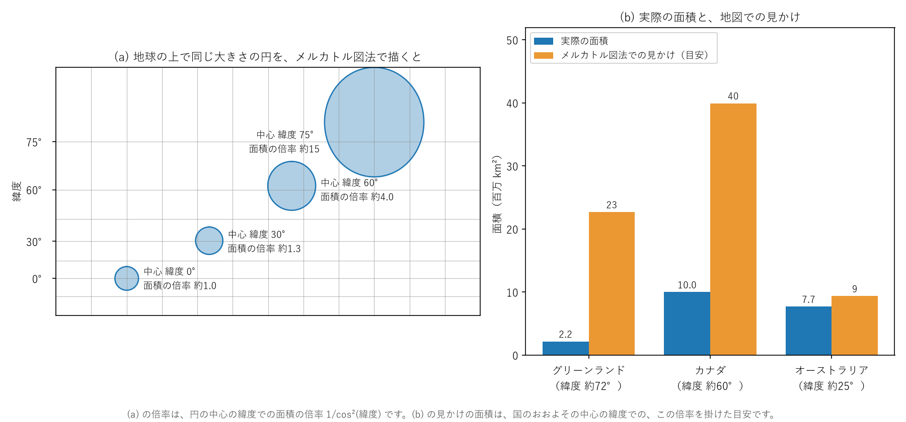

## はじめに

:::message
この本は執筆中です。各章の式は、著者の手計算での検証の前のものを含みます（章ごとに冒頭に書きます）。誤りを見つけたら、コメントで教えてください。
:::

はじめましての方は、はじめまして。カズマと申します。元放射線技師で、今は IT エンジニアをしています。この本を開いていただき、ありがとうございます。

この本は、微分の本です。ただ、微分の計算の練習帳ではありません。1つの変数の微分から出発して、その考え方がどれだけ遠くまで枝分かれしていくのかを、一緒に見て回る本です。

## 数学って、何に使うの？

私は数学が好きだったので、学生のころ、この疑問を持ったことはありませんでした。でも、周りにはこう言う人がたくさんいましたし、今もよく聞かれます。

微分に限って言えば、答えははっきりしています。私たちの身の回りで、微分はもう働いています。

- **AI の学習。** AI（ディープラーニング）は、予測の誤差を少しずつ小さくすることで学習します。どちらへ動けば誤差が減るかを教えてくれるのが、微分（勾配）です。何百万もの数を同時に調整するときも、微分の連鎖律という1つの規則をくり返し使って計算しています（誤差逆伝播）。
- **スマートフォンの地図。** GPS の衛星の時計は、相対性理論の効果で、地上の時計より1日に約38マイクロ秒進みます。補正しないと、測位に大きな誤差が出ます。時計のずれを光の進む距離に換算すると、1日で約11 km にあたります。この補正の計算は、曲がった時空の微分の言葉で書かれています。
- **天気予報。** 空気の流れや温度の変化は、微分を使った方程式で表されます。天気予報は、その方程式をコンピュータで解いて作っています。
- **病院の MRI。** MRI は、場所ごとに磁場の強さを少しずつ変える「傾斜磁場」を使って、体の中のどこから信号が来たかを見分けます。傾斜磁場は英語で gradient で、微分の「勾配」と同じ言葉です。

:::details MRI って、どんな検査？
MRI は、病院で、大きな筒（トンネル）の形をした装置の中に横になって入り、体の断面の画像を撮る検査です。X 線ではなく、強い磁石と電波を使います。

体の中には、水に含まれる水素の原子核がたくさんあります。強い磁石の中では、この原子核は、磁場の強さに比例した周波数の電波にだけ反応します。そこで、傾斜磁場で場所ごとに磁場の強さを少しずつ変えておくと、場所ごとに反応する周波数が変わります。返ってきた信号の周波数を調べれば、傾斜磁場の向きに沿って、信号がどの位置から来たのかが分かります。ほかの向きの位置は、傾斜磁場をかける向きを変えたり、信号のタイミングのずれ（位相）を使ったりして見分け、それらを組み合わせて断面の画像を作ります。
:::

微分を学ぶと、こうした仕組みが「なぜそうなっているのか」まで読めるようになります。それに、もう1つ良いことがあります。難しい計算が、ずっと楽になることです。次の節は、私がそれを身をもって知った話です。

## 10ページと、一行

量子力学の教科書を読んでいたときのことです。

教科書に、直交座標 $(x,y,z)$ を、半径 $r$ と2つの角度 $(\theta,\varphi)$ の球座標で書き換える式が出てきました。原子の中の電子のように、中心のまわりで球の形に広がるものを扱うには、球座標で考えるのが自然だからです。ところが、導出は途中までしか書かれておらず、残りは「自分でやってみてください」となっていました。そこで、愚直に手で計算しました。偏微分を1つずつ書き換えて、項を並べて、まとめる。気づけば、手書きのノートで10ページほどになっていました。

その少しあとで、次の式に出会いました。

$$
\Delta f=\frac{1}{\sqrt{|g|}}\,\frac{\partial}{\partial q^i}\!\left(\sqrt{|g|}\,g^{ij}\,\frac{\partial f}{\partial q^j}\right)
$$

ラプラス・ベルトラミ作用素と呼ばれる式です。左辺の $\Delta f$ はラプラシアンといって、ある点の値が、そのごく近くの範囲の平均と比べてどれだけ低いか（高いか）の度合いを表す量です（$\Delta f$ が正なら、ごく近くの平均のほうが高い）。熱の広がり、波の伝わり方、電気の力の場、そして量子力学で電子の様子を決めるシュレーディンガー方程式と、物理のあちこちに出てきます。

右辺の記号の意味は、今は分からなくて大丈夫です（読み方は、この節の最後の折りたたみに書きました）。大事なのは、座標ごとに決まる $g_{ij}$（計量）という表さえ作れば、この一行に代入するだけで、いろいろな座標でのラプラシアンが出てくる、ということでした（計量の表が壊れていない範囲で、という条件はつきます）。あの10ページの計算の結論が、代入だけで出てきてしまうのです。

うおおお！マジか！めっちゃ簡単に計算できるじゃん！！

と、興奮したのを覚えています。

こんなに便利な式があるのか、と素直に驚きました。しかも、この一行は球座標だけの裏技ではありません。円柱座標でも、ほかの座標でも、計量さえ作れば同じように使えます。座標ごとに違って見えた計算の裏に、共通の仕組みがあったのです。

:::details 参考：一行から出てくる、球座標のラプラシアン
まず記号の読み方です。球座標 $(r,\theta,\varphi)$ では、$r$ は原点からの距離、$\theta$ は北極の方向（$z$ 軸の正の向き）から測った角度、$\varphi$ は $xy$ 平面の上で $x$ 軸から測った角度です。つまり $x=r\sin\theta\cos\varphi$、$y=r\sin\theta\sin\varphi$、$z=r\cos\theta$ です。上の式の $q^1,q^2,q^3$ は、この3つの座標 $r,\theta,\varphi$ のことです。$|g|$ は、計量 $g_{ij}$ を並べた行列の行列式です。上の式では $i$ も $j$ も2回ずつ出てきます。このように同じ添字が2回出てくるときは、その添字を 1, 2, 3 と動かして足し合わせる約束です（足し算の記号 $\sum_{i=1}^{3}\sum_{j=1}^{3}$ を省いて書いています）。この約束を、**アインシュタインの縮約記法**と呼びます。アインシュタインが一般相対論の式を書くときに使い始めた書き方で、この本でも、このあとずっと使います。正確には、同じ添字が「上の添字」と「下の添字」として1回ずつ出てくるときに和を取ります。$\dfrac{\partial}{\partial q^i}$ のように分母にある添字は、下の添字として数えるので、上の式の $i$ も $j$ も、ちょうど上と下に1回ずつ出てきています。

以下は、球座標がきちんと使える範囲 $r>0,\ 0<\theta<\pi$ での話です（原点と、$z$ 軸の上の点 $\theta=0,\pi$ では、下の式の分母が 0 になります）。この範囲で、計量は $g=\mathrm{diag}(1,\ r^2,\ r^2\sin^2\theta)$、$\sqrt{|g|}=r^2\sin\theta$ です。計量の逆行列は $g^{ij}=\mathrm{diag}\!\left(1,\ \dfrac{1}{r^2},\ \dfrac{1}{r^2\sin^2\theta}\right)$ です。これらを上の式に代入すると、

$$
\Delta f=\frac{1}{r^2}\frac{\partial}{\partial r}\!\left(r^2\frac{\partial f}{\partial r}\right)
+\frac{1}{r^2\sin\theta}\frac{\partial}{\partial\theta}\!\left(\sin\theta\,\frac{\partial f}{\partial\theta}\right)
+\frac{1}{r^2\sin^2\theta}\frac{\partial^2 f}{\partial\varphi^2}
$$

が出てきます。この代入は、本編の2章で、手で1つずつ行います。SymPy での検算のコードは、GitHub の [verify/verify_00_introduction.py](https://github.com/kazuma0606/quantum-study/blob/master/書籍/微分/verify/verify_00_introduction.py) にあります。
:::

## 全部が、つながった

そこから先は、芋づる式でした。

計量 $g_{ij}$ をもう少し調べると、クリストッフェル記号という量に出会いました。座標が曲がっていると、ベクトルを微分するとき、ベクトルの成分の変化だけでなく、基底（座標の向きを表す矢印）の変化も考える必要があります。その基底の変化を表すのが、クリストッフェル記号です。そして、計量とクリストッフェル記号は、量子力学とは別の場所、一般相対論でも中心の道具として使われていると知りました。重力や、曲がった時空を記述するための道具として、です。

ここで1つ、区別しておきたいことがあります。さきほどの球座標のラプラシアンは、平らな普通の3次元空間を、曲がった座標（球座標）で見たときのものです。空間そのものが曲がっているわけではありません。一方、一般相対論の時空は、空間そのものが曲がっています。「座標が曲がっている」ことと「空間が曲がっている」ことをどう見分けるかは、この本の3章と4章の大きなテーマです。

量子力学を理解するために覚えた道具が、いつの間にか重力の理論を読むための道具にもなっていた。微分は、変化率を計算するための道具であると同時に、空間そのものの形を記述する道具でもあった。これが、私にとっての「全部がつながった」瞬間でした。

「数学って、何に使うの？」への私の答えは、「いろいろな所に使える」だけではありません。微分という1つの考え方が、思いもよらない分野どうしを、裏側でつないでいる。それを知ると、別々に見えていた世界が、1枚の地図の上に並んで見えてきます。

## この本で伝えたいこと

1つの変数の微分の先には、こんなにも広い世界が広がっています。この本で伝えたいのは、そのことです。

そのために、この本では、次のことを約束します。

- **全部を覚えなくても、読み進められるように書きます。** 厳密な定義や細かい導出は、読みたい人だけが開けるように、折りたたみ（トグル）の中に入れます。折りたたみを閉じたままでも、本文だけで話の筋が通るようにします。
- **同じ例を、最後まで使います。** 例に使うのは地球（球面）です。1つの問いを、この本の最初に置いておきます。

> **地球の表面を、どんなに小さな範囲でも、距離を正しく保ったまま平面の地図に写すことはできない。なぜでしょうか。**

身近な例が、よく目にするメルカトル図法の世界地図です。この地図は、角度を正しく保つように作られています。そのかわり、赤道から離れるほど、ものが大きく描かれます。赤道の近くと比べて、緯度60°のあたりでは面積が約4倍、緯度75°のあたりでは約15倍に描かれます。

*(a) 地球の上で同じ大きさの円を、メルカトル図法の地図に描いたもの。高緯度ほど大きくなります。数字は、円の中心の緯度での面積の倍率です。(b) 実際の面積と、地図での見かけの面積の目安（国のおおよその中心の緯度での倍率を掛けたもの）。*

そのため、地図で見る印象と、実際の大きさは、かなり違います。

- **グリーンランドは、地図ではオーストラリアより大きく見えます。** でも実際の面積は、オーストラリアのほうが約3.5倍も大きいのです。
- **カナダは、地図ではオーストラリアの何倍もあるように見えます。** 実際には、カナダは世界で2番目に大きな国ですが、オーストラリアの約1.3倍にとどまります。

では、角度も面積も距離も、すべて正しく保つ地図は作れないのでしょうか。どう工夫しても作れません。その理由は、4章の「曲率」で明らかになります。そこまでの道のりで使う道具は、すべて微分から作ります。

<!-- 図：微分の枝分かれ（予告）。figures/ に作る予定。中心に「微分」を置いた放射状の樹形図で、この本で扱う枝を濃く、紹介だけの枝を薄く描く -->

## この本の読み方

どの章から読んでも構いません。各章の冒頭に「この章で使う道具」の一覧を置き、それを説明している章へのリンクを付けます。分からない言葉が出てきたら、そのときに戻れば十分です。

各節は、3つの層でできています。

| 層 | 置き場所 | こんな人に |
|---|---|---|
| 直感 | 本文（図と具体例） | 微分の世界の広がりを、まず眺めたい人 |
| 数学 | 「導出」の折りたたみ | 式を手で追って、納得したい人 |
| 検証 | 「SymPy で検算」「Lean で証明」の折りたたみ | 計算機で確かめたい人、さらに先へ進みたい人 |

1回目は本文だけを読み、2回目に導出を開き、3回目に検算を動かす、という読み方もできます。

## この本の記法

この本では、囲みを次のように使い分けます。

:::message
その章の要点は、このように書きます。
:::

:::message alert
よくある間違いや、特に注意してほしい所は、このように書きます。
:::

:::details 導出・検算・証明は、このような折りたたみに入れます
開かなくても、本文の筋は通るように書いています。
:::

この本に出てくるコードは、AI を使って書いています。どのコードも、テストを通して、動くことを確かめたものだけを載せています。Lean の証明は、Lean の検査を通ったものです。一方、本文の式の正しさは、冒頭の囲みに書いたとおり、著者が手計算で検証している途中のものを含みます。コードと図を作るスクリプトは、すべて GitHub のリポジトリ（[kazuma0606/quantum-study](https://github.com/kazuma0606/quantum-study)）の `書籍/微分/` に置いています。

## 目次（仮）

これから書く予定の章です。章の分け方と題は、書きながら変わることがあります。

**準備編**：微分を初めて学ぶ人や、すっかり忘れてしまった人のための章です。覚えている人は、飛ばして本編へ進んでください。

- **準備1 極限と収束**：近づいていく、とはどういうことか。微分の定義の土台です。
- **準備2 1変数の微分**：微分とは、曲線を直線で近似することです。
- **準備3 ベクトルと行列**：たくさんの変数での「直線」にあたる、線形写像と行列です。

**本編**

- **1 多変数の微分**：偏微分と Jacobian。たくさんの変数の関数を、行列で近似します。
- **2 ベクトル微分**：grad・div・rot を、極座標と球座標で計算し直します。「10ページと、一行」の計算も、ここで行います。
- **3 共変微分**：座標が曲がっているとき、ベクトルをどう微分するか。クリストッフェル記号が登場します。
- **4 曲率と曲面**：空間そのものの曲がり方。地図の問いに、ここで答えます。
- **5 抽象化**：外微分と微分形式。2章の grad・div・rot を、1つの見方でまとめ直します。
- **6 その先**：微分の枝分かれの地図を広げます。

**番外編・おまけ**

- **番外編 重力レンズ**：地球の上の最短の道から、光が曲がって進む道へ。
- **おまけ ディープラーニングの数理**：誤差逆伝播を、連鎖律として読み直します。

## 準備編へ

本編の主役は、曲がった座標や曲がった空間での微分です。そこへ向かう前に、準備編で、出発点をそろえておきます。

準備編で扱うのは、本編で使うものだけです。極限は、微分の定義そのものに使います。1変数の微分は、「微分とは、曲線を直線で近似すること」という見方を作るために使います。ベクトルと行列は、その見方を、変数がたくさんある場合へ広げるために使います。準備編の最後には、この3つを組み合わせて、本編の最初に出てくる Jacobian（ヤコビ行列）の形にして渡します。

それでは、極限から始めましょう。
