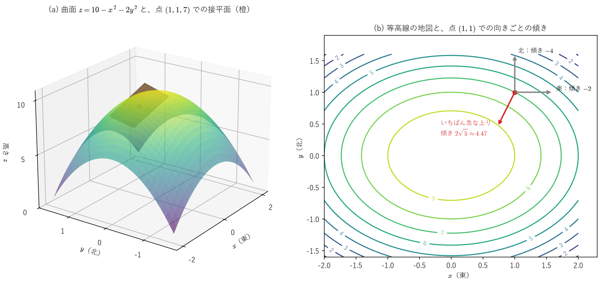
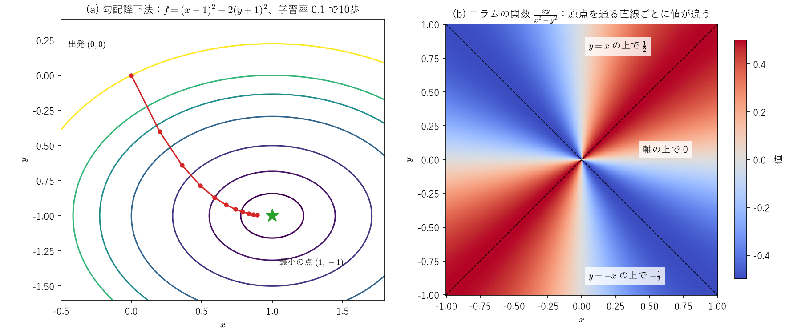

## 1 多変数の微分

:::message
この章の式は、著者の手計算での検証の前のものです（SymPy での検算は済んでいます）。誤りを見つけたら、コメントで教えてください。
:::

**この章で使う道具**：[準備2](P2_1変数の微分.md)の微分係数と「最良の直線による近似」、連鎖律。[準備3](P3_ベクトルと行列.md)のベクトル、行列とベクトルの積、行列の積、極座標の Jacobian。

## はじめに：山の斜面に立つ

ここからが本編です。最初の章では、変数が2つ以上ある関数を微分します。

山の斜面に立っているところを想像してください。地図の上の位置を、東西の座標 $x$ と南北の座標 $y$ で表すと、その地点の高さ $z$ は、$x$ と $y$ の2つの変数で決まる関数 $z=f(x,y)$ です。この章では、例として、次の形の山を使います。

$$
f(x,y)=10-x^2-2y^2
$$

頂上は原点 $(0,0)$ で、高さ 10 です。南北の方向（$y$）のほうが、東西の方向（$x$）より急な山です。

点 $(1,1)$（高さ $f(1,1)=10-1-2=7$）に立ったとします。ここでの「坂の傾き」は、いくつでしょうか。実は、この問いには1つの答えがありません。東へ歩くか、北へ歩くか、斜めに歩くかで、坂の傾きが違うからです。1変数の微分では、傾きは1つの数でした。変数が2つになると、「どの向きに進むか」を決めないと、傾きが決まらないのです。

この章では、まず東と北の2つの向きの傾き（偏微分）を求め、それを組み合わせて、どの向きの傾きも一度に表す方法（多変数の微分、Jacobian）を作ります。準備2と準備3で「1章で説明します」と約束した2つのこと（変化を足し合わせた近似がうまくいく理由と、連鎖律が成り立つ理由）にも、この章で答えます。


*(a) 山の形の曲面 $z=10-x^2-2y^2$ と、点 $(1,1,7)$ での接平面（橙）。(b) 同じ山の等高線の地図。点 $(1,1)$ から、東へ進むと傾きは $-2$、北へ進むと $-4$、いちばん急に登れる向きでは $2\sqrt{5}\approx4.47$ です（2節）。*

## 1. 偏微分：1つの向きだけの傾き

まず、東へ進むときの傾きを求めます。南北の位置 $y$ を 1 のまま止めて、$x$ だけを動かせば、高さは $x$ だけの関数 $f(x,1)=10-x^2-2$ になります。これを、準備2のとおりに $x$ で微分すれば、東向きの傾きが求まります。

> $y$ を止めて、$x$ だけで微分したものを、$f$ の $x$ についての**偏微分**といい、$\dfrac{\partial f}{\partial x}$ と書きます。

$\partial$ は「ラウンド・ディー」と読み、「ほかの変数を止めて微分する」ことを表す記号です。差分商で書くと、点 $(a,b)$ では

$$
\frac{\partial f}{\partial x}(a,b)=\lim_{h\to0}\frac{f(a+h,b)-f(a,b)}{h}
$$

です。同じように、$x$ を止めて $y$ だけで微分したものが、$y$ についての偏微分 $\dfrac{\partial f}{\partial y}$ です。

例の山では、$y$ を定数とみて $x$ で微分すると $-2y^2$ の部分は消えるので、

$$
\frac{\partial f}{\partial x}=-2x,\qquad\frac{\partial f}{\partial y}=-4y
$$

です。点 $(1,1)$ では、$\dfrac{\partial f}{\partial x}=-2$、$\dfrac{\partial f}{\partial y}=-4$ です。この点から東へごく小さく $h$ 進むと、高さは約 $2h$ 下がり、北へごく小さく $k$ 進むと、約 $4k$ 下がります（この章の最初の図の (b)）。偏微分は、その点での「その場の傾き」です（実際に東へ 1 進むと、高さは $f(2,1)-f(1,1)=-3$ 変わり、$-2$ とは違います。1 は「ごく小さく」ないからです）。

:::details 差分商で確かめる
点 $(1,1)$ で、$x$ だけを $h$ 動かすと、

$$
\frac{f(1+h,1)-f(1,1)}{h}=\frac{\bigl(10-(1+h)^2-2\bigr)-7}{h}=\frac{-2h-h^2}{h}=-2-h
$$

で（約分は $h\neq0$ として）、$h\to0$ とすると $-2$ に近づきます。$y$ だけを動かすと、同じように $-4-2h\to-4$ です。
:::

## 2. 多変数の微分：曲面を平面で近似する

### 接平面

準備2では、曲線を、点のごく近くで直線（接線）に置き換えました。2変数の関数のグラフは曲面なので、置き換える先は**平面**になります。点 $(a,b)$ から、$x$ を $h$、$y$ を $k$ だけ動かしたときの高さの変化を、

$$
f(a+h,b+k)-f(a,b)\approx\frac{\partial f}{\partial x}(a,b)\,h+\frac{\partial f}{\partial y}(a,b)\,k
$$

と、東向きの変化と北向きの変化の和で近似します。右辺を高さに足した $z=f(a,b)+\frac{\partial f}{\partial x}h+\frac{\partial f}{\partial y}k$ のグラフが、点 $(a,b,f(a,b))$ での**接平面**です（この章の最初の図の (a) の橙の平面）。

例の山の点 $(1,1)$ で、$h=0.1$、$k=0.05$ として確かめます。

| | 値 |
|---|---|
| 接平面による近似 $7+(-2)(0.1)+(-4)(0.05)$ | 6.6 |
| 実際の高さ $f(1.1,\ 1.05)$ | 6.585 |
| 誤差 | 0.015 |

$h$、$k$ をどちらも半分（$0.05$、$0.025$）にすると、誤差は $0.00375$ で、ちょうど $\frac{1}{4}$ になります。準備2と同じく、誤差は動かす量の2乗程度で小さくなります。実際、この山では、誤差は正確に $h^2+2k^2$ です。

準備2の1節の、地球の話を思い出してください。地球の表面は曲面ですが、足もとは平らに見えました。それは、足もとのごく近くでは、曲面が接平面とほとんど区別できないからです。準備2では「曲線が直線に見える」と言いましたが、2次元では「曲面が平面に見える」ことになります。

### 多変数の微分の定義

準備2では、接線が「誤差が $h$ よりも速く小さくなる、ただ1本の直線」でした。2変数でも同じ考え方で、微分を定義します。動かす量をベクトル $\boldsymbol{h}=(h,k)$ で表し、その長さを $|\boldsymbol{h}|=\sqrt{h^2+k^2}$ と書きます。

> 関数 $f$ が点 $\boldsymbol{a}=(a,b)$ で**微分できる**とは、ある数 $p$、$q$ があって、
> $$f(a+h,b+k)-f(a,b)=p\,h+q\,k+R(h,k)$$
> と書いたとき、誤差の項 $R(h,k)$ が、$\boldsymbol{h}\to\boldsymbol{0}$ で $\dfrac{R(h,k)}{|\boldsymbol{h}|}\to0$ を満たすことをいう。

$p\,h+q\,k$ は、準備3の言葉では、ベクトル $(h,k)$ に 1×2 の行列 $(p\ \ q)$ を掛けたものです。つまり、2変数の微分とは、「値の変化を、行列を掛ける関数（線形写像）で、誤差が $|\boldsymbol{h}|$ よりも速く小さくなるように置き換えること」です。準備2の「数を掛ける」が、「行列を掛ける」に変わっただけです。

この $p$、$q$ は、偏微分になります。$f$ が微分できるとき、$k=0$ として $x$ の向きにだけ動かすと、

$$
\frac{f(a+h,b)-f(a,b)}{h}=p+\frac{R(h,0)}{h}
$$

で、$h\to0$ のとき右辺の第2項は 0 に近づく（$R$ は $|h|$ よりも速く小さくなる）ので、$p=\dfrac{\partial f}{\partial x}(a,b)$ です。同じように、$q=\dfrac{\partial f}{\partial y}(a,b)$ です。したがって、微分を表す行列は

$$
\begin{pmatrix}\dfrac{\partial f}{\partial x}&\dfrac{\partial f}{\partial y}\end{pmatrix}
$$

と、偏微分を並べたものに決まります。

この関係を、記号で短く書いたものが

$$
df=\frac{\partial f}{\partial x}\,dx+\frac{\partial f}{\partial y}\,dy
$$

です（**全微分**と呼ばれる書き方です）。$dx$、$dy$ は小さな変化 $h$、$k$ を、$df$ はそれに対する $f$ の変化の、最良の線形近似を表します。表紙の左上にある $df=\frac{\partial f}{\partial x^i}dx^i$ は、この式を、変数が何個あっても書けるように、[「はじめに」](00_はじめに.md)のアインシュタインの縮約記法で書いたものです（$x^1=x$、$x^2=y$ として、$i$ について和をとります）。

### どの向きの傾きも、一度に分かる

微分できる関数では、どの向きの傾きも、偏微分から計算できます。長さ 1 のベクトル $\boldsymbol{u}=(u_1,u_2)$ の向きに $t$ だけ進む（$h=tu_1$、$k=tu_2$）と、高さの変化は $t\,(p\,u_1+q\,u_2)+R(tu_1,tu_2)$ なので、$t$ で割って $t\to0$ とすると、その向きの傾きは

$$
\frac{\partial f}{\partial x}\,u_1+\frac{\partial f}{\partial y}\,u_2
$$

です。これは、準備3の内積 $\left(\frac{\partial f}{\partial x},\frac{\partial f}{\partial y}\right)\cdot\boldsymbol{u}$ です。この傾きを、$\boldsymbol{u}$ の向きの**方向微分**といいます。

例の山の点 $(1,1)$ では、偏微分を並べたベクトルは $(-2,-4)$ です。

- 東 $\boldsymbol{u}=(1,0)$：傾き $-2$
- 北 $\boldsymbol{u}=(0,1)$：傾き $-4$
- 北東 $\boldsymbol{u}=\frac{1}{\sqrt{2}}(1,1)$：傾き $\frac{-2-4}{\sqrt{2}}=-3\sqrt{2}\approx-4.24$
- $\boldsymbol{u}=\frac{1}{\sqrt{5}}(-1,-2)$：傾き $\frac{2+8}{\sqrt{5}}=2\sqrt{5}\approx4.47$

最後の向きは、偏微分のベクトル $(-2,-4)$ と同じ向きです。内積は、2本のベクトルが同じ向きのときに一番大きくなる（準備3の $\boldsymbol{a}\cdot\boldsymbol{b}=|\boldsymbol{a}||\boldsymbol{b}|\cos\theta$ で $\theta=0$）ので、**偏微分を並べたベクトルが $\boldsymbol{0}$ でない点では、その向きが、いちばん急に登れる向き**で、その傾きはベクトルの長さ $\sqrt{(-2)^2+(-4)^2}=2\sqrt{5}$ です。ベクトルが $\boldsymbol{0}$ になる点（たとえば山の頂上 $(0,0)$）では、どの向きの傾きも 0 で、「いちばん急な向き」は決まりません。このベクトルが、2章の主役の**勾配**（grad）です。

## 3. 偏微分があるだけでは足りない

2節の「微分できる」は、偏微分が存在することよりも強い条件です。偏微分が東と北の2つの向きの傾きしか見ていないのに対して、微分できることは、どの向きから近づいても誤差が小さいことを求めるからです。実際、偏微分はあるのに微分できない関数があります（章の最後のコラム）。

では、どんなときに微分できるのでしょうか。よく使う十分条件が、次の定理です。

> **定理**：偏微分 $\dfrac{\partial f}{\partial x}$、$\dfrac{\partial f}{\partial y}$ が、点 $\boldsymbol{a}$ のまわりで存在し、しかも連続なら、$f$ は $\boldsymbol{a}$ で微分できる。

偏微分が連続な関数を、**$C^1$ 級の関数**といいます。多項式、$\sin$、$\cos$、$e^x$ などを組み合わせた関数は、式が意味を持つ範囲で $C^1$ 級なので、この本に出てくる関数のほとんどは、この定理で微分できると分かります。例の山も、$C^1$ 級です。

準備3の6節で、極座標の小さな変化を「$r$ だけ動かした変化と、$\theta$ だけ動かした変化の和」で近似し、「本編の1章で理由を説明します」と書きました。その理由が、この定理です。$x=r\cos\theta$、$y=r\sin\theta$ は $C^1$ 級なので微分でき、2節のとおり、変化は偏微分を使った和で近似できるのです。

:::details 定理の証明のあらすじ
点 $(a,b)$ から $(a+h,b+k)$ への変化を、2段に分けます。

$$
f(a+h,b+k)-f(a,b)=\bigl(f(a+h,b+k)-f(a,b+k)\bigr)+\bigl(f(a,b+k)-f(a,b)\bigr)
$$

第1段は、$y=b+k$ に止めて $x$ だけを動かした変化、第2段は、$x=a$ に止めて $y$ だけを動かした変化です。

ここで、1変数の**平均値の定理**（なめらかな関数 $g$ では、$g(a+h)-g(a)=g'(c)\,h$ となる $c$ が、$a$ と $a+h$ の間にある。この本では、証明なしで使います）を使うと、

$$
f(a+h,b+k)-f(a,b+k)=\frac{\partial f}{\partial x}(c,\,b+k)\,h,\qquad f(a,b+k)-f(a,b)=\frac{\partial f}{\partial y}(a,\,d)\,k
$$

となる $c$（$a$ と $a+h$ の間）、$d$（$b$ と $b+k$ の間）があります（左の式が第1段、右の式が第2段です）。偏微分が連続なので、$\boldsymbol{h}\to\boldsymbol{0}$ のとき、$\frac{\partial f}{\partial x}(c,b+k)\to\frac{\partial f}{\partial x}(a,b)$、$\frac{\partial f}{\partial y}(a,d)\to\frac{\partial f}{\partial y}(a,b)$ です。したがって、2節の定義の誤差の項

$$
R(h,k)=\Bigl(\frac{\partial f}{\partial x}(c,b+k)-\frac{\partial f}{\partial x}(a,b)\Bigr)h+\Bigl(\frac{\partial f}{\partial y}(a,d)-\frac{\partial f}{\partial y}(a,b)\Bigr)k
$$

は、$|h|\leq|\boldsymbol{h}|$、$|k|\leq|\boldsymbol{h}|$ より、$|\boldsymbol{h}|$ に「0 に近づく数」を掛けたもので抑えられます。だから、$\frac{R(h,k)}{|\boldsymbol{h}|}\to0$ です。
:::

## 4. Jacobian：たくさんの値を返す関数の微分

ここまでは、高さという1つの値を返す関数でした。準備3の極座標の写像 $(r,\theta)\mapsto(x,y)$ のように、値も2つ以上ある関数でも、考え方は同じです。

変数が $n$ 個、値が $m$ 個の関数 $\boldsymbol{F}=(F_1,\dots,F_m)$ を考えます。値のそれぞれ $F_i$ は、変数が $n$ 個の関数です。どの $F_i$ も微分できるとき、2節のとおり、偏微分を並べた $1\times n$ の行列で微分が表せます。それを、値の順に縦に積み重ねた $m\times n$ の行列

$$
J_{\boldsymbol{F}}=\begin{pmatrix}\dfrac{\partial F_1}{\partial x_1}&\cdots&\dfrac{\partial F_1}{\partial x_n}\\\vdots&&\vdots\\\dfrac{\partial F_m}{\partial x_1}&\cdots&\dfrac{\partial F_m}{\partial x_n}\end{pmatrix}
$$

を、$\boldsymbol{F}$ の **Jacobian**（ヤコビ行列）といいます。$i$ 行 $j$ 列の成分は、「$i$ 番目の値を、$j$ 番目の変数で偏微分したもの」です。$\boldsymbol{F}$ が微分できるとき、

$$
\boldsymbol{F}(\boldsymbol{a}+\boldsymbol{h})-\boldsymbol{F}(\boldsymbol{a})\approx J_{\boldsymbol{F}}(\boldsymbol{a})\,\boldsymbol{h}
$$

で、誤差は $|\boldsymbol{h}|$ よりも速く小さくなります。

- 例の山の $f$（変数2つ、値1つ）では、Jacobian は 1×2 の行列 $(-2x\ \ -4y)$ です。
- 準備3の極座標 $(r,\theta)\mapsto(r\cos\theta,\ r\sin\theta)$（変数2つ、値2つ）では、2×2 の
$$
J=\begin{pmatrix}\cos\theta&-r\sin\theta\\\sin\theta&r\cos\theta\end{pmatrix}
$$
で、準備3で先取りしたものと同じです。準備3では「ほかを止めて1つだけ動かして微分したものを列に並べる」と作りましたが、それは、この定義の「$j$ 列目は $j$ 番目の変数での偏微分」のことです。

## 5. 連鎖律：Jacobian の積

準備2で認めて使った連鎖律を、ここで導きます。2つの関数をつないだもの（合成）の微分です。

> **連鎖律**：$\boldsymbol{F}$ が点 $\boldsymbol{a}$ で、$\boldsymbol{G}$ が点 $\boldsymbol{F}(\boldsymbol{a})$ で微分できるなら、合成 $\boldsymbol{G}\circ\boldsymbol{F}$（$\boldsymbol{x}$ を $\boldsymbol{G}(\boldsymbol{F}(\boldsymbol{x}))$ に写す関数）も $\boldsymbol{a}$ で微分でき、その Jacobian は
> $$J_{\boldsymbol{G}\circ\boldsymbol{F}}(\boldsymbol{a})=J_{\boldsymbol{G}}\bigl(\boldsymbol{F}(\boldsymbol{a})\bigr)\,J_{\boldsymbol{F}}(\boldsymbol{a})$$
> である。

つまり、**つないだ関数の Jacobian は、それぞれの Jacobian の積**です。考え方は単純です。$\boldsymbol{a}$ を $\boldsymbol{h}$ だけ動かすと、$\boldsymbol{F}$ の値は、およそ $\boldsymbol{k}=J_{\boldsymbol{F}}\boldsymbol{h}$ だけ動きます。$\boldsymbol{G}$ の入力が $\boldsymbol{k}$ だけ動くので、$\boldsymbol{G}$ の値は、およそ $J_{\boldsymbol{G}}\boldsymbol{k}=J_{\boldsymbol{G}}J_{\boldsymbol{F}}\boldsymbol{h}$ だけ動きます。準備3で見たとおり、線形写像の合成は行列の積なので、近似の線形写像も積になるのです。先に行う $\boldsymbol{F}$ の Jacobian が右、あとに行う $\boldsymbol{G}$ の Jacobian が左にくるのも、準備3と同じです。

変数も値も1つずつなら、Jacobian は 1×1 の行列（ただの数）で、連鎖律は準備2の $\bigl(g(f(x))\bigr)'=g'\bigl(f(x)\bigr)\,f'(x)$ になります。準備2で認めて使ったきまりは、この定理の特別な場合だったのです。

:::details 誤差まで含めた証明
$\boldsymbol{b}=\boldsymbol{F}(\boldsymbol{a})$ とおき、2つの関数が微分できることを、誤差 $\boldsymbol{r}$、$\boldsymbol{s}$ を使って書きます。

$$
\boldsymbol{F}(\boldsymbol{a}+\boldsymbol{h})=\boldsymbol{b}+J_{\boldsymbol{F}}\boldsymbol{h}+\boldsymbol{r}(\boldsymbol{h}),\qquad\boldsymbol{G}(\boldsymbol{b}+\boldsymbol{k})=\boldsymbol{G}(\boldsymbol{b})+J_{\boldsymbol{G}}\boldsymbol{k}+\boldsymbol{s}(\boldsymbol{k})
$$

ここで、$\frac{|\boldsymbol{r}(\boldsymbol{h})|}{|\boldsymbol{h}|}\to0$、$\frac{|\boldsymbol{s}(\boldsymbol{k})|}{|\boldsymbol{k}|}\to0$ で、$\boldsymbol{s}(\boldsymbol{0})=\boldsymbol{0}$ です。$\boldsymbol{k}=\boldsymbol{F}(\boldsymbol{a}+\boldsymbol{h})-\boldsymbol{b}=J_{\boldsymbol{F}}\boldsymbol{h}+\boldsymbol{r}(\boldsymbol{h})$ とおくと、

$$
\boldsymbol{G}\bigl(\boldsymbol{F}(\boldsymbol{a}+\boldsymbol{h})\bigr)=\boldsymbol{G}(\boldsymbol{b})+J_{\boldsymbol{G}}J_{\boldsymbol{F}}\boldsymbol{h}+J_{\boldsymbol{G}}\,\boldsymbol{r}(\boldsymbol{h})+\boldsymbol{s}(\boldsymbol{k})
$$

です。最後の2項 $J_{\boldsymbol{G}}\,\boldsymbol{r}(\boldsymbol{h})+\boldsymbol{s}(\boldsymbol{k})$ が、合成の近似の誤差の項です。これを $|\boldsymbol{h}|$ で割ったものが 0 に近づくことを示します。ここで、「行列を掛けたベクトルの長さは、元のベクトルの長さの定数倍以下になる」（行列 $A$ ごとに、$|A\boldsymbol{v}|\leq C\,|\boldsymbol{v}|$ となる定数 $C$ がある。この本では、証明なしで使います）という事実を使います。

- 第1項：$|J_{\boldsymbol{G}}\,\boldsymbol{r}(\boldsymbol{h})|\leq C_G\,|\boldsymbol{r}(\boldsymbol{h})|$ で、$\frac{|\boldsymbol{r}(\boldsymbol{h})|}{|\boldsymbol{h}|}\to0$ なので、$|\boldsymbol{h}|$ で割ると 0 に近づきます。
- 第2項：$|\boldsymbol{h}|$ が小さければ $|\boldsymbol{r}(\boldsymbol{h})|\leq|\boldsymbol{h}|$ なので、$|\boldsymbol{k}|\leq C_F|\boldsymbol{h}|+|\boldsymbol{h}|=(C_F+1)|\boldsymbol{h}|$ です。$\boldsymbol{k}\neq\boldsymbol{0}$ なら $\frac{|\boldsymbol{s}(\boldsymbol{k})|}{|\boldsymbol{h}|}=\frac{|\boldsymbol{s}(\boldsymbol{k})|}{|\boldsymbol{k}|}\cdot\frac{|\boldsymbol{k}|}{|\boldsymbol{h}|}\leq\frac{|\boldsymbol{s}(\boldsymbol{k})|}{|\boldsymbol{k}|}(C_F+1)$ で、$\boldsymbol{h}\to\boldsymbol{0}$ のとき $\boldsymbol{k}\to\boldsymbol{0}$ なので、0 に近づきます。$\boldsymbol{k}=\boldsymbol{0}$ なら $\boldsymbol{s}(\boldsymbol{k})=\boldsymbol{0}$ です。
:::

### 例：極座標で見た関数の偏微分

連鎖律が一番よく使われるのは、座標を取り替えるときです。$f(x,y)$ を、極座標で $g(r,\theta)=f(r\cos\theta,\ r\sin\theta)$ と見ると、$g$ は「極座標の写像のあとに $f$」という合成です。連鎖律から、

$$
\begin{pmatrix}\dfrac{\partial g}{\partial r}&\dfrac{\partial g}{\partial\theta}\end{pmatrix}=\begin{pmatrix}\dfrac{\partial f}{\partial x}&\dfrac{\partial f}{\partial y}\end{pmatrix}\begin{pmatrix}\cos\theta&-r\sin\theta\\\sin\theta&r\cos\theta\end{pmatrix}
$$

です。成分で書くと、

$$
\frac{\partial g}{\partial r}=\frac{\partial f}{\partial x}\cos\theta+\frac{\partial f}{\partial y}\sin\theta,\qquad\frac{\partial g}{\partial\theta}=-\frac{\partial f}{\partial x}\,r\sin\theta+\frac{\partial f}{\partial y}\,r\cos\theta
$$

です。$f=x^2+y^2$ で確かめると、$\frac{\partial f}{\partial x}=2x=2r\cos\theta$、$\frac{\partial f}{\partial y}=2y=2r\sin\theta$ なので、$\frac{\partial g}{\partial r}=2r(\cos^2\theta+\sin^2\theta)=2r$、$\frac{\partial g}{\partial\theta}=0$ です。実際、$g=r^2$ なので、直接微分した結果と一致します。

「はじめに」で、球座標のラプラシアンを手で求めるのに10ページかかった、という話をしました。球座標のラプラシアンを直接求める計算は、この連鎖律を、2階の微分まで、3つの変数でくり返すものです。2章では、その計算を、連鎖律と計量を使って見通しよく行います。

### AI の学習と連鎖律

「はじめに」で、AI の学習を支える誤差逆伝播は、連鎖律をくり返し使ったものだ、と書きました。ここで、その形を見ておきます。

AI（ニューラルネットワーク）は、入力 $\boldsymbol{x}$ に、層と呼ばれる計算 $\boldsymbol{F}_1,\boldsymbol{F}_2,\dots,\boldsymbol{F}_K$ を順に施して、予測を出します。その予測が正解からどれだけずれているかを、1つの数で表す関数 $\ell$ を、**損失関数**といいます。全体は、合成

$$
\ell\circ\boldsymbol{F}_K\circ\cdots\circ\boldsymbol{F}_2\circ\boldsymbol{F}_1
$$

です。途中の値を $\boldsymbol{z}_0=\boldsymbol{x}$、$\boldsymbol{z}_1=\boldsymbol{F}_1(\boldsymbol{z}_0)$、$\boldsymbol{z}_2=\boldsymbol{F}_2(\boldsymbol{z}_1)$、…、$\boldsymbol{z}_K=\boldsymbol{F}_K(\boldsymbol{z}_{K-1})$ と書くと、連鎖律をくり返し使って、全体の Jacobian は、各段の Jacobian の積

$$
J_\ell(\boldsymbol{z}_K)\,J_{\boldsymbol{F}_K}(\boldsymbol{z}_{K-1})\cdots J_{\boldsymbol{F}_2}(\boldsymbol{z}_1)\,J_{\boldsymbol{F}_1}(\boldsymbol{z}_0)
$$

になります。それぞれの Jacobian は、その段に入ってくる値で計算します（連鎖律の $J_{\boldsymbol{G}}\bigl(\boldsymbol{F}(\boldsymbol{a})\bigr)$ と同じです）。学習とは、この損失 $\ell$ が小さくなるように、各層の中にある数（**パラメータ**）を少しずつ調整することで、そのために6節の勾配降下法を使います（6節の $f$ が、ここでの損失にあたります）。実際の学習では、入力 $\boldsymbol{x}$ ではなくパラメータで微分しますが、連鎖律で Jacobian の積になる仕組みは同じです。

誤差逆伝播は、この行列の積を、損失の側（左）から順に掛けていく計算の工夫です。$\ell$ の値は1つの数なので、$J_\ell$ は 1 行の横長の行列です。左から掛けていけば、途中に出てくるのはいつも 1 行の横長の行列だけになり、計算が軽くて済むのです。

## 6. たくさんの変数での勾配降下法

準備2の勾配降下法は、傾きの逆向きに少しずつ進んで、関数が一番小さくなる点を探す方法でした。変数がたくさんあるときは、2節の「偏微分を並べたベクトル」の逆向きに進みます。そのベクトルが $\boldsymbol{0}$ でない点では、その向きがいちばん急な上りなので、その逆向きは、いちばん急な下りだからです（ベクトルが $\boldsymbol{0}$ になる点では、下の式で位置が動かなくなります）。変数が2つなら、

$$
x_{n+1}=x_n-\eta\,\frac{\partial f}{\partial x}(x_n,y_n),\qquad y_{n+1}=y_n-\eta\,\frac{\partial f}{\partial y}(x_n,y_n)
$$

です。

$f(x,y)=(x-1)^2+2(y+1)^2$（一番小さくなるのは $(1,-1)$）で、$(0,0)$ から学習率 $\eta=0.1$ で試します。偏微分は $\frac{\partial f}{\partial x}=2(x-1)$、$\frac{\partial f}{\partial y}=4(y+1)$ なので、

$$
(x_1,y_1)=(0.2,\ -0.4),\qquad(x_2,y_2)=(0.36,\ -0.64),\qquad\dots
$$

と進み、$n$ 歩目は

$$
(x_n,\ y_n)=(1-0.8^n,\ -1+0.6^n)
$$

です。1歩ごとに、$x$ は $1$ との差が 0.8 倍、$y$ は $-1$ との差が 0.6 倍になり、どちらも $(1,-1)$ に近づきます。


*(a) 勾配降下法の10歩。いちばん急な下りの向きに進むので、坂の急な $y$ の向きに、初めは大きく動きます。(b) 章の最後のコラムの関数。*

AI の学習では、変数が何百万個にもなりますが、やることは同じです。偏微分を並べたベクトルを、5節の連鎖律（誤差逆伝播）で計算し、その逆向きに少し進む。それをくり返しています。

:::details SymPy で検算する
偏微分は `diff`、Jacobian は `Matrix.jacobian` で計算できます。

```python
import sympy as sp

x, y = sp.symbols("x y", real=True)
f = 10 - x**2 - 2 * y**2
print(sp.diff(f, x), sp.diff(f, y))                    # -2*x -4*y

r, th = sp.symbols("r theta", positive=True)
P = sp.Matrix([r * sp.cos(th), r * sp.sin(th)])
J = P.jacobian([r, th])                                # 極座標の Jacobian
g = (x**2 + y**2).subs({x: P[0], y: P[1]})
row = sp.Matrix([[2 * x, 2 * y]]).subs({x: P[0], y: P[1]})
print(sp.simplify(row * J))                            # 連鎖律：Matrix([[2*r, 0]])
print(sp.simplify(sp.diff(g, r)), sp.simplify(sp.diff(g, th)))  # 直接：2*r 0
```

この章のすべての式と数値を確かめるスクリプトは、GitHub の [verify/verify_01_multivariable.py](https://github.com/kazuma0606/quantum-study/blob/master/書籍/微分/verify/verify_01_multivariable.py) にあります。
:::

## 次の章へ

この章では、変数がたくさんある関数の微分を、「値の変化を、Jacobian という行列を掛ける関数で置き換えること」として定めました。2節で、偏微分を並べたベクトルが「いちばん急に登れる向き」を指すことも見ました。

2章では、このベクトルに**勾配**（grad）という名前をつけ、さらに、ベクトルの集まり（風の流れのような**ベクトル場**）を微分する div と rot を加えます。そして、それらを直交座標から極座標、球座標へと書き直すと、式の形が崩れることを見ます。その崩れ方を説明するのが、「はじめに」で出てきた計量 $g_{ij}$ です。

## コラム：偏微分はあるのに、微分できない関数

3節で、偏微分があるだけでは微分できるとは限らない、と書きました。その例が、次の関数です。

$$
f(x,y)=\frac{xy}{x^2+y^2}\quad\bigl((x,y)\neq(0,0)\bigr),\qquad f(0,0)=0
$$

**原点で、偏微分はどちらも 0 です。** $x$ 軸の上（$y=0$）では、$f(x,0)=0$ です。だから、原点から $x$ の向きに進んでも高さはずっと 0 で、$\frac{\partial f}{\partial x}(0,0)=0$ です。$y$ 軸の上でも同じで、$\frac{\partial f}{\partial y}(0,0)=0$ です。

**でも、原点で微分できません。** それどころか、連続でもありません。直線 $y=x$ の上では、原点を除くと、$f(x,x)=\frac{x^2}{2x^2}=\frac{1}{2}$ で、原点にどれだけ近づいても、値は $\frac{1}{2}$ のままです。直線 $y=-x$ の上では、原点を除くと $-\frac{1}{2}$ です。一般に、直線 $y=mx$ の上では、原点を除くと、値はいつも $\frac{m}{1+m^2}$ です（図の (b)）。原点に近づく道によって近づく値が違うので、極限がなく、原点の値 0 とつながりません。微分できる点では、関数は連続です（2節の定義で、変化 $p\,h+q\,k+R(h,k)$ は $\boldsymbol{h}\to\boldsymbol{0}$ で 0 に近づくから。準備2の1変数の場合と同じです）。だから、連続でないこの関数は、原点で微分できません。

偏微分は、東と北の2本の道しか見ていません。その2本の道の上ではたまたま平らでも、斜めの道では、まったく違う景色が広がっていることがあるのです。3節の定理の「偏微分が連続」という条件は、こうした関数を除くためのものです。実際、この関数の偏微分は、原点の近くで連続ではありません（たとえば $y$ 軸の上（$y\neq0$）で $\frac{\partial f}{\partial x}=\frac{1}{y}$ で、$y\to0$ で、その絶対値が限りなく大きくなります）。

準備2のコラムでは、「微分できるのに、導関数がつながらない関数」を見ました。変数が増えると、さらに「東と北の向きの傾き（偏微分）はあるのに、微分できない関数」まで現れます。この関数では、斜めの向きの傾きは、そもそもありません（直線 $y=x$ に沿って原点から進むと、差分商は $\frac{1/2}{t}$ で、限りなく大きくなります）。微分の世界は、変数が1つ増えるだけで、ぐっと奥行きが深くなります。
