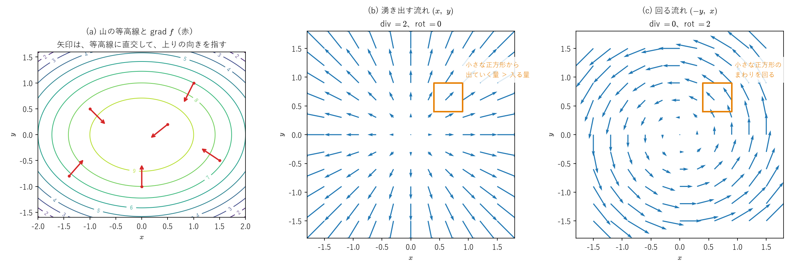
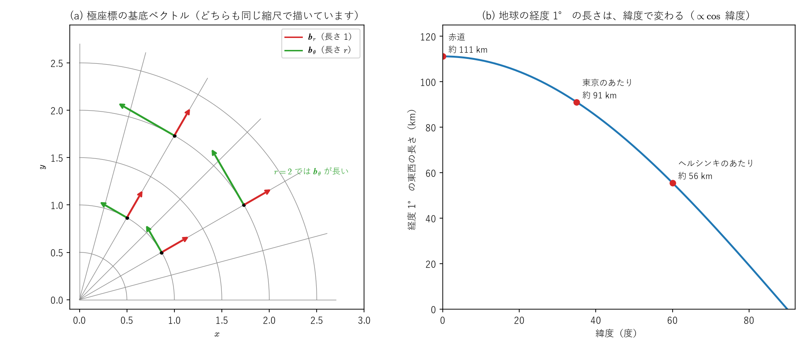

## 2 ベクトル微分

:::message
この章の式は、著者の手計算での検証の前のものです（SymPy での検算は済んでいます）。誤りを見つけたら、コメントで教えてください。
:::

**この章で使う道具**：[1章](01_多変数の微分.md)の偏微分、方向微分、連鎖律、Jacobian。[準備3](P3_ベクトルと行列.md)のベクトル、内積、行列式。

## はじめに：gradient、divergence、rotation

1章の最後に、偏微分を並べたベクトルが「いちばん急に登れる向き」を指すことを見ました。この章では、まずそのベクトルに **grad**（勾配）という名前をつけます。次に、風や水の流れのように、各点に矢印が1本ずつ決まっているもの（**ベクトル場**）を考え、それを微分する2つの操作 **div**（発散）と **rot**（回転）を導入します。grad・div・rot は、ベクトル解析と呼ばれる分野の3つの基本の道具で、電磁気学、流体力学、そして量子力学の方程式に、くり返し出てきます。

後半では、これらを、直交座標 $(x,y)$ から極座標 $(r,\theta)$ や球座標 $(r,\theta,\varphi)$ に書き直します。すると、式の形が崩れます。その崩れ方を、1つの道具で説明できるのが**計量**です。そして最後に、[「はじめに」](00_はじめに.md)で出てきた「一行の式」、ラプラス・ベルトラミの式が、なぜ成り立つのかの中身が見えてきます。

## 1. grad：いちばん急な上りを指す矢印

1章の山 $f(x,y)=10-x^2-2y^2$ を、もう一度使います。偏微分を並べたベクトル

$$
\operatorname{grad}f=\left(\frac{\partial f}{\partial x},\ \frac{\partial f}{\partial y}\right)
$$

を、$f$ の**勾配**（grad、グラディエント）といいます。3変数なら、$\left(\frac{\partial f}{\partial x},\frac{\partial f}{\partial y},\frac{\partial f}{\partial z}\right)$ です。例の山では $\operatorname{grad}f=(-2x,-4y)$ で、点 $(1,1)$ では $(-2,-4)$ です。

1章の2節で見たように、$\operatorname{grad}f$ が $\boldsymbol{0}$ でない点では、

- 向きは、いちばん急に登れる向き
- 長さは、その向きの傾き（例の山の点 $(1,1)$ では $2\sqrt{5}$）

です。地図の上で言えば、grad は「その場所で、坂をまっすぐ登る向き」を指す矢印です。

### grad は、等高線に直交する

もう1つ、大事な性質があります。$\operatorname{grad}f$ が $\boldsymbol{0}$ でない点では、$\operatorname{grad}f$ は**等高線に直交します**（図の (a)）。（山の頂上のように $\operatorname{grad}f=\boldsymbol{0}$ となる点では、等高線が1点につぶれて、接線の向きが決まらないことがあります。）

理由は、1章の連鎖律です。等高線に沿って動く点を $\boldsymbol{c}(t)$ とすると、その上では高さが変わらないので、$f(\boldsymbol{c}(t))$ は一定です。これを $t$ で微分すると 0 で、連鎖律から

$$
\frac{d}{dt}f\bigl(\boldsymbol{c}(t)\bigr)=\operatorname{grad}f\cdot\boldsymbol{c}'(t)=0
$$

です。$\boldsymbol{c}'(t)$ は、等高線に沿う向き（等高線の接線の向き）です。それとの内積が 0 なので、$\operatorname{grad}f$ は等高線に直交しています。例の山の点 $(1,1)$ では、等高線 $x^2+2y^2=3$ の接線の向きは $(2,-1)$ で、$(-2,-4)\cdot(2,-1)=-4+4=0$ です。

坂をまっすぐ登る向きは、同じ高さの線（等高線）を真横に横切る向きだ、ということです。登山道がジグザグに作られるのは、この向きをわざと避けて、坂を緩やかにするためです。


*(a) 山の等高線と、各点での grad の向き（赤。長さはそろえて描いています）。等高線に直交して、上りの向きを指します。(b) 湧き出す流れ $(x,y)$。(c) 回る流れ $(-y,x)$。橙の正方形は、2節・3節で使います。*

## 2. ベクトル場と div：湧き出し

平面の各点 $(x,y)$ に、ベクトル $\boldsymbol{V}(x,y)=\bigl(P(x,y),\ Q(x,y)\bigr)$ が1本ずつ決まっているものを、**ベクトル場**といいます。川の流れや風を思い浮かべてください。各点で、水や空気が流れる向きと速さが、矢印で表されています。grad も、各点にベクトルを決めるので、ベクトル場の一種です。

ベクトル場に対して、

$$
\operatorname{div}\boldsymbol{V}=\frac{\partial P}{\partial x}+\frac{\partial Q}{\partial y}
$$

を、$\boldsymbol{V}$ の**発散**（div、ダイバージェンス）といいます。3次元なら、$\boldsymbol{V}=(P,Q,R)$ に対して $\frac{\partial P}{\partial x}+\frac{\partial Q}{\partial y}+\frac{\partial R}{\partial z}$ です。

div は、**その点から、どれだけ湧き出しているか**を表します。正確には、点のまわりに小さな正方形をとり、そこから出ていく量から入ってくる量を引いて、正方形の面積で割ったもの（の、正方形を小さくした極限）です。

- **湧き出す流れ** $\boldsymbol{V}=(x,y)$（図の (b)）：$\operatorname{div}\boldsymbol{V}=1+1=2$ です。どの点でも、流れは外へ広がっていて、小さな正方形からは、入ってくるよりも多く出ていきます。実際、一辺 $a$ の正方形からの正味の流出は、どこでも $2a^2$（div × 面積）です。
- **回る流れ** $\boldsymbol{W}=(-y,x)$（図の (c)）：$\operatorname{div}\boldsymbol{W}=0+0=0$ です。ぐるぐる回っているだけで、どこからも湧き出していません。

## 3. rot：渦

ベクトル場 $\boldsymbol{V}=(P,Q)$ に対して、

$$
\operatorname{rot}\boldsymbol{V}=\frac{\partial Q}{\partial x}-\frac{\partial P}{\partial y}
$$

を、$\boldsymbol{V}$ の**回転**（rot、ローテーション。curl とも呼ばれます）といいます。rot は、**その点のまわりの、ごく小さな範囲で、流れがどれだけ回転させようとしているか**を表します。正確には、点のまわりの小さな正方形のふちに沿って、流れの向きの成分を一周足し合わせたもの（**循環**）を、面積で割ったもの（の極限）です。正なら左回り、負なら右回りの循環です。

ただし、rot が 0 でないからといって、流れが目に見えて渦を巻いているとは限りません。たとえば $(0,x)$ という流れは、どこでも $y$ の向きにまっすぐ流れていて（右へ行くほど速い）、流れの線は直線ですが、$\operatorname{rot}=1$ です。川に浮かべた小さな羽根車を思い浮かべてください。右側のほうが速く流れているので、羽根車はその場で左回りに回ります。rot が表すのは、この「その場で回そうとする働き」です。

- **湧き出す流れ** $(x,y)$：$\operatorname{rot}=0-0=0$。渦はありません。
- **回る流れ** $(-y,x)$：$\operatorname{rot}=1-(-1)=2$。一辺 $a$ の正方形を左回りに一周した循環は、どこでも $2a^2$（rot × 面積）です。

3次元のベクトル場 $\boldsymbol{V}=(P,Q,R)$ では、rot はベクトルになり、

$$
\operatorname{rot}\boldsymbol{V}=\left(\frac{\partial R}{\partial y}-\frac{\partial Q}{\partial z},\ \frac{\partial P}{\partial z}-\frac{\partial R}{\partial x},\ \frac{\partial Q}{\partial x}-\frac{\partial P}{\partial y}\right)
$$

です。第3成分が、上の2次元の rot と同じ形です。rot のベクトルの向きは、その場で回そうとする働き（局所的な循環）の軸の向き、長さはその強さを表します。

### ナブラ記号

grad・div・rot は、**ナブラ**と呼ばれる記号 $\nabla=\left(\frac{\partial}{\partial x},\frac{\partial}{\partial y},\frac{\partial}{\partial z}\right)$ を使って、

$$
\operatorname{grad}f=\nabla f,\qquad\operatorname{div}\boldsymbol{V}=\nabla\cdot\boldsymbol{V},\qquad\operatorname{rot}\boldsymbol{V}=\nabla\times\boldsymbol{V}
$$

とも書きます。$\nabla$ をベクトルのようにみなして、スカラーに掛ける（grad）、内積をとる（div）、外積をとる（rot）、という覚え方です。物理の本では、こちらの書き方がよく使われます。

## 4. 3つの間の関係と、ラプラシアン

grad・div・rot の間には、3次元で、次の2つの関係が成り立ちます（2次元の rot は数1つなので、2つ目の式はそのままでは意味を持ちません）。ただし、$f$ や $\boldsymbol{V}$ はなめらか（2階偏微分が連続）だとします。この条件がないと成り立たない例があります（下の折りたたみ）。

$$
\operatorname{rot}(\operatorname{grad}f)=\boldsymbol{0},\qquad\operatorname{div}(\operatorname{rot}\boldsymbol{V})=0
$$

1つ目は、「坂を登る向きの矢印の場は、渦を巻かない」ということです。山の斜面を、ぐるっと一周して元の場所に戻れば、登った分だけ下っているはずです。2つ目は、「渦だけの流れは、どこからも湧き出さない」ということです。

:::details 2つの関係の確かめ
どちらも、成分で計算すると、同じ2階微分が逆の符号で2回出てきて、打ち消し合います。たとえば $\operatorname{rot}(\operatorname{grad}f)$ の第3成分は

$$
\frac{\partial}{\partial x}\frac{\partial f}{\partial y}-\frac{\partial}{\partial y}\frac{\partial f}{\partial x}
$$

で、2回微分する順番を入れ替えたもの同士の差です。なめらかな関数（2階偏微分が連続な関数）では、2回微分する順番を入れ替えても結果は変わらないので、これは 0 です（この本では、この事実を証明なしで使います）。ほかの成分や、$\operatorname{div}(\operatorname{rot}\boldsymbol{V})$ も同じです。

なめらかさの条件は、飾りではありません。たとえば $h(x,y)=\frac{xy(x^2-y^2)}{x^2+y^2}$（原点では $h=0$）は、原点で2階偏微分が連続ではなく、原点では、先に $x$ で微分してから $y$ で微分した値が $-1$、先に $y$ で微分してから $x$ で微分した値が $1$ になります。そのため、原点では $\operatorname{rot}(\operatorname{grad}h)$ の第3成分が $2$ になり、0 になりません。

この2つの関係は、5章で、外微分の $d\circ d=0$ という1つの式から、まとめて出てくることを見ます。
:::

もう1つ、grad のあとに div をとったもの

$$
\operatorname{div}(\operatorname{grad}f)=\frac{\partial^2f}{\partial x^2}+\frac{\partial^2f}{\partial y^2}+\frac{\partial^2f}{\partial z^2}
$$

が、「はじめに」で出てきた**ラプラシアン** $\Delta f$ です（$\nabla^2f$ とも書きます）。「坂の向きの場」が、どれだけ湧き出しているか、を表します。例の山では $\Delta f=-2-4=-6$ です。負なので、坂の向きの矢印は、頂上へ向かって集まってくる形です。

## 5. 極座標で書き直すと、式が崩れる

ここからが、この章の本題です。grad やラプラシアンを、極座標 $(r,\theta)$ で書き直してみます。

### 素朴な書き直しは、うまくいかない

1章の山を極座標で書くと、$x=r\cos\theta$、$y=r\sin\theta$ を代入して

$$
G(r,\theta)=10-r^2-r^2\sin^2\theta
$$

です。直交座標では $\operatorname{grad}f=\left(\frac{\partial f}{\partial x},\frac{\partial f}{\partial y}\right)$ でした。では、極座標では、単に $\left(\frac{\partial G}{\partial r},\frac{\partial G}{\partial\theta}\right)$ を「$r$ の向きの成分」「$\theta$ の向きの成分」とすればよいのでしょうか。

点 $(1,1)$（$r=\sqrt{2}$、$\theta=\frac{\pi}{4}$）で試します。$\frac{\partial G}{\partial r}=-3\sqrt{2}$、$\frac{\partial G}{\partial\theta}=-2$ なので、この素朴なベクトルの長さは $\sqrt{18+4}=\sqrt{22}\approx4.69$ です。ところが、1章で求めた grad の長さ（いちばん急な傾き）は $2\sqrt{5}\approx4.47$ でした。合いません。

### 正しい式

原点以外（$r>0$）で考えます。原点から外へ向かう長さ 1 のベクトルを $\boldsymbol{e}_r=(\cos\theta,\sin\theta)$、原点のまわりを左回りに回る向きの長さ 1 のベクトルを $\boldsymbol{e}_\theta=(-\sin\theta,\cos\theta)$ とします。正しい式は、

$$
\operatorname{grad}f=\frac{\partial G}{\partial r}\,\boldsymbol{e}_r+\frac{1}{r}\,\frac{\partial G}{\partial\theta}\,\boldsymbol{e}_\theta
$$

です。$\theta$ の向きの成分にだけ、$\frac{1}{r}$ が付いています。点 $(1,1)$ で確かめると、長さは $\sqrt{(-3\sqrt{2})^2+\left(\frac{-2}{\sqrt{2}}\right)^2}=\sqrt{18+2}=2\sqrt{5}$ で、合っています。

$\frac{1}{r}$ が付く理由は、単純です。$r$ を $dr$ 増やすと、点は距離 $dr$ だけ動きます。でも、$\theta$ を $d\theta$ 増やすと、点は半径 $r$ の円の上を、距離 $r\,d\theta$ だけ動きます。$\frac{\partial G}{\partial\theta}$ は「$\theta$ 1 あたりの高さの変化」なので、「距離 1 あたりの高さの変化」（傾き）にするには、$r$ で割る必要があるのです。$\theta$ は角度で、長さではありません。座標の数字の大きさと、実際の距離が、同じではないのです。

:::details 1章の連鎖律から導く
1章の5節で、極座標で見た関数 $G(r,\theta)=f(r\cos\theta,r\sin\theta)$ について、連鎖律から

$$
\begin{pmatrix}\dfrac{\partial G}{\partial r}&\dfrac{\partial G}{\partial\theta}\end{pmatrix}=\begin{pmatrix}\dfrac{\partial f}{\partial x}&\dfrac{\partial f}{\partial y}\end{pmatrix}J,\qquad J=\begin{pmatrix}\cos\theta&-r\sin\theta\\\sin\theta&r\cos\theta\end{pmatrix}
$$

を導きました。$\det J=r$ なので（$r>0$ では）$J$ には逆行列があり、準備3の公式から

$$
J^{-1}=\frac{1}{r}\begin{pmatrix}r\cos\theta&r\sin\theta\\-\sin\theta&\cos\theta\end{pmatrix}
$$

です。両辺に右から $J^{-1}$ を掛けると、

$$
\frac{\partial f}{\partial x}=\frac{\partial G}{\partial r}\cos\theta-\frac{1}{r}\frac{\partial G}{\partial\theta}\sin\theta,\qquad\frac{\partial f}{\partial y}=\frac{\partial G}{\partial r}\sin\theta+\frac{1}{r}\frac{\partial G}{\partial\theta}\cos\theta
$$

です。これを $\operatorname{grad}f=\left(\frac{\partial f}{\partial x},\frac{\partial f}{\partial y}\right)$ に入れて、$\frac{\partial G}{\partial r}$ の項と $\frac{\partial G}{\partial\theta}$ の項に分けると、$\frac{\partial G}{\partial r}(\cos\theta,\sin\theta)+\frac{1}{r}\frac{\partial G}{\partial\theta}(-\sin\theta,\cos\theta)$ で、上の式になります。
:::

### ラプラシアンも崩れる

ラプラシアンを極座標で書き直すと、もっと崩れます。

$$
\Delta f=\frac{\partial^2G}{\partial r^2}+\frac{1}{r}\frac{\partial G}{\partial r}+\frac{1}{r^2}\frac{\partial^2G}{\partial\theta^2}
$$

直交座標の $\frac{\partial^2f}{\partial x^2}+\frac{\partial^2f}{\partial y^2}$ とは、似ても似つかない形です。$\frac{1}{r}\frac{\partial G}{\partial r}$ という余分な項まで現れています。この式を導くには、上のトグルの連鎖律を、もう一度、2階の微分まで使う必要があります。項がどんどん増えていき、手で追うと、かなりの量になります。3次元の球座標では、さらに大変です。「はじめに」の10ページは、この計算でした。

では、この崩れ方には、何か規則があるのでしょうか。

## 6. 計量：座標の目盛りと、実際の長さ

5節で見たように、崩れの原因は、「座標の数字の変化」と「実際に動く距離」が一致しないことでした。そのずれを、きちんと表すのが計量です。

### 座標の基底ベクトル

準備3の6節で、極座標の Jacobian の列は、「$r$ だけ動かしたときの変化の向き」と「$\theta$ だけ動かしたときの変化の向き」だと見ました。

$$
\boldsymbol{b}_r=\begin{pmatrix}\cos\theta\\\sin\theta\end{pmatrix},\qquad\boldsymbol{b}_\theta=\begin{pmatrix}-r\sin\theta\\r\cos\theta\end{pmatrix}
$$

この2本を、極座標の**座標の基底ベクトル**と呼ぶことにします（原点 $r=0$ では $\boldsymbol{b}_\theta=\boldsymbol{0}$ になって基底にならないので、$r>0$ で考えます）。$\boldsymbol{b}_r$ は長さ 1 ですが、$\boldsymbol{b}_\theta$ は長さ $r$ です（図の (a)）。$\theta$ を小さく $d\theta$ だけ動かすと、点は半径 $r$ の円弧に沿って、距離 $r\,d\theta$ だけ動く、ということを表しています。原点から遠いほど、$\boldsymbol{b}_\theta$ は長くなります。


*(a) 極座標の網と、座標の基底ベクトル。$\boldsymbol{b}_r$（赤）はどこでも長さ 1、$\boldsymbol{b}_\theta$（緑）は長さ $r$ で、外側ほど長くなります。(b) 地球の経度 1° の東西の長さ。赤道で約 111 km、東京のあたり（緯度 35°）で約 91 km、緯度 60° で約 56 km です。*

### 計量は、基底ベクトルどうしの内積の表

座標の基底ベクトルどうしの内積を、表に並べたもの

$$
g_{ij}=\boldsymbol{b}_i\cdot\boldsymbol{b}_j
$$

を、**計量**（計量テンソル）といいます。極座標では、

$$
g=\begin{pmatrix}\boldsymbol{b}_r\cdot\boldsymbol{b}_r&\boldsymbol{b}_r\cdot\boldsymbol{b}_\theta\\\boldsymbol{b}_\theta\cdot\boldsymbol{b}_r&\boldsymbol{b}_\theta\cdot\boldsymbol{b}_\theta\end{pmatrix}=\begin{pmatrix}1&0\\0&r^2\end{pmatrix}
$$

です。対角の成分は基底ベクトルの長さの2乗、それ以外の成分は2本の向きの関係（0 なら直交）を表しています。基底ベクトルは Jacobian の列なので、計量は、Jacobian から $g=J^{\mathsf{T}}J$ と計算することもできます（$J^{\mathsf{T}}$ は、$J$ の行と列を入れ替えた**転置**行列です。$J^{\mathsf{T}}J$ の $i$ 行 $j$ 列は、$J$ の第 $i$ 列と第 $j$ 列の内積になります）。準備3で「本編で掘り下げます」と書いた、計量と Jacobian の関係が、これです。

計量を使うと、座標を $dr$、$d\theta$ だけ動かしたときの、実際の距離 $ds$ が分かります。動きは $dr\,\boldsymbol{b}_r+d\theta\,\boldsymbol{b}_\theta$ なので、その長さの2乗は

$$
ds^2=dr^2+r^2\,d\theta^2
$$

です。一般には、アインシュタインの縮約記法で

$$
ds^2=g_{ij}\,dq^i\,dq^j
$$

と書けます（$q^1,q^2,\dots$ は座標）。表紙の左下にある式は、これです。計量は、「座標の目盛り」を「実際の長さ」に換算する、換算表なのです。

### 地球の計量

球座標 $(r,\theta,\varphi)$（$\theta$ は北極から測った角度、$\varphi$ は経度。$r>0$、$0<\theta<\pi$ で考えます。原点では角度の向きの基底ベクトル2本が、北極・南極では経度の向きの1本が $\boldsymbol{0}$ になります）では、直交座標との関係は $x=r\sin\theta\cos\varphi$、$y=r\sin\theta\sin\varphi$、$z=r\cos\theta$ で、座標の基底ベクトル（Jacobian の列）は

$$
\boldsymbol{b}_r=\begin{pmatrix}\sin\theta\cos\varphi\\\sin\theta\sin\varphi\\\cos\theta\end{pmatrix},\qquad\boldsymbol{b}_\theta=\begin{pmatrix}r\cos\theta\cos\varphi\\r\cos\theta\sin\varphi\\-r\sin\theta\end{pmatrix},\qquad\boldsymbol{b}_\varphi=\begin{pmatrix}-r\sin\theta\sin\varphi\\r\sin\theta\cos\varphi\\0\end{pmatrix}
$$

です（準備3のサラスの公式のコラムに書いた $J$ の列と同じです）。それぞれの長さの2乗は、$\cos^2+\sin^2=1$ を使って $1$、$r^2$、$r^2\sin^2\theta$ と計算でき、異なる2本の内積はどれも 0 です。したがって

$$
g=\begin{pmatrix}1&0&0\\0&r^2&0\\0&0&r^2\sin^2\theta\end{pmatrix}
$$

です。地球の表面（半径 $R$）で、経度を $d\varphi$ だけ動かしたときの東西の距離は、$\sqrt{g_{\varphi\varphi}}\,d\varphi=R\sin\theta\,d\varphi$ です。北極から測った角度 $\theta$ は、緯度 $\lambda$ と $\theta=90°-\lambda$ の関係なので、$\sin\theta=\cos\lambda$ です。だから、経度 1° の東西の長さは、緯度とともに $\cos\lambda$ に比例して短くなります（図の (b)）。

| 緯度 | 0°（赤道） | 35°（東京のあたり） | 60° |
|---|---|---|---|
| 経度 1° の東西の長さ | 約 111 km | 約 91 km | 約 56 km |

「はじめに」のメルカトル図法は、この縮み方を打ち消すように、地図を横に引き伸ばしたものでした。緯度 60° では、経度 1° が赤道の半分の長さしかないので、地図では2倍に引き伸ばされます。面積で約4倍に描かれたのは、そのためです（縦にも同じだけ引き伸ばして、角度を正しく保つので、$2\times2=4$ 倍）。

## 7. ラプラス・ベルトラミの式の中身

計量を使うと、grad と div を、どんな座標でも書けます。

### どんな座標でも使える grad と div

座標を $q^1,q^2,\dots$、計量を $g_{ij}$、その逆行列（**逆計量**）を $g^{ij}$、計量の行列式を $|g|$ と書きます。ここでは、計量の行列式が 0 にならない（基底ベクトルがきちんと基底になっている）範囲で考えます。極座標なら $r>0$、球座標なら $r>0$、$0<\theta<\pi$ です。ベクトル場を、座標の基底ベクトルで $\boldsymbol{V}=V^i\,\boldsymbol{b}_i$ と表すとき、

$$
\operatorname{grad}f=g^{ij}\,\frac{\partial f}{\partial q^j}\,\boldsymbol{b}_i,\qquad\operatorname{div}\boldsymbol{V}=\frac{1}{\sqrt{|g|}}\,\frac{\partial}{\partial q^i}\Bigl(\sqrt{|g|}\,V^i\Bigr)
$$

です（どちらも、縮約記法で $i$、$j$ について和をとります）。grad の式は、下の1つ目の折りたたみで導きます。div の式は、2つ目の折りたたみで、2次元の場合の考え方を示します（何次元でも成り立つことは、5章で微分形式を使って導きます）。

:::details grad の式を導く
1章の2節の考え方を使います。点をベクトル $\boldsymbol{v}$ の向きに $t\boldsymbol{v}$ だけ動かしたときの $f$ の変化率（$t$ についての微分）は、$\operatorname{grad}f\cdot\boldsymbol{v}$ でした（$\boldsymbol{v}$ が長さ 1 なら、これが方向微分です）。座標 $q^j$ だけを $dq^j$ 動かすと、点は $dq^j\,\boldsymbol{b}_j$ だけ動きます。$\boldsymbol{b}_j$ は一般に長さ 1 ではないので、これは方向微分そのものではなく、「座標 $q^j$ を 1 だけ動かす割合での変化率」です。1章の連鎖律から、それは

$$
\frac{\partial f}{\partial q^j}=\operatorname{grad}f\cdot\boldsymbol{b}_j
$$

です（$f$ を座標 $q$ の関数とみて $q^j$ で偏微分したもの）。ここで、$\operatorname{grad}f=W^i\boldsymbol{b}_i$ と、座標の基底ベクトルで表すと、右辺は $W^i\,\boldsymbol{b}_i\cdot\boldsymbol{b}_j=W^i\,g_{ij}$ です。したがって

$$
g_{ij}\,W^i=\frac{\partial f}{\partial q^j}
$$

で、これは成分 $W^i$ についての連立1次方程式です。計量の逆行列 $g^{ij}$ を掛けて解くと、$W^i=g^{ij}\frac{\partial f}{\partial q^j}$ です。
:::

:::details div の式の考え方（2次元）
2節の「div は、小さな領域から出ていく量 ÷ その面積」を、座標 $(q^1,q^2)$ の小さな四角形で計算します。座標を $q^1$ から $q^1+dq^1$、$q^2$ から $q^2+dq^2$ まで動かしてできる小さな四角形は、2本の辺 $dq^1\,\boldsymbol{b}_1$、$dq^2\,\boldsymbol{b}_2$ が作る平行四辺形とみなせます。ここでは、$\det(\boldsymbol{b}_1,\boldsymbol{b}_2)>0$（極座標の $r>0$ のように、向きが裏返らない座標）とします。

**面積**：準備3の5節から、面積は $\det(\boldsymbol{b}_1,\boldsymbol{b}_2)\,dq^1dq^2$ です。計量は $g=J^{\mathsf{T}}J$ で $|g|=(\det J)^2$、$J$ の列が $\boldsymbol{b}_1,\boldsymbol{b}_2$ なので、$\det(\boldsymbol{b}_1,\boldsymbol{b}_2)=\sqrt{|g|}$ です。面積は $\sqrt{|g|}\,dq^1dq^2$ です。

**辺を横切って出ていく量**：短い辺（ベクトル $\boldsymbol{s}$）を横切って、流れ $\boldsymbol{V}$ が辺の右側へ出ていく量は、$\boldsymbol{V}$ と $\boldsymbol{s}$ が作る平行四辺形の（向きつきの）面積 $\det(\boldsymbol{V},\boldsymbol{s})$ です。直交座標で確かめると、右の辺 $\boldsymbol{s}=(0,dy)$ では $\det(\boldsymbol{V},\boldsymbol{s})=P\,dy$ で、2節の「右の辺から出ていく量」と同じです。$q^1+dq^1$ の側の辺は $\boldsymbol{s}=dq^2\,\boldsymbol{b}_2$ なので、$\boldsymbol{V}=V^1\boldsymbol{b}_1+V^2\boldsymbol{b}_2$ を入れると、

$$
\det(V^1\boldsymbol{b}_1+V^2\boldsymbol{b}_2,\ \boldsymbol{b}_2)\,dq^2=V^1\det(\boldsymbol{b}_1,\boldsymbol{b}_2)\,dq^2=V^1\sqrt{|g|}\,dq^2
$$

です（$\det(\boldsymbol{b}_2,\boldsymbol{b}_2)=0$ なので、$V^2$ の項は消えます）。$q^1$ の側の辺からは、同じ量が入ってきます。だから、この2辺での正味の流出は、$V^1\sqrt{|g|}$ の $q^1+dq^1$ での値と $q^1$ での値の差で、およそ $\frac{\partial}{\partial q^1}\bigl(\sqrt{|g|}\,V^1\bigr)\,dq^1dq^2$ です。残りの2辺も同じように計算すると、$\frac{\partial}{\partial q^2}\bigl(\sqrt{|g|}\,V^2\bigr)\,dq^1dq^2$ です。

**割り算**：正味の流出の合計を面積 $\sqrt{|g|}\,dq^1dq^2$ で割ると、

$$
\operatorname{div}\boldsymbol{V}=\frac{1}{\sqrt{|g|}}\left(\frac{\partial}{\partial q^1}\bigl(\sqrt{|g|}\,V^1\bigr)+\frac{\partial}{\partial q^2}\bigl(\sqrt{|g|}\,V^2\bigr)\right)
$$

で、上の div の式になります。ここでは「およそ」を重ねた考え方を示しました。小さな四角形の極限として厳密にすること、3次元以上に広げることは、5章で行います。
:::

grad の式は、5節の結果と合っています。極座標では $g^{ij}=\operatorname{diag}\left(1,\frac{1}{r^2}\right)$ なので、$\operatorname{grad}f=\frac{\partial G}{\partial r}\boldsymbol{b}_r+\frac{1}{r^2}\frac{\partial G}{\partial\theta}\boldsymbol{b}_\theta$ です。$\boldsymbol{b}_\theta=r\,\boldsymbol{e}_\theta$ を入れると、5節の $\frac{\partial G}{\partial r}\boldsymbol{e}_r+\frac{1}{r}\frac{\partial G}{\partial\theta}\boldsymbol{e}_\theta$ になります。5節で「$r$ で割る必要がある」と言った $\frac{1}{r}$ は、逆計量の $\frac{1}{r^2}$ と、基底ベクトルの長さ $r$ の組み合わせだったのです。

div の式も、2節の例で確かめられます。極座標では $\sqrt{|g|}=r$ です。

- 湧き出す流れ $(x,y)$ は $r\,\boldsymbol{b}_r$ なので、$V^r=r$、$V^\theta=0$ で、$\operatorname{div}=\frac{1}{r}\frac{\partial}{\partial r}(r\cdot r)=2$。直交座標での値 2 と一致します。
- 回る流れ $(-y,x)$ は $\boldsymbol{b}_\theta$ そのものなので、$V^r=0$、$V^\theta=1$ で、$\operatorname{div}=\frac{1}{r}\frac{\partial}{\partial\theta}(r\cdot1)=0$。これも一致します。

2つの例が合うことは、それだけでは div の式の証明にはなりません（考え方は上の折りたたみ、厳密な証明は5章です）。ここでは、$\sqrt{|g|}$ が、準備3で見た「面積（体積）の倍率」であることに注目してください。div は「湧き出しの量 ÷ 面積」だったので、座標の目盛りで測った面積を、実際の面積に換算する $\sqrt{|g|}$ が入ってくるのです。

### 一行の式が、ここで組み上がる

ラプラシアンは「grad のあとに div」でした。上の2つの式を組み合わせると、grad の成分 $V^i=g^{ij}\frac{\partial f}{\partial q^j}$ を div の式に入れて、

$$
\Delta f=\frac{1}{\sqrt{|g|}}\,\frac{\partial}{\partial q^i}\Bigl(\sqrt{|g|}\,g^{ij}\,\frac{\partial f}{\partial q^j}\Bigr)
$$

です。これが、「はじめに」の**ラプラス・ベルトラミの式**です。「一行の式」は、天から降ってきた公式ではなく、「どんな座標でも使える grad」と「どんな座標でも使える div」を、つなげただけのものでした。

極座標で確かめます。$\sqrt{|g|}=r$、$g^{ij}=\operatorname{diag}\left(1,\frac{1}{r^2}\right)$ を入れると、

$$
\Delta f=\frac{1}{r}\left[\frac{\partial}{\partial r}\left(r\frac{\partial G}{\partial r}\right)+\frac{\partial}{\partial\theta}\left(r\cdot\frac{1}{r^2}\frac{\partial G}{\partial\theta}\right)\right]=\frac{\partial^2G}{\partial r^2}+\frac{1}{r}\frac{\partial G}{\partial r}+\frac{1}{r^2}\frac{\partial^2G}{\partial\theta^2}
$$

で、5節で「手で追うとかなりの量」と言った式が、代入だけで出てきました。5節の $\frac{1}{r}\frac{\partial G}{\partial r}$ という余分な項は、$\frac{\partial}{\partial r}\left(r\frac{\partial G}{\partial r}\right)$ を積のきまりで展開したときに出てくる項で、面積の倍率 $\sqrt{|g|}=r$ が $r$ によって変わることから生まれていたのです。球座標で同じ代入をすると、「はじめに」の折りたたみに書いた、球座標のラプラシアンが出てきます（下の折りたたみで、1つずつ代入します）。

:::details 球座標で、1つずつ代入する
球座標 $(r,\theta,\varphi)$（$r>0$、$0<\theta<\pi$）では、6節のとおり、計量は $g=\operatorname{diag}(1,\ r^2,\ r^2\sin^2\theta)$ です。対角の行列なので、

- 逆計量は、対角の成分の逆数を並べた $g^{ij}=\operatorname{diag}\left(1,\ \dfrac{1}{r^2},\ \dfrac{1}{r^2\sin^2\theta}\right)$
- 行列式は $|g|=r^4\sin^2\theta$ で、$\sin\theta>0$ なので $\sqrt{|g|}=r^2\sin\theta$

です。逆計量が対角なので、ラプラス・ベルトラミの式の $i$、$j$ の和は、$i=j$ の3つの項だけが残ります。

$$
\Delta f=\frac{1}{r^2\sin\theta}\left[\frac{\partial}{\partial r}\left(r^2\sin\theta\cdot1\cdot\frac{\partial f}{\partial r}\right)+\frac{\partial}{\partial\theta}\left(r^2\sin\theta\cdot\frac{1}{r^2}\cdot\frac{\partial f}{\partial\theta}\right)+\frac{\partial}{\partial\varphi}\left(r^2\sin\theta\cdot\frac{1}{r^2\sin^2\theta}\cdot\frac{\partial f}{\partial\varphi}\right)\right]
$$

それぞれのかっこの中を約分し、微分する変数に関係のない因子を外に出します。1つ目は $r$ で微分するので $\sin\theta$ を外へ、2つ目は $\theta$ で微分するので、$r^2$ は約分で消えます。3つ目は $\varphi$ で微分するので、$\frac{1}{\sin\theta}$ を外へ出せます。すると、

$$
\Delta f=\frac{1}{r^2}\frac{\partial}{\partial r}\left(r^2\frac{\partial f}{\partial r}\right)+\frac{1}{r^2\sin\theta}\frac{\partial}{\partial\theta}\left(\sin\theta\,\frac{\partial f}{\partial\theta}\right)+\frac{1}{r^2\sin^2\theta}\frac{\partial^2f}{\partial\varphi^2}
$$

で、「はじめに」の式と一致します。
:::

:::details SymPy で検算する
計量は `J.T * J`、極座標のラプラシアンは、ラプラス・ベルトラミの式に代入して確かめられます。

```python
import sympy as sp

r, th = sp.symbols("r theta", positive=True)
J = sp.Matrix([r * sp.cos(th), r * sp.sin(th)]).jacobian([r, th])
g = sp.simplify(J.T * J)
print(g)                                                  # 計量 diag(1, r**2)

G = sp.Function("G")(r, th)
gi, sg = g.inv(), sp.sqrt(g.det())
q = [r, th]
lap = sum(sp.diff(sg * sum(gi[i, j] * sp.diff(G, q[j]) for j in range(2)), q[i])
          for i in range(2)) / sg
print(sp.expand(sp.simplify(lap)))                        # G_rr + G_r/r + G_θθ/r²
```

この章のすべての式と数値を確かめるスクリプトは、GitHub の [verify/verify_02_vector_calculus.py](https://github.com/kazuma0606/quantum-study/blob/master/書籍/微分/verify/verify_02_vector_calculus.py) にあります。
:::

## 次の章へ：基底ベクトルが動く

この章では、関数（スカラー）の grad と、ベクトル場の div を、どんな座標でも書けるようにしました。ラプラシアンも、その組み合わせとして書けました。

では、ベクトル場そのものを微分するとどうなるでしょうか。たとえば、流れの速さが、場所によってどう変わるかを調べたいとします。直交座標では、成分 $P$、$Q$ をそれぞれ微分すれば済みました。ところが、極座標では、そうはいきません。6節の図の (a) を見てください。座標の基底ベクトル $\boldsymbol{b}_r$、$\boldsymbol{b}_\theta$ は、場所によって向きも長さも変わります。ベクトル $\boldsymbol{V}=V^i\boldsymbol{b}_i$ を微分するときには、成分 $V^i$ の変化だけでなく、基底ベクトル $\boldsymbol{b}_i$ 自身の変化も考えなければなりません。

その「基底ベクトルの変化」を表すのが、「はじめに」で出てきた**クリストッフェル記号**で、それを正しく組み込んだ微分が、3章の**共変微分**です。

## コラム：ナビエ–ストークス方程式 ― 解けそうで解けない

この章の道具を全部使う方程式があります。水や空気の流れを表す、**ナビエ–ストークス方程式**です。密度と粘り気（動粘性係数）が一定で、重力などの外からの力を省いた流れ（たとえば水）では、

$$
\frac{\partial\boldsymbol{u}}{\partial t}+(\boldsymbol{u}\cdot\nabla)\boldsymbol{u}=-\frac{1}{\rho}\nabla p+\nu\,\Delta\boldsymbol{u},\qquad\nabla\cdot\boldsymbol{u}=0
$$

と書けます。$\boldsymbol{u}$ は流れの速度、$p$ は圧力、$\rho$ は密度、$\nu$ は粘り気の強さ（動粘性係数）です。それぞれの項は、この章で見たものです。

- $-\frac{1}{\rho}\nabla p$：圧力の **grad**。流体は、圧力の高い所から低い所へ押されます。grad は圧力の上りの向きなので、その逆向きに力がはたらきます。
- $\nabla\cdot\boldsymbol{u}=0$：速度の **div** が 0。水は押し縮められないので、どこからも湧き出さず、どこにも吸い込まれない、という条件です。
- $\nu\,\Delta\boldsymbol{u}$：速度の**ラプラシアン**。ベクトル $\boldsymbol{u}$ のラプラシアン $\Delta\boldsymbol{u}$ は、直交座標で、$\boldsymbol{u}$ の各成分にそれぞれラプラシアンを施したベクトルです。粘り気によって、速さの違いがならされる効果です。
- $(\boldsymbol{u}\cdot\nabla)\boldsymbol{u}$：**移流項**。流れが、自分自身の速度を運んでいく効果です。速度 $\boldsymbol{u}$ が、$\boldsymbol{u}$ 自身に掛かっているので、この項は非線形で、方程式を難しくしている原因です。この形は、3章の共変微分 $\nabla_{\boldsymbol{u}}\boldsymbol{u}$ に、もう一度出てきます。

渦（**rot**）も、この方程式の中に隠れています。方程式の両辺の rot をとると、渦の強さがどう運ばれ、どう広がるかを表す方程式が得られます。

この方程式は、天気予報や、飛行機・自動車の設計で、コンピュータを使って数値的に解かれ、実用に役立っています（数値流体力学、CFD）。ところが、数学としては、大きな問題が残っています。**3次元で、なめらかな初期状態から出発したとき、なめらかな解がいつまでも存在し続けるのか、それとも、ある時刻で解が壊れる（速度が無限大になるなどの特異点ができる）ことがあるのか**。これは、2000年にクレイ数学研究所が選んだ7つの「ミレニアム懸賞問題」の1つで、解決には100万ドルの賞金がかけられています。

### 時事ネタ：AI と Lean による「解決」の発表

この問題をめぐって、2026年9月に大きなニュースがありました。OpenAI が、AI を使って、解が有限の時間で壊れる例（反例）を作ったと発表し、Lean による形式化を添えたのです。なめらかな解がいつまでも存在することを証明する向きではなく、「いつまでもなめらかとは限らない」ことを示す向きの主張です。OpenAI の発表によれば、この例は、初めは静止している滑らかな流体に、外から滑らかな力を加え続ける形のもので、エネルギーは有限のまま、有限の時間で速度が際限なく大きくなります。クレイ数学研究所の問題文は、外からの力がない設定（「A」「B」）と、外からの力を許す設定（「C」「D」）を分けて書いていて、発表は「C」（および「D」）を示したと主張しています。だから、上に書いた「外からの力を省いた流れ」の式の反例が見つかった、という意味ではありません。なお、OpenAI は、この成果でミレニアム賞を請求する意向はない、と述べています。

ただし、この本を書いている2026年11月の時点で、この主張は、数学者たちによる独立の検証を終えていません。クレイ数学研究所の賞も授与されていません。研究所は、解決の候補が査読付きの論文として出版され、その後も一定の期間（2年）をかけて精査されてから、賞を検討するという決まりを設けています。

ここに、「証明とは何か」という面白い問題があります。Lean で形式化された証明は、書かれた前提から結論までの一歩一歩が正しいことを、計算機が確かめたものです。でも、それだけでは、次のことまでは保証されません。

- **Lean で書いた命題が、もとの問題を正しく言い表しているか。** ミレニアム問題の文章を、Lean の式に翻訳するときに、条件を取り違えていれば、正しい証明でも、別の問題を解いたことになります。この確認は、人間の専門家の仕事です。
- **数学の世界が、それを「解決」と認めるか。** 証明は、専門家が読んで理解し、納得し、その考え方が共有されて、はじめて数学の成果として受け入れられます。査読や、その後の議論は、そのためにあります。

計算機による検証は、強力な道具です。それでも、「証明が通った」ことと「数学の問題が解決したと認められた」ことの間には、まだ人間の判断が残っています。この本で Lean の証明を載せるときに、証明の前に「この Lean の定理の文が、本文のどの主張に対応するか」を書くことにしているのも、そのためです。

コンピュータで流れを計算して設計に役立てることはできるのに、方程式の解がいつまでもきちんと存在するかは、まだ確定していない。grad・div・rot という、この章の道具だけで書ける方程式の中に、数学の最前線があるのです。

（参考：[OpenAI「ナビエ–ストークスのミレニアム懸賞問題について」（2026年9月8日）](https://openai.com/ja-JP/index/navier-stokes-solution/)、[Millennium Prize Problems（Wikipedia）](https://en.wikipedia.org/wiki/Millennium_Prize_Problems)、[NYU Shanghai RITS の記事](https://rits.shanghai.nyu.edu/ai/openai-navier-stokes-proof-credit-dispute/)。状況は変わりうるので、最新の情報を確かめてください。）
