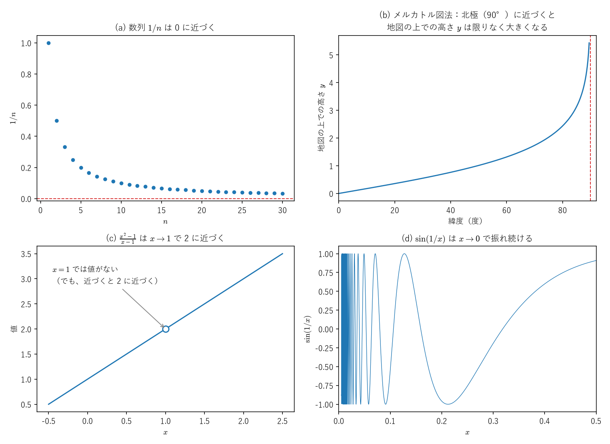
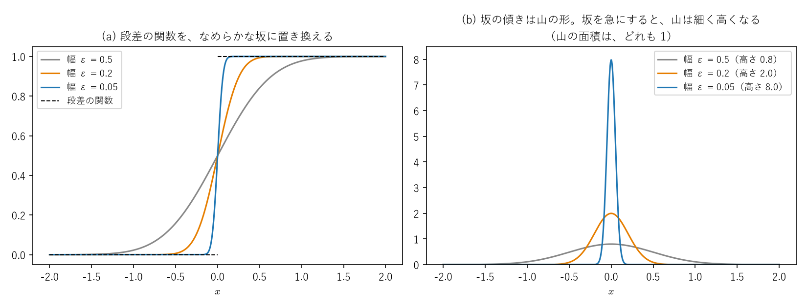

## 準備1 極限と収束

:::message
この章の式は、SymPy での検算と、著者の確認を済ませています。誤りを見つけたら、コメントで教えてください。
:::

**この章で使う道具**：分数と小数の計算と、グラフの読み方。一部で、三角関数（$\sin$、$\tan$）と対数（$\log$）が出てきます。

## なぜ、極限から始めるのか

微分は、「近づけていったら、どうなるか」を考えることで定義されます。

たとえば、車の速さを考えます。1時間で 60 km 進んだなら、平均の速さは時速 60 km です。では、「今この瞬間の速さ」はどう決めればよいでしょうか。測る時間を1分、1秒、0.001秒と短くしていけば、瞬間の速さに近づいていきそうです。でも、測る時間をちょうど 0 にすると、進んだ距離も 0 になり、「0 ÷ 0」になってしまいます。

この「ちょうど 0 にはしないが、限りなく 0 に近づける」という考え方を、正確に言葉にしたものが**極限**です。この章では、極限を、数の並び（数列）、足し続けること（級数）、関数、の順に見ていきます。最後に、この章の道具で、瞬間の速さにあたるもの（微分係数）を計算して、次の章へ渡します。


*この章で扱う4つの極限。(a) 0 に近づく数列、(b) 限りなく大きくなる関数、(c) 値がない点に近づく関数、(d) 1つの値に近づかない関数。*

## 1. 近づいていく数の並び

数を順番に並べたものを**数列**といいます。たとえば

$$
1,\ \frac{1}{2},\ \frac{1}{3},\ \frac{1}{4},\ \dots
$$

は、$n$ 番目の数が $a_n=\dfrac{1}{n}$ の数列です。$n$ を大きくしていくと、$a_n$ は 0 に近づいていきます（図の (a)）。ただし、どこまで行っても、ちょうど 0 にはなりません。

このように、$n$ を大きくすると $a_n$ がある数 $\alpha$ に近づいていくとき、数列は $\alpha$ に**収束する**といい、

$$
\lim_{n\to\infty}a_n=\alpha
$$

と書きます。$\lim$ は「極限」を意味する英語 limit の略で、$n\to\infty$ は「$n$ を限りなく大きくする」と読みます。この記号を使うと、上の例は $\displaystyle\lim_{n\to\infty}\frac{1}{n}=0$ です。

「近づいていく」を、もう少し正確に言うと、こうなります。

> $n$ を十分大きくすれば、$a_n$ と $\alpha$ の差を、どれだけ小さくでもできる。

「どれだけ小さくでも」がポイントです。差を 0.1 より小さくしたければ、$n$ を 11 以上にすれば $\frac{1}{n}<0.1$ です。差を 0.001 より小さくしたければ、$n$ を 1001 以上にすれば足ります。どんなに厳しい注文にも、$n$ を大きくすれば応えられる。これが「0 に収束する」の中身です。

:::details 正確な定義（ε-N 論法）
上の言葉を、そのまま式にしたものが次の定義です。$\varepsilon$（イプシロン）は「許す差」を表す正の数です。

> 数列 $a_n$ が $\alpha$ に収束するとは、どんな正の数 $\varepsilon$ に対しても、ある番号 $N$ があって、$n\geq N$ を満たすすべての $n$ で $|a_n-\alpha|<\varepsilon$ となることをいう。

**例：$\frac{1}{n}\to0$ を、この定義で確かめる。** 正の数 $\varepsilon$ が与えられたとします。$N$ として、$\frac{1}{\varepsilon}$ より大きい整数を1つ選びます（たとえば $\varepsilon=0.1$ なら $N=11$）。すると、$n\geq N$ のとき

$$
\left|\frac{1}{n}-0\right|=\frac{1}{n}\leq\frac{1}{N}<\varepsilon
$$

です。最初の $\leq$ は、$n\geq N$ なので分母が大きいほうが小さいから、最後の $<$ は、$N>\frac{1}{\varepsilon}$ の両辺の逆数をとったものです。どんな $\varepsilon$ にもこうして $N$ が選べるので、$\frac{1}{n}$ は 0 に収束します。
:::

### 0.999… は 1 に等しい

もう1つ、少し不思議な例を見ておきます。

$$
0.9,\quad 0.99,\quad 0.999,\quad 0.9999,\quad\dots
$$

$n$ 番目の数は $1-\dfrac{1}{10^n}$ です。1 との差は $\frac{1}{10^n}$ で、$n$ を大きくすればいくらでも小さくなるので、この数列は 1 に収束します。

ところで、9 が無限に続く小数 $0.999\cdots$ とは、何のことでしょうか。無限に続く小数は、「途中で打ち切った小数の並びが近づいていく先」として定義されます。つまり $0.999\cdots$ は、上の数列の極限です。したがって

$$
0.999\cdots=1
$$

です。「限りなく 1 に近いが、1 より少し小さい数」ではなく、ちょうど 1 です。極限という考え方を使うと、こうした疑問にもはっきり答えられます。

## 2. 近づかない数の並び：発散と振動

数列は、いつも収束するとは限りません。

- **限りなく大きくなる。** $a_n=n^2$ の数列 $1,4,9,16,\dots$ は、どんな数も超えて大きくなっていきます。これを、**無限大に発散する**といい、$\displaystyle\lim_{n\to\infty}n^2=\infty$ と書きます。$\infty$ は数ではないので、「$\infty$ に収束する」とは言いません。
- **振れ続ける。** $a_n=(-1)^n$ の数列 $-1,1,-1,1,\dots$ は、大きくもならず、1つの数にも近づきません。これを**振動する**といいます。

収束しない数列を、まとめて**発散する**といいます。無限大に発散する場合も、振動する場合も含みます。

## 3. 足し続けるとどうなるか：級数

無限に続く数を、全部足すとどうなるでしょうか。無限個の数を一度に足すことはできないので、ここでも極限を使います。最初の $N$ 個までの和（**部分和**）を作り、$N$ を大きくしたときに部分和が近づく先を、無限個の和と考えます。無限個の数の和を**級数**といいます。

### 半分ずつ足すと、1 になる

$$
\frac{1}{2}+\frac{1}{4}+\frac{1}{8}+\frac{1}{16}+\cdots
$$

1 m のテープを考えます。まず半分（$\frac{1}{2}$ m）を切り取り、残りの半分（$\frac{1}{4}$ m）を切り取り、さらに残りの半分……とくり返します。$N$ 回切り取ったとき、残っているのは $\frac{1}{2^N}$ m なので、切り取った長さの合計（部分和）は

$$
\frac{1}{2}+\frac{1}{4}+\cdots+\frac{1}{2^N}=1-\frac{1}{2^N}
$$

です。$N$ を大きくすると $\frac{1}{2^N}$ は 0 に近づくので、部分和は 1 に近づきます。無限に足しても、和は 1 で止まるのです。

さきほどの $0.999\cdots$ も、実はこの仲間です。$0.9+0.09+0.009+\cdots$ という級数で、部分和は $1-\frac{1}{10^N}$ でした。

### 少しずつ小さくなっても、無限に大きくなることがある

では、足す数が 0 に近づいていけば、和はいつも有限で止まるのでしょうか。そうではありません。

$$
1+\frac{1}{2}+\frac{1}{3}+\frac{1}{4}+\frac{1}{5}+\cdots
$$

この級数（**調和級数**）は、足す数が 0 に近づくのに、和は限りなく大きくなります。ただし、その増え方はとてもゆっくりです。部分和が 10 を超えるのは、12367 個目を足したときです。

:::details 調和級数が発散する理由
項を、2個、4個、8個……のまとまりに分けます。

$$
1+\frac{1}{2}+\left(\frac{1}{3}+\frac{1}{4}\right)+\left(\frac{1}{5}+\frac{1}{6}+\frac{1}{7}+\frac{1}{8}\right)+\cdots
$$

1つ目のかっこの中は、どちらの項も $\frac{1}{4}$ 以上なので、和は $\frac{1}{4}+\frac{1}{4}=\frac{1}{2}$ 以上です。2つ目のかっこの中は、4つの項がどれも $\frac{1}{8}$ 以上なので、和は $4\times\frac{1}{8}=\frac{1}{2}$ 以上です。同じように、どのかっこの和も $\frac{1}{2}$ 以上になります。

したがって、$\frac{1}{2^m}$ までの部分和は $1+\frac{m}{2}$ 以上です（最初の $1$ と、$\frac{1}{2}$ と、$m-1$ 個のかっこ）。$\frac{1}{2}$ を何回でも足せるので、部分和はどんな数も超えます。
:::

:::details 少し先の話：調和級数は、ほぼ log n
調和級数の最初の $n$ 個の和を $H_n=1+\frac{1}{2}+\cdots+\frac{1}{n}$ と書きます。実は、$n$ が大きいとき、$H_n$ は自然対数 $\log n$ とほぼ同じ速さで増えていき、

$$
H_n\approx\log n+\gamma,\qquad\gamma=0.5772\cdots
$$

となることが知られています。$\gamma$ は**オイラー定数**と呼ばれる数です。なぜ $\log$ が出てくるのかは、積分を使うと説明できますが、ここでは結論だけを紹介します。

この式を使うと、本文の「10 を超えるのは 12367 個目」に見当がつきます。$\log n+\gamma=10$ を解くと

$$
n=e^{10-\gamma}\approx12367.0
$$

で、ぴったり合います。実際に分数を足していくと、$H_{12366}=9.99996\cdots$、$H_{12367}=10.00004\cdots$ です。

$\log n$ の増え方は、とてもゆっくりです。$n$ を10倍にしても、$\log n$ は約 2.3 しか増えません。部分和を 10 から 20 にしようとすると、足す項の数を約 $e^{10}\approx2$ 万2千倍にしなければなりません。「発散する」といっても、その歩みは、気が遠くなるほど遅いのです。

一方、足す数を2乗の逆数にすると、級数は収束します。しかも、その和には円周率が現れます。

$$
1+\frac{1}{4}+\frac{1}{9}+\frac{1}{16}+\cdots=\frac{\pi^2}{6}
$$

整数の2乗の逆数を足しただけなのに、円とは何の関係もなさそうな所から $\pi$ が出てくる。18世紀にオイラーが示したこの結果は、**バーゼル問題**の答えとして知られています。
:::

### 倍々に足すと？

$$
1+2+4+8+16+\cdots
$$

部分和は $1,3,7,15,31,\dots$ で、最初の $N$ 個の和は $2^N-1$ です（$N=1,2,3$ で $1,3,7$）。これは無限大に発散します。当たり前に見えますが、この級数には、章の最後のコラムで、もう一度出会います。

## 4. 関数の極限

ここまでは、番号 $n$ を大きくしていく話でした。同じ考え方を、関数にも使います。$x$ を、ある数 $a$ に近づけていったとき、$f(x)$ がある数 $L$ に近づくなら、

$$
\lim_{x\to a}f(x)=L
$$

と書き、「$x\to a$ のとき、$f(x)$ は $L$ に収束する」といいます。大事なのは、$x$ は $a$ に近づけるだけで、$a$ そのものにはしないことです。

### 値がない点にも、近づくことはできる

$$
f(x)=\frac{x^2-1}{x-1}
$$

を考えます。$x=1$ を入れると $\frac{0}{0}$ になり、値がありません。でも、$x\neq1$ なら、分子を $x^2-1=(x-1)(x+1)$ と分けて約分でき、$f(x)=x+1$ です。だから、$x$ を 1 に近づけると、$f(x)$ は 2 に近づきます（図の (c)）。

$$
\lim_{x\to1}\frac{x^2-1}{x-1}=2
$$

$x=1$ では値がないのに、極限はある。冒頭の「0 ÷ 0 になる瞬間の速さ」は、まさにこの形をしています。

:::details 正確な定義（ε-δ 論法）と、この例での確かめ
数列のときと同じ考え方で、関数の極限を式にしたものが次の定義です。$\delta$（デルタ）は「$x$ を $a$ にどれだけ近づけるか」を表す正の数です。

> （ここで $a$ は、$a$ 以外の定義域の点から、いくらでも近づける点とします。）$x\to a$ のとき $f(x)$ が $L$ に収束するとは、どんな正の数 $\varepsilon$ に対しても、ある正の数 $\delta$ があって、$0<|x-a|<\delta$ を満たし、$f$ の値が決まっている（定義域に入っている）すべての $x$ で $|f(x)-L|<\varepsilon$ となることをいう。

$0<|x-a|$ という条件が、「$x=a$ そのものは考えない」ことを表しています。

**例：$\frac{x^2-1}{x-1}\to2$（$x\to1$）を確かめる。** $x\neq1$ のとき $f(x)=x+1$ なので、

$$
|f(x)-2|=|(x+1)-2|=|x-1|
$$

です。正の数 $\varepsilon$ が与えられたら、$\delta=\varepsilon$ と選びます。すると、$0<|x-1|<\delta$ のとき $|f(x)-2|=|x-1|<\delta=\varepsilon$ です。
:::

### 片側から近づく：北極は地図に描けない

$x$ を $a$ に、片側からだけ近づけることもあります。右から（$a$ より大きい側から）近づけるときは $x\to a+0$、左から近づけるときは $x\to a-0$ と書きます。

たとえば $f(x)=\frac{1}{x}$ は、$x$ を右から 0 に近づけると限りなく大きくなり、左から近づけると、負の側に限りなく大きくなります。

$$
\lim_{x\to+0}\frac{1}{x}=\infty,\qquad\lim_{x\to-0}\frac{1}{x}=-\infty
$$

（$a=0$ のときは、$0+0$ を単に $+0$ と書きます。）

身近な例が、「はじめに」で見たメルカトル図法です。この地図では、緯度 $\varphi$ の地点が、赤道からの高さ

$$
y=\log\left(\tan\left(\frac{\pi}{4}+\frac{\varphi}{2}\right)\right)
$$

の所に描かれます（地球の半径を 1 としたときの値です。$\log$ は、$e$ を底とする自然対数です）。緯度を北極の 90° に近づけていくと、$y$ は次のように大きくなっていきます。

| 緯度 $\varphi$ | 60° | 80° | 89° | 89.9° |
|---|---|---|---|---|
| 地図の上での高さ $y$ | 1.32 | 2.44 | 4.74 | 7.04 |

90° に近づけるほど、$y$ は限りなく大きくなります（図の (b)）。

$$
\lim_{\varphi\to90°-0}y=\infty
$$

つまり、北極は、メルカトル図法の地図のどこにも描けません。地図を上へ上へと伸ばしても、北極には永遠にたどり着かないのです。

### 1つの値に近づかない

関数の極限も、いつもあるとは限りません。$f(x)=\sin\frac{1}{x}$ は、$x$ を 0 に近づけると、$-1$ と $1$ の間を、どんどん速く振れ続けます（図の (d)）。

たとえば、$x=\frac{1}{\pi},\frac{1}{2\pi},\frac{1}{3\pi},\dots$ と 0 に近づけると、$\sin\frac{1}{x}=\sin(n\pi)$ はずっと 0 です。一方、$x=\frac{1}{2\pi+\frac{\pi}{2}},\frac{1}{4\pi+\frac{\pi}{2}},\dots$ と近づけると、$\sin\frac{1}{x}$ はずっと 1 です。近づけ方によって、近づく先が違う。こういうとき、$x\to0$ での極限はありません。

## 5. 連続

関数のグラフが、ある点で「つながっている」ことを、極限を使って言い表せます。

> 関数 $f$ が $x=a$ で**連続**であるとは、$\displaystyle\lim_{x\to a}f(x)=f(a)$ となることをいう。

ここでの極限は、$f$ の値が決まっている範囲（定義域）の中で $x$ を $a$ に近づけたものです。たとえば $\sqrt{x}$ は $x\geq0$ でしか値が決まらないので、$x=0$ では右からだけ近づけます。そうすると $\sqrt{x}\to0=\sqrt{0}$ なので、$\sqrt{x}$ は $x=0$ でも連続です。

つまり、「近づいていく先」と「その点での値」が一致する、ということです。

- $f(x)=x^2$ のような多項式や、$\sin x$ は、どの点でも連続です。
- $x<0$ で 0、$x\geq0$ で 1 をとる「段差の関数」は、$x=0$ で連続ではありません。左から近づくと 0 に、右から近づくと 1 に近づくので、$x\to0$ での極限がそもそもありません。
- さきほどの $\frac{x^2-1}{x-1}$ は、$x=1$ に値がないので、そこでは連続かどうかを考えられません。ただし、$x=1$ での値を、極限の 2 と決めてしまえば、連続な関数（$x+1$）になります。

## 6. 微分への入口：差分商の極限

最後に、冒頭の「瞬間の速さ」に戻ります。

$f(x)=x^2$ のグラフの、$x=1$ の点での傾きを考えます。$h\neq0$ として、$x$ を 1 から $1+h$ まで動かしたとき、$f$ の変化の割合（**差分商**）は

$$
\frac{f(1+h)-f(1)}{h}=\frac{(1+h)^2-1}{h}=\frac{2h+h^2}{h}=2+h
$$

です（最後の約分で、$h\neq0$ を使いました）。$h$ を小さくしていくと、

| $h$ | 0.1 | 0.01 | 0.001 |
|---|---|---|---|
| 差分商 $2+h$ | 2.1 | 2.01 | 2.001 |

と、2 に近づいていきます。$h=0$ を入れると $\frac{0}{0}$ になってしまいますが、極限ならあります。

$$
\lim_{h\to0}\frac{f(1+h)-f(1)}{h}=2
$$

この極限の値 2 が、$x=1$ での $f$ の**微分係数**です。関数で言えば「その点での傾き」、車で言えば「その瞬間の速さ」にあたります。4節の $\frac{x^2-1}{x-1}$ と同じく、「値がない点に近づく」形の極限です。

次の章では、この微分係数を、「曲線を、その点のごく近くで直線に置き換える」という見方で読み直します。

:::details SymPy で検算する
この章の極限は、Python の数式処理ライブラリ SymPy の `limit` で確かめられます。

```python
import sympy as sp

n = sp.symbols("n", positive=True)
x, h = sp.symbols("x h", real=True)
print(sp.limit(1 / n, n, sp.oo))                         # 0
# "+-" は、左右の両側から近づけた極限（左右で違えばエラー）
print(sp.limit((x**2 - 1) / (x - 1), x, 1, "+-"))         # 2
print(sp.limit(((1 + h)**2 - 1) / h, h, 0, "+-"))         # 2

phi = sp.symbols("phi", real=True)
y = sp.log(sp.tan(sp.pi / 4 + phi / 2))
print(sp.limit(y, phi, sp.pi / 2, "-"))             # oo（無限大）
```

この章のすべての式と数値を確かめるスクリプトは、GitHub の [verify/verify_P1_limits.py](https://github.com/kazuma0606/quantum-study/blob/master/書籍/微分/verify/verify_P1_limits.py) にあります。
:::

## コラム：1 + 2 + 4 + 8 + ⋯ = −1 ？

3節で、$1+2+4+8+\cdots$ は無限大に発散すると書きました。ところが、本やネットで「$1+2+4+8+\cdots=-1$」という式を見かけることがあります。どういうことでしょうか。

出どころは、3節の「半分ずつ足す」計算を一般にしたものです。$|x|<1$ のとき、

$$
1+x+x^2+x^3+\cdots=\frac{1}{1-x}
$$

が成り立ちます（$x=\frac{1}{2}$ を入れると、左辺は $1+\frac{1}{2}+\frac{1}{4}+\cdots$、右辺は 2 で、3節の結果に 1 を足したものと合います）。この式の両辺に、無理やり $x=2$ を入れると、左辺は $1+2+4+8+\cdots$、右辺は $\frac{1}{1-2}=-1$ になります。

でも、これは「級数の和が $-1$ になる」という意味ではありません。最初の $N$ 個の和は $2^N-1$ で、確かに無限大に発散します。この式は、$|x|<1$ のときにしか成り立たないのでした。

正しい読み方は、こうです。右辺の関数 $\frac{1}{1-x}$ は、$x=1$ 以外ならどこでも値を持ちます。左辺の級数は、その関数を $|x|<1$ の範囲だけで表す「1つの書き方」にすぎません。「$-1$」は、級数の和ではなく、級数が表していた関数の、$x=2$ での値なのです。

級数が使えない場所でも、関数そのものは延ばせる。この考え方は**解析接続**と呼ばれ、複素数の関数の理論で大きな役割を果たします。微分の枝分かれの地図の、ずっと先にある枝の1つです。

## コラム：北極とδ関数 ― 枠を広げると見えてくるもの

4節で、北極はメルカトル図法の地図のどこにも描けない、という話をしました。でも、北極は地球の上に確かにあります。描けないのは、メルカトル図法という「枠」のせいです。実際、北極を真ん中に置いた別の地図（立体射影という描き方）を使えば、北極は地図の中心の、ごく普通の点として描けます。枠を取り替えれば、たどり着けなかった点に、ちゃんと行けるのです。

同じことが、関数でも起こります。

5節の「段差の関数」を思い出してください。$x<0$ で 0、$x\geq0$ で 1 をとる関数です。次の章で扱う「傾き」で考えると、$x=0$ 以外では平らなので、傾きは 0 です。では、$x=0$ での傾きは何でしょうか。段差は一瞬で 0 から 1 に跳び上がっているので、傾きは「無限大」と言いたくなります。でも、無限大は数ではありませんでした。

そこで、段差を、幅 $\varepsilon$ のなめらかな坂に置き換えて考えます（図の (a)）。この坂の傾きのグラフは、$x=0$ を中心とする山の形になります（図の (b)）。坂は全体で高さ 1 だけ上るので、山の面積は、坂の幅によらず、いつも 1 です。


*(a) 段差の関数（黒の破線）を、幅 $\varepsilon$ のなめらかな坂に置き換えたもの。(b) それぞれの坂の傾き。坂を急にするほど、山は細く高くなりますが、面積はどれも 1 のままです。*

坂の幅 $\varepsilon$ を 0 に近づけていくと、$x=0$ 以外の点では、坂は段差の関数に近づき、山はどんどん細く、高くなります（$x=0$ では、坂の値はいつも段差の中ほどの $\frac{1}{2}$ です）。極限では、「$x=0$ 以外では 0、$x=0$ では無限大、それでいて面積は 1」という山になるはずです。でも、そんな関数はありません。1点だけで値が大きくても、面積は 0 にしかならないからです。

この「山の極限」を、関数という枠を広げて、新しい対象として認めてしまおう、というのが**δ関数**（ディラックのデルタ関数）です。量子力学で、物理学者のディラックが使い始めました。のちに数学者たちが、δ関数がきちんと居場所を持つ広い枠（**超関数**）を整えました。その広い枠の中では、「段差の関数の傾き（微分）は、δ関数である」と言えます。普通の意味では微分できない関数を、枠を広げることで微分できるようにしたのです。

δ関数には、もう1つ面白い性質があります。波の重ね合わせ（フーリエ変換）で見ると、δ関数は、すべての周波数の波を同じ強さで含んでいます。山が細いほど、それを作るには、たくさんの周波数の波が必要になるからです。有限個の波をいくら足しても、δ関数そのものにはたどり着けません。足す波を増やすほど近づくだけです。北極に近づいていく緯度と、よく似ています。

たどり着けない所にも、枠を取り替えれば行ける。この考え方は、この本の最後の「微分の枝分かれの地図」で、超関数の微分という枝として、もう一度出てきます。

:::details 式で書くと
幅 $\varepsilon$（$\varepsilon>0$）の山として、ガウス関数

$$
g_\varepsilon(x)=\frac{1}{\varepsilon\sqrt{2\pi}}\,e^{-x^2/(2\varepsilon^2)}
$$

を使います。山の面積は、どの $\varepsilon>0$ でも 1 です。$x\neq0$ を固定して $\varepsilon\to+0$ とすると $g_\varepsilon(x)\to0$、$x=0$ での高さ $\frac{1}{\varepsilon\sqrt{2\pi}}$ は無限大に発散します（図の (b) の山の高さ 0.8、2.0、8.0 は、この式の値です）。

δ関数は、値ではなく、なめらかな関数 $\varphi$ との「重みつきの面積」で定義します。ここで $\varphi$ は、なめらかで、ある有限の範囲の外ではずっと 0 になる関数とします（遠くで大きくなりすぎる関数では、下の積分そのものが発散してしまうことがあるためです）。

$$
\int_{-\infty}^{\infty}g_\varepsilon(x)\,\varphi(x)\,dx\ \longrightarrow\ \varphi(0)\qquad(\varepsilon\to+0)
$$

この極限の操作（$\varphi$ に $\varphi(0)$ を対応させること）そのものを、δ関数と呼びます。

フーリエ変換を $F(k)=\displaystyle\int_{-\infty}^{\infty}f(x)\,e^{-ikx}\,dx$ と決めると、山のフーリエ変換は

$$
e^{-\varepsilon^2k^2/2}
$$

です。山の幅が $\varepsilon$ のとき、フーリエ変換の幅は $1/\varepsilon$ 程度で、山が細いほど広がります。$\varepsilon\to+0$ とすると、すべての $k$ で 1 に近づきます。これが「δ関数のフーリエ変換は 1」の意味です。

ここに出てきた積分は、この本では詳しく扱いません。SymPy での検算は、[verify/verify_P1_limits.py](https://github.com/kazuma0606/quantum-study/blob/master/書籍/微分/verify/verify_P1_limits.py) の最後にあります。
:::
