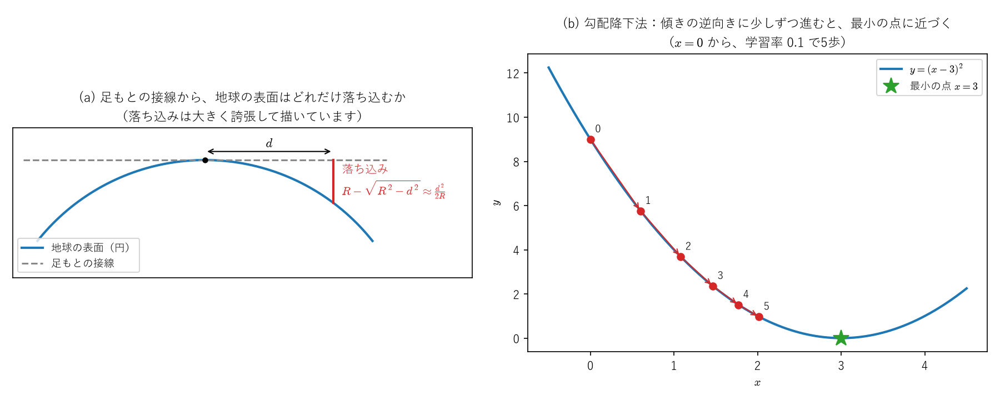
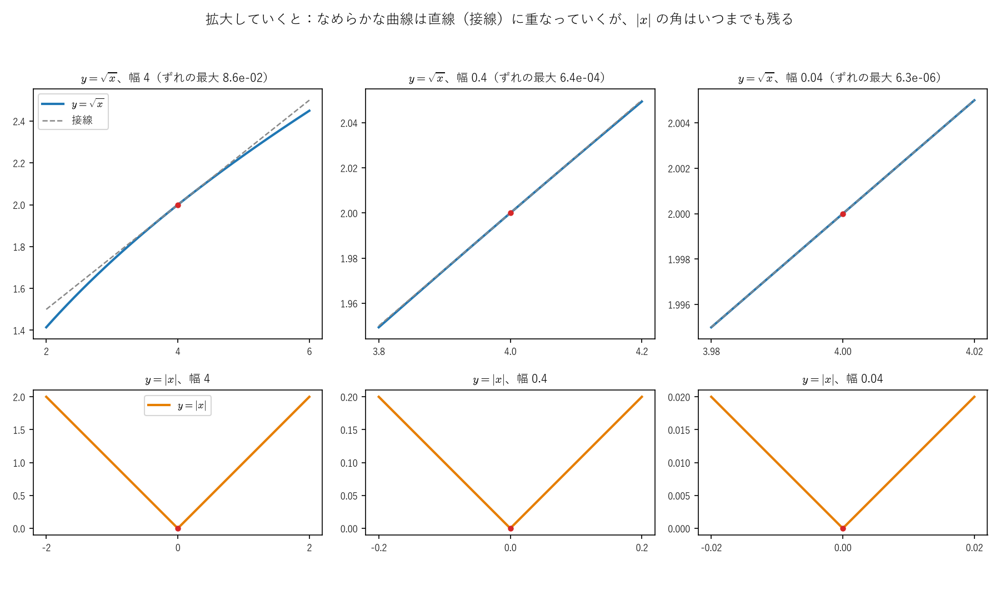

## 準備2 1変数の微分

:::message
この章の式は、SymPy での検算と、著者の確認を済ませています。誤りを見つけたら、コメントで教えてください。
:::

**この章で使う道具**：準備1の極限と、準備1の6節の差分商。三角関数（$\sin$、$\cos$）、指数関数 $e^x$、対数 $\log$ が出てきます。

## 1. 地球は丸いのに、足もとは平らに見える

地球は丸いのに、私たちの足もとの地面は、平らに見えます。なぜでしょうか。

足もとで地面に接する、まっすぐな線（接線）を考えます。そこから距離 $d$ だけ進むと、丸い地球の表面は、接線から少しずつ下へ落ち込んでいきます。地球の半径を $R$ とすると、その落ち込みはおよそ

$$
\frac{d^2}{2R}
$$

です（図の (a)。どうしてこの式になるかは、5節で導きます）。地球の半径 $R\approx6371$ km を入れると、次のようになります。

| 進む距離 $d$ | 1 km | 10 km | 100 km |
|---|---|---|---|
| 接線からの落ち込み | 約 7.8 cm | 約 7.8 m | 約 785 m |

1 km 先でも、わずか 8 cm ほどです。しかも、距離を $\frac{1}{10}$ にすると、落ち込みは $\frac{1}{100}$ になります。落ち込みが距離の2乗に比例するからです。だから、足もとのごく近くでは、地面は接線とほとんど区別できず、平らに見えるのです。


*(a) 足もとの接線から、地球の表面はどれだけ落ち込むか（大きく誇張して描いています）。(b) 4節の勾配降下法。*

同じことが、なめらかな曲線なら、どれにでも起こります。曲線の1点のまわりを拡大していくと、曲線はだんだん、まっすぐな線に見えてきます（下の図の上段）。この「拡大すると見えてくる直線」の傾きが、その点での**微分係数**です。

> **微分とは、曲線を、その点のごく近くで、直線に置き換えることです。**

これが、この本を通して使う、微分の見方です。


*上段：$y=\sqrt{x}$ の $x=4$ のまわりを、幅 4、0.4、0.04 で拡大したもの。灰色の破線は接線です。拡大の幅を $\frac{1}{10}$ にすると、曲線と接線のずれは約 $\frac{1}{100}$ になります（幅 0.4 から 0.04 で、ずれの最大は $6.4\times10^{-4}$ から $6.3\times10^{-6}$）。下段：$y=|x|$ の $x=0$ のまわり。いくら拡大しても、角は角のままです。*

## 2. 微分係数と接線

準備1の6節で、関数 $f$ の $x=a$ での**微分係数**を、差分商の極限として定めました。

$$
f'(a)=\lim_{h\to0}\frac{f(a+h)-f(a)}{h}
$$

$f'(a)$ は「エフ・プライム・エー」と読みます。この極限があるとき、$f$ は $x=a$ で**微分できる**（微分可能である）といいます。

微分係数を傾きにもち、点 $(a,f(a))$ を通る直線

$$
y=f(a)+f'(a)\,(x-a)
$$

が、$x=a$ での**接線**です。

### 接線で近くの値を見積もる

接線は、$a$ の近くで、曲線のよい代わりになります。$x=a+h$ と書くと、

$$
f(a+h)\approx f(a)+f'(a)\,h
$$

です。たとえば $f(x)=\sqrt{x}$ は、$x=4$ で $f(4)=2$、微分係数は $f'(4)=\frac{1}{4}$ です（3節の公式で求められます）。そこで $\sqrt{4.1}$ を見積もると、

$$
\sqrt{4.1}\approx2+\frac{1}{4}\times0.1=2.025
$$

です。本当の値は $2.024845\cdots$ なので、誤差は約 $0.00015$ しかありません。

### 「最良の」直線

点 $(a,f(a))$ を通る直線は、傾きを変えれば、いくらでもあります。その中で、接線だけが特別なのはなぜでしょうか。

近似の誤差（曲線と直線のずれ）を、$h$ を小さくしながら見てみます。$\sqrt{x}$ の $x=4$ では、

| $h$ | 0.1 | 0.01 | 0.001 |
|---|---|---|---|
| 接線の誤差 | $1.5\times10^{-4}$ | $1.6\times10^{-6}$ | $1.6\times10^{-8}$ |
| 誤差 $\div\,h$ | $1.5\times10^{-3}$ | $1.6\times10^{-4}$ | $1.6\times10^{-5}$ |

です。$h$ を $\frac{1}{10}$ にすると、誤差は $\frac{1}{100}$ になり、「誤差 $\div\,h$」も 0 に近づいていきます。誤差が、$h$ そのものよりも速く小さくなる、ということです。

接線以外の傾き $m$ の直線では、こうはなりません。「誤差 $\div\,h$」は 0 に近づかず、その大きさは $|f'(a)-m|$ に近づきます。つまり、

> 誤差が $h$ よりも速く小さくなる直線は、接線ただ1本だけです。

これが、接線が「最良の直線による近似」であるという意味です。本編の1章で、変数がたくさんある場合の微分を考えるときも、この言い方をそのまま使います。

:::details 確かめ：傾き m の直線の誤差
曲線と、傾き $m$ の直線との差（符号も込めた誤差）を $h$ で割ると、

$$
\frac{f(a+h)-\bigl(f(a)+m\,h\bigr)}{h}=\frac{f(a+h)-f(a)}{h}-m
$$

です。$h\to0$ とすると、右辺の第1項は微分係数 $f'(a)$ に近づくので、全体は $f'(a)-m$ に近づきます。これが 0 になるのは、$m=f'(a)$、つまり接線のときだけです。

$f(x)=x^2$ で具体的に見ると、$(a+h)^2-a^2=2ah+h^2$ です。$2ah$ が接線の部分（傾き $2a$）、残りの $h^2$ が誤差で、$h^2\div h=h\to0$ です。
:::

### 微分できない点：角

$f(x)=|x|$ は、$x=0$ で微分できません。$x=0$ での差分商は $\frac{|h|}{h}$ で、$h>0$ なら 1、$h<0$ なら $-1$ です。右から近づくと 1、左から近づくと $-1$ で、1つの値に近づかないので、極限がありません。

グラフで見ると、$x=0$ に角があります。いくら拡大しても、角は角のままで、1本の直線には見えてきません（1節の図の下段）。拡大して直線に見えるかどうかが、微分できるかどうかの目安です。

なお、微分できる点では、関数は必ず連続です（$f(a+h)-f(a)=\frac{f(a+h)-f(a)}{h}\times h$ で、$h\to0$ のとき $f'(a)\times0=0$ に近づくから）。逆は成り立ちません。$|x|$ は $x=0$ で連続ですが、微分できません。

## 3. 導関数と、微分の計算のきまり

各点 $x$ に、その点での微分係数 $f'(x)$ を対応させる関数を、$f$ の**導関数**といいます。$f'(x)$ のほかに、$\dfrac{df}{dx}$ とも書きます。導関数を求めることを、「微分する」といいます。

### よく使う導関数

| 関数 $f(x)$ | 導関数 $f'(x)$ |
|---|---|
| $x^n$（$n$ は正の整数） | $n\,x^{n-1}$ |
| $\dfrac{1}{x}$ | $-\dfrac{1}{x^2}$ |
| $\sqrt{x}$（$x>0$） | $\dfrac{1}{2\sqrt{x}}$ |
| $\sin x$ | $\cos x$ |
| $\cos x$ | $-\sin x$ |
| $e^x$ | $e^x$ |
| $\log x$（$x>0$） | $\dfrac{1}{x}$ |

2節で使った $\sqrt{x}$ の $x=4$ での微分係数は、この表から $\frac{1}{2\sqrt{4}}=\frac{1}{4}$ です。

:::details x^n の導関数
$(x+h)^n$ を展開すると、

$$
(x+h)^n=x^n+n\,x^{n-1}h+(\,h^2\text{ 以上の項}\,)
$$

です（$x+h$ を $n$ 個掛けるとき、$h$ をちょうど1個選ぶ選び方が $n$ 通りあるので、$h$ の1次の項は $n\,x^{n-1}h$）。したがって

$$
\frac{(x+h)^n-x^n}{h}=n\,x^{n-1}+(\,h\text{ 以上の項}\,)
$$

で、$h\to0$ とすると $n\,x^{n-1}$ に近づきます。
:::

:::details sin x の導関数
ここでは、角度をラジアン（弧度法：半径 1 の円の弧の長さで角度を測る方法）で測ります。度で測ると、$\frac{\sin h}{h}$ の極限は 1 ではなくなり、公式の形が変わります。三角関数の加法定理 $\sin(x+h)=\sin x\cos h+\cos x\sin h$ から、

$$
\frac{\sin(x+h)-\sin x}{h}=\sin x\cdot\frac{\cos h-1}{h}+\cos x\cdot\frac{\sin h}{h}
$$

です。$h\to0$ のとき、$\dfrac{\sin h}{h}\to1$、$\dfrac{\cos h-1}{h}\to0$ となることが知られています（前者は、半径 1 の円の扇形と三角形の面積を比べて示せます。数値で見ると、$h=0.1$ で $\frac{\sin h}{h}=0.99833\cdots$、$h=0.01$ で $0.99998\cdots$ です）。したがって、右辺は $\cos x$ に近づきます。$\cos x$ の導関数も、同じように求められます。
:::

### e は、どんな数か

$e^x$ の導関数が、$e^x$ そのものになるのはなぜでしょうか。実は、$e$ という数は、そうなるように選ばれた数です。

$a^x$（$a>1$）のグラフの、$x=0$ での傾きを考えます。$a=2$ では約 0.693、$a=3$ では約 1.099 です。$a$ を大きくしていくと、この傾きは途切れずに増えていきます（このことは、ここでは認めて使います）。だから、2と3の間に、傾きがちょうど 1 になる $a$ が、ただ1つあります。それが

$$
e=2.71828\cdots
$$

です。$x=0$ での傾きが 1 なので、どの点 $x$ でも、

$$
\frac{e^{x+h}-e^x}{h}=e^x\cdot\frac{e^h-1}{h}\ \longrightarrow\ e^x\times1=e^x
$$

となります。「傾きが、自分自身の値に等しい」関数です。$\log x$ は、この $e$ を底とする対数（自然対数）です。

### 計算のきまり

関数を足したり、掛けたり、つないだりしたものの導関数は、次のきまりで求められます。

| きまり | 式 |
|---|---|
| 和 | $(u+v)'=u'+v'$ |
| 定数倍 | $(c\,u)'=c\,u'$ |
| 積 | $(u\,v)'=u'\,v+u\,v'$ |
| 合成（連鎖律） | $\bigl(g(f(x))\bigr)'=g'\bigl(f(x)\bigr)\cdot f'(x)$ |

最後の**連鎖律**が、いちばん大事です。関数をつないだ（合成した）ものの微分は、それぞれの微分の掛け算になる、というきまりです。

たとえば車で、1時間に 60 km 進み、1 km 進むごとに 0.05 L のガソリンを使うとします。1時間あたりのガソリンの量は、$60\times0.05=3$ L です。「時間に対する距離の変化の割合」と、「距離に対するガソリンの変化の割合」を掛けると、「時間に対するガソリンの変化の割合」になる。連鎖律は、この当たり前の計算を、一般の関数で言ったものです。

例を2つ挙げます。

$$
\bigl((x^2+1)^5\bigr)'=5(x^2+1)^4\cdot2x,\qquad\bigl(\sin(x^2)\bigr)'=\cos(x^2)\cdot2x
$$

どちらも、「外側の関数の微分」に「内側の関数の微分」を掛けています。

「はじめに」で、AI の学習を支える誤差逆伝播は、微分の連鎖律をくり返し使ったものだ、と書きました。何層も重ねた計算の微分を、層ごとの微分の掛け算として求めているのです。

:::details 積のきまりと、log x の導関数
**積のきまり**：差分を、次のように2つに分けます。

$$
u(x+h)v(x+h)-u(x)v(x)=\bigl(u(x+h)-u(x)\bigr)v(x+h)+u(x)\bigl(v(x+h)-v(x)\bigr)
$$

両辺を $h$ で割って $h\to0$ とすると、右辺の第1項は $u'(x)v(x)$（$v$ は連続なので $v(x+h)\to v(x)$）、第2項は $u(x)v'(x)$ に近づきます。

**$\log x$ の導関数**：$e^{\log x}=x$ の両辺を、連鎖律を使って微分すると、

$$
e^{\log x}\cdot(\log x)'=1
$$

です。$e^{\log x}=x$ なので、$(\log x)'=\dfrac{1}{x}$ です（ここでは、$\log x$ が微分できることは認めて使っています）。
:::

## 4. 傾きで分かること：増減と、勾配降下法

導関数が分かると、関数の増え方・減り方が分かります。

- $f'(x)>0$ の所では、$f$ は増えている（右上がり）。
- $f'(x)<0$ の所では、$f$ は減っている（右下がり）。
- なめらかな関数が、定義域の内側の点で一番小さく（または大きく）なるとき、そこでは $f'(x)=0$ です（グラフが一瞬、平らになる）。定義域の端の点では、この限りではありません。

この性質を使って、関数が一番小さくなる点を探すのが、AI の学習で使われる**勾配降下法**です。考え方は単純で、「傾きの逆向きに、少しずつ進む」をくり返します。$n$ 歩目の位置を $x_n$ と書くと、次の位置は

$$
x_{n+1}=x_n-\eta\,f'(x_n)
$$

です。$\eta$（イータ）は一歩の大きさを決める小さな正の数で、**学習率**と呼ばれます。傾きが正（右上がり）なら左へ、負（右下がり）なら右へ進むので、学習率を十分小さくとれば、坂を下っていくことになります。学習率が大きすぎると、坂の底を飛び越えて、かえって高い所へ行ってしまうこともあります。

$f(x)=(x-3)^2$ で試します。一番小さくなるのは $x=3$ です。導関数は $f'(x)=2(x-3)$ で、$x_0=0$ から、学習率 $\eta=0.1$ で進むと、

$$
x_1=0-0.1\times2(0-3)=0.6,\qquad x_2=0.6-0.1\times2(0.6-3)=1.08,\qquad\dots
$$

と、3 に近づいていきます（1節の図の (b)）。実は、$n$ 歩目の値は

$$
x_n=3-3\times0.8^n
$$

と書けます。1歩ごとに、3 との差が 0.8 倍になるからです。準備1で見たように $0.8^n\to0$ なので、$x_n\to3$ です。

AI の学習では、$x$ が1つの数ではなく、何百万もの数になります。そのとき、傾き $f'(x)$ の代わりに使うのが、本編の1章と2章で出てくる**勾配**です。

## 5. 2階微分と、曲がり具合

導関数 $f'$ を、もう一度微分したものを**2階導関数**といい、$f''(x)$ と書きます。$f'$ が傾きなら、$f''$ は「傾きの変わり方」、つまり曲線の曲がり具合を表します。

- $f''(x)>0$ の所では、傾きが増えていき、グラフは下に凸（お椀の形）です。たとえば $x^2$ の2階導関数は 2 です。
- $f''(x)<0$ の所では、グラフは上に凸（山の形）です。

### 接線の次は、放物線で近づける

接線による近似 $f(a)+f'(a)h$ に、2階導関数の項を1つ足すと、近似の誤差は、$h$ が小さくなるとき $h^2$ よりも速く小さくなります（接線だけの近似では、誤差は一般に $h^2$ 程度です）。ただし、$f''(a)=0$ の点では、2次の項は 0 なので、近似の値は変わりません。係数の $\frac{1}{2}$ は、$f(x)=x^2$ で確かめられます。$(a+h)^2=a^2+2ah+h^2$ で、$f''=2$ なので、$\frac{f''(a)}{2}h^2=h^2$ と、ちょうど合います。一般の関数でこの式が成り立つこと（2回微分できて、2階導関数が連続なら成り立ちます）の証明は、ここでは省きます。

$$
f(a+h)\approx f(a)+f'(a)\,h+\frac{f''(a)}{2}\,h^2
$$

直線の代わりに、放物線で曲線に寄り添う形です。2節の $\sqrt{4.1}$ では、$\sqrt{x}$ の $x=4$ での2階導関数が $-\frac{1}{32}$ なので、

$$
\sqrt{4.1}\approx2.025-\frac{1}{64}\times0.01=2.02484375
$$

となり、誤差は約 $0.00015$ から約 $0.000002$ に小さくなります。さらに3次、4次の項を足していくものを、**テイラー展開**といいます。

### 地球の落ち込みの正体

1節の地球の落ち込み $\frac{d^2}{2R}$ も、この式から出てきます。地球の表面の断面を、半径 $R$ の円とします。足もとを原点にとり、下向きに測った落ち込みを $y$ とすると、円の上の点は $y=R-\sqrt{R^2-x^2}$ で表されます。足もと（$x=0$）では、

$$
y(0)=0,\qquad y'(0)=0,\qquad y''(0)=\frac{1}{R}
$$

です。$y'(0)=0$ は、接線が水平であることを表します。だから、接線による近似は「落ち込み 0」で、落ち込みは2次の項から始まり、

$$
y(d)\approx\frac{1}{2}\cdot\frac{1}{R}\cdot d^2=\frac{d^2}{2R}
$$

です。

ここで、円の2階導関数が $\frac{1}{R}$ になったことに注目してください。半径が大きい円ほど、曲がり具合は小さい。この $\frac{1}{R}$ は、本編の4章で、**曲率**という名前で、もう一度出てきます。表紙の $K=\frac{1}{R^2}$ は、その曲面版です。

:::details SymPy で検算する
この章の導関数や近似は、SymPy の `diff`（微分）と `series`（テイラー展開）で確かめられます。

```python
import sympy as sp

x, h = sp.symbols("x h", real=True)
R = sp.symbols("R", positive=True)
print(sp.diff(sp.sqrt(x), x).subs(x, 4))             # 1/4
print(sp.diff(sp.sin(x**2), x))                      # 2*x*cos(x**2)
print(sp.limit((sp.exp(h) - 1) / h, h, 0))           # 1
y = R - sp.sqrt(R**2 - x**2)                         # 円の上の点の落ち込み
print(sp.diff(y, x, 2).subs(x, 0))                   # 1/R
print(sp.series(y, x, 0, 4))                         # x**2/(2*R) + O(x**4)
```

この章のすべての式と数値を確かめるスクリプトは、GitHub の [verify/verify_P2_derivative.py](https://github.com/kazuma0606/quantum-study/blob/master/書籍/微分/verify/verify_P2_derivative.py) にあります。
:::

## 6. 次の章へ：「数を掛ける」から「行列を掛ける」へ

この章で見た微分の見方を、もう一度まとめます。

$$
f(a+h)\approx f(a)+f'(a)\,h
$$

右辺の $f'(a)\,h$ は、「$h$ に、数 $f'(a)$ を掛ける」という、いちばん単純な形の関数です。曲線そのものはどんなに複雑でも、点 $a$ からの値の変化 $f(a+h)-f(a)$ は、ごく近くでは、「数を掛ける」だけの関数で置き換えられる。それが微分でした。

では、変数がたくさんある関数ではどうなるでしょうか。たとえば、地球の表面の標高は、緯度と経度の2つの変数で決まります。その場合、「数を掛ける」の代わりになるのが、「**行列を掛ける**」です。次の章では、その準備として、ベクトルと行列を、「数を掛けること」を広げたものとして見ていきます。

## コラム：微分できるのに、導関数がつながらない関数

2節で、拡大して直線に見える点では微分できる、と書きました。では、微分できる関数の導関数は、いつもなめらかにつながっているのでしょうか。意外なことに、そうとは限りません。

$$
f(x)=x^2\sin\frac{1}{x}\quad(x\neq0),\qquad f(0)=0
$$

という関数を考えます。準備1の4節で、$\sin\frac{1}{x}$ は $x\to0$ で振れ続けて、極限がないことを見ました。この $f$ は、その振れを $x^2$ で押さえつけた関数です。

**$x=0$ では微分できます。** $x=0$ での差分商は

$$
\frac{f(h)-f(0)}{h}=h\sin\frac{1}{h}
$$

です。$\sin\frac{1}{h}$ は $-1$ から $1$ の間にあるので、$|h\sin\frac{1}{h}|\leq|h|$ で、$h\to0$ のとき 0 に近づきます。したがって $f'(0)=0$ です。

**でも、導関数は $x=0$ でつながっていません。** $x\neq0$ では、3節のきまり（積と連鎖律）を使って、

$$
f'(x)=2x\sin\frac{1}{x}-\cos\frac{1}{x}
$$

です。$x\to0$ とすると、第1項は 0 に近づきますが、第2項の $\cos\frac{1}{x}$ は $-1$ と $1$ の間で振れ続けます。たとえば $x=\frac{1}{2n\pi}$ では $f'(x)=-1$、$x=\frac{1}{(2n+1)\pi}$ では $f'(x)=1$ です（$n$ は正の整数）。$x$ を 0 に近づけても、$f'(x)$ は1つの値に近づかないので、$f'(0)=0$ とつながりません。

各点で微分はできるのに、その傾きを並べた導関数は、連続ではない。微分の世界には、こうした直感を裏切る関数がいくつもあります。厳密な数学の教科書が「微分できる」と「導関数が連続である」を区別して扱うのは、このためです。
