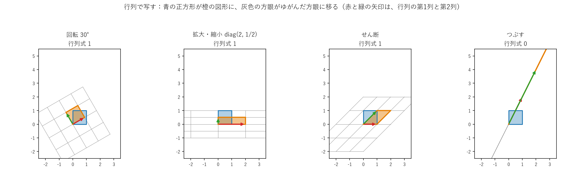
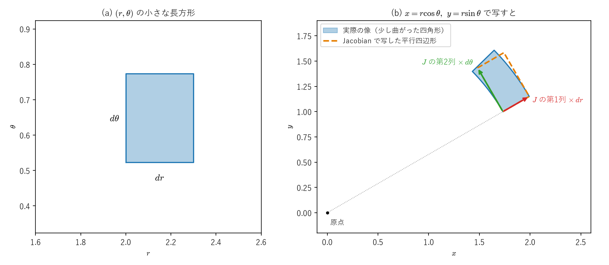

## 準備3 ベクトルと行列

:::message
この章の式は、SymPy での検算と、著者の確認を済ませています。誤りを見つけたら、コメントで教えてください。
:::

**この章で使う道具**：準備2の「微分は、値の変化を『数を掛ける』関数で置き換えること」という見方。三平方の定理と、三角関数（$\sin$、$\cos$）が出てきます。

## なぜ、ベクトルと行列なのか

準備2の最後に、微分をこうまとめました。

$$
f(a+h)-f(a)\approx f'(a)\,h
$$

値の変化は、ごく近くでは「$h$ に数 $f'(a)$ を掛ける」だけの関数で置き換えられる、という見方です。

でも、世の中の量の多くは、1つの数では決まりません。地図の上の位置は、東西と南北の2つの数で決まります。地球の表面の標高は、緯度と経度の2つの数で決まります。変数がいくつもあるとき、「小さな変化」は、いくつかの数の組になります。数の組を1つのまとまりとして扱うのが**ベクトル**、そして「数を掛ける」の代わりになるのが「**行列を掛ける**」です。

ベクトルと行列が必要になる理由は、もう1つあります。本編の後半では、曲がった座標や、曲がった空間の上で微分をします（3章の**共変微分**、4章の曲率。まとめて**微分幾何学**と呼ばれる分野です）。そこで主役になるのは、ベクトルそのものと、「座標を取り替えると、ベクトルの成分がどう変わるか」です。その変わり方を表すのが行列で、とくにこの章の最後に出てくる Jacobian です。ベクトルと行列は、本編の最後まで使い続ける道具なのです。

この章では、ベクトルと行列を、本編で使う所に絞って見ていきます。最後に、それらを組み合わせて、本編の1章の主役になる **Jacobian（ヤコビ行列）** を先取りします。

## 1. ベクトル

### 数の組としてのベクトル、矢印としてのベクトル

平面の上の位置や移動は、2つの数の組 $(a_1,a_2)$ で表せます。たとえば「東へ 3、北へ 1 進む」移動は $(3,1)$ です。このような数の組を**ベクトル**といい、ここでは太字で $\boldsymbol{a}=(a_1,a_2)$ と書きます。$a_1$、$a_2$ を、ベクトルの**成分**といいます。

ベクトルは、原点から点 $(a_1,a_2)$ へ向かう**矢印**としても描けます。矢印の向きが移動の向き、長さが移動の大きさです。

ベクトルどうしは、成分ごとに足せます。また、ベクトルに普通の数を掛けることができ、そのときは、すべての成分に掛けます。ベクトルと区別するために、普通の数のことを**スカラー**と呼びます。

$$
(3,1)+(1,2)=(4,3),\qquad 2\,(3,1)=(6,2)
$$

足し算は「移動を続けて行う」ことにあたります。$(0,0)$ でないベクトルに正のスカラーを掛けると、向きはそのままで、長さがそのスカラーの倍になります。負のスカラーを掛けると、向きが逆になります（0 を掛けると、長さ 0 のベクトル $\boldsymbol{0}=(0,0)$ になります）。ベクトルにスカラーを掛けることを、**スカラー倍**といいます。

特別なベクトルとして、$\boldsymbol{e}_1=(1,0)$（東へ 1）と $\boldsymbol{e}_2=(0,1)$（北へ 1）を使います。どんなベクトルも、この2つを使って

$$
(a_1,a_2)=a_1\,\boldsymbol{e}_1+a_2\,\boldsymbol{e}_2
$$

と書けます（$\boldsymbol{e}_1$ を $a_1$ 倍したものと、$\boldsymbol{e}_2$ を $a_2$ 倍したものの和）。$\boldsymbol{e}_1$、$\boldsymbol{e}_2$ のように、すべてのベクトルを、スカラー倍と足し算で、ただ一通りに組み立てられるベクトルの組を、**基底**といいます（「ただ一通りに」が大事です。たとえば $(1,0)$、$(0,1)$、$(1,1)$ の3本でもすべてのベクトルを作れますが、$(1,1)$ は残りの2本の和で作れるので、組み立て方が一通りに決まらず、基底ではありません）。成分とは、「基底をそれぞれ何個使うか」を表す数です。

3次元なら、ベクトルは3つの数の組 $(a_1,a_2,a_3)$ で、基底は $\boldsymbol{e}_1,\boldsymbol{e}_2,\boldsymbol{e}_3$ の3本です。この章では、図に描きやすい2次元で話を進めますが、考え方は3次元でも同じです。

### 長さと内積

ベクトル $\boldsymbol{a}=(a_1,a_2)$ の長さ $|\boldsymbol{a}|$ は、三平方の定理から

$$
|\boldsymbol{a}|=\sqrt{a_1^2+a_2^2}
$$

です。たとえば $(3,4)$ の長さは $\sqrt{9+16}=5$ です。

2つのベクトル $\boldsymbol{a}=(a_1,a_2)$、$\boldsymbol{b}=(b_1,b_2)$ に対して、

$$
\boldsymbol{a}\cdot\boldsymbol{b}=a_1b_1+a_2b_2
$$

を、**内積**といいます。成分どうしを掛けて足すだけの計算ですが、図形の意味があります。$\boldsymbol{a}$、$\boldsymbol{b}$ がどちらも $\boldsymbol{0}$ でないとき、2つの矢印のなす角を $\theta$ とすると、

$$
\boldsymbol{a}\cdot\boldsymbol{b}=|\boldsymbol{a}|\,|\boldsymbol{b}|\cos\theta
$$

が成り立ちます。とくに、内積が 0 なら $\cos\theta=0$、つまり2つの矢印は**直交**しています。たとえば $(1,2)\cdot(-2,1)=-2+2=0$ なので、この2本は直交しています。また、$\boldsymbol{a}\cdot\boldsymbol{a}=a_1^2+a_2^2=|\boldsymbol{a}|^2$ で、内積から長さも求められます。

内積は、「長さ」と「角度」という図形の量を、成分の計算に置き換える道具です。本編の2章では、曲がった座標で長さや角度を測るために、基底どうしの内積を並べた表を作ります。それが、「はじめに」で出てきた**計量** $g_{ij}$ です。

:::details 内積の式が cos θ と結びつく理由
三角形の余弦定理を使います。2本の矢印 $\boldsymbol{a}$、$\boldsymbol{b}$ の先を結ぶ辺は $\boldsymbol{a}-\boldsymbol{b}$ で、余弦定理から

$$
|\boldsymbol{a}-\boldsymbol{b}|^2=|\boldsymbol{a}|^2+|\boldsymbol{b}|^2-2|\boldsymbol{a}||\boldsymbol{b}|\cos\theta
$$

です。一方、左辺を成分で計算すると

$$
(a_1-b_1)^2+(a_2-b_2)^2=(a_1^2+a_2^2)+(b_1^2+b_2^2)-2(a_1b_1+a_2b_2)
$$

です。2つの式を比べると、$a_1b_1+a_2b_2=|\boldsymbol{a}||\boldsymbol{b}|\cos\theta$ が出てきます。
:::

## 2. 線形写像：「数を掛ける」を広げる

準備2の「数を掛ける」関数 $h\mapsto c\,h$ には、次の2つの性質があります。

$$
c\,(h+k)=c\,h+c\,k,\qquad c\,(t\,h)=t\,(c\,h)
$$

「足してから掛けても、掛けてから足しても同じ」「何倍かしてから掛けても、掛けてから何倍かしても同じ」という性質です。

この2つの性質を、ベクトルからベクトルへの関数に広げます。

その前に、言葉を1つ用意します。高校までの「関数」は、数を入れると数が出てくるものでした。ここでは、ベクトルを入れるとベクトルが出てくるものも考えます。このように、入れるものや出てくるものが数とは限らない「関数」を、**写像**と呼びます。考え方は関数と同じで、名前を広げただけです。また、写像 $L$ がベクトル $\boldsymbol{x}$ を $L(\boldsymbol{x})$ に対応させることを、「$L$ は $\boldsymbol{x}$ を $L(\boldsymbol{x})$ に**写す**」といいます。

ベクトルをベクトルに写す写像 $L$ が、どんなベクトル $\boldsymbol{x}$、$\boldsymbol{y}$ とスカラー $t$ についても

$$
L(\boldsymbol{x}+\boldsymbol{y})=L(\boldsymbol{x})+L(\boldsymbol{y}),\qquad L(t\,\boldsymbol{x})=t\,L(\boldsymbol{x})
$$

を満たすとき、$L$ を**線形写像**といいます。「足してから写しても、写してから足しても同じ」「スカラー倍してから写しても、写してからスカラー倍しても同じ」という性質です。

線形でない例も見ておきます。

- $x\mapsto x^2$ は線形ではありません。$(1+1)^2=4$ ですが、$1^2+1^2=2$ です。
- $x\mapsto x+1$ も線形ではありません。グラフはまっすぐな直線ですが、線形写像は $0$ を必ず $0$ に写します（$L(0)=L(0\cdot0)=0\cdot L(0)=0$）。$x+1$ は $0$ を $1$ に写すので、線形ではありません。高校で習う「1次関数」と「線形写像」は、定数項の分だけ違います。

## 3. 行列

### 線形写像は、基底の行き先で決まる

平面から平面への線形写像 $L$ を考えます。$L$ が基底 $\boldsymbol{e}_1$、$\boldsymbol{e}_2$ をどこへ写すかが分かれば、どんなベクトルの行き先も分かります。$\boldsymbol{x}=x_1\boldsymbol{e}_1+x_2\boldsymbol{e}_2$ なので、線形写像の2つの性質から

$$
L(\boldsymbol{x})=x_1\,L(\boldsymbol{e}_1)+x_2\,L(\boldsymbol{e}_2)
$$

だからです。

そこで、$L(\boldsymbol{e}_1)$ と $L(\boldsymbol{e}_2)$ の成分を、縦に並べて箱に入れます。$L(\boldsymbol{e}_1)=(a,c)$、$L(\boldsymbol{e}_2)=(b,d)$ なら、

$$
A=\begin{pmatrix}a&b\\c&d\end{pmatrix}
$$

です。これを、$L$ の**行列**といいます。**行列の第1列は $\boldsymbol{e}_1$ の行き先、第2列は $\boldsymbol{e}_2$ の行き先**です。

ベクトルを縦に書いて、行列とベクトルの積を

$$
\begin{pmatrix}a&b\\c&d\end{pmatrix}\begin{pmatrix}x_1\\x_2\end{pmatrix}=x_1\begin{pmatrix}a\\c\end{pmatrix}+x_2\begin{pmatrix}b\\d\end{pmatrix}=\begin{pmatrix}a\,x_1+b\,x_2\\c\,x_1+d\,x_2\end{pmatrix}
$$

と決めます。すると、$L(\boldsymbol{x})=A\boldsymbol{x}$ と書けます。「行の成分と、ベクトルの成分を掛けて足す」という行列の積の計算は、「基底の行き先を、成分の分だけ足し合わせる」ことを表しています。たとえば

$$
\begin{pmatrix}2&1\\1&3\end{pmatrix}\begin{pmatrix}1\\2\end{pmatrix}=\begin{pmatrix}2+2\\1+6\end{pmatrix}=\begin{pmatrix}4\\7\end{pmatrix}
$$

です。

### 行列の例


*4つの行列で、方眼（灰色）と単位正方形（青）を写したもの（橙）。赤と緑の矢印は、行列の第1列と第2列、つまり $\boldsymbol{e}_1$ と $\boldsymbol{e}_2$ の行き先です。*

- **回転**：角度 $\theta$ だけ回す写像は、$\boldsymbol{e}_1=(1,0)$ を $(\cos\theta,\sin\theta)$ に、$\boldsymbol{e}_2=(0,1)$ を $(-\sin\theta,\cos\theta)$ に写すので、
$$
R(\theta)=\begin{pmatrix}\cos\theta&-\sin\theta\\\sin\theta&\cos\theta\end{pmatrix}
$$
です。回転しても長さは変わりません（$\cos^2\theta+\sin^2\theta=1$ を使って確かめられます）。
- **拡大・縮小**：$\begin{pmatrix}2&0\\0&\frac{1}{2}\end{pmatrix}$ は、横に2倍、縦に $\frac{1}{2}$ 倍します。
- **せん断**：$\begin{pmatrix}1&1\\0&1\end{pmatrix}$ は、正方形を横にずらして、平行四辺形にします。
- **つぶす**：$\begin{pmatrix}1&2\\2&4\end{pmatrix}$ の2つの列は同じ向きなので、平面全体が1本の直線の上につぶれます。

量子コンピュータの「ゲート」も、行列で表される線形写像です。行列は、それほど広い場所で使われている道具です。

## 4. 合成は、行列の積

2つの線形写像を続けて行うことを、**合成**といいます。まず $A$ で写し、次に $B$ で写すと、$\boldsymbol{x}$ は $B(A\boldsymbol{x})$ に行きます。この合成も線形写像で、その行列を $BA$ と書いて、行列の**積**と呼びます。2×2 の行列なら、

$$
\begin{pmatrix}p&q\\u&w\end{pmatrix}\begin{pmatrix}a&b\\c&d\end{pmatrix}=\begin{pmatrix}pa+qc&pb+qd\\ua+wc&ub+wd\end{pmatrix}
$$

です。右の行列の各列（つまり $A$ による基底の行き先）に、左の行列を掛けたものを並べています。先に行う写像が右、あとに行う写像が左にくることに注意してください。

**順番を変えると、結果が変わります。** せん断 $S=\begin{pmatrix}1&1\\0&1\end{pmatrix}$ と、90° の回転 $R=\begin{pmatrix}0&-1\\1&0\end{pmatrix}$ で試します。

$$
RS=\begin{pmatrix}0&-1\\1&1\end{pmatrix},\qquad SR=\begin{pmatrix}1&-1\\1&0\end{pmatrix}
$$

ベクトル $(1,2)$ は、「せん断してから回転」（$RS$）では $(-2,3)$ に、「回転してからせん断」（$SR$）では $(-1,1)$ に行きます。数の掛け算と違って、行列の掛け算は、順番を入れ替えると結果が変わることがあります。

本編の1章では、準備2で認めて使った連鎖律を、この行列の積として導きます。関数をつないだものの微分は、それぞれの Jacobian の積になるのです。

## 5. 行列式：面積が何倍になるか

3節の図で、橙の図形の面積を見てください。回転、拡大・縮小、せん断では面積は 1 のまま、つぶす行列では面積は 0 です。この「面積が何倍になるか」を表す数が、**行列式**です。2×2 の行列では、

$$
\det\begin{pmatrix}a&b\\c&d\end{pmatrix}=ad-bc
$$

です（$\det$ は、行列式を意味する英語 determinant の略）。たとえば $\det\begin{pmatrix}2&1\\1&3\end{pmatrix}=6-1=5$ で、この行列は単位正方形を、面積 5 の平行四辺形に写します。

行列式について、次のことが成り立ちます。

- **大きさが、面積の倍率です。** 行列式の絶対値 $|\det A|$ は、$A$ で写したときに、どんな図形の面積も何倍になるかを表します。
- **符号は、向きを表します。** 左右を入れ替える $\begin{pmatrix}0&1\\1&0\end{pmatrix}$ の行列式は $-1$ です。面積は変わりませんが、図形が裏返ります。
- **0 なら、つぶれます。** $\det A=0$ なら、平面全体が直線（または1点）につぶれて、面積は 0 になります。つぶれた写像は元に戻せないので、逆の写像（**逆行列**）がありません。逆に、$\det A\neq0$ なら逆行列があります。
- **合成すると、掛け算になります。** $\det(BA)=\det B\cdot\det A$ です。面積を $|\det A|$ 倍してから $|\det B|$ 倍すれば、全体で $|\det B|\cdot|\det A|$ 倍になります。向きの符号も含めた行列式そのものについても、同じ掛け算の関係が成り立つ、というのがこの式です（2×2 なら、成分で展開して確かめられます）。

:::details 2×2 の逆行列
$ad-bc\neq0$ のとき、

$$
\begin{pmatrix}a&b\\c&d\end{pmatrix}^{-1}=\frac{1}{ad-bc}\begin{pmatrix}d&-b\\-c&a\end{pmatrix}
$$

です。右辺を元の行列に掛けると、単位行列 $\begin{pmatrix}1&0\\0&1\end{pmatrix}$（何も動かさない写像の行列）になることを、成分の計算で確かめられます。たとえば $\begin{pmatrix}2&1\\1&3\end{pmatrix}^{-1}=\dfrac{1}{5}\begin{pmatrix}3&-1\\-1&2\end{pmatrix}$ です。$ad-bc=0$ のときは分母が 0 になり、この式は使えません。上で見たとおり、そのときは逆行列がありません。
:::

## 6. 特に重要：Jacobian の理解

最後に、ここまでの道具を組み合わせて、本編の1章の主役を先取りします。

### 極座標から直交座標へ

平面の点は、原点からの距離 $r$ と、$x$ 軸から測った角度 $\theta$ でも表せます（**極座標**）。直交座標 $(x,y)$ との関係は

$$
x=r\cos\theta,\qquad y=r\sin\theta
$$

です。ここでは $r>0$ とします。これは、2つの数 $(r,\theta)$ を、2つの数 $(x,y)$ に写す関数です。でも、$r\cos\theta$ や $r\sin\theta$ は、線形ではありません。

では、点 $(r,\theta)$ から、$r$ を $dr$、$\theta$ を $d\theta$ だけ少し動かしたら、$(x,y)$ はどれだけ動くでしょうか。準備2の考え方を、1つずつ使います。

- **$\theta$ を止めて、$r$ だけ動かす。** $x=r\cos\theta$ を $r$ で微分すると $\cos\theta$、$y=r\sin\theta$ を $r$ で微分すると $\sin\theta$ です。だから、$(x,y)$ はおよそ $dr\,(\cos\theta,\sin\theta)$ だけ動きます。原点から外へ向かう向きです。
- **$r$ を止めて、$\theta$ だけ動かす。** $\theta$ で微分すると、$x$ は $-r\sin\theta$、$y$ は $r\cos\theta$ です。だから、$(x,y)$ はおよそ $d\theta\,(-r\sin\theta,r\cos\theta)$ だけ動きます。原点のまわりを回る向きです。

「ほかの変数を止めて、1つの変数だけで微分する」ことを、**偏微分**といいます（本編の1章で、正式に扱います）。

両方を同時に動かしたときの変化は、2つを足したものでおよそ表せます（$dr$、$d\theta$ が小さければよい近似になることは、すぐ下で数値で確かめ、本編の1章で理由を説明します）。3節の行列の積の形で書くと、

$$
\begin{pmatrix}dx\\dy\end{pmatrix}\approx\begin{pmatrix}\cos\theta&-r\sin\theta\\\sin\theta&r\cos\theta\end{pmatrix}\begin{pmatrix}dr\\d\theta\end{pmatrix}
$$

です。この行列

$$
J=\begin{pmatrix}\cos\theta&-r\sin\theta\\\sin\theta&r\cos\theta\end{pmatrix}
$$

が、極座標の **Jacobian** です。第1列は「$r$ だけ動かしたときの変化の向き」、第2列は「$\theta$ だけ動かしたときの変化の向き」で、3節の「行列の列は、基底の行き先」と同じ形をしています。

準備2の 1変数の微分 $f(a+h)-f(a)\approx f'(a)\,h$ と見比べてください。数 $f'(a)$ の代わりに行列 $J$ が、数 $h$ の代わりにベクトル $(dr,d\theta)$ が入っています。「値の変化を、行列を掛ける関数で置き換える」。これが、変数がたくさんある場合の微分です。

### 数値で確かめる

$r=2$、$\theta=\frac{\pi}{6}$（30°）から、$dr=0.01$、$d\theta=0.02$ だけ動かします。Jacobian で見積もった変化は

$$
\begin{pmatrix}dx\\dy\end{pmatrix}\approx\begin{pmatrix}-0.0113\\0.0396\end{pmatrix}
$$

で、実際の変化 $(-0.0118,\ 0.0396)$ とのずれは、変化の大きさの約 1% です。動かす量 $dr$、$d\theta$ を半分にすると、ずれは約 $\frac{1}{4}$ になります。準備2で、接線の誤差が $h$ の2乗程度で小さくなったのと同じです。


*(a) $(r,\theta)$ の小さな長方形（見やすいように大きめにとっています）。(b) それを $(x,y)$ に写した実際の像（青）と、Jacobian で写した平行四辺形（橙の破線）。小さな範囲では、両者はほとんど重なります。*

### 行列式は、面積の倍率

Jacobian の行列式は

$$
\det J=\cos\theta\cdot r\cos\theta-(-r\sin\theta)\cdot\sin\theta=r\,(\cos^2\theta+\sin^2\theta)=r
$$

です。5節によれば、これは面積の倍率です。$dr>0$、$d\theta>0$ として、$(r,\theta)$ の小さな長方形（面積 $dr\,d\theta$）は、$(x,y)$ では面積およそ $r\,dr\,d\theta$ の四角形に写ります。原点から遠いほど、同じ $d\theta$ でも大きく広がるからです。

同じことを、3次元の球座標 $(r,\theta,\varphi)$ でやると、Jacobian は 3×3 の行列になり、その行列式は $r^2\sin\theta$ です（$0<\theta<\pi$ のとき）。これは、「はじめに」のラプラス・ベルトラミの式に出てきた $\sqrt{|g|}$ と同じものです。実は、計量 $g_{ij}$ は Jacobian の列どうしの内積を並べた表で、その行列式は $(\det J)^2$ になっています。「はじめに」の一行の式の中身が、少しずつ見えてきました。

本編の1章では、この Jacobian を偏微分を使って正式に定義し、連鎖律が「Jacobian の積」になることを導きます。

さらにその先でも、Jacobian は活躍します。同じ小さな動きを、$(r,\theta)$ の成分 $(dr,d\theta)$ で表すか、$(x,y)$ の成分 $(dx,dy)$ で表すかは、座標の選び方の違いにすぎません。2つの表し方をつなぐのが Jacobian です。本編の3章では、曲がった座標の上でベクトルを微分しようとすると、この「座標を取り替えると成分が変わる」ことが問題になり、それを正しく扱うために**共変微分**が必要になります。準備編で道具をそろえた理由は、そこにあります。

:::details SymPy で検算する
この章の行列の計算は、SymPy の `Matrix` で確かめられます。

```python
import sympy as sp

R = sp.Matrix([[0, -1], [1, 0]])                 # 90° の回転
S = sp.Matrix([[1, 1], [0, 1]])                  # せん断
print(R * S, S * R)                              # 順番で結果が違う
print(sp.Matrix([[2, 1], [1, 3]]).det())         # 5

r, th = sp.symbols("r theta", positive=True)
J = sp.Matrix([r * sp.cos(th), r * sp.sin(th)]).jacobian([r, th])
print(J)                                         # 極座標の Jacobian
print(sp.simplify(J.det()))                      # r
```

この章のすべての式と数値を確かめるスクリプトは、GitHub の [verify/verify_P3_vectors_matrices.py](https://github.com/kazuma0606/quantum-study/blob/master/書籍/微分/verify/verify_P3_vectors_matrices.py) にあります。
:::

## コラム：回転を2回すると、加法定理が出てくる

準備2で、$\sin x$ の導関数を求めるときに、三角関数の加法定理を使いました。

$$
\sin(\alpha+\beta)=\sin\alpha\cos\beta+\cos\alpha\sin\beta,\qquad\cos(\alpha+\beta)=\cos\alpha\cos\beta-\sin\alpha\sin\beta
$$

高校で覚えるのに苦労した人もいるかもしれません。でも、行列を使うと、この式は覚えなくても出てきます。

角度 $\beta$ だけ回してから、さらに角度 $\alpha$ だけ回すと、全体で $\alpha+\beta$ だけ回したことになります。4節によれば、合成は行列の積なので、

$$
R(\alpha)\,R(\beta)=R(\alpha+\beta)
$$

です。左辺を積の公式で計算すると、

$$
\begin{pmatrix}\cos\alpha&-\sin\alpha\\\sin\alpha&\cos\alpha\end{pmatrix}\begin{pmatrix}\cos\beta&-\sin\beta\\\sin\beta&\cos\beta\end{pmatrix}=\begin{pmatrix}\cos\alpha\cos\beta-\sin\alpha\sin\beta&\cdots\\\sin\alpha\cos\beta+\cos\alpha\sin\beta&\cdots\end{pmatrix}
$$

です（右の列は省きました）。一方、右辺の $R(\alpha+\beta)$ の第1列は $(\cos(\alpha+\beta),\ \sin(\alpha+\beta))$ です。両辺の第1列を比べると、加法定理の2つの式が、そのまま出てきます。

加法定理は、「回転を2回続けると、角度が足される」という当たり前のことを、成分で書いたものだったのです。

なお、4節で、行列の積は順番を入れ替えると結果が変わることがある、と書きました。でも回転どうしは、$R(\alpha)R(\beta)=R(\beta)R(\alpha)$ と、順番によりません。どちらも $R(\alpha+\beta)$ だからです。平面の回転は、順番を気にしなくてよい、特別な仲間です。

ここで伝えたいのは、加法定理の別の覚え方ではありません。公式は、それ自体を覚えることよりも、その式がどういう背景で成り立っているのかを見渡すことのほうが、ずっと大事だということです。受験では、時間内に解くために、公式を覚えておくことが求められます。でもそれは、受験という特殊な環境ならではの事情です。本来、学問は、「なぜそうなるのか」を掘り下げ、探求していくものだと私は思います。この本も、公式を覚えるためではなく、公式の裏にある仕組みを一緒に掘り下げるための本です。

## コラム：サラスの公式と、その背景

5節では、2×2 の行列式 $ad-bc$ だけを扱いました。3×3 の行列式には、次の**サラスの公式**があります。

$$
\det\begin{pmatrix}a&b&c\\d&e&f\\g&h&i\end{pmatrix}=aei+bfg+cdh-ceg-bdi-afh
$$

覚え方として、行列の右に第1列と第2列をもう一度書き足し、左上から右下への斜めの3本の積を足して、右上から左下への斜めの3本の積を引く、という方法が知られています。

$$
\begin{matrix}a&b&c&a&b\\d&e&f&d&e\\g&h&i&g&h\end{matrix}
$$

左上から右下への斜めは $aei$、$bfg$、$cdh$、右上から左下への斜めは $ceg$、$afh$、$bdi$ です。

ただし、この覚え方が使えるのは 3×3 だけです。4×4 の行列に同じことをしても、行列式にはなりません（4×4 の行列式の計算のしかたは、[こちらのページ](https://risalc.info/src/determinant-four-by-four.html)に詳しく書かれています）。だから、サラスの公式は、斜めの線の形として覚えるよりも、その背景を知っておくほうが役に立ちます。

背景は、5節と同じです。2×2 の行列式が「面積が何倍になるか」だったように、3×3 の行列式は「**体積が何倍になるか**」を表します。行列の3つの列（$\boldsymbol{e}_1,\boldsymbol{e}_2,\boldsymbol{e}_3$ の行き先）が作る平行六面体の体積（向きの符号つき）が、行列式です。6節で、球座標の Jacobian の行列式が $r^2\sin\theta$ になる、と書きました。これは、$(r,\theta,\varphi)$ の小さな直方体が、$(x,y,z)$ ではおよそ $r^2\sin\theta$ 倍の体積の立体に写る、という意味です。

:::details サラスの公式で、球座標の Jacobian の行列式を計算する
球座標 $x=r\sin\theta\cos\varphi$、$y=r\sin\theta\sin\varphi$、$z=r\cos\theta$ の Jacobian は、6節と同じように、$r$、$\theta$、$\varphi$ のそれぞれ1つだけで微分したものを列に並べて、

$$
J=\begin{pmatrix}\sin\theta\cos\varphi&r\cos\theta\cos\varphi&-r\sin\theta\sin\varphi\\\sin\theta\sin\varphi&r\cos\theta\sin\varphi&r\sin\theta\cos\varphi\\\cos\theta&-r\sin\theta&0\end{pmatrix}
$$

です。サラスの公式の6つの項は、

- $aei=0$（$i=0$ なので）
- $bfg=r^2\sin\theta\cos^2\theta\cos^2\varphi$
- $cdh=r^2\sin^3\theta\sin^2\varphi$
- $ceg=-r^2\sin\theta\cos^2\theta\sin^2\varphi$
- $bdi=0$（$i=0$ なので）
- $afh=-r^2\sin^3\theta\cos^2\varphi$

です。$aei+bfg+cdh-ceg-bdi-afh$ を計算し、$\cos^2\varphi+\sin^2\varphi=1$ でまとめると、

$$
\det J=r^2\sin\theta\cos^2\theta+r^2\sin^3\theta=r^2\sin\theta\,(\cos^2\theta+\sin^2\theta)=r^2\sin\theta
$$

です。
:::
