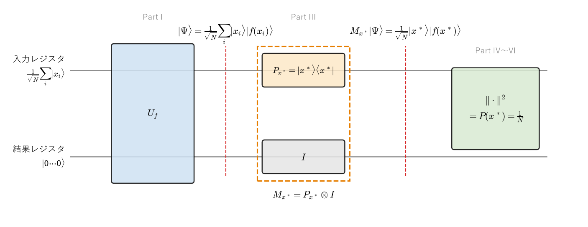
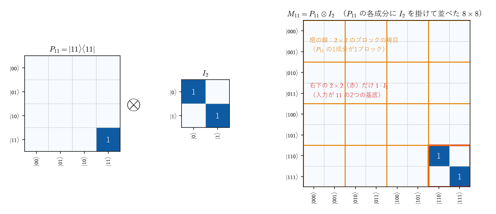
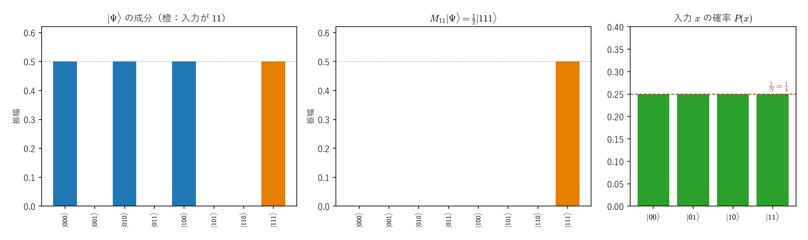
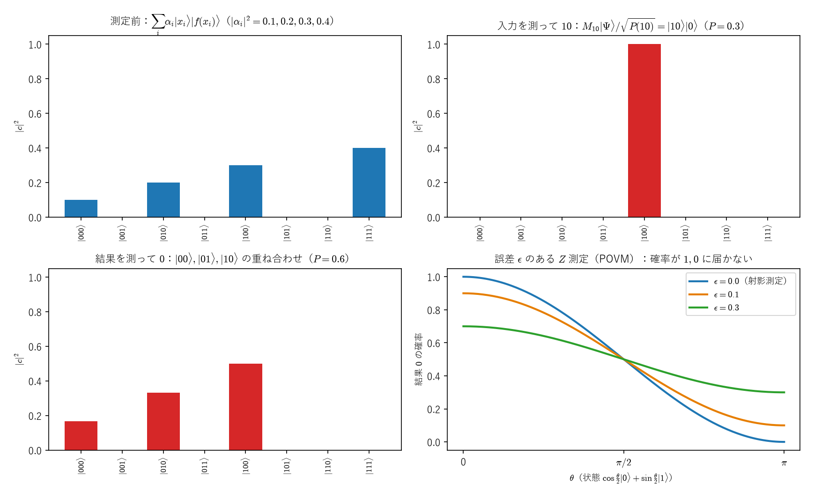
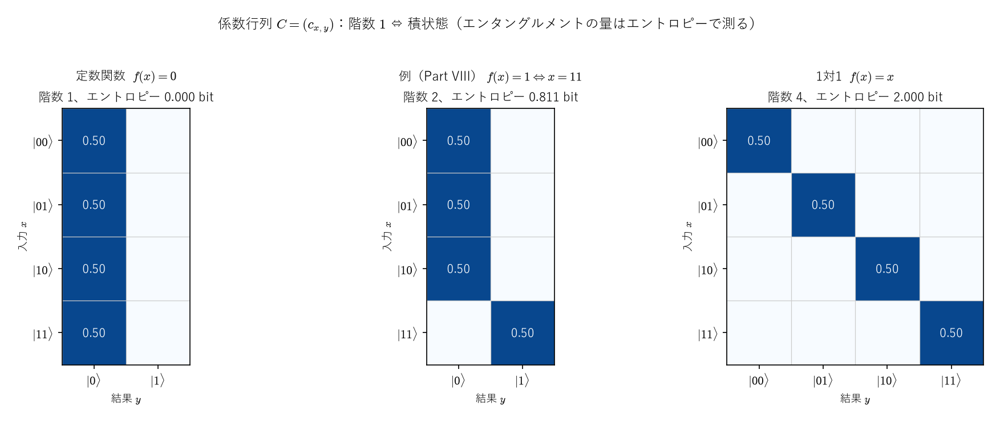
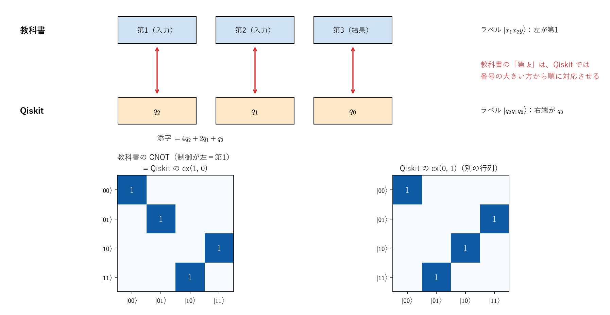

# 射影演算子による測定確率の計算 ―$P(x^\ast)=\big\|(|x^\ast\rangle\langle x^\ast|\otimes I)|\Psi\rangle\big\|^2=\tfrac1N$の導出―

> **作成** 2026-10-17　**更新** 2026-10-24
> 入力レジスタを測ると正解の確率が $\frac1N$ になることを、射影演算子 $P_{x^\ast}\otimes I$ とボルン則から導出する。テンソル積の作用の証明、4候補の数値例、付録（完全な射影測定とPOVM、結果レジスタの測定とエンタングルメント、クロネッカー積の性質とQiskitの並び順、検算の一覧）。

関数を計算する量子回路に、すべての候補の均等な重ね合わせを入力したあと、入力レジスタを測定して正解$x^\ast$が得られる確率が$\tfrac1N$であることを、射影演算子を使って導出します。物理の仮定（ボルン則）を使う箇所と、線形代数だけで導ける箇所を区別しながら進めます。最後に4候補の数値例で確認します。

- **Part I**：何を計算するのか（$|\Psi\rangle$ と、求めたい確率）
- **Part II**：正解の成分だけを取り出す射影演算子 $|x^\ast\rangle\langle x^\ast|$
- **Part III**：なぜ $\otimes I$ が必要なのか。テンソル積の定義と、$(A\otimes B)(|u\rangle\otimes|v\rangle)=A|u\rangle\otimes B|v\rangle$ の証明、3つ以上のテンソル積、どこまで分けられるか、線形性
- **Part IV**：確率は、取り出した成分のノルムの2乗（ボルン則）
- **Part V**〜**VII**：$|\Psi\rangle$ に当てはめる、ノルムの2乗、一般の入力
- **Part VIII**：数値例（4候補・正解1個）
- **付録A**：テンソル積の性質（準備）、完全な射影測定、測定後の状態、POVM
- **付録B**：結果レジスタを測る、係数行列とエンタングルメント
- **付録C**：Qiskit の並び順
- **付録D**：検算の一覧

**関連ファイル**：図は [figures/make_measurement_projection_figures.py](figures/make_measurement_projection_figures.py) で作っていて、各図の値はスクリプトの中で本文の式と照合しています。式と数値の検算は [experiments/measurement_projection/](../../experiments/measurement_projection/README.md)（スクリプトと52件のテスト、Qiskit での確認と、別ノートの部分トレースの検算を含む）。密度行列と完全性関係は[密度行列のノート](../05_量子力学/density_matrix_bracket_notation.md)、ブラケット記法とボルン則は[ブラケット記法のノート](../05_量子力学/bra_ket_notation_path_integral.md)、パウリ行列とブロッホ球は[パウリ行列のノート](../04_群論・代数/pauli_matrices_derivation_and_group.md)、指数関数とトロッター分解は[行列の指数関数のノート](../04_群論・代数/matrix_exponential_commutator_bch_trotter.md)、ノイズと量子チャネルは[ノイズのノート](../05_量子力学/noise_modeling_through_mri.md)にあります。

<a id="toc"></a>

## 目次

<!-- toc:start -->

- [Part I：何を計算するのか](#p1)
- [Part II：正解の成分だけを取り出す演算子|x^\*⟩⟨ x^\*|](#p2)
- [Part III：なぜ⊗ Iが必要なのか](#p3)
  - [1. 全体の状態は2つのレジスタのテンソル積](#p3-1)
  - [2. テンソル積の演算子は、それぞれのレジスタに別々に作用する](#p3-2)
  - [3. M\_x^\*を各項に作用させる](#p3-3)
  - [4. 線形性：和の各項に別々に作用させてよい](#p3-4)
- [Part IV：確率は、取り出した成分のノルムの2乗（ボルン則）](#p4)
  - [1. 一般の状態の展開](#p4-1)
  - [2. 仮定：ボルン則](#p4-2)
  - [3. 入力レジスタだけを測定する場合](#p4-3)
  - [4. 成分を取り出す](#p4-4)
  - [5. テンソル積の内積](#p4-5)
  - [6. ノルムの2乗を計算する](#p4-6)
  - [7. 結論](#p4-7)
- [Part V：|Psi⟩に当てはめる](#p5)
- [Part VI：ノルムの2乗を取る](#p6)
- [Part VII：一般の入力の場合](#p7)
- [Part VIII：数値例：4候補・正解1個](#p8)
  - [1. 設定](#p8-1)
  - [2. 列ベクトルで書く](#p8-2)
  - [3. 射影演算子を行列で書く](#p8-3)
  - [4. 状態に作用させる（Part Vの確認）](#p8-4)
  - [5. ノルムの2乗（Part VIの確認）](#p8-5)
  - [6. 他の候補](#p8-6)
- [まとめ](#summary)
- [付録A：完全な射影測定、測定後の状態、POVM](#appA)
  - [A-1. 準備：テンソル積の性質](#A-1)
  - [A-2. 完全性：確率の和が1になる](#A-2)
  - [A-3. 測定後の状態（射影仮説）](#A-3)
  - [A-4. 同じ測定をもう一度すると](#A-4)
  - [A-5. 一般の測定と POVM](#A-5)
- [付録B：結果レジスタを測る、係数行列とエンタングルメント](#appB)
  - [B-1. 係数行列](#B-1)
  - [B-2. 結果レジスタを測る](#B-2)
  - [B-3. 積状態の判定：係数行列の階数](#B-3)
- [付録C：Qiskit の並び順](#appC)
  - [C-1. Qiskit の並び順](#C-1)
- [付録D：検算の一覧](#appD)

<!-- toc:end -->

---

## 記法と約束

このノートでは、**記号の宣言**（この節）、**演算の定義**（初めて使う箇所で定義）、**性質の証明**（必要な箇所で証明）を区別します。この節で宣言した記号は、以降は説明なしで使います。

### 共通の記法

| 記法 | 意味 |
|---|---|
| $\mathbb N,\ \mathbb R,\ \mathbb C$ | 自然数、実数、複素数の集合 |
| $\mathcal H$ | 有限次元の複素ヒルベルト空間（内積を持つ複素ベクトル空間） |
| $\dim\mathcal H=m$ | $\mathcal H$の次元が$m$ |
| $\lvert\psi\rangle\in\mathcal H$ | $\mathcal H$に属するケットベクトル |
| $\langle\psi\rvert$ | $\lvert\psi\rangle$に対応するブラ（成分を複素共役にして横に並べたもの） |
| $\langle\phi\vert\psi\rangle$ | 内積。成分で$\sum_k\phi_k^\ast\psi_k$ |
| $\lVert\psi\rVert$ | ノルム（長さ）。$\lVert\psi\rVert^2:=\langle\psi\vert\psi\rangle$ |
| $\mathcal L(\mathcal H)$ | $\mathcal H$上の線形演算子（$\mathcal H\to\mathcal H$の線形写像）全体 |
| $z^\ast$、$A^\ast$ | 複素数$z$の複素共役。ベクトル・行列では、成分ごとに複素共役を取ったもの（複素共役はすべてこの記法で書く。$x^\ast$（正解）とは別の意味） |
| $P(x)$、$P_x$ | $P(x)$ は入力が $x$ になる**確率**（数）、$P_x=\lvert x\rangle\langle x\rvert$ は**射影演算子**（行列）。同じ文字だが、別のもの |
| $A^\dagger$ | $A$の随伴演算子（行列では、転置して複素共役を取ったもの） |
| $I_{\mathcal H}$、$I_m$ | $\mathcal H$上の恒等演算子、$m\times m$の単位行列 |
| $\otimes$ | テンソル積（Part III §2で定義） |
| $\cong$ | 同型（基底を対応させることで同一視できる） |
| $\delta_{ij}$ | クロネッカーのデルタ（$i=j$なら$1$、それ以外は$0$） |

**基底を固定した表示**：有限次元のヒルベルト空間$\mathcal H$で正規直交基底（量子計算では計算基底）を1つ固定すると、ベクトルは成分を並べた列ベクトルで、演算子は行列で表せます。このノートでは、この意味で$\mathcal H=\mathbb C^m$、$\mathcal L(\mathcal H)=\mathbb C^{m\times m}$（$m\times m$の複素行列全体）と書きます。有限次元なので、すべての線形演算子は行列で表せます（無限次元の空間では、$\mathcal L(\mathcal H)$を有界な線形演算子に限る、などの条件が文献によって付きます）。

**書体の使い分け**：$\mathbb C$のような黒板太字は数の集合、$\mathcal H$のような筆記体は空間、$|\psi\rangle$のようなケットはベクトル、$A$のような斜体の大文字は演算子（行列）、$\mathrm{CNOT}$のような立体の文字は名前の付いたゲートや群（例：$\mathrm{SU}(2)$）、$\mathfrak{su}(2)$のようなフラクトゥール体はリー代数を表します。

### 量子計算の約束

$q$量子ビットのレジスタの状態空間は

$$
\mathcal H_q:=(\mathbb C^2)^{\otimes q}\cong\mathbb C^{2^q}
$$

で、量子状態は規格化されたベクトル$|\psi\rangle\in\mathcal H_q$、$\langle\psi|\psi\rangle=1$です。計算基底$|j\rangle$（$j=0,\dots,2^q-1$）は、$j$を2進数で書いたビット列の順に並べます（例：2量子ビットでは$|00\rangle,|01\rangle,|10\rangle,|11\rangle$）。$|ab\rangle$は$|a\rangle\otimes|b\rangle$の略記で、$|u\rangle|v\rangle$も$|u\rangle\otimes|v\rangle$の略記です。量子ビットの個数$q$と状態空間の次元$2^q$は別のものです（Part III §2-f-5）。

### このノートで使う記号

- $x_1,\dots,x_N$：入力の候補となるビット列。すべて異なるとします。$|x_i\rangle$はその計算基底ベクトルで、正規直交：$\langle x_i|x_j\rangle=\delta_{ij}$。
- $x^\ast$：正解。候補$x_1,\dots,x_N$の中にちょうど1つ含まれるとします。$\delta_{x^\ast,x_i}$は$x_i=x^\ast$なら$1$、それ以外は$0$です。
- $f(x)$：候補$x$に対して計算する関数の値（ビット列）。$|f(x)\rangle$はその計算基底ベクトルです。
- **入力レジスタ**：$x$を入れる量子ビットの組。**結果レジスタ**：$f(x)$を書き込む量子ビットの組。
- $I$：結果レジスタ上の恒等演算子。
- **レジスタの次元**：入力レジスタは $q_A$ 量子ビット、結果レジスタは $q_B$ 量子ビットで、状態空間は $\mathcal H_A=(\mathbb C^2)^{\otimes q_A}\cong\mathbb C^{d_A}$、$\mathcal H_B=(\mathbb C^2)^{\otimes q_B}\cong\mathbb C^{d_B}$（$d_A=2^{q_A}$、$d_B=2^{q_B}$）です。全体は $\mathcal H_A\otimes\mathcal H_B\cong\mathbb C^{d_Ad_B}$ です。$|x_i\rangle\in\mathcal H_A$、$|f(x)\rangle\in\mathcal H_B$ です。
- **候補の個数**：$N$ 個の候補は、$d_A$ 個ある入力レジスタの基底のうちの $N$ 個です（$N\le d_A$）。Part VIII の例は $N=d_A=4$ です。入力レジスタの全基底を使う場合（$N=d_A$）、付録A・付録B と部分トレースのノートでは、入力レジスタの次元 $d_A$ を $m$、結果レジスタの次元 $d_B$ を $n$ と書きます（付録A-1 の記号です）。
- **演算子の大きさ**：$P_{x^\ast}\in\mathbb C^{d_A\times d_A}$（Part II）、$I\in\mathbb C^{d_B\times d_B}$、$M_{x^\ast}=P_{x^\ast}\otimes I\in\mathbb C^{d_Ad_B\times d_Ad_B}$（Part III §1）です。

---

<a id="p1"></a>

# Part I：何を計算するのか

関数を計算する回路$U_f$は、結果レジスタを$|0\cdots0\rangle$に初期化しておくと

$$
U_f\,|x\rangle|0\cdots0\rangle=|x\rangle|f(x)\rangle
$$

と働く回路です（入力$x$を残したまま、結果レジスタに$f(x)$を書き込みます）。入力レジスタをすべての候補の均等な重ね合わせ$\frac1{\sqrt N}\sum_i|x_i\rangle$にして$U_f$をかけると、$U_f$は線形なので和の各項に別々に作用し：

$$
|\Psi\rangle:=\frac1{\sqrt N}\sum_{i=1}^N|x_i\rangle|f(x_i)\rangle
$$

となります。これは入力レジスタと結果レジスタを合わせた量子状態です（$|x_i\rangle\in\mathcal H_A$、$|f(x_i)\rangle\in\mathcal H_B$、$|\Psi\rangle\in\mathcal H_A\otimes\mathcal H_B$。次元は「記法と約束」の宣言のとおり）。

**求めたいもの**：この状態で入力レジスタを測定したとき、正解$x^\ast$が得られる確率$P(x^\ast)$。

**方針**：正解に対応する状態の成分だけを取り出し（Part II・Part III）、その大きさから確率を求めます（Part IV〜Part VI）。



*回路の流れ。$U_f$ で $|\Psi\rangle$ を作り、結果レジスタには何もしない恒等演算子 $I$ を組み合わせた $M_{x^\ast}=P_{x^\ast}\otimes I$ で正解の成分を取り出し、ノルムの2乗を取ると確率 $P(x^\ast)$ が得られる。図を描くときに、$N=4$ の例で $P=\frac14$、$M_{x^\ast}|\Psi\rangle=\frac12|111\rangle$ を確かめています。*

---

<a id="p2"></a>

# Part II：正解の成分だけを取り出す演算子$|x^\ast\rangle\langle x^\ast|$

**記法**：正解$x^\ast$についての演算子を

$$
P_{x^\ast}:=|x^\ast\rangle\langle x^\ast|
$$

と定義します。これは、正解$x^\ast$の方向（1次元の部分空間）への**射影演算子**です。$|x^\ast\rangle\in\mathcal H_A=\mathbb C^{d_A}$（縦ベクトル）、$\langle x^\ast|$ は横ベクトルなので、$P_{x^\ast}$ は $d_A\times d_A$ の行列です。

**作用**：候補の基底ベクトル$|x_i\rangle$に作用させると、ブラとケットの積$\langle x^\ast|x_i\rangle$が数になるので：

$$
P_{x^\ast}|x_i\rangle=|x^\ast\rangle\langle x^\ast|x_i\rangle=\delta_{x^\ast,x_i}\,|x^\ast\rangle
$$

（最後は正規直交性$\langle x^\ast|x_i\rangle=\delta_{x^\ast,x_i}$です。）したがって：

$$
P_{x^\ast}|x_i\rangle=\begin{cases}|x^\ast\rangle&(x_i=x^\ast)\\0&(x_i\ne x^\ast)\end{cases}
$$

**$P_{x^\ast}$は、正解の基底成分だけを残し、それ以外をゼロにする演算子です。** これは新しい仮定ではなく、計算基底の正規直交性から直接導かれる性質です。

**射影演算子の性質**：

- $P_{x^\ast}^2=P_{x^\ast}$：$P_{x^\ast}^2=|x^\ast\rangle\langle x^\ast|x^\ast\rangle\langle x^\ast|=|x^\ast\rangle\cdot1\cdot\langle x^\ast|=P_{x^\ast}$（一度取り出したものをもう一度取り出しても変わらない）。
- $P_{x^\ast}^\dagger=P_{x^\ast}$：$(|a\rangle\langle b|)^\dagger=|b\rangle\langle a|$なので、$a=b=x^\ast$では自分自身です。

---

<a id="p3"></a>

# Part III：なぜ$\otimes I$が必要なのか

<!-- part-toc:start -->

**この Part の内容**

- [1. 全体の状態は2つのレジスタのテンソル積](#p3-1)
- [2. テンソル積の演算子は、それぞれのレジスタに別々に作用する](#p3-2)
  - [2-a. 設定：2つのレジスタ](#p3-2a)
  - [2-b. 複合系の状態空間](#p3-2b)
  - [2-c. ベクトルのテンソル積の定義](#p3-2c)
  - [2-d. 行列のテンソル積の定義](#p3-2d)
  - [2-e. (III-1)の証明](#p3-2e)
  - [2-f. 3つ以上のテンソル積](#p3-2f)
  - [2-g. どこまで分けられるか：分解の判定基準](#p3-2g)
- [3. M\_x^\*を各項に作用させる](#p3-3)
- [4. 線形性：和の各項に別々に作用させてよい](#p3-4)

<!-- part-toc:end -->

<a id="p3-1"></a>

## 1. 全体の状態は2つのレジスタのテンソル積

$|\Psi\rangle$の各項は$|x_i\rangle\otimes|f(x_i)\rangle$という、入力レジスタと結果レジスタのテンソル積です。$P_{x^\ast}$は入力レジスタの上の演算子なので、そのままでは全体の状態に作用させられません（例えば入力が2量子ビット、結果が1量子ビットなら、$P_{x^\ast}$は$4\times4$、全体の状態は8次元です）。

測定したいのは入力レジスタだけで、結果レジスタには何もしたくありません。そこで、結果レジスタには恒等演算子$I$を組み合わせて：

$$
M_{x^\ast}:=P_{x^\ast}\otimes I=|x^\ast\rangle\langle x^\ast|\otimes I
$$

と定義します。

**次元**：$P_{x^\ast}$ は $d_A\times d_A$、$I$ は $d_B\times d_B$ の単位行列なので、$M_{x^\ast}$ は $d_Ad_B\times d_Ad_B$ の行列で、全体の状態（$d_Ad_B$ 次元）に作用します。Part III §2-a の記号では $A=P_{x^\ast}$（$m=d_A$）、$B=I$（$n=d_B$）にあたります。

<a id="p3-2"></a>

## 2. テンソル積の演算子は、それぞれのレジスタに別々に作用する

この節の目標は、次の式(III-1)を証明することです：

$$
(A\otimes B)\big(|u\rangle\otimes|v\rangle\big)=A|u\rangle\otimes B|v\rangle\tag{III-1}
$$

Part III §2-a〜Part III §2-dで記号とテンソル積を定義し、Part III §2-eで(III-1)を証明します。Part III §2-fでは3つ以上のテンソル積に広げ、Part III §2-gでは、どこまで分けて計算できるかを扱います。

<a id="p3-2a"></a>

### 2-a. 設定：2つのレジスタ

2つのレジスタの状態空間と、そこに属するベクトル、そこに作用する演算子を次のように宣言します：

$$
\mathcal H_A=\mathbb C^m,\qquad\mathcal H_B=\mathbb C^n,\qquad|u\rangle\in\mathcal H_A,\qquad|v\rangle\in\mathcal H_B,\qquad A\in\mathcal L(\mathcal H_A),\qquad B\in\mathcal L(\mathcal H_B)
$$

基底を固定すると$A\in\mathbb C^{m\times m}$、$B\in\mathbb C^{n\times n}$です。$A,B$は一般の線形演算子で、ユニタリである必要はありません（量子ゲートも射影演算子も、この議論に含まれます）。

**記法**：$\mathcal H_A$の計算基底を$|k\rangle_A$（$k=0,\dots,m-1$）、$\mathcal H_B$の計算基底を$|l\rangle_B$（$l=0,\dots,n-1$）と書き、それぞれ正規直交です：${}_A\langle k|k'\rangle_A=\delta_{kk'}$、${}_B\langle l|l'\rangle_B=\delta_{ll'}$。ベクトルを基底で展開して、その係数（成分）を$u_k,v_l\in\mathbb C$と書きます：

$$
|u\rangle=\sum_{k=0}^{m-1}u_k|k\rangle_A,\qquad|v\rangle=\sum_{l=0}^{n-1}v_l|l\rangle_B
$$

演算子の行列成分は$A_{kk'}$、$B_{ll'}$と書きます。

<a id="p3-2b"></a>

### 2-b. 複合系の状態空間

2つのレジスタを合わせた系の状態空間は、テンソル積で

$$
\mathcal H_{AB}:=\mathcal H_A\otimes\mathcal H_B\cong\mathbb C^{mn}
$$

と表されます（Part III §2-cで定義します）。$m$次元と$n$次元の空間から、$mn$次元の空間ができます。対応関係をまとめると：

| 対象 | 属する空間・写像 | 次元・大きさ |
|---|---|---|
| $\lvert u\rangle$ | $\mathcal H_A$ | $m$ |
| $\lvert v\rangle$ | $\mathcal H_B$ | $n$ |
| $\lvert u\rangle\otimes\lvert v\rangle$ | $\mathcal H_{AB}$ | $mn$ |
| $A$ | $\mathcal H_A\to\mathcal H_A$ | $m\times m$ |
| $B$ | $\mathcal H_B\to\mathcal H_B$ | $n\times n$ |
| $A\otimes B$ | $\mathcal H_{AB}\to\mathcal H_{AB}$ | $mn\times mn$ |

<a id="p3-2c"></a>

### 2-c. ベクトルのテンソル積の定義

**記法**：複合系の計算基底を$|k,l\rangle:=|k\rangle_A\otimes|l\rangle_B$と書きます。

テンソル積は、各因子について線形（**双線形**）であるように定義されます：

$$
(a|u_1\rangle+b|u_2\rangle)\otimes|v\rangle=a\,|u_1\rangle\otimes|v\rangle+b\,|u_2\rangle\otimes|v\rangle,\qquad|u\rangle\otimes(a|v_1\rangle+b|v_2\rangle)=a\,|u\rangle\otimes|v_1\rangle+b\,|u\rangle\otimes|v_2\rangle
$$

（これはテンソル積の定義の一部で、(III-1)のために新しく仮定したものではありません。）双線形性を左の因子、右の因子の順に使うと：

$$
|u\rangle\otimes|v\rangle=\Big(\sum_ku_k|k\rangle_A\Big)\otimes\Big(\sum_lv_l|l\rangle_B\Big)=\sum_ku_k\Big(|k\rangle_A\otimes\sum_lv_l|l\rangle_B\Big)=\sum_k\sum_lu_kv_l\,|k,l\rangle
$$

したがって、基底$|k,l\rangle$に対応する成分は：

$$
\boxed{\big(|u\rangle\otimes|v\rangle\big)_{(k,l)}=u_k\,v_l}\qquad(0\le k<m,\ 0\le l<n)
$$

これが「左の各成分に、右のベクトル全体を掛けて並べる（総当たりで成分同士の積を作る）」ことの式での表現です。

**成分の並べ方**：成分の番号を組$(k,l)$で表し、$(0,0),(0,1),\dots,(0,n-1),(1,0),\dots,(m-1,n-1)$の順（左の番号$k$を固定して、右の番号$l$を先に進める順）に並べます。普通の列ベクトルの番号$\alpha$（0から数える）との対応は：

$$
\alpha=kn+l
$$

です。$m=n=2$なら、$(0,0),(0,1),(1,0),(1,1)$がそれぞれ$\alpha=0,1,2,3$です。

**例**：$|0\rangle=(1,0)^T$、$|1\rangle=(0,1)^T$として、$|u\rangle=|1\rangle$（$u_0=0,u_1=1$）、$|v\rangle=|0\rangle$（$v_0=1,v_1=0$）とすると、成分は順に$u_0v_0=0$、$u_0v_1=0$、$u_1v_0=1$、$u_1v_1=0$なので：

$$
|1\rangle\otimes|0\rangle=(0,0,1,0)^T=|10\rangle
$$

**注意**：$|uv\rangle:=|u\rangle\otimes|v\rangle$という略記は、2つのレジスタの状態を並べたものです。複合系の一般の状態が、必ずこのような1つのテンソル積の形に書けるという意味ではありません（Part III §2-f-5）。

<a id="p3-2d"></a>

### 2-d. 行列のテンソル積の定義

$A\otimes B$は$mn\times mn$の行列で、行の番号を組$(k,l)$、列の番号を組$(k',l')$で表して、成分を

$$
\boxed{\big(A\otimes B\big)_{(k,l),(k',l')}:=A_{kk'}\,B_{ll'}}
$$

と定義します。これは、$A$の各成分に行列$B$全体を掛けて、ブロック状に並べることにあたります。$A,B$がともに$2\times2$なら：

$$
A\otimes B=\begin{pmatrix}A_{00}B&A_{01}B\\A_{10}B&A_{11}B\end{pmatrix}=\begin{pmatrix}A_{00}B_{00}&A_{00}B_{01}&A_{01}B_{00}&A_{01}B_{01}\\A_{00}B_{10}&A_{00}B_{11}&A_{01}B_{10}&A_{01}B_{11}\\A_{10}B_{00}&A_{10}B_{01}&A_{11}B_{00}&A_{11}B_{01}\\A_{10}B_{10}&A_{10}B_{11}&A_{11}B_{10}&A_{11}B_{11}\end{pmatrix}
$$

例えば、行$(0,1)$・列$(1,0)$の成分は$A_{01}B_{10}$で、成分を1から数える普通の行列表示では第2行・第3列（$a_{12}b_{21}$）にあたります。

<a id="p3-2e"></a>

### 2-e. (III-1)の証明

**証明したい式**：Part III §2の冒頭で掲げた

$$
(A\otimes B)\big(|u\rangle\otimes|v\rangle\big)=A|u\rangle\otimes B|v\rangle
$$

を、Part III §2-cとPart III §2-dの定義だけを使って証明します。

**方針**：2つのベクトルが等しいとは、次元が同じで、すべての成分が等しいことです。左辺は$mn\times mn$の行列$A\otimes B$と$mn$次元のベクトル$|u\rangle\otimes|v\rangle$の積なので$mn$次元、右辺は$m$次元のベクトル$A|u\rangle$と$n$次元のベクトル$B|v\rangle$のテンソル積なので$mn$次元で、次元は同じです。そこで、**右辺の第$(k,l)$成分と左辺の第$(k,l)$成分を別々に計算し、すべての$(k,l)$で一致することを示します。**

**右辺の第$(k,l)$成分**：Part III §2-cのベクトルのテンソル積の定義を、$A|u\rangle$と$B|v\rangle$という2つのベクトルに当てはめると、第$(k,l)$成分は「$A|u\rangle$の第$k$成分」と「$B|v\rangle$の第$l$成分」の積です。それぞれを行列とベクトルの積の定義（第$k$行と、ベクトルの成分を掛けて、すべての列について足す）で書くと：

$$
\Big[A|u\rangle\otimes B|v\rangle\Big]_{(k,l)}=(A|u\rangle)_k\,(B|v\rangle)_l=\Big(\sum_{k'=0}^{m-1}A_{kk'}u_{k'}\Big)\Big(\sum_{l'=0}^{n-1}B_{ll'}v_{l'}\Big)\tag{R}
$$

**左辺の第$(k,l)$成分**：

*ステップ1（行列とベクトルの積の定義）*：行列$M$と列ベクトル$\mathbf z$の積の第$\alpha$成分は$(M\mathbf z)_\alpha=\sum_\beta M_{\alpha\beta}z_\beta$です。今は$M=A\otimes B$、$\mathbf z=|u\rangle\otimes|v\rangle$で、行の番号$\alpha$は組$(k,l)$、列の番号$\beta$は組$(k',l')$なので、「すべての列について足す」は「すべての$k'$とすべての$l'$について足す」ことです：

$$
\Big[(A\otimes B)\big(|u\rangle\otimes|v\rangle\big)\Big]_{(k,l)}=\sum_{k'=0}^{m-1}\sum_{l'=0}^{n-1}\big(A\otimes B\big)_{(k,l),(k',l')}\,\big(|u\rangle\otimes|v\rangle\big)_{(k',l')}
$$

*ステップ2（定義を代入）*：Part III §2-dの$(A\otimes B)_{(k,l),(k',l')}=A_{kk'}B_{ll'}$と、Part III §2-cの$(|u\rangle\otimes|v\rangle)_{(k',l')}=u_{k'}v_{l'}$を代入します：

$$
=\sum_{k'=0}^{m-1}\sum_{l'=0}^{n-1}A_{kk'}B_{ll'}\,u_{k'}v_{l'}
$$

*ステップ3（2つの和に分ける）*：各成分は複素数なので、掛け算の順序を入れ替えて$\big(A_{kk'}u_{k'}\big)\big(B_{ll'}v_{l'}\big)$とします。前の括弧は$k'$にだけ依存し$l'$には依存せず、後の括弧は$l'$にだけ依存し$k'$には依存しません。そのため、分配法則を逆向きに使って：

$$
\Big[(A\otimes B)\big(|u\rangle\otimes|v\rangle\big)\Big]_{(k,l)}=\Big(\sum_{k'=0}^{m-1}A_{kk'}u_{k'}\Big)\Big(\sum_{l'=0}^{n-1}B_{ll'}v_{l'}\Big)\tag{L}
$$

（分配法則の向きは、例えば$(a_0+a_1)(b_0+b_1)=a_0b_0+a_0b_1+a_1b_0+a_1b_1$です。右辺の「すべての組の積の和」は、左辺の「和と和の積」に戻せます。）

**比較**：(L)と(R)の右辺は同じ式です。したがって、すべての$(k,l)$（$0\le k<m$、$0\le l<n$）について、左辺の第$(k,l)$成分と右辺の第$(k,l)$成分が等しくなります。

**結論**：次元が同じで、すべての成分が等しいので、

$$
\boxed{(A\otimes B)\big(|u\rangle\otimes|v\rangle\big)=A|u\rangle\otimes B|v\rangle}
$$

が成り立ちます。これで(III-1)が証明されました。

**補足**：ステップ1〜3（左辺の計算）だけを見ると、「テンソル積の行列とベクトルの積を、成分で書き直した」計算に見えます。それが右辺の成分(R)と一致することを確かめるところまでが、(III-1)の証明です。この証明は線形代数だけで、ボルン則のような量子力学の公理は使っていません。具体的な数値を入れて確かめると成り立つのは、ステップ3の「独立な2つの和が積に分かれる」ことを、各成分で見ていることにあたります。

**数値例**：$A=X=\begin{pmatrix}0&1\\1&0\end{pmatrix}$、$B=Z=\begin{pmatrix}1&0\\0&-1\end{pmatrix}$、$|u\rangle=(1,2)^T$、$|v\rangle=(3,4)^T$ で (III-1) を確かめます。$A\otimes B$ は、$A$ の各成分に $B$ を掛けて並べたブロック行列（Part III §2-d）で

$$
A\otimes B=\begin{pmatrix}0\cdot Z&1\cdot Z\\1\cdot Z&0\cdot Z\end{pmatrix}=\begin{pmatrix}0&0&1&0\\0&0&0&-1\\1&0&0&0\\0&-1&0&0\end{pmatrix}
$$

です。左辺は、$|u\rangle\otimes|v\rangle=(1\cdot3,\ 1\cdot4,\ 2\cdot3,\ 2\cdot4)^T=(3,4,6,8)^T$ に $A\otimes B$ を掛けて

$$
(A\otimes B)\big(|u\rangle\otimes|v\rangle\big)=(6,\ -8,\ 3,\ -4)^T
$$

です。右辺は、$A|u\rangle=(2,1)^T$、$B|v\rangle=(3,-4)^T$ から

$$
A|u\rangle\otimes B|v\rangle=(2\cdot3,\ 2\cdot(-4),\ 1\cdot3,\ 1\cdot(-4))^T=(6,\ -8,\ 3,\ -4)^T
$$

で、両辺が一致します。

<a id="p3-2f"></a>

### 2-f. 3つ以上のテンソル積

#### 2-f-1. 設定

3つのレジスタの状態空間を$\mathbb C^m$、$\mathbb C^n$、$\mathbb C^s$とし：

$$
|u\rangle\in\mathbb C^m,\quad|v\rangle\in\mathbb C^n,\quad|w\rangle\in\mathbb C^s,\qquad A\in\mathbb C^{m\times m},\quad B\in\mathbb C^{n\times n},\quad C\in\mathbb C^{s\times s}
$$

とします。合わせた系の状態空間は$\mathbb C^m\otimes\mathbb C^n\otimes\mathbb C^s\cong\mathbb C^{mns}$で、$A\otimes B\otimes C$は$mns\times mns$の行列です。成分の添字は$u_k$、$v_l$、$w_r$（$0\le k<m$、$0\le l<n$、$0\le r<s$）と書きます。

#### 2-f-2. 成分による定義

Part III §2-c、Part III §2-dと同じく、番号の3つの組で：

$$
\big(|u\rangle\otimes|v\rangle\otimes|w\rangle\big)_{(k,l,r)}:=u_kv_lw_r,\qquad\big(A\otimes B\otimes C\big)_{(k,l,r),(k',l',r')}:=A_{kk'}B_{ll'}C_{rr'}
$$

#### 2-f-3. 作用の式と証明

$$
\boxed{(A\otimes B\otimes C)\big(|u\rangle\otimes|v\rangle\otimes|w\rangle\big)=A|u\rangle\otimes B|v\rangle\otimes C|w\rangle}
$$

Part III §2-eと同じ方針で、左辺と右辺の第$(k,l,r)$成分を比べます。まず左辺の成分を計算します。ステップ1・2から：

$$
\sum_{k'}\sum_{l'}\sum_{r'}A_{kk'}B_{ll'}C_{rr'}\,u_{k'}v_{l'}w_{r'}
$$

掛け算を$\big(A_{kk'}u_{k'}\big)\big(B_{ll'}v_{l'}\big)\big(C_{rr'}w_{r'}\big)$と並べ替えると、3つの括弧はそれぞれ別の添字にだけ依存するので、3つの和の積に分かれます：

$$
=\Big(\sum_{k'}A_{kk'}u_{k'}\Big)\Big(\sum_{l'}B_{ll'}v_{l'}\Big)\Big(\sum_{r'}C_{rr'}w_{r'}\Big)=(A|u\rangle)_k\,(B|v\rangle)_l\,(C|w\rangle)_r
$$

一方、右辺の第$(k,l,r)$成分は、Part III §2-f-2のベクトルのテンソル積の定義を$A|u\rangle$、$B|v\rangle$、$C|w\rangle$に当てはめて$(A|u\rangle)_k\,(B|v\rangle)_l\,(C|w\rangle)_r$です。左辺と右辺の成分がすべての$(k,l,r)$で一致し、次元（$mns$）も同じなので、式が証明されました。4つ以上の場合も、和が個数分に分かれるだけで、同じ証明が成り立ちます。

#### 2-f-4. いくつかの量子ビットを1つのレジスタとしてまとめる

**括弧の位置**：成分で見ると$(u_kv_l)w_r=u_k(v_lw_r)$なので、$\big(|u\rangle\otimes|v\rangle\big)\otimes|w\rangle$と$|u\rangle\otimes\big(|v\rangle\otimes|w\rangle\big)$は同じ成分を持ちます。厳密には2つは自然な同型で対応する空間の元ですが、量子計算では同一視し、括弧を省略します。

**まとめて見る**：3つの1量子ビット$|u\rangle,|v\rangle,|w\rangle\in\mathbb C^2$について、**記法**：$|z\rangle:=|v\rangle\otimes|w\rangle\in\mathbb C^4$とおくと：

$$
|u\rangle\otimes|v\rangle\otimes|w\rangle=|u\rangle\otimes|z\rangle
$$

で、3量子ビットを「1量子ビットのレジスタ」と「2量子ビットのレジスタ」の2つのまとまりとして扱えます。演算子を$A\in\mathbb C^{2\times2}$、$B\in\mathbb C^{4\times4}$とすると$A\otimes B\in\mathbb C^{8\times8}$で、(III-1)から：

$$
(A\otimes B)\big(|u\rangle\otimes|v\rangle\otimes|w\rangle\big)=(A\otimes B)\big(|u\rangle\otimes|z\rangle\big)=A|u\rangle\otimes B|z\rangle=A|u\rangle\otimes B\big(|v\rangle\otimes|w\rangle\big)
$$

**前提**：行列の大きさと、作用させるベクトルの次元が一致している必要があります。$A$は2次元の$|u\rangle$に、$B$は4次元の$|v\rangle\otimes|w\rangle$に作用します。この先の計算は$B$の形で決まります（Part III §2-g）。

#### 2-f-5. 量子ビット数と状態空間の次元、積の形でない状態

1量子ビットの状態空間は$\mathbb C^2$、2量子ビットは$\mathbb C^2\otimes\mathbb C^2\cong\mathbb C^4$、3量子ビットは$\mathbb C^8$で、一般に$q$量子ビットでは$(\mathbb C^2)^{\otimes q}\cong\mathbb C^{2^q}$です：

| 量子ビット数 | 状態空間 | 次元 |
|---|---|---|
| 1 | $\mathbb C^2$ | 2 |
| 2 | $\mathbb C^4$ | 4 |
| 3 | $\mathbb C^8$ | 8 |
| $q$ | $\mathbb C^{2^q}$ | $2^q$ |

量子ビットが1つ増えるごとに、次元は2倍になります。量子ビットの個数と状態ベクトルの次元は別のもので、例えば2量子ビットの状態は4次元ベクトルです。

**積の形でない状態**：$q$量子ビットの一般の状態$|\psi\rangle=\sum_{j=0}^{2^q-1}\alpha_j|j\rangle$（$\sum_j|\alpha_j|^2=1$）は、各量子ビットの状態の1つのテンソル積に書けるとは限りません。例えば

$$
|\Phi^+\rangle:=\tfrac1{\sqrt2}\big(|00\rangle+|11\rangle\big)
$$

は、どんな1量子ビットの状態$|u\rangle,|v\rangle$を選んでも$|u\rangle\otimes|v\rangle$には等しくなりません。実際、$|u\rangle\otimes|v\rangle$の成分はPart III §2-cから$(u_0v_0,u_0v_1,u_1v_0,u_1v_1)$で、$|\Phi^+\rangle$の成分$(\tfrac1{\sqrt2},0,0,\tfrac1{\sqrt2})$と比べると、$u_0v_0\ne0$、$u_1v_1\ne0$から$u_0,v_1\ne0$なので$u_0v_1\ne0$となり、第2成分が$0$であることと矛盾します。このような状態を**エンタングルした状態**と呼びます。

**それでも$A\otimes B$は作用できる**：(III-1)は積の形の状態についての式ですが、一般の状態は積の形の状態（例えば基底$|j\rangle$）の和なので、線形性（Part III §4）で各項に(III-1)を使えます：

$$
(A\otimes B)|\Phi^+\rangle=\tfrac1{\sqrt2}\big((A\otimes B)|00\rangle+(A\otimes B)|11\rangle\big)=\tfrac1{\sqrt2}\big(A|0\rangle\otimes B|0\rangle+A|1\rangle\otimes B|1\rangle\big)
$$

#### 2-f-6. $n$個への一般化

**記号**：$n$個のテンソル積を、総積$\prod$にならって次のように書きます：

$$
\bigotimes_{i=1}^nA_i:=A_1\otimes A_2\otimes\cdots\otimes A_n,\qquad\bigotimes_{i=1}^n|u_i\rangle:=|u_1\rangle\otimes|u_2\rangle\otimes\cdots\otimes|u_n\rangle
$$

同じものを$n$個並べる場合は$V^{\otimes n}$と書きます（$V$はベクトル空間や行列などの、並べる対象です。記法と約束の$(\mathbb C^2)^{\otimes q}$がその例です）。行列のテンソル積は**クロネッカー積**とも呼ばれます。

**設定**：$|u_i\rangle\in\mathbb C^{d_i}$、$A_i\in\mathbb C^{d_i\times d_i}$（$i=1,\dots,n$）とします。**記法**：成分の番号の組を$\mathbf k:=(k_1,\dots,k_n)$（$0\le k_i<d_i$）と書き、$\mathbf k'=(k_1',\dots,k_n')$も同様とします。

**成分による定義**：Part III §2-c、Part III §2-d、Part III §2-f-2を$n$個に広げて：

$$
\Big(\bigotimes_{i=1}^n|u_i\rangle\Big)_{\mathbf k}:=\prod_{i=1}^n(u_i)_{k_i},\qquad\Big(\bigotimes_{i=1}^nA_i\Big)_{\mathbf k,\mathbf k'}:=\prod_{i=1}^n(A_i)_{k_ik_i'}
$$

**テンソル積の成分は、各因子の成分の普通の数の総積**です。「総当たりで成分同士を掛ける」ことが、$\prod$でそのまま書けます。成分の番号の組は$\mathbf k$の取り方の数だけあるので、次元は$\prod_{i=1}^nd_i$です（$q$量子ビットなら$2^q$）。

**補題（積の和は和の積）**：$a_1,\dots,a_n$を、それぞれ1つの添字の関数とします（$a_i$は添字$k_i'$の関数）。このとき：

$$
\sum_{k_1'}\sum_{k_2'}\cdots\sum_{k_n'}\ \prod_{i=1}^na_i(k_i')=\prod_{i=1}^n\Big(\sum_{k_i'}a_i(k_i')\Big)\tag{L$_n$}
$$

右辺の$\sum_{k_i'}a_i(k_i')$は、$a_i$の値をすべての添字について足した**1つの数**です。和の添字は「すべての値について足す」ための目印なので、どの文字で書いても同じ数を表しますが、ここでは文字を付け替えずに済むよう、左辺と同じ$k_i'$のまま書いています。

*証明*（$n$についての数学的帰納法）：次の2つを示します。

**(i) $n=1$のとき**：(L$_1$)の左辺は$\sum_{k_1'}a_1(k_1')$、右辺も$\sum_{k_1'}a_1(k_1')$で、一致します。

**(ii) $n-1$で成り立つなら、$n$でも成り立つ**：$n-1$のときの式（帰納法の仮定）は：

$$
\sum_{k_1'}\cdots\sum_{k_{n-1}'}\ \prod_{i=1}^{n-1}a_i(k_i')=\prod_{i=1}^{n-1}\Big(\sum_{k_i'}a_i(k_i')\Big)\tag{L$_{n-1}$}
$$

これを使って(L$_n$)を示します。

*ステップa（最後の因子を総積から外に出す）*：総積の定義から、$n$個の積は「$n-1$個の積」と「$n$個目の因子」の積です：

$$
\prod_{i=1}^na_i(k_i')=\Big[\prod_{i=1}^{n-1}a_i(k_i')\Big]\,a_n(k_n')
$$

*ステップb（一番内側の和の外に出す）*：(L$_n$)の左辺で、一番内側の和は$\sum_{k_n'}$です。ステップaの角括弧は$k_n'$を含まないので、$k_n'$について足すときは定数として扱えて、和の外に出せます（例えば$\sum_kc\,b(k)=c\sum_kb(k)$と同じです）：

$$
\sum_{k_1'}\cdots\sum_{k_{n-1}'}\sum_{k_n'}\Big[\prod_{i=1}^{n-1}a_i(k_i')\Big]a_n(k_n')=\sum_{k_1'}\cdots\sum_{k_{n-1}'}\Big[\prod_{i=1}^{n-1}a_i(k_i')\Big]\Big(\sum_{k_n'}a_n(k_n')\Big)
$$

*ステップc（残りの和の外に出す）*：$\sum_{k_n'}a_n(k_n')$は、$k_n'$についての和を取り終えた1つの数で、$k_1',\dots,k_{n-1}'$を含みません。したがって、残りの和$\sum_{k_1'}\cdots\sum_{k_{n-1}'}$にとっても定数で、すべての和の外に出せます：

$$
=\Big(\sum_{k_n'}a_n(k_n')\Big)\cdot\sum_{k_1'}\cdots\sum_{k_{n-1}'}\ \prod_{i=1}^{n-1}a_i(k_i')
$$

*ステップd（帰納法の仮定を使う）*：後ろの部分は(L$_{n-1}$)の左辺そのものなので、(L$_{n-1}$)の右辺に置き換えます：

$$
=\Big(\sum_{k_n'}a_n(k_n')\Big)\cdot\prod_{i=1}^{n-1}\Big(\sum_{k_i'}a_i(k_i')\Big)
$$

*ステップe（総積にまとめ直す）*：前の因子$\sum_{k_n'}a_n(k_n')$は、右辺の総積で$i=n$とした因子です。ステップaと逆向きに総積の定義を使うと：

$$
=\prod_{i=1}^n\Big(\sum_{k_i'}a_i(k_i')\Big)
$$

これは(L$_n$)の右辺です。したがって、(L$_{n-1}$)が成り立てば(L$_n$)も成り立ちます。

**結論**：(i)から$n=1$で成り立ち、(ii)から$n=1$で成り立てば$n=2$で、$n=2$で成り立てば$n=3$で、…と順に成り立つので、数学的帰納法により、すべての$n\ge1$で(L$_n$)が成り立ちます。$n=2$の場合が、Part III §2-eのステップ3です。

**(III-1)の一般化**：

$$
\boxed{\Big(\bigotimes_{i=1}^nA_i\Big)\Big(\bigotimes_{i=1}^n|u_i\rangle\Big)=\bigotimes_{i=1}^nA_i|u_i\rangle}
$$

*証明*：Part III §2-eと同じく、両辺の第$\mathbf k$成分を比べます。次元はどちらも$\prod_id_i$です。

左辺の第$\mathbf k$成分は、行列とベクトルの積の定義（すべての列$\mathbf k'$について足す）と、上の成分による定義から：

$$
\sum_{k_1'}\cdots\sum_{k_n'}\Big(\prod_{i=1}^n(A_i)_{k_ik_i'}\Big)\Big(\prod_{i=1}^n(u_i)_{k_i'}\Big)=\sum_{k_1'}\cdots\sum_{k_n'}\ \prod_{i=1}^n\Big[(A_i)_{k_ik_i'}(u_i)_{k_i'}\Big]
$$

（数の積は順序を入れ替えてよいので、同じ$i$の因子どうしをまとめました。）いま求めているのは第$\mathbf k$成分なので、$k_1,\dots,k_n$は固定された番号です。したがって角括弧は、添字$k_i'$だけの関数とみなせます。補題で$a_i(k_i'):=(A_i)_{k_ik_i'}(u_i)_{k_i'}$とおくと：

$$
=\prod_{i=1}^n\Big(\sum_{k_i'}(A_i)_{k_ik_i'}(u_i)_{k_i'}\Big)
$$

各因子の括弧は、行列とベクトルの積の定義（第$k_i$行とベクトルの成分を掛けて、すべての列$k_i'$について足す）から$A_i|u_i\rangle$の第$k_i$成分です：

$$
=\prod_{i=1}^n\big(A_i|u_i\rangle\big)_{k_i}
$$

右辺の第$\mathbf k$成分は、ベクトルのテンソル積の定義を$A_i|u_i\rangle$に当てはめて$\prod_{i=1}^n(A_i|u_i\rangle)_{k_i}$です。すべての$\mathbf k$で一致するので、式が証明されました。

#### 2-f-7. 順序について：$A\otimes B\ne B\otimes A$

**テンソル積は、一般に順序を入れ替えられません。** $\bigotimes_{i=1}^n$は「$i=1$から順に左から並べる」という意味です。

**例**：$X=\begin{pmatrix}0&1\\1&0\end{pmatrix}$（反転）として、$X\otimes I_2$と$I_2\otimes X$を$|00\rangle$に作用させると、(III-1)から：

$$
(X\otimes I_2)|00\rangle=X|0\rangle\otimes|0\rangle=|10\rangle,\qquad(I_2\otimes X)|00\rangle=|0\rangle\otimes X|0\rangle=|01\rangle
$$

結果が違うので$X\otimes I_2\ne I_2\otimes X$です。左に置いた因子は1つ目のレジスタに、右に置いた因子は2つ目のレジスタに作用するので、入れ替えると作用するレジスタが変わります。

**交換子との区別**：**記法**：行列の交換子を$[A,B]:=AB-BA$と書きます。交換子は**行列の積**の順序を入れ替えたときの差で、テンソル積の順序とは別のものです。上の例では$[X,I_2]=XI_2-I_2X=0$（行列の積としては可換）ですが、$X\otimes I_2\ne I_2\otimes X$です。

**恒等演算子の添字と作用する空間**：Part III §2-aで宣言した$A\in\mathbb C^{m\times m}$、$B\in\mathbb C^{n\times n}$に対して、$I_m$は$m\times m$、$I_n$は$n\times n$の単位行列です。添字は隣に書かれた行列の名前ではなく、**その因子が作用するレジスタの次元**を示します。したがって、$A\otimes I_n$は第1レジスタに$A$、第2レジスタに$I_n$を作用させ、$I_m\otimes B$は第1レジスタに$I_m$、第2レジスタに$B$を作用させます。どちらも$mn\times mn$の行列です。$A\otimes I_m$とすると一般には$m^2\times m^2$となり、ここで考える複合系とは次元が一致しません。$X$が$2\times2$行列の上の例では、両レジスタが2次元なので$I_2$を使いました。

**交換子で書ける事実**：別々のレジスタに作用する演算子は、行列の積として可換です。$A\in\mathbb C^{m\times m}$、$B\in\mathbb C^{n\times n}$について：

$$
\boxed{(A\otimes I_n)(I_m\otimes B)=A\otimes B=(I_m\otimes B)(A\otimes I_n)}
$$

これを(III-1)とPart III §2-cの成分の定義から導きます。

*準備（基底ベクトルに作用させると列が出てくる）*：複合系の基底ベクトル$|k\rangle\otimes|l\rangle$の成分は、Part III §2-cの定義から$(|k\rangle\otimes|l\rangle)_{(k',l')}=\delta_{kk'}\delta_{ll'}$で、第$(k,l)$成分だけが$1$、他は$0$です。行列$M$にこのベクトルを掛けると、行列とベクトルの積の定義から$M$の第$(k,l)$列だけが取り出されます。したがって、2つの$mn\times mn$行列が、すべての基底ベクトル$|k\rangle\otimes|l\rangle$に対して同じ結果を返せば、すべての列が一致するので、行列として等しくなります。

*左の式*：$(A\otimes I_n)(I_m\otimes B)$を$|k\rangle\otimes|l\rangle$に作用させます。行列の積は右から順に作用するので、まず$I_m\otimes B$を作用させ、(III-1)と$I_m|k\rangle=|k\rangle$を使うと：

$$
(I_m\otimes B)\big(|k\rangle\otimes|l\rangle\big)=|k\rangle\otimes B|l\rangle
$$

次に$A\otimes I_n$を作用させ、(III-1)と$I_n\big(B|l\rangle\big)=B|l\rangle$を使うと：

$$
(A\otimes I_n)\big(|k\rangle\otimes B|l\rangle\big)=A|k\rangle\otimes B|l\rangle
$$

*右の式*：$(I_m\otimes B)(A\otimes I_n)$を$|k\rangle\otimes|l\rangle$に作用させます。まず$A\otimes I_n$を作用させ、(III-1)と$I_n|l\rangle=|l\rangle$を使うと：

$$
(A\otimes I_n)\big(|k\rangle\otimes|l\rangle\big)=A|k\rangle\otimes|l\rangle
$$

次に$I_m\otimes B$を作用させ、(III-1)と$I_m\big(A|k\rangle\big)=A|k\rangle$を使うと：

$$
(I_m\otimes B)\big(A|k\rangle\otimes|l\rangle\big)=A|k\rangle\otimes B|l\rangle
$$

*$A\otimes B$*：(III-1)から、$(A\otimes B)\big(|k\rangle\otimes|l\rangle\big)=A|k\rangle\otimes B|l\rangle$です。

3つの行列は、すべての基底ベクトル$|k\rangle\otimes|l\rangle$に対して同じ$A|k\rangle\otimes B|l\rangle$を返すので、準備から行列として等しく、上の式が成り立ちます。両端を引き算すると：

$$
\big[A\otimes I_n,\ I_m\otimes B\big]=(A\otimes I_n)(I_m\otimes B)-(I_m\otimes B)(A\otimes I_n)=0
$$

$A$と$B$自身が可換かどうか（そもそも大きさが違えば$AB$も定義されません）に関係なく成り立ちます。「1つ目のレジスタに$A$、2つ目に$B$を同時にかけること」は「片方ずつ、どちらの順番でかけても同じ」ということで、量子回路で別々の量子ビットに作用するゲートを順番に並べて描いてよいのは、このためです。

**括弧の位置は変えてよい**：一方、Part III §2-f-4で見た通り、成分で$(u_kv_l)w_r=u_k(v_lw_r)$なので、括弧の位置は変えてよく（結合法則にあたる）、$\bigotimes$は括弧なしで書けます。テンソル積は「順序は変えられないが、括弧は自由」という点で、行列の積と同じ性質を持っています。

**テンソル積どうしの積**：$U_1,V_1$ を $m\times m$ 行列、$U_2,V_2$ を $n\times n$ 行列とします。基底ベクトル $|k\rangle\otimes|l\rangle$ に、右から順に作用させると、(III-1) を2回使って

$$
(U_1\otimes U_2)(V_1\otimes V_2)\big(|k\rangle\otimes|l\rangle\big)=(U_1\otimes U_2)\big(V_1|k\rangle\otimes V_2|l\rangle\big)=U_1V_1|k\rangle\otimes U_2V_2|l\rangle
$$

です。右辺は (III-1) から $(U_1V_1\otimes U_2V_2)\big(|k\rangle\otimes|l\rangle\big)$ に等しいので、すべての基底ベクトルで一致し、準備から行列として等しくなります。

$$
(U_1\otimes U_2)(V_1\otimes V_2)=U_1V_1\otimes U_2V_2
$$

これを付録A-1 では (A-1) として、一般の大きさで扱います。

<a id="p3-2g"></a>

### 2-g. どこまで分けられるか：分解の判定基準

#### 2-g-1. 判定基準

Part III §2-f-4の$B\big(|v\rangle\otimes|w\rangle\big)$を、さらに$|v\rangle$側と$|w\rangle$側に分けられるかどうかは、**行列$B$が$B=B_1\otimes B_2$（$B_1,B_2\in\mathbb C^{2\times2}$）の形に書けるかどうか**で決まります。書き方ではなく、行列そのものの性質です。

- **書ける場合**：(III-1)をもう一度使って$B\big(|v\rangle\otimes|w\rangle\big)=B_1|v\rangle\otimes B_2|w\rangle$なので、全体は

$$
(A\otimes B)\big(|u\rangle\otimes|v\rangle\otimes|w\rangle\big)=A|u\rangle\otimes B_1|v\rangle\otimes B_2|w\rangle
$$

- **書けない場合**：$B\big(|v\rangle\otimes|w\rangle\big)$を4次元のベクトルとしてそのまま計算します。計算はできますが、(III-1)を使って$B_1|v\rangle\otimes B_2|w\rangle$と演算子ごとに分けることはできません。ただし、特定の入力に対する出力が積状態になる可能性まで否定するものではありません。たとえば、**CNOT（制御NOT）**は、第1量子ビットが $|1\rangle$ のときだけ第2量子ビットを反転する2量子ビットのゲートで、基底の行き先は

$$
|00\rangle\mapsto|00\rangle,\qquad|01\rangle\mapsto|01\rangle,\qquad|10\rangle\mapsto|11\rangle,\qquad|11\rangle\mapsto|10\rangle
$$

です。入力が $|v\rangle\otimes|w\rangle=|0\rangle\otimes|0\rangle$ なら、出力は $|00\rangle=|0\rangle\otimes|0\rangle$ で、積状態です（第1量子ビットが $|0\rangle$ なので、何も起きません）。一方、入力が $\frac1{\sqrt2}(|0\rangle+|1\rangle)\otimes|0\rangle$ なら、出力は $\frac1{\sqrt2}(|00\rangle+|11\rangle)$ で、積状態ではありません。

#### 2-g-2. CNOTは$B_1\otimes B_2$の形に書けない

CNOT（§2-g-1 で定義）の行列は、基底の行き先を列に並べると、$2\times2$のブロックで$\begin{pmatrix}I_2&0\\0&X\end{pmatrix}$（$X=\begin{pmatrix}0&1\\1&0\end{pmatrix}$）です。仮に$\mathrm{CNOT}=B_1\otimes B_2$と書けたとすると、Part III §2-dのブロック表示から

$$
\begin{pmatrix}(B_1)_{00}B_2&(B_1)_{01}B_2\\(B_1)_{10}B_2&(B_1)_{11}B_2\end{pmatrix}=\begin{pmatrix}I_2&0\\0&X\end{pmatrix}
$$

です。左上のブロックから$(B_1)_{00}B_2=I_2$なので$(B_1)_{00}\ne0$で、$B_2=\frac1{(B_1)_{00}}I_2$です。右下のブロックから$(B_1)_{11}B_2=X$で、これに$B_2$を代入すると$X=\frac{(B_1)_{11}}{(B_1)_{00}}I_2$となります。しかし$X$は対角成分が$0$で非対角成分が$1$なので、単位行列の定数倍にはなりません。これは矛盾なので、CNOTは$B_1\otimes B_2$の形に書けません。

#### 2-g-3. 恒等演算子を付けても、$B$自体は分けられない

$B\in\mathbb C^{4\times4}$に恒等演算子を付けた$B\otimes I_2$は$8\times8$の行列で、3量子ビットに作用する**別の演算子**です（「2量子ビットに$B$をかけ、もう1つの量子ビットには何もしない」という意味）。$B$自身とは大きさが違うので等しくなく、$B$の中身（$|v\rangle$と$|w\rangle$をどう混ぜるか）も変わらないため、$|v\rangle$側と$|w\rangle$側に分けることにはなりません。

一方、**全体の演算子$A\otimes B$は、恒等演算子を使って行列の積に分解できます**。Part III §2-f-7で$m=2$、$n=4$として導いた通り、

$$
(A\otimes I_4)(I_2\otimes B)=A\otimes B=(I_2\otimes B)(A\otimes I_4)
$$

です。ただし、この分解でも$B$は$I_2\otimes B$の中にまとまったままで、$|v\rangle$と$|w\rangle$には分かれません。

#### 2-g-4. このノートの$M_{x^\ast}$との対応

入力レジスタが2量子ビット、結果レジスタが1量子ビットなら、$\mathcal H_A=\mathbb C^4$、$\mathcal H_B=\mathbb C^2$で、$|x_i\rangle\in\mathbb C^4$、$|f(x_i)\rangle\in\mathbb C^2$、$|x_i\rangle\otimes|f(x_i)\rangle\in\mathbb C^8$です。射影演算子は$P_{x^\ast}\in\mathbb C^{4\times4}$、結果レジスタには$I_2\in\mathbb C^{2\times2}$を組み合わせて：

$$
M_{x^\ast}=P_{x^\ast}\otimes I_2\in\mathbb C^{8\times8}
$$

これはPart III §2-f-4の「まとめて見る」形で、$P_{x^\ast}$は入力レジスタの2量子ビットにまとめて作用し、$I_2$は結果レジスタに作用します。$P_{x^\ast}$を1量子ビットずつに分けるかどうか（Part III §2-g-1）は、この計算には必要ありません。各項への作用はPart III §3で、和で書かれた$|\Psi\rangle$全体への作用はPart III §4の線形性で扱います。

<a id="p3-3"></a>

## 3. $M_{x^\ast}$を各項に作用させる

(III-1)で$A=P_{x^\ast}$、$B=I$、$|u\rangle=|x_i\rangle$、$|v\rangle=|f(x_i)\rangle$とし、Part IIの結果と$I|f(x_i)\rangle=|f(x_i)\rangle$を使います：

$$
M_{x^\ast}\big(|x_i\rangle|f(x_i)\rangle\big)=\big(P_{x^\ast}|x_i\rangle\big)\otimes\big(I|f(x_i)\rangle\big)=\delta_{x^\ast,x_i}\,|x^\ast\rangle|f(x_i)\rangle\tag{III-2}
$$

**入力が正解の項だけを残し、結果レジスタはそのまま保ちます。**

<a id="p3-4"></a>

## 4. 線形性：和の各項に別々に作用させてよい

$M_{x^\ast}$は行列なので、行列の積の分配法則から、ベクトル$|u\rangle,|v\rangle$と数$a,b$について

$$
M_{x^\ast}\big(a|u\rangle+b|v\rangle\big)=a\,M_{x^\ast}|u\rangle+b\,M_{x^\ast}|v\rangle
$$

が成り立ちます（線形性）。これを繰り返し使うと、和についても

$$
M_{x^\ast}\Big(\sum_ic_i|v_i\rangle\Big)=\sum_ic_i\,M_{x^\ast}|v_i\rangle
$$

です。これは$M_{x^\ast}$が射影演算子であることとは関係なく、行列で表されるすべての演算子（量子ゲートを含む）について成り立つ性質です。

---

---

<a id="p4"></a>

# Part IV：確率は、取り出した成分のノルムの2乗（ボルン則）

<!-- part-toc:start -->

**この Part の内容**

- [1. 一般の状態の展開](#p4-1)
- [2. 仮定：ボルン則](#p4-2)
- [3. 入力レジスタだけを測定する場合](#p4-3)
- [4. 成分を取り出す](#p4-4)
- [5. テンソル積の内積](#p4-5)
- [6. ノルムの2乗を計算する](#p4-6)
- [7. 結論](#p4-7)

<!-- part-toc:end -->

ここで、なぜ「成分を取り出してノルムの2乗を取る」と確率になるのかを導きます。

<a id="p4-1"></a>

## 1. 一般の状態の展開

入力レジスタと結果レジスタを合わせた一般の状態を、計算基底で

$$
|\Phi\rangle=\sum_{x,y}c_{x,y}\,|x\rangle|y\rangle
$$

と展開します（$x=0,\dots,d_A-1$ は入力、$y=0,\dots,d_B-1$ は結果の基底ラベル、$c_{x,y}$ は複素数の係数。$|\Phi\rangle\in\mathcal H_A\otimes\mathcal H_B$）。以下、一般の $x$ について $P_x:=|x\rangle\langle x|\in\mathbb C^{d_A\times d_A}$、$M_x:=P_x\otimes I\in\mathbb C^{d_Ad_B\times d_Ad_B}$ と書きます（$x=x^\ast$ なら Part II・Part III の $P_{x^\ast}$、$M_{x^\ast}$）。

<a id="p4-2"></a>

## 2. 仮定：ボルン則

**全体を計算基底で測定したとき、$(x,y)$が得られる確率は$|c_{x,y}|^2$である。** これは量子力学の公理（ボルン則）で、このノートで物理の仮定を使うのはここだけです。

<a id="p4-3"></a>

## 3. 入力レジスタだけを測定する場合

入力が$x$になるのは、結果レジスタの値$y$が何であっても$(x,y)$が出た場合です。これらは互いに重ならない（同時には起こらない）ので、確率を足し合わせて：

$$
P(x)=\sum_y|c_{x,y}|^2\tag{IV-1}
$$

<a id="p4-4"></a>

## 4. 成分を取り出す

Part III §3の計算は、候補$x_i$に限らず一般の基底$|x'\rangle|y\rangle$でも同じです。(III-1)で$P_x\otimes I$を$|x'\rangle\otimes|y\rangle$に作用させ、$P_x|x'\rangle=|x\rangle\langle x|x'\rangle=\delta_{x,x'}|x\rangle$（正規直交性$\langle x|x'\rangle=\delta_{x,x'}$）を使うと、$P_x:=|x\rangle\langle x|$について

$$
(P_x\otimes I)\,|x'\rangle|y\rangle=\big(P_x|x'\rangle\big)\otimes\big(I|y\rangle\big)=\big(\delta_{x,x'}|x\rangle\big)\otimes|y\rangle=\delta_{x,x'}\,|x\rangle|y\rangle
$$

です（最後の等号は、スカラー$\delta_{x,x'}$をテンソル積の外に出しています：Part III §2-cの双線形性）。Part III §4の線形性で$|\Phi\rangle$の和の各項に作用させます：

$$
(P_x\otimes I)|\Phi\rangle=\sum_{x',y}c_{x',y}\,\delta_{x,x'}\,|x\rangle|y\rangle
$$

$\delta_{x,x'}$は$x'=x$のときだけ$1$なので、$x'$についての和は$x'=x$の項だけが残ります：

$$
(P_x\otimes I)|\Phi\rangle=\sum_yc_{x,y}\,|x\rangle|y\rangle
$$

<a id="p4-5"></a>

## 5. テンソル積の内積

ノルムを計算する準備として、テンソル積同士の内積を求めます：

$$
\big(\langle a|\langle b|\big)\big(|c\rangle|d\rangle\big)=\langle a|c\rangle\,\langle b|d\rangle\tag{IV-2}
$$

**導出**：ブラは、ケットの成分を複素共役にして横に並べたものです。$|a\rangle|b\rangle$の成分は$a_kb_l$なので、そのブラの成分は$a_k^\ast b_l^\ast$です。内積は対応する成分の積の和なので、複素数の積の順序を入れ替えて$a_k^\ast c_k$と$b_l^\ast d_l$をまとめ、分配法則$\big(\sum_ks_k\big)\big(\sum_lt_l\big)=\sum_k\sum_ls_kt_l$を右から左に使うと：

$$
\sum_{k,l}a_k^\ast b_l^\ast\,c_kd_l=\sum_{k,l}\big(a_k^\ast c_k\big)\big(b_l^\ast d_l\big)=\Big(\sum_ka_k^\ast c_k\Big)\Big(\sum_lb_l^\ast d_l\Big)=\langle a|c\rangle\langle b|d\rangle
$$

（$k$と$l$の和が独立に分かれます。）

**数値例**：$|a\rangle=(1,i)^T$、$|b\rangle=(1,1)^T$、$|c\rangle=(1,1)^T$、$|d\rangle=(2,1)^T$ で、複素共役を取る位置を確かめます。右辺は

$$
\langle a|c\rangle=1^\ast\cdot1+i^\ast\cdot1=1-i,\qquad\langle b|d\rangle=1\cdot2+1\cdot1=3,\qquad\langle a|c\rangle\langle b|d\rangle=3-3i
$$

です。左辺は、$|a\rangle|b\rangle=(1,1,i,i)^T$（成分は $a_kb_l$）なので、ブラは各成分を複素共役にした行ベクトル $(1,1,-i,-i)$ で、$|c\rangle|d\rangle=(2,1,2,1)^T$ との内積は

$$
1\cdot2+1\cdot1+(-i)\cdot2+(-i)\cdot1=3-3i
$$

で、一致します。

<a id="p4-6"></a>

## 6. ノルムの2乗を計算する

Part IV §4のベクトルを$|w\rangle:=\sum_yc_{x,y}|x\rangle|y\rangle$とおき、ノルムの2乗$\|w\|^2:=\langle w|w\rangle$を計算します。ブラは係数を複素共役にして$\langle w|=\sum_{y}c_{x,y}^\ast\,\langle x|\langle y|$です。2つの和は別々の文字$y,y'$で書きます：

$$
\langle w|w\rangle=\sum_y\sum_{y'}c_{x,y}^\ast\,c_{x,y'}\,\big(\langle x|\langle y|\big)\big(|x\rangle|y'\rangle\big)
$$

(IV-2)と正規直交性から$\big(\langle x|\langle y|\big)\big(|x\rangle|y'\rangle\big)=\langle x|x\rangle\langle y|y'\rangle=1\cdot\delta_{y,y'}$なので

$$
\|w\|^2=\sum_y\sum_{y'}c_{x,y}^\ast\,c_{x,y'}\,\delta_{y,y'}
$$

です。各$y$について、$y'$の和は$y'=y$の項だけが残るので：

$$
\big\|(P_x\otimes I)|\Phi\rangle\big\|^2=\sum_yc_{x,y}^\ast c_{x,y}=\sum_y|c_{x,y}|^2
$$

<a id="p4-7"></a>

## 7. 結論

(IV-1)と見比べると：

$$
\boxed{P(x)=\big\|(P_x\otimes I)|\Phi\rangle\big\|^2}
$$

**取り出した成分のノルムの2乗が、入力レジスタの測定確率です。** 物理の仮定はボルン則（Part IV §2）だけで、それ以外は線形代数から導かれています。

（**補足**（以降の議論では使いません）：Part IIの$P_x^\dagger=P_x$、$P_x^2=P_x$と、$I^\dagger=I$、$I^2=I$に、共役転置の性質$(A\otimes B)^\dagger=A^\dagger\otimes B^\dagger$（付録A-1の補題3）と混合積の公式(A-1)（付録A-1）を使うと

$$
(P_x\otimes I)^\dagger(P_x\otimes I)=(P_x^\dagger\otimes I^\dagger)(P_x\otimes I)=P_x^\dagger P_x\otimes I^\dagger I=P_x^2\otimes I=P_x\otimes I
$$

となります。また、ケット$M|\Phi\rangle$のブラは$\langle\Phi|M^\dagger$（積の共役転置は順序が逆）なので、$M=P_x\otimes I$とすると

$$
\|M|\Phi\rangle\|^2=\langle\Phi|M^\dagger M|\Phi\rangle=\langle\Phi|(P_x\otimes I)|\Phi\rangle
$$

とも書けます。）この形から、全部の$x$について確率を足すと$1$になること、測定した後の状態がどうなるかは、付録Aの A-2 節・A-3 節で扱います。

---

<a id="p5"></a>

# Part V：$|\Psi\rangle$に当てはめる

Part III §4の線形性で、$M_{x^\ast}$をPart Iの$|\Psi\rangle$の和の各項に作用させます：

$$
M_{x^\ast}|\Psi\rangle=M_{x^\ast}\Big(\frac1{\sqrt N}\sum_{i=1}^N|x_i\rangle|f(x_i)\rangle\Big)=\frac1{\sqrt N}\sum_{i=1}^NM_{x^\ast}\big(|x_i\rangle|f(x_i)\rangle\big)
$$

各項に(III-2)を代入します：

$$
M_{x^\ast}|\Psi\rangle=\frac1{\sqrt N}\sum_{i=1}^N\delta_{x^\ast,x_i}\,|x^\ast\rangle|f(x_i)\rangle
$$

和を書き出すと、

$$
\frac1{\sqrt N}\Big(\delta_{x^\ast,x_1}|x^\ast\rangle|f(x_1)\rangle+\delta_{x^\ast,x_2}|x^\ast\rangle|f(x_2)\rangle+\cdots+\delta_{x^\ast,x_N}|x^\ast\rangle|f(x_N)\rangle\Big)
$$

です。$x_1,\dots,x_N$はすべて異なり、正解$x^\ast$はその中にちょうど1つあるので、$\delta_{x^\ast,x_i}=1$となる$i$はただ1つで、他の項はすべてゼロです。残る項では$x_i=x^\ast$なので$f(x_i)=f(x^\ast)$です：

$$
\boxed{M_{x^\ast}|\Psi\rangle=\frac1{\sqrt N}\,|x^\ast\rangle|f(x^\ast)\rangle}
$$

---

<a id="p6"></a>

# Part VI：ノルムの2乗を取る

Part IV §7から、$P(x^\ast)=\|M_{x^\ast}|\Psi\rangle\|^2$です。Part Vのベクトルのブラは、係数$\frac1{\sqrt N}$を複素共役にしたもの（実数なのでそのまま）を使って$\frac1{\sqrt N}\langle x^\ast|\langle f(x^\ast)|$です：

$$
P(x^\ast)=\frac1{\sqrt N}\cdot\frac1{\sqrt N}\,\big(\langle x^\ast|\langle f(x^\ast)|\big)\big(|x^\ast\rangle|f(x^\ast)\rangle\big)
$$

(IV-2)から、括弧の部分は$\langle x^\ast|x^\ast\rangle\,\langle f(x^\ast)|f(x^\ast)\rangle$で、どちらも規格化された基底ベクトルなので$1\cdot1=1$です。したがって：

$$
\boxed{P(x^\ast)=\frac1N}
$$

---

<a id="p7"></a>

# Part VII：一般の入力の場合

入力が均等な重ね合わせでなく

$$
\sum_{i=1}^N\alpha_i|x_i\rangle,\qquad\sum_{i=1}^N|\alpha_i|^2=1
$$

の場合、$U_f$をかけた後の状態は、$U_f$が線形で$U_f|x_i\rangle|0\cdots0\rangle=|x_i\rangle|f(x_i)\rangle$なので

$$
U_f\Big(\sum_i\alpha_i|x_i\rangle\Big)|0\cdots0\rangle=\sum_i\alpha_i\,U_f|x_i\rangle|0\cdots0\rangle=\sum_i\alpha_i|x_i\rangle|f(x_i)\rangle
$$

です。Part Vの$\frac1{\sqrt N}$が$\alpha_i$に置き換わるだけなので、Part Vと同じ計算（$\alpha_i$は定数なので外に出る）で、$M_{x^\ast}$を作用させると

$$
M_{x^\ast}\sum_i\alpha_i|x_i\rangle|f(x_i)\rangle=\sum_i\alpha_i\,\delta_{x^\ast,x_i}\,|x^\ast\rangle|f(x_i)\rangle=\alpha_{x^\ast}|x^\ast\rangle|f(x^\ast)\rangle
$$

が残ります（$\alpha_{x^\ast}$は$x_i=x^\ast$となる$i$の$\alpha_i$）。Part VIと同じ計算で、ブラの係数は複素共役$\alpha_{x^\ast}^\ast$になり（$\alpha_{x^\ast}$は一般に複素数）、(IV-2)から

$$
P(x^\ast)=\alpha_{x^\ast}^\ast\alpha_{x^\ast}\,\langle x^\ast|x^\ast\rangle\langle f(x^\ast)|f(x^\ast)\rangle=\alpha_{x^\ast}^\ast\alpha_{x^\ast}\cdot1\cdot1
$$

です。つまり：

$$
\boxed{P(x^\ast)=|\alpha_{x^\ast}|^2}
$$

これは、$U_f$をかける前に入力レジスタを測定した場合の確率と同じです。**$U_f$は各候補に$|f(x_i)\rangle$というラベルを付けるだけで、入力の振幅$\alpha_i$を変えない**ので、関数を計算しても正解の確率は増えません。均等な重ね合わせでは$\alpha_{x^\ast}=\frac1{\sqrt N}$なので$\frac1N$です。正解の確率を大きくするには、振幅$\alpha_i$そのものを動かす別の操作（グローバー探索の位相オラクルと拡散演算子）が必要です。

なお、入力レジスタを**単独で**測る確率は変わりませんが、結果レジスタとの間には相関が生まれます（均等な重ね合わせでは、$f$ が定数でなければ、$U_f$ は入力と結果をエンタングルさせる。一般の振幅では、振幅がゼロでない入力の上で $f$ が**複数の値を取る場合に限って**相関が生まれます。たとえば入力が $|0\rangle$ だけなら、非定数の $f$ でも出力は $|0\rangle|f(0)\rangle$ の積状態です。付録B-3）。結果レジスタを測ると入力レジスタの状態が変わることは、付録Bの B-2 節・B-3 節で扱います。

---

<a id="p8"></a>

# Part VIII：数値例：4候補・正解1個

<!-- part-toc:start -->

**この Part の内容**

- [1. 設定](#p8-1)
- [2. 列ベクトルで書く](#p8-2)
- [3. 射影演算子を行列で書く](#p8-3)
- [4. 状態に作用させる（Part Vの確認）](#p8-4)
- [5. ノルムの2乗（Part VIの確認）](#p8-5)
- [6. 他の候補](#p8-6)

<!-- part-toc:end -->

<a id="p8-1"></a>

## 1. 設定

候補は$x\in\{00,01,10,11\}$（$N=4$、入力レジスタは2量子ビット）、正解は$x^\ast=11$、関数は正解に印を付ける

$$
f(x)=\begin{cases}1&(x=11)\\0&(x\ne11)\end{cases}
$$

とします（結果レジスタは1量子ビット）。Part Iの状態は：

$$
|\Psi\rangle=\tfrac12\big(|00\rangle|0\rangle+|01\rangle|0\rangle+|10\rangle|0\rangle+|11\rangle|1\rangle\big)=\tfrac12\big(|000\rangle+|010\rangle+|100\rangle+|111\rangle\big)
$$

（最初の2文字が入力、最後の1文字が結果です。）

**記法と次元の宣言**：この例で使う空間・ベクトル・演算子の大きさを、先にまとめます。

| 対象 | 記号 | 空間・大きさ |
|---|---|---|
| 入力レジスタ | $q_A=2$ | $\mathcal H_A=\mathbb C^4$（$d_A=4$）、基底 $\lvert00\rangle,\lvert01\rangle,\lvert10\rangle,\lvert11\rangle$ |
| 結果レジスタ | $q_B=1$ | $\mathcal H_B=\mathbb C^2$（$d_B=2$）、基底 $\lvert0\rangle,\lvert1\rangle$ |
| 全体 | $\mathcal H_A\otimes\mathcal H_B$ | $\mathbb C^8$（$d_Ad_B=8$）、基底 $\lvert000\rangle,\dots,\lvert111\rangle$（2進数の順） |
| 状態 | $\lvert\Psi\rangle$ | $\mathbb C^8$ の縦ベクトル（8成分） |
| 射影演算子 | $P_{11}=\lvert11\rangle\langle11\rvert$ | $4\times4$ の行列 |
| 恒等演算子 | $I_2$ | $2\times2$ の単位行列 |
| 測定の演算子 | $M_{11}=P_{11}\otimes I_2$ | $8\times8$ の行列 |

候補の個数は $N=4=d_A$ で、すべての基底が候補です。行列のテンソル積は $(P_{11}\otimes I_2)_{(k,l),(k',l')}=(P_{11})_{kk'}(I_2)_{ll'}$（Part III §2-d）で、行と列の番号 $(k,l)$ は $2k+l$ の順に並べます（$k$ が入力、$l$ が結果）。

<a id="p8-2"></a>

## 2. 列ベクトルで書く

$|\Psi\rangle$ は4つの基底ベクトルの和 $\frac12(|000\rangle+|010\rangle+|100\rangle+|111\rangle)$ なので、**それぞれを8成分の列ベクトルにして足す**だけです。

**基底ベクトルの列ベクトル**：3量子ビットの基底 $|abc\rangle$ は8個あり、ラベルを2進数と読んだ順（$000,001,\dots,111$）に、上から $1,2,\dots,8$ 番目と数えます（$|abc\rangle$ は $4a+2b+c+1$ 番目）。基底ベクトル $|abc\rangle$ は、**その番号の成分だけが $1$ で、ほかの7個が $0$** の列ベクトルです。たとえば $|100\rangle$ は $4\cdot1+0+0+1=5$ 番目なので $(0,0,0,0,1,0,0,0)^T$ です。これは、テンソル積の定義（Part III §2-c）で $|10\rangle\otimes|0\rangle$ を計算した結果とも一致します：

$$
|10\rangle|0\rangle=\begin{pmatrix}0\\0\\1\\0\end{pmatrix}\otimes\begin{pmatrix}1\\0\end{pmatrix}=\begin{pmatrix}0\cdot\binom10\\0\cdot\binom10\\1\cdot\binom10\\0\cdot\binom10\end{pmatrix}=\begin{pmatrix}0\\0\\0\\0\\1\\0\\0\\0\end{pmatrix}
$$

**4つの項を足す**：同じ規則で、$|000\rangle$ は1番目、$|010\rangle$ は3番目、$|100\rangle$ は5番目、$|111\rangle$ は8番目だけが $1$ の列ベクトルです。足し算は成分ごとなので、

$$
|\Psi\rangle=\tfrac12\left[\begin{pmatrix}1\\0\\0\\0\\0\\0\\0\\0\end{pmatrix}+\begin{pmatrix}0\\0\\1\\0\\0\\0\\0\\0\end{pmatrix}+\begin{pmatrix}0\\0\\0\\0\\1\\0\\0\\0\end{pmatrix}+\begin{pmatrix}0\\0\\0\\0\\0\\0\\0\\1\end{pmatrix}\right]=\tfrac12\begin{pmatrix}1\\0\\1\\0\\1\\0\\0\\1\end{pmatrix}
$$

です。成分が $\frac12$ になるのは1, 3, 5, 8番目だけですが、これは「その位置が選ばれた」のではなく、**状態に含まれる4つの基底ベクトルの番号がそうなっているだけ**です（含まれない $|001\rangle,|011\rangle,|101\rangle,|110\rangle$ の位置、つまり2, 4, 6, 7番目は $0$）。

**確認**：成分の2乗の和は $4\cdot\frac14=1$ で、規格化されています。

<a id="p8-3"></a>

## 3. 射影演算子を行列で書く

（この節では、行列の行と列を **1 から**数えます。Part III §2 の組の番号 $(k,l)$ は 0 から数えました。）

**$P_{11}$**：Part IIの定義から、$P_{11}=|11\rangle\langle11|$は、ケット（縦ベクトル）とブラ（横ベクトル）の積です。$|11\rangle=(0,0,0,1)^T$ のブラは、成分が実数なので、そのまま横にした$\langle11|=(0,0,0,1)$です。

$$
P_{11}=\begin{pmatrix}0\\0\\0\\1\end{pmatrix}\begin{pmatrix}0&0&0&1\end{pmatrix}=\begin{pmatrix}0&0&0&0\\0&0&0&0\\0&0&0&0\\0&0&0&1\end{pmatrix}
$$

第$(k,l)$成分は、縦ベクトルの第$k$成分と横ベクトルの第$l$成分の積で、$k=l=4$のときだけ$1\cdot1=1$、ほかはすべて$0$です。

**$M_{11}=P_{11}\otimes I_2$**：行列のテンソル積は、「$P_{11}$の各成分に、$I_2$の全体を掛けて、並べたブロック行列」です（Part III §2-d）。$P_{11}$は$4\times4$なので、$2\times2$のブロックが$4\times4$個並び、全体は$8\times8$です。第$(k,l)$ブロックは$(P_{11})_{kl}\cdot I_2$です。

$$
M_{11}=\begin{pmatrix}0\cdot I_2&0\cdot I_2&0\cdot I_2&0\cdot I_2\\0\cdot I_2&0\cdot I_2&0\cdot I_2&0\cdot I_2\\0\cdot I_2&0\cdot I_2&0\cdot I_2&0\cdot I_2\\0\cdot I_2&0\cdot I_2&0\cdot I_2&1\cdot I_2\end{pmatrix}
$$

ゼロでないのは、第$(4,4)$ブロックの$1\cdot I_2=\begin{pmatrix}1&0\\0&1\end{pmatrix}$だけです。**第$k$ブロック行は、全体の第$2k-1$行と第$2k$行**にあたり、第$4$ブロック行は7行目と8行目、第$4$ブロック列は7列目と8列目です。したがって、$8\times8$の行列では、7行7列と8行8列の2か所だけが$1$です。

$$
M_{11}=\begin{pmatrix}0&0&0&0&0&0&0&0\\0&0&0&0&0&0&0&0\\0&0&0&0&0&0&0&0\\0&0&0&0&0&0&0&0\\0&0&0&0&0&0&0&0\\0&0&0&0&0&0&0&0\\0&0&0&0&0&0&1&0\\0&0&0&0&0&0&0&1\end{pmatrix}
$$

7行7列と8行8列が$1$なのは、**入力レジスタが$11$である基底が、全体の7番目の$|110\rangle$と8番目の$|111\rangle$の2つだから**です（結果レジスタの値が$0$でも$1$でも、入力が$11$なら残す、という意味。$I_2$が「結果レジスタには何もしない」にあたります）。対角行列で、対角成分が$(0,0,0,0,0,0,1,1)$です。



*$P_{11}$（$4\times4$）の各成分に $I_2$ を掛けて並べると $M_{11}$（$8\times8$）になる。$P_{11}$ の $(4,4)$ 成分だけが $1$ なので、右下の $2\times2$ のブロックだけが $I_2$ で、ほかはすべてゼロ。図を描くときに、$M_{11}=P_{11}\otimes I_2$ の対角が $(0,0,0,0,0,0,1,1)$ であることを確かめています。*

<a id="p8-4"></a>

## 4. 状態に作用させる（Part Vの確認）

同じ$M_{11}|\Psi\rangle$を、2通りで計算して、一致することを確かめます。

**(a) 行列の積で**：行列とベクトルの積の第$i$成分は、$\sum_jM_{ij}\Psi_j$（$M_{11}$の第$i$行と$|\Psi\rangle$の内積）です。$M_{11}$は対角行列なので、第$i$成分は$M_{ii}\Psi_i$だけになります。$|\Psi\rangle=\tfrac12(1,0,1,0,1,0,0,1)^T$ の各成分に、対角成分$(0,0,0,0,0,0,1,1)$を掛けると：

| 成分$i$ | 1 | 2 | 3 | 4 | 5 | 6 | 7 | 8 |
|---|---|---|---|---|---|---|---|---|
| $M_{ii}$ | 0 | 0 | 0 | 0 | 0 | 0 | 1 | 1 |
| $\Psi_i$ | $\frac12$ | 0 | $\frac12$ | 0 | $\frac12$ | 0 | 0 | $\frac12$ |
| $M_{ii}\Psi_i$ | 0 | 0 | 0 | 0 | 0 | 0 | 0 | $\frac12$ |

7番目は、$M_{77}=1$ですが$\Psi_7=0$なので$0$です。8番目だけが$1\cdot\frac12=\frac12$です。

$$
M_{11}|\Psi\rangle=\begin{pmatrix}0&0&0&0&0&0&0&\tfrac12\end{pmatrix}^T=\tfrac12|111\rangle
$$

**(b) 各項ごとに**（Part III §4の線形性と(III-2)で）：$|\Psi\rangle$の4つの項に、$M_{11}$を1つずつ作用させます。

$$
M_{11}|\Psi\rangle=\tfrac12\big(M_{11}|00\rangle|0\rangle+M_{11}|01\rangle|0\rangle+M_{11}|10\rangle|0\rangle+M_{11}|11\rangle|1\rangle\big)
$$

(III-2)の$M_{x^\ast}\big(|x_i\rangle|f(x_i)\rangle\big)=\delta_{x^\ast,x_i}|x^\ast\rangle|f(x_i)\rangle$で$x^\ast=11$とすると、各項は、

| 項 | $x_i$ | $\delta_{11,x_i}$ | 結果 |
|---|---|---|---|
| $M_{11}\lvert00\rangle\lvert0\rangle$ | $00$ | $0$ | $0$ |
| $M_{11}\lvert01\rangle\lvert0\rangle$ | $01$ | $0$ | $0$ |
| $M_{11}\lvert10\rangle\lvert0\rangle$ | $10$ | $0$ | $0$ |
| $M_{11}\lvert11\rangle\lvert1\rangle$ | $11$ | $1$ | $\lvert11\rangle\lvert1\rangle=\lvert111\rangle$ |

なので、最初の3項はゼロ、最後の項だけが残ります。

$$
M_{11}|\Psi\rangle=\tfrac12|111\rangle
$$

(a)と(b)は一致しました。また、これは、Part Vの式$\frac1{\sqrt N}|x^\ast\rangle|f(x^\ast)\rangle$で、$N=4$、$x^\ast=11$、$f(x^\ast)=1$としたものにもなっています（$\frac1{\sqrt4}=\frac12$、$|x^\ast\rangle|f(x^\ast)\rangle=|11\rangle|1\rangle=|111\rangle$）。

<a id="p8-5"></a>

## 5. ノルムの2乗（Part VIの確認）

$M_{11}|\Psi\rangle=\tfrac12|111\rangle$ のノルムの2乗を、2通りで計算します。

**(a) 成分で**：ベクトル$v=(0,\dots,0,\tfrac12)^T$のノルムの2乗は、成分の絶対値の2乗の和です。0でない成分は8番目の$\frac12$だけなので、

$$
\|v\|^2=\sum_i|v_i|^2=\Big(\tfrac12\Big)^2=\tfrac14
$$

**(b) 内積で**：Part VIと同じく、係数$\frac12$（実数）と基底ベクトルに分けて、

$$
P(11)=\big\|\tfrac12|111\rangle\big\|^2=\tfrac12\cdot\tfrac12\,\langle111|111\rangle=\tfrac14\cdot1=\tfrac14
$$

です（$\langle111|111\rangle=1$：規格化された基底ベクトルの内積）。(a)と(b)は一致し、Part VIの$\frac1N$で$N=4$としたものとも一致します。

<a id="p8-6"></a>

## 6. 他の候補

正解が$11$以外でも、同じ計算で確かめます。入力が$x$の項だけを残す演算子$M_x=P_x\otimes I_2$は、この Part の §3 と同じ作り方で、「入力が$x$である2つの基底の位置が$1$、ほかが$0$」の対角行列です。$|\Psi\rangle$の8個の成分を、**入力が同じもの2個ずつ**（入力$00$は1・2番目、$01$は3・4番目、$10$は5・6番目、$11$は7・8番目）に区切って見ます。

$$
|\Psi\rangle=\tfrac12\big(\underbrace{1,\ 0}_{x=00},\ \underbrace{1,\ 0}_{x=01},\ \underbrace{1,\ 0}_{x=10},\ \underbrace{0,\ 1}_{x=11}\big)^T
$$

各ペアの2つの成分は、結果レジスタが$|0\rangle$か$|1\rangle$か、に対応します（ペアの1つ目が結果$|0\rangle$、2つ目が結果$|1\rangle$）。Part IV §3の(IV-1)$P(x)=\sum_y|c_{x,y}|^2$は、**そのペアの成分の絶対値の2乗の和**です。

| 入力$x$ | 該当する基底 | 係数（結果$y=0$、$y=1$） | 確率$P(x)=\sum_y\lvert c_{x,y}\rvert^2$ |
|---|---|---|---|
| $00$ | $\lvert000\rangle$、$\lvert001\rangle$ | $\tfrac12$、$0$ | $\frac14+0=\tfrac14$ |
| $01$ | $\lvert010\rangle$、$\lvert011\rangle$ | $\tfrac12$、$0$ | $\frac14+0=\tfrac14$ |
| $10$ | $\lvert100\rangle$、$\lvert101\rangle$ | $\tfrac12$、$0$ | $\frac14+0=\tfrac14$ |
| $11$ | $\lvert110\rangle$、$\lvert111\rangle$ | $0$、$\tfrac12$ | $0+\frac14=\tfrac14$ |

$M_x|\Psi\rangle$も、同じペアだけを残したベクトルです。

| 正解$x^\ast$ | $M_{x^\ast}\lvert\Psi\rangle$ | ノルムの2乗 |
|---|---|---|
| $00$ | $\tfrac12\lvert000\rangle$（1番目だけ） | $\tfrac14$ |
| $01$ | $\tfrac12\lvert010\rangle$（3番目だけ） | $\tfrac14$ |
| $10$ | $\tfrac12\lvert100\rangle$（5番目だけ） | $\tfrac14$ |
| $11$ | $\tfrac12\lvert111\rangle$（8番目だけ） | $\tfrac14$ |

4つの候補の確率はすべて$\frac14$で、合計は$1$です。**関数の値をすべての候補について計算したにもかかわらず、正解の確率は、ランダムに1つ選ぶのと同じ$\frac14$のまま**です（Part VII）。



*左：$|\Psi\rangle$ の8成分（橙は入力が $11$ の基底）。中：$M_{11}|\Psi\rangle=\frac12|111\rangle$（入力が $11$ の成分だけが残る）。右：入力 $x$ の確率はどれも $\frac14=\frac1N$。図を描くときに、成分と確率を本文の式で確かめています。*

**この先**：入力レジスタを測った**後**の状態は付録Aの A-3 節、結果レジスタを測るとどうなるか、$|\Psi\rangle$ がどれだけエンタングルしているかは付録B、教科書の式と Qiskit の並び順の違いは付録Cで扱います。

---

<a id="summary"></a>

# まとめ

1. Part II：$P_{x^\ast}=|x^\ast\rangle\langle x^\ast|$は、正解の基底成分だけを残す（正規直交性から）。
2. Part III：$M_{x^\ast}=P_{x^\ast}\otimes I$は、入力が正解の項だけを残し、結果レジスタはそのまま保つ（$(A\otimes B)(|u\rangle\otimes|v\rangle)=A|u\rangle\otimes B|v\rangle$から）。和には線形性で各項に作用させる。
3. Part IV：取り出した成分のノルムの2乗が確率（ボルン則と、テンソル積の内積$\big(\langle a|\langle b|\big)\big(|c\rangle|d\rangle\big)=\langle a|c\rangle\langle b|d\rangle$から）。物理の仮定はボルン則だけ。
4. Part V：$|\Psi\rangle$の和の各項に作用させると、$\delta_{x^\ast,x_i}$で正解の1項だけが残り$\frac1{\sqrt N}|x^\ast\rangle|f(x^\ast)\rangle$。
5. Part VI：そのノルムの2乗が$P(x^\ast)=\frac1N$。
6. Part VII：一般の入力では$P(x^\ast)=|\alpha_{x^\ast}|^2$で、$U_f$は入力の振幅を変えない。
7. Part VIII：4候補の例で、行列$P_{11}\otimes I_2$（第7・第8対角成分だけが1）を使って$\frac14$になることを確認。

---

<a id="appA"></a>

# 付録A：完全な射影測定、測定後の状態、POVM

<!-- part-toc:start -->

**この付録の内容**

- [A-1. 準備：テンソル積の性質](#A-1)
- [A-2. 完全性：確率の和が1になる](#A-2)
- [A-3. 測定後の状態（射影仮説）](#A-3)
- [A-4. 同じ測定をもう一度すると](#A-4)
- [A-5. 一般の測定と POVM](#A-5)
  - [A-5-1. 測定演算子](#A-5-1)
  - [A-5-2. POVM とは](#A-5-2)
  - [A-5-3. 例と、一般の測定](#A-5-3)

<!-- part-toc:end -->

本編は、「入力が $x^\ast$ になる確率」だけを求めました。ここでは、(1) 行列のテンソル積の性質（以後の準備）、(2) 入力レジスタのすべての値についての測定をまとめて見ると確率の和が $1$ になること、(3) 測定した**後**の状態、(4) 射影測定をさらに一般にした測定（POVM）を扱います。各節は、本編と、それより前の節だけを使います。

<a id="A-1"></a>

## A-1. 準備：テンソル積の性質

付録A・付録Bでは、行列のテンソル積について、次の性質を使います。ここで**証明してから**使います。前提にするのは、本編 Part III の定義（§2-c のベクトル、§2-d の行列）と、(III-1)（§2-e で証明済み）だけです。

**記法と次元の宣言**（Part III §2-a と同じ形式）：2つのレジスタの空間、ベクトル、演算子を

$$
\mathcal H_A=\mathbb C^m,\qquad\mathcal H_B=\mathbb C^n,\qquad|u\rangle\in\mathcal H_A,\qquad|v\rangle\in\mathcal H_B,\qquad A,A'\in\mathbb C^{m\times m},\qquad B,B'\in\mathbb C^{n\times n}
$$

と宣言します。計算基底は、$\mathcal H_A$ の $|k\rangle$（$k=0,\dots,m-1$）と $\mathcal H_B$ の $|l\rangle$（$l=0,\dots,n-1$）で、どちらも正規直交です。複合系 $\mathcal H_A\otimes\mathcal H_B\cong\mathbb C^{mn}$ の基底は $|k\rangle\otimes|l\rangle$ で、列ベクトルの上から数えた番号（0から数える）は $\alpha=kn+l$ です（Part III §2-c）。本編・付録での対応は、$m=d_A$、$n=d_B$ です。

| 対象 | 属する空間・写像 | 次元・大きさ |
|---|---|---|
| $\lvert u\rangle$、$\lvert k\rangle$ | $\mathcal H_A$ | $m$ |
| $\lvert v\rangle$、$\lvert l\rangle$ | $\mathcal H_B$ | $n$ |
| $\lvert u\rangle\otimes\lvert v\rangle$、$\lvert k\rangle\otimes\lvert l\rangle$ | $\mathcal H_A\otimes\mathcal H_B$ | $mn$ |
| $A$、$A'$、$AA'$ | $\mathcal H_A\to\mathcal H_A$ | $m\times m$ |
| $B$、$B'$、$BB'$ | $\mathcal H_B\to\mathcal H_B$ | $n\times n$ |
| $A\otimes B$、$A'\otimes B'$、$AA'\otimes BB'$ | $\mathcal H_A\otimes\mathcal H_B\to\mathcal H_A\otimes\mathcal H_B$ | $mn\times mn$ |

**使う定義と事実**：成分の番号は、行も列も組で表します。

$$
\big(|u\rangle\otimes|v\rangle\big)_{(k,l)}=u_k\,v_l\qquad(\text{Part III §2-c})
$$

$$
\big(A\otimes B\big)_{(k,l),(k',l')}=A_{kk'}\,B_{ll'}\qquad(\text{Part III §2-d})
$$

$$
(XY)_{\alpha\beta}=\sum_\gamma X_{\alpha\gamma}Y_{\gamma\beta},\qquad(X\mathbf z)_\alpha=\sum_\beta X_{\alpha\beta}z_\beta\qquad(\text{行列の積、行列とベクトルの積})
$$

$$
(A\otimes B)\big(|u\rangle\otimes|v\rangle\big)=A|u\rangle\otimes B|v\rangle\qquad(\text{III-1})
$$

**事実0：行列は、基底ベクトルへの作用で決まる**。基底ベクトル $|k\rangle\otimes|l\rangle$ は、第 $(k,l)$ 成分だけが $1$ で、ほかの成分が $0$ です。これに $mn\times mn$ の行列 $X$ を掛けると、行列とベクトルの積の定義で、$\beta=(k,l)$ の項だけが残り、

$$
\Big[X\big(|k\rangle\otimes|l\rangle\big)\Big]_\alpha=\sum_\beta X_{\alpha\beta}\,\delta_{\beta,(k,l)}=X_{\alpha,(k,l)}
$$

となります。つまり**$X$ の第 $(k,l)$ 列が取り出されます**。したがって、2つの $mn\times mn$ 行列が、すべての基底ベクトル $|k\rangle\otimes|l\rangle$ に対して同じベクトルを返すなら、すべての列が一致するので、行列として等しくなります。

**事実1：スカラーは、テンソル積の外に出せる**。$c\in\mathbb C$（複素数）、$|u\rangle,|u_1\rangle,|u_2\rangle\in\mathcal H_A$、$|v\rangle\in\mathcal H_B$ のとき

$$
(c|u\rangle)\otimes|v\rangle=c\,\big(|u\rangle\otimes|v\rangle\big)=|u\rangle\otimes(c|v\rangle),\qquad(|u_1\rangle+|u_2\rangle)\otimes|v\rangle=|u_1\rangle\otimes|v\rangle+|u_2\rangle\otimes|v\rangle
$$

です（第2因子の和も同様）。これはテンソル積の定義（成分は $u_kv_l$）から、成分ごとに確かめられます。第 $(k,l)$ 成分を、定義 $(|u\rangle\otimes|v\rangle)_{(k,l)}=u_kv_l$ で計算すると

$$
\big((c|u\rangle)\otimes|v\rangle\big)_{(k,l)}=(cu_k)\,v_l=c\,(u_kv_l)=\big(c\,(|u\rangle\otimes|v\rangle)\big)_{(k,l)}
$$

$$
\big(|u\rangle\otimes(c|v\rangle)\big)_{(k,l)}=u_k\,(cv_l)=c\,(u_kv_l)=\big(c\,(|u\rangle\otimes|v\rangle)\big)_{(k,l)}
$$

$$
\big((|u_1\rangle+|u_2\rangle)\otimes|v\rangle\big)_{(k,l)}=(u_{1,k}+u_{2,k})\,v_l=u_{1,k}v_l+u_{2,k}v_l
$$

です。2つ目の式の途中で $u_k(cv_l)=c(u_kv_l)$ としているのは、**複素数どうしの積は順序を入れ替えてよい**（$\mathbb C$ の積の可換性：$u_kc=cu_k$）からです。すべての成分が等しいので、ベクトルとして等しくなります。ここで使っているのは、「成分が数どうしの積 $u_kv_l$ で定義されている」ことだけで、行列の性質ではありません。

**補題1（テンソル積同士の積はテンソル積）**：

$$
\boxed{(A\otimes B)(A'\otimes B')=AA'\otimes BB'}\tag{A-1}
$$

**証明（基底ベクトルへの作用で）**：左辺を $|k\rangle\otimes|l\rangle$ に作用させます。行列の積は右から順に作用するので、(III-1) を2回使うと

$$
(A\otimes B)(A'\otimes B')\big(|k\rangle\otimes|l\rangle\big)=(A\otimes B)\big(A'|k\rangle\otimes B'|l\rangle\big)=AA'|k\rangle\otimes BB'|l\rangle
$$

です。右辺 $AA'\otimes BB'$ に (III-1) を使っても、同じ $AA'|k\rangle\otimes BB'|l\rangle$ です。すべての基底ベクトルで一致するので、事実0から行列として等しくなります。$\square$

**証明（成分で、(III-1) を使わない確認）**：左辺の第 $(k,l),(k',l')$ 成分は、行列の積の定義で、途中の添字 $(k'',l'')$ について足して

$$
\sum_{k''=0}^{m-1}\sum_{l''=0}^{n-1}A_{kk''}B_{ll''}\,A'_{k''k'}B'_{l''l'}=\Big(\sum_{k''}A_{kk''}A'_{k''k'}\Big)\Big(\sum_{l''}B_{ll''}B'_{l''l'}\Big)=(AA')_{kk'}\,(BB')_{ll'}
$$

です。これは $AA'\otimes BB'$ の第 $(k,l),(k',l')$ 成分そのものです（和が $k''$ と $l''$ に分かれて、因子ごとにまとまる）。$\square$

**補題2（和に対する線形性、単位行列）**：$(A+A')\otimes B=A\otimes B+A'\otimes B$、$A\otimes(B+B')=A\otimes B+A\otimes B'$、$I_m\otimes I_n=I_{mn}$。

**証明**：定義の成分で、和の第 $(k,l),(k',l')$ 成分を計算します。

$$
\big((A+A')\otimes B\big)_{(k,l),(k',l')}=(A+A')_{kk'}\,B_{ll'}=(A_{kk'}+A'_{kk'})\,B_{ll'}=A_{kk'}B_{ll'}+A'_{kk'}B_{ll'}=\big(A\otimes B+A'\otimes B\big)_{(k,l),(k',l')}
$$

$$
\big(A\otimes(B+B')\big)_{(k,l),(k',l')}=A_{kk'}\,(B_{ll'}+B'_{ll'})=A_{kk'}B_{ll'}+A_{kk'}B'_{ll'}=\big(A\otimes B+A\otimes B'\big)_{(k,l),(k',l')}
$$

すべての成分が等しいので、行列として等しくなります。定数倍 $(cA)\otimes B=c\,(A\otimes B)$ も、成分で確かめます。

$$
\big((cA)\otimes B\big)_{(k,l),(k',l')}=(cA_{kk'})\,B_{ll'}=c\,(A_{kk'}B_{ll'})=\big(c\,(A\otimes B)\big)_{(k,l),(k',l')}
$$

すべての成分が等しいので、行列として等しくなります。単位行列は、成分が

$$
(I_m\otimes I_n)_{(k,l),(k',l')}=\delta_{kk'}\,\delta_{ll'}=\delta_{(k,l),(k',l')}
$$

なので、$mn\times mn$ の単位行列です。$\square$

**帰結**：

- $A'=I_m$、$B=I_n$ とすると、$(A\otimes I_n)(I_m\otimes B')=AI_m\otimes I_nB'=A\otimes B'$ になります（Part III §2-f-7 の式）。
- 両方がテンソル積なら、積もテンソル積です。例：(A-1) で $A=X$、$A'=I_2$、$B=I_2$、$B'=Z$ とすると、$(X\otimes I_2)(I_2\otimes Z)=XI_2\otimes I_2Z=X\otimes Z$ です。ブロック行列で確かめると、$X\otimes I_2$ は $X$ の各成分に $I_2$ を掛けて並べたもの、$I_2\otimes Z$ は $I_2$ の各成分に $Z$ を掛けて並べたもの（$Z$ が2個、対角に並ぶ）なので

$$
(X\otimes I_2)(I_2\otimes Z)=\begin{pmatrix}0\cdot I_2&1\cdot I_2\\1\cdot I_2&0\cdot I_2\end{pmatrix}\begin{pmatrix}Z&0\\0&Z\end{pmatrix}=\begin{pmatrix}0\cdot Z+I_2\cdot0&0\cdot0+I_2Z\\I_2Z+0\cdot0&I_2\cdot0+0\cdot Z\end{pmatrix}=\begin{pmatrix}0&Z\\Z&0\end{pmatrix}=\begin{pmatrix}0\cdot Z&1\cdot Z\\1\cdot Z&0\cdot Z\end{pmatrix}=X\otimes Z
$$

で、一致します。
- 因子がテンソル積でなくても、積がテンソル積になることがあります。例：$\mathrm{CNOT}\cdot\mathrm{CNOT}=I_4=I_2\otimes I_2$（導出は下の例）。
- したがって、「行列の積で書かれているから分けられない」のではなく、**結果の行列が $B_1\otimes B_2$ の形に書けるか**で判断します（Part III §2-g-1）。

**例：$\mathrm{CNOT}\cdot\mathrm{CNOT}$ を、飛ばさずに計算する**。2量子ビット（$\mathbb C^4$）で、第1量子ビットが制御、第2量子ビットが標的の CNOT は、$\mathrm{CNOT}\,|a\rangle|b\rangle=|a\rangle|b\oplus a\rangle$（$\oplus$ は mod 2 の足し算）です。

*(1) 行列を求める*：基底ベクトルの行き先は

$$
|00\rangle\mapsto|00\rangle,\qquad|01\rangle\mapsto|01\rangle,\qquad|10\rangle\mapsto|11\rangle,\qquad|11\rangle\mapsto|10\rangle
$$

です。事実0（基底ベクトルに作用させると、行列の列が出る）から、第1〜4列がこれらの行き先で、

$$
\mathrm{CNOT}=\begin{pmatrix}1&0&0&0\\0&1&0&0\\0&0&0&1\\0&0&1&0\end{pmatrix}=\begin{pmatrix}I_2&0\\0&X\end{pmatrix},\qquad X=\begin{pmatrix}0&1\\1&0\end{pmatrix}
$$

です。右の形は、$4\times4$ を $2\times2$ のブロックに区切ったもので、左上が $I_2$、右下が $X$、右上と左下が $2\times2$ のゼロ行列です（Part III §2-g-2 と同じ）。

*(2) テンソル積の和で書く*：$P_0=\begin{pmatrix}1&0\\0&0\end{pmatrix}$、$P_1=\begin{pmatrix}0&0\\0&1\end{pmatrix}$ とすると、$P_0\otimes I_2$ は「$P_0$ の各成分に $I_2$ を掛けて並べたブロック行列」（Part III §2-d）なので

$$
P_0\otimes I_2=\begin{pmatrix}1\cdot I_2&0\cdot I_2\\0\cdot I_2&0\cdot I_2\end{pmatrix}=\begin{pmatrix}I_2&0\\0&0\end{pmatrix},\qquad P_1\otimes X=\begin{pmatrix}0\cdot X&0\cdot X\\0\cdot X&1\cdot X\end{pmatrix}=\begin{pmatrix}0&0\\0&X\end{pmatrix}
$$

です。足すと (1) のブロック行列になるので

$$
\mathrm{CNOT}=P_0\otimes I_2+P_1\otimes X
$$

です。この形は、$P_0\otimes I_2$ と $P_1\otimes X$ という**2つのテンソル積の和**で、1つのテンソル積 $B_1\otimes B_2$ の形ではありません（和は積の形を保たない）。

*(3) 2乗を展開する*：補題2（和に対する線形性）で展開し、各項に (A-1) を使うと

$$
\mathrm{CNOT}^2=(P_0\otimes I_2)(P_0\otimes I_2)+(P_0\otimes I_2)(P_1\otimes X)+(P_1\otimes X)(P_0\otimes I_2)+(P_1\otimes X)(P_1\otimes X)
$$

$$
=P_0P_0\otimes I_2I_2+P_0P_1\otimes I_2X+P_1P_0\otimes XI_2+P_1P_1\otimes XX
$$

です。ここで、$2\times2$ の行列の積を直接計算すると

$$
P_0P_0=P_0,\qquad P_1P_1=P_1,\qquad P_0P_1=\begin{pmatrix}1&0\\0&0\end{pmatrix}\begin{pmatrix}0&0\\0&1\end{pmatrix}=\begin{pmatrix}0&0\\0&0\end{pmatrix},\qquad P_1P_0=0
$$

$$
X^2=\begin{pmatrix}0&1\\1&0\end{pmatrix}\begin{pmatrix}0&1\\1&0\end{pmatrix}=\begin{pmatrix}0\cdot0+1\cdot1&0\cdot1+1\cdot0\\1\cdot0+0\cdot1&1\cdot1+0\cdot0\end{pmatrix}=I_2
$$

です。零行列とのテンソル積は零行列なので（成分が $0\cdot B_{ll'}=0$）、2番目と3番目の項は $0$ になり、

$$
\mathrm{CNOT}^2=P_0\otimes I_2+P_1\otimes I_2=(P_0+P_1)\otimes I_2=I_2\otimes I_2=I_4
$$

です（補題2 の線形性と、$P_0+P_1=\begin{pmatrix}1&0\\0&1\end{pmatrix}=I_2$、$I_2\otimes I_2=I_4$）。

*(4) ブロック行列での確認*：(1) のブロック表示どうしの積は、ブロックごとに計算できて

$$
\begin{pmatrix}I_2&0\\0&X\end{pmatrix}\begin{pmatrix}I_2&0\\0&X\end{pmatrix}=\begin{pmatrix}I_2I_2+0\cdot0&I_2\cdot0+0\cdot X\\0\cdot I_2+X\cdot0&0\cdot0+XX\end{pmatrix}=\begin{pmatrix}I_2&0\\0&X^2\end{pmatrix}=\begin{pmatrix}I_2&0\\0&I_2\end{pmatrix}=I_4
$$

で、(3) と一致します。右下のブロックが $X^2$ で、$X^2=I_2$ だから単位行列になる点が肝心です。$X^2\ne I_2$ の行列なら、右下は $X^2$ のまま残り、単位行列にはなりません。

*まとめ*：CNOT は $B_1\otimes B_2$ の形に書けません（Part III §2-g-2）が、CNOT どうしの積は $I_2\otimes I_2$ というテンソル積の形になります。「行列の積で書かれているか」ではなく、「結果が積の形か」で判断する、ということの例です。

**補題3（転置・共役転置）**：

$$
(A\otimes B)^T=A^T\otimes B^T,\qquad(A\otimes B)^\dagger=A^\dagger\otimes B^\dagger
$$

**証明**：転置の定義は「行と列の番号を入れ替える」、共役転置の定義は「さらに複素共役を取る」です：$(X^T)_{\alpha\beta}=X_{\beta\alpha}$、$(X^\dagger)_{\alpha\beta}=X_{\beta\alpha}^\ast$。まず転置の成分を、行の番号 $(k,l)$、列の番号 $(k',l')$ で計算します。

$$
\big[(A\otimes B)^T\big]_{(k,l),(k',l')}=(A\otimes B)_{(k',l'),(k,l)}=A_{k'k}\,B_{l'l}=(A^T)_{kk'}\,(B^T)_{ll'}
$$

最初の等号が転置の定義、2番目がテンソル積の定義（行が $(k',l')$、列が $(k,l)$ なので $A_{k'k}B_{l'l}$）、3番目が $A^T,B^T$ の定義です。右辺は $A^T\otimes B^T$ の第 $(k,l),(k',l')$ 成分なので、$(A\otimes B)^T=A^T\otimes B^T$ です。

共役転置は、同じ計算の途中で複素共役を取ります。複素数の積の複素共役は、複素共役の積（$(ab)^\ast=a^\ast b^\ast$）なので

$$
\big[(A\otimes B)^\dagger\big]_{(k,l),(k',l')}=\big((A\otimes B)_{(k',l'),(k,l)}\big)^\ast=\big(A_{k'k}\,B_{l'l}\big)^\ast=A_{k'k}^\ast\;B_{l'l}^\ast=(A^\dagger)_{kk'}\,(B^\dagger)_{ll'}
$$

で、$A^\dagger\otimes B^\dagger$ の成分です。$\square$

**補題4（ユニタリ性）**：$U_1\in\mathbb C^{m\times m}$、$U_2\in\mathbb C^{n\times n}$ がユニタリなら、$U_1\otimes U_2$ もユニタリです。

**証明**：補題3 と (A-1)、補題2 を順に使うと

$$
(U_1\otimes U_2)^\dagger(U_1\otimes U_2)=(U_1^\dagger\otimes U_2^\dagger)(U_1\otimes U_2)=U_1^\dagger U_1\otimes U_2^\dagger U_2=I_m\otimes I_n=I_{mn}
$$

です。1番目の等号は補題3、2番目は (A-1)（$A=U_1^\dagger$、$A'=U_1$、$B=U_2^\dagger$、$B'=U_2$）、3番目は $U_1,U_2$ がユニタリ（$U_1^\dagger U_1=I_m$、$U_2^\dagger U_2=I_n$）であること、最後は補題2 です。ユニタリ行列の定義は $W^\dagger W=I$ ですが、正方行列では $W^\dagger W=I$ なら $WW^\dagger=I$ も成り立ちます（$W^\dagger$ が $W$ の逆行列になる）。同じ計算を順序を変えて行っても

$$
(U_1\otimes U_2)(U_1\otimes U_2)^\dagger=(U_1\otimes U_2)(U_1^\dagger\otimes U_2^\dagger)=U_1U_1^\dagger\otimes U_2U_2^\dagger=I_m\otimes I_n=I_{mn}
$$

です。$\square$ 別々のレジスタに作用するゲートを並べたものはユニタリ、ということです。

**補題5（トレース）**：

$$
\operatorname{tr}(A\otimes B)=\operatorname{tr}A\cdot\operatorname{tr}B
$$

**証明**：トレースは対角成分の和で、対角成分は $(k,l)=(k',l')$ のときなので

$$
\operatorname{tr}(A\otimes B)=\sum_{k,l}(A\otimes B)_{(k,l),(k,l)}=\sum_{k,l}A_{kk}B_{ll}=\Big(\sum_kA_{kk}\Big)\Big(\sum_lB_{ll}\Big)
$$

です。最後の等号は、二重和を先に $l$ で、次に $k$ で足すと

$$
\sum_k\sum_lA_{kk}B_{ll}=\sum_kA_{kk}\Big(\sum_lB_{ll}\Big)=\Big(\sum_lB_{ll}\Big)\sum_kA_{kk}
$$

となることによります（$A_{kk}$ は $l$ によらない定数なので、$l$ の和の外に出せます。内側の和 $\sum_lB_{ll}$ は $k$ によらない定数なので、$k$ の和の外に出せます）。$\square$

**例**：$A=\begin{pmatrix}1&2\\3&4\end{pmatrix}$（$\operatorname{tr}A=5$）、$B=I_2$（$\operatorname{tr}B=2$）のとき、$A\otimes I_2$ は $A$ の各成分に $I_2$ を掛けて並べた $4\times4$ 行列で、対角成分は $1\cdot1,\ 1\cdot1,\ 4\cdot1,\ 4\cdot1$ です。

$$
\operatorname{tr}(A\otimes I_2)=1+1+4+4=10=5\cdot2=\operatorname{tr}A\cdot\operatorname{tr}I_2
$$

**補題6（固有ベクトルのテンソル積は、テンソル積の固有ベクトル）**：$u\in\mathbb C^m$ が $A$ の固有ベクトルで固有値が $\lambda$、$v\in\mathbb C^n$ が $B$ の固有ベクトルで固有値が $\mu$ とします。つまり

$$
Au=\lambda u,\quad u\neq0\qquad(\lambda\in\mathbb C),\qquad\qquad Bv=\mu v,\quad v\neq0\qquad(\mu\in\mathbb C)
$$

です（固有ベクトルは、ゼロベクトルでないベクトルです）。このとき

$$
\boxed{(A\otimes B)(u\otimes v)=\lambda\mu\,(u\otimes v),\qquad u\otimes v\neq0}
$$

が成り立ちます。つまり、**$u\otimes v$ は $A\otimes B$ の固有ベクトルで、固有値は $\lambda\mu$** です（各行列の固有値を、積 $\lambda\mu$ として外に出せる、という主張です）。

**証明の方針**：左辺を (III-1) で $Au\otimes Bv$ に直し、固有値の式を代入し、$\lambda$ と $\mu$ を事実1 でテンソル積の外に出して、右辺の形にします。最後に、$u\otimes v\neq0$（固有ベクトルの条件）を確かめます。

**証明**：

*(1) (III-1) を使う*：

$$
(A\otimes B)(u\otimes v)=Au\otimes Bv
$$

*(2) 固有値の式を代入する*：$Au=\lambda u$、$Bv=\mu v$ なので

$$
Au\otimes Bv=(\lambda u)\otimes(\mu v)
$$

*(3) 第1因子の $\lambda$ を外に出す*（事実1 の第1式で $c=\lambda$）：

$$
(\lambda u)\otimes(\mu v)=\lambda\,\big(u\otimes(\mu v)\big)
$$

*(4) 第2因子の $\mu$ を外に出す*（事実1 の第2式で $c=\mu$）：

$$
u\otimes(\mu v)=\mu\,(u\otimes v)
$$

*(5) まとめる*：(1)〜(4) をつなげると

$$
(A\otimes B)(u\otimes v)=Au\otimes Bv=(\lambda u)\otimes(\mu v)=\lambda\,\mu\,(u\otimes v)
$$

です。成分で直接確かめても、第 $(k,l)$ 成分は $(\lambda u_k)(\mu v_l)=\lambda\mu\,(u_kv_l)$ で一致します。

*(6) $u\otimes v\neq0$ を確かめる*（固有ベクトルはゼロベクトルでないことが必要）：$u\neq0$ なので $u_{k_0}\neq0$ となる $k_0$ があり、$v\neq0$ なので $v_{l_0}\neq0$ となる $l_0$ があります。すると $u\otimes v$ の第 $(k_0,l_0)$ 成分は $u_{k_0}v_{l_0}$ で、ゼロでない2つの複素数の積はゼロでないので、$u\otimes v\neq0$ です。$\square$

**数値例**：$A=X$、$|u\rangle=(1,-1)^T$（$X|u\rangle=-|u\rangle$、$\lambda=-1$）、$B=Z$、$|v\rangle=(0,1)^T$（$Z|v\rangle=-|v\rangle$、$\mu=-1$）とします。$|u\rangle\otimes|v\rangle=(0,1,0,-1)^T$ で、Part III §2-e の数値例と同じ行列 $X\otimes Z$ を掛けると

$$
(X\otimes Z)\,(0,1,0,-1)^T=(0,\ 1,\ 0,\ -1)^T=(+1)\cdot(0,1,0,-1)^T
$$

で、固有値は $\lambda\mu=(-1)(-1)=+1$ です（符号の積になります）。

**3個以上の場合**：$C\in\mathbb C^{s\times s}$ とその固有ベクトル $w\in\mathbb C^s$（$Cw=\varphi w$、$w\neq0$、$\varphi\in\mathbb C$）を加えると

$$
\boxed{(A\otimes B\otimes C)(u\otimes v\otimes w)=\lambda\mu\varphi\,(u\otimes v\otimes w)}
$$

が成り立ちます。

**証明**：Part III §2-f の定義（成分で書いたもの。3つ目の因子の次元は $s$、成分の添字は $r$）を使います。$u\otimes v\otimes w$ の第 $(k,l,r)$ 成分は $u_kv_lw_r$、$A\otimes B\otimes C$ の第 $(k,l,r),(k',l',r')$ 成分は $A_{kk'}B_{ll'}C_{rr'}$ です。左辺の第 $(k,l,r)$ 成分を、行列とベクトルの積の定義で計算します。

*(1) 積の定義*：すべての列の番号 $(k',l',r')$ について足して

$$
\big[(A\otimes B\otimes C)(u\otimes v\otimes w)\big]_{(k,l,r)}=\sum_{k',l',r'}A_{kk'}B_{ll'}C_{rr'}\;u_{k'}v_{l'}w_{r'}
$$

*(2) 和を因子ごとに分ける*：複素数の積の順序を入れ替えて $A_{kk'}u_{k'}$、$B_{ll'}v_{l'}$、$C_{rr'}w_{r'}$ をまとめ、分配法則を右から左に使うと

$$
\sum_{k',l',r'}\big(A_{kk'}u_{k'}\big)\big(B_{ll'}v_{l'}\big)\big(C_{rr'}w_{r'}\big)=\Big(\sum_{k'}A_{kk'}u_{k'}\Big)\Big(\sum_{l'}B_{ll'}v_{l'}\Big)\Big(\sum_{r'}C_{rr'}w_{r'}\Big)=(Au)_k\,(Bv)_l\,(Cw)_r
$$

*(3) 固有値の式を代入する*：$Au=\lambda u$ なので $(Au)_k=\lambda u_k$、$Bv=\mu v$ なので $(Bv)_l=\mu v_l$、$Cw=\varphi w$ なので $(Cw)_r=\varphi w_r$ です。複素数の積の順序を入れ替えて

$$
(Au)_k(Bv)_l(Cw)_r=(\lambda u_k)(\mu v_l)(\varphi w_r)=\lambda\mu\varphi\,(u_kv_lw_r)
$$

*(4) 右辺と比べる*：右辺 $\lambda\mu\varphi\,(u\otimes v\otimes w)$ の第 $(k,l,r)$ 成分は $\lambda\mu\varphi\,(u_kv_lw_r)$ で、(3) と一致します。すべての成分で一致するので、等式が成り立ちます。$\square$

固有値 $\lambda,\mu,\varphi$ は、どれも複素数（スカラー）で、成分の積の中から順序を気にせず外に出せるので、**何個でも**外に出せます。行列そのもの（$A,B,C$）は、順序を入れ替えられないので、同じようには外に出せません。$u\otimes v\otimes w\neq0$ は、次のようにして分かります。$u,v,w$ はどれも零でないので、$u_{k_0}\neq0$、$v_{l_0}\neq0$、$w_{r_0}\neq0$ となる成分があります。第 $(k_0,l_0,r_0)$ 成分は

$$
(u\otimes v\otimes w)_{(k_0,l_0,r_0)}=u_{k_0}v_{l_0}w_{r_0}
$$

で、零でない複素数3つの積は零でないので、$u\otimes v\otimes w$ は零ベクトルではありません。

**系（対角化できるとき、すべての固有値が出る）**：$A=S\Lambda S^{-1}$、$B=T\Theta T^{-1}$（$S\in\mathbb C^{m\times m}$、$T\in\mathbb C^{n\times n}$ は正則、$\Lambda=\mathrm{diag}(\lambda_1,\dots,\lambda_m)$、$\Theta=\mathrm{diag}(\mu_1,\dots,\mu_n)$）と対角化できるなら、$A\otimes B$ の固有値は、$\lambda_k\mu_l$（$k=1,\dots,m$、$l=1,\dots,n$）の $mn$ 個すべてです。

**証明の方針**：$A\otimes B$ が、対角行列 $\Lambda\otimes\Theta$ と相似（$P(\Lambda\otimes\Theta)P^{-1}$ の形）であることを示し、相似な行列の固有値は等しいことを使います。

**証明**：

*(1) $A\otimes B$ を書き換える*：$A=S\Lambda S^{-1}$、$B=T\Theta T^{-1}$ を代入して

$$
A\otimes B=\big(S\Lambda S^{-1}\big)\otimes\big(T\Theta T^{-1}\big)
$$

*(2) (A-1) を2回、右辺から左辺に使う*：(A-1) を $(A_1\otimes B_1)(A_2\otimes B_2)=A_1A_2\otimes B_1B_2$ と書き、まず $A_1=S$、$B_1=T$、$A_2=\Lambda$、$B_2=\Theta$ とすると

$$
(S\otimes T)(\Lambda\otimes\Theta)=S\Lambda\otimes T\Theta
$$

です。次に $A_1=S\Lambda$、$B_1=T\Theta$、$A_2=S^{-1}$、$B_2=T^{-1}$ とすると

$$
(S\Lambda\otimes T\Theta)(S^{-1}\otimes T^{-1})=S\Lambda S^{-1}\otimes T\Theta T^{-1}
$$

です。2つをつなげると

$$
(S\otimes T)(\Lambda\otimes\Theta)(S^{-1}\otimes T^{-1})=S\Lambda S^{-1}\otimes T\Theta T^{-1}=A\otimes B
$$

*(3) $S\otimes T$ が逆行列を持つ*：(A-1) と補題2（$I_m\otimes I_n=I_{mn}$）から

$$
(S\otimes T)(S^{-1}\otimes T^{-1})=SS^{-1}\otimes TT^{-1}=I_m\otimes I_n=I_{mn}
$$

です。順序を入れ替えた積も、(A-1) と補題2から、次のようになります。

$$
(S^{-1}\otimes T^{-1})(S\otimes T)=S^{-1}S\otimes T^{-1}T=I_m\otimes I_n=I_{mn}
$$

したがって $(S\otimes T)^{-1}=S^{-1}\otimes T^{-1}$ で、(2) は $A\otimes B=P(\Lambda\otimes\Theta)P^{-1}$（$P:=S\otimes T$）の形、つまり相似です。

*(4) $\Lambda\otimes\Theta$ は対角行列*：成分は

$$
(\Lambda\otimes\Theta)_{(k,l),(k',l')}=\Lambda_{kk'}\Theta_{ll'}=\lambda_k\delta_{kk'}\cdot\mu_l\delta_{ll'}=\lambda_k\mu_l\,\delta_{(k,l),(k',l')}
$$

なので、対角行列で、第 $(k,l)$ 対角成分は $\lambda_k\mu_l$ です。$m=n=2$ なら

$$
\Lambda\otimes\Theta=\mathrm{diag}\big(\lambda_1\mu_1,\ \lambda_1\mu_2,\ \lambda_2\mu_1,\ \lambda_2\mu_2\big)
$$

です。

*(5) 相似な行列の固有値は等しい*：$A\otimes B=PDP^{-1}$（$D:=\Lambda\otimes\Theta$）なら、固有多項式は

$$
\det\big(xI-PDP^{-1}\big)=\det\big(P(xI-D)P^{-1}\big)=\det P\cdot\det(xI-D)\cdot(\det P)^{-1}=\det(xI-D)
$$

で、$A\otimes B$ と $D$ の固有多項式が一致します。したがって固有値も等しく、$D$ の固有値は対角成分 $\lambda_k\mu_l$（$mn$ 個）なので、$A\otimes B$ の固有値は $\lambda_k\mu_l$ の $mn$ 個すべてです。$\square$

**補題7（行列式）**：$A\in\mathbb C^{m\times m}$、$B\in\mathbb C^{n\times n}$ のとき

$$
\boxed{\det(A\otimes B)=(\det A)^n\,(\det B)^m}
$$

が成り立ちます（$A\otimes B$ は $mn\times mn$ の行列で、$A$ の行列式は $B$ の次元 $n$ 乗、$B$ の行列式は $A$ の次元 $m$ 乗になります）。

**証明の方針**：$A\otimes B$ を、$A\otimes I_n$ と $I_m\otimes B$ の積に分けて、行列式の積の公式を使います。$I_m\otimes B$ は $B$ を並べたブロック対角行列なので、行列式がすぐ求まります。$A\otimes I_n$ は、基底の並びを入れ替える置換行列 $\Pi$ で $I_n\otimes A$（$A$ を並べたブロック対角行列）に直してから、行列式を求めます。

**証明**：

**手順0：2つの因子に分ける**。(A-1) の記号をはっきり区別して $(A_1\otimes B_1)(A_2\otimes B_2)=A_1A_2\otimes B_1B_2$ と書き、$A_1=A$、$B_1=I_n$、$A_2=I_m$、$B_2=B$ を代入します（この補題の $A,B$ は、$A_1=A$ と $B_2=B$ にだけ入ります）。

$$
(A\otimes I_n)(I_m\otimes B)=AI_m\otimes I_nB=A\otimes B
$$

つまり

$$
A\otimes B=(A\otimes I_n)(I_m\otimes B)
$$

です。行列式の積の公式 $\det(XY)=\det X\cdot\det Y$ から

$$
\det(A\otimes B)=\det(A\otimes I_n)\cdot\det(I_m\otimes B)
$$

なので、右辺の2つの因子を別々に求めます。

**手順1：$\det(I_m\otimes B)$**。成分は

$$
(I_m\otimes B)_{(k,l),(k',l')}=\delta_{kk'}\,B_{ll'}
$$

で、$k\neq k'$ ならゼロです。同じ $k$ の行と列だけが $B$ でつながるので、$B$ を $m$ 個対角に並べたブロック対角行列になります。

$$
I_m\otimes B=\begin{pmatrix}B&&\\&\ddots&\\&&B\end{pmatrix}\quad(B\text{ が }m\text{ 個})
$$

ブロック対角行列の行列式は、各ブロックの行列式の積なので

$$
\det(I_m\otimes B)=(\det B)^m
$$

です。この「ブロック対角行列の行列式は積」を、ブロックの個数 $m$ についての帰納法で確かめます。$m=1$ では $I_1\otimes B=B$ なので、$\det B=(\det B)^1$ です。$m-1$ 個の場合の行列を $D$ とおいて、$\det D=(\det B)^{m-1}$ を仮定します。$m$ 個の行列は、次のように2つの行列の積に分けられます。

$$
\begin{pmatrix}B&0\\0&D\end{pmatrix}=\begin{pmatrix}B&0\\0&I\end{pmatrix}\begin{pmatrix}I&0\\0&D\end{pmatrix}
$$

（右辺を実際に掛けると、$B\cdot I+0\cdot0=B$、$B\cdot0+0\cdot D=0$、$0\cdot I+I\cdot0=0$、$0\cdot0+I\cdot D=D$ で、左辺になります。）右辺の第1因子の行列式は、単位行列の部分の行について余因子展開して求めます。その行には、対角成分の $1$ のほかにゼロしかないので、展開の項は $1$ と、その行・列を取り除いた小さい行列の行列式の積の1つだけです。対角成分なので符号も $+1$ です。この「行と列を1つ取り除く」ことを、単位行列の部分がなくなるまで繰り返すと、$B$ だけが残り、第1因子の行列式は $\det B$ です。第2因子も同じで、$D$ だけが残り、$\det D$ です。積の公式から

$$
\det\begin{pmatrix}B&0\\0&D\end{pmatrix}=\det B\cdot\det D=\det B\cdot(\det B)^{m-1}=(\det B)^m
$$

です。

**手順2：$\det(A\otimes I_n)$**。成分は $A_{kk'}\delta_{ll'}$ です。同じ $l$ の行と列だけが $A$ でつながりますが、番号の並び $(k,l)$ では、$A$ の成分が離れて並んでいます。そこで、基底の並びを入れ替える置換行列 $\Pi$ を使って、$A\otimes I_n$ を $I_n\otimes A$（$A$ が $n$ 個並んだ形）に直します。手順2 は、次の3つの段階で進めます。

- **2-1**：置換行列 $\Pi$ を定義する。
- **2-2**：関係式 $\Pi(A\otimes I_n)\Pi^{-1}=I_n\otimes A$ を導く。
- **2-3**：この関係式を使って、$\det(A\otimes I_n)$ を求める。

**2-1. 置換行列 $\Pi$ の定義**：

$$
\Pi\big(|k\rangle\otimes|l\rangle\big)=|l\rangle\otimes|k\rangle,\qquad\Pi\in\mathbb C^{mn\times mn}
$$

（$\mathcal H_A\otimes\mathcal H_B$ の基底を、$\mathcal H_B\otimes\mathcal H_A$ の基底に移します。各列に $1$ が1つだけある行列です。）$\Pi$ が $|k\rangle\otimes|l\rangle$ を $|l\rangle\otimes|k\rangle$ に移すので、逆行列 $\Pi^{-1}$ は逆向きに、$|l\rangle\otimes|k\rangle$ を $|k\rangle\otimes|l\rangle$ に移します。

**2-2. 関係式の導出**：

$$
\Pi\,(A\otimes I_n)\,\Pi^{-1}=I_n\otimes A\tag{★}
$$

を示します。両辺はどちらも $mn\times mn$ の行列です。事実0 から、すべての基底ベクトルに作用させて同じベクトルが出れば（行列に基底ベクトルを作用させると、その行列の列が出てくるので）、行列として等しくなります。そこで、基底ベクトル $|l\rangle\otimes|k\rangle$（第1因子が $n$ 次元、第2因子が $m$ 次元。事実0 の $m$ と $n$ を入れ替えたもの）に、両辺を作用させて比べます。

*左辺*：$\Pi(A\otimes I_n)\Pi^{-1}$ は、右の行列から順に作用させます。

1. $\Pi^{-1}$：2-1 から、$|l\rangle\otimes|k\rangle$ が $|k\rangle\otimes|l\rangle$ に移ります。
2. $A\otimes I_n$：(III-1) から $(A\otimes I_n)\big(|k\rangle\otimes|l\rangle\big)=A|k\rangle\otimes I_n|l\rangle=A|k\rangle\otimes|l\rangle$ です。
3. $\Pi$：$A|k\rangle\otimes|l\rangle$ は基底ベクトルではないので、$\Pi$ の定義がそのままは使えません。$A|k\rangle=\sum_{k'}A_{k'k}|k'\rangle$ と展開し、$\Pi$ の線形性と、$\Pi$ の定義を各項に使います。

$$
\Pi\big(A|k\rangle\otimes|l\rangle\big)=\sum_{k'}A_{k'k}\,\Pi\big(|k'\rangle\otimes|l\rangle\big)=\sum_{k'}A_{k'k}\,|l\rangle\otimes|k'\rangle=|l\rangle\otimes\sum_{k'}A_{k'k}|k'\rangle=|l\rangle\otimes A|k\rangle
$$

3つをつなげると

$$
|l\rangle\otimes|k\rangle\ \xrightarrow{\ \Pi^{-1}\ }\ |k\rangle\otimes|l\rangle\ \xrightarrow{\ A\otimes I_n\ }\ A|k\rangle\otimes|l\rangle\ \xrightarrow{\ \Pi\ }\ |l\rangle\otimes A|k\rangle
$$

です。

*右辺*：(III-1) から（第1因子が $I_n$、第2因子が $A$）

$$
(I_n\otimes A)\big(|l\rangle\otimes|k\rangle\big)=I_n|l\rangle\otimes A|k\rangle=|l\rangle\otimes A|k\rangle
$$

です。

*比べる*：左辺と右辺は、すべての基底ベクトル $|l\rangle\otimes|k\rangle$ で同じ $|l\rangle\otimes A|k\rangle$ を返します。事実0 から列がすべて一致するので、(★) が成り立ちます。以降は、この関係式 (★) を使います。

**2-3. (★) を使って $\det(A\otimes I_n)$ を求める**：$I_n\otimes A$ の成分は、番号の組を $(l,k)$ として

$$
(I_n\otimes A)_{(l,k),(l',k')}=\delta_{ll'}\,A_{kk'}
$$

で、$l\neq l'$ なら $0$ です。したがって、手順1 と同じく $A$ を $n$ 個並べたブロック対角行列で

$$
\det(I_n\otimes A)=(\det A)^n
$$

です。相似変換は行列式を変えません：

$$
\det\big(\Pi X\Pi^{-1}\big)=\det\Pi\cdot\det X\cdot(\det\Pi)^{-1}=\det X
$$

なので、$X=A\otimes I_n$ として、(★) を使うと

$$
\det(A\otimes I_n)=\det\big(\Pi(A\otimes I_n)\Pi^{-1}\big)=\det(I_n\otimes A)=(\det A)^n
$$

です。

**手順3：まとめ**。手順1・2 の結果を、最初の式に代入します。

$$
\det(A\otimes B)=\det(A\otimes I_n)\cdot\det(I_m\otimes B)=(\det A)^n\,(\det B)^m
$$

$\square$

**数値例**：$A=\mathrm{diag}(1,2)$（$m=2$）、$B=\mathrm{diag}(1,2,3)$（$n=3$）とします。$A\otimes B$ は、$A$ の各成分に $B$ を掛けて並べた対角行列で、対角成分は $(1,2,3,\ 2,4,6)$ です。行列式は、対角成分の積

$$
\det(A\otimes B)=1\cdot2\cdot3\cdot2\cdot4\cdot6=288
$$

で、公式の右辺は $(\det A)^n(\det B)^m=2^3\cdot6^2=8\cdot36=288$ です。

**数値による確認**：(A-1)、補題3〜7 と $\Pi(A\otimes I_n)\Pi^{-1}=I_n\otimes A$ は、ランダムな複素行列（$2\times2$ と $3\times3$ の組合せ）でも数値で確かめました（付録D）。

**この準備を使う場所**：

| 性質 | 使う場所 |
|---|---|
| (A-1) | A-2（$M_xM_{x'}$）、付録B-2（$M_xM'_y$）、Part III §2-f-7 |
| 補題2（線形性、単位行列） | A-2（$\sum_xM_x=I$） |
| 補題3（共役転置） | Part IV §7（$M_x^\dagger=M_x$） |
| 補題4（ユニタリ性） | 回路の1層（別々のレジスタへのゲート）がユニタリであること |
| 補題5（トレース） | 例：$\operatorname{tr}M_x=\operatorname{tr}P_x\cdot\operatorname{tr}I_n=n$ |
| 補題6、7 | 参考（固有値と行列式） |


<a id="A-2"></a>

## A-2. 完全性：確率の和が1になる

**記法と次元の宣言**：入力レジスタは $q$ 量子ビット、$m=2^q$ として、結果レジスタの次元を $n$（$=d_B$）とします。

$$
\mathcal H_A=\mathbb C^m,\qquad\mathcal H_B=\mathbb C^n,\qquad|x\rangle\in\mathcal H_A,\qquad P_x:=|x\rangle\langle x|\in\mathbb C^{m\times m},\qquad M_x:=P_x\otimes I_n\in\mathbb C^{mn\times mn}
$$

$|x\rangle$ は入力レジスタの計算基底（$x=0,\dots,m-1$）、$I_n$ は結果レジスタ上の恒等演算子（$n\times n$）です。次元の文字 $m,n$ は **A-1 節と同じ**（$\mathcal H_A=\mathbb C^m$、$\mathcal H_B=\mathbb C^n$）です。基底の添字は、入力の $x$ が A-1 節の $k$ に、結果の $y$ が A-1 節の $l$ にあたります（本編で値の意味を持つ文字なので、$x,y$ を使います）。本編の候補の個数 $N$ は、すべての基底が候補なら $m$ と一致します。

| 対象 | 属する空間・写像 | 次元・大きさ |
|---|---|---|
| $\lvert x\rangle$ | $\mathcal H_A$ | $m$ |
| $P_x$ | $\mathcal H_A\to\mathcal H_A$ | $m\times m$ |
| $I_n$ | $\mathcal H_B\to\mathcal H_B$ | $n\times n$ |
| $M_x=P_x\otimes I_n$ | $\mathcal H_A\otimes\mathcal H_B\to\mathcal H_A\otimes\mathcal H_B$ | $mn\times mn$ |
| $\lvert\Phi\rangle$ | $\mathcal H_A\otimes\mathcal H_B$ | $mn$ |

**(a) $M_x$ どうしは直交する**：

$$
M_xM_{x'}=\delta_{xx'}\,M_x\tag{A-2}
$$

**証明**：(A-1) で $A=P_x$、$A'=P_{x'}$、$B=B'=I_n$ とすると

$$
M_xM_{x'}=(P_x\otimes I_n)(P_{x'}\otimes I_n)=P_xP_{x'}\otimes I_nI_n=P_xP_{x'}\otimes I_n
$$

です。$P_xP_{x'}$ は、正規直交性 $\langle x|x'\rangle=\delta_{xx'}$ から

$$
P_xP_{x'}=|x\rangle\langle x|x'\rangle\langle x'|=\delta_{xx'}\,|x\rangle\langle x'|=\delta_{xx'}\,|x\rangle\langle x|=\delta_{xx'}P_x
$$

です（$\delta_{xx'}\neq0$ なら $x=x'$）。したがって $M_xM_{x'}=\delta_{xx'}P_x\otimes I_n=\delta_{xx'}M_x$ です。$\square$

**(b) 足すと恒等演算子になる**：まず、正規直交基底の**完全性関係**

$$
\sum_xP_x=\sum_x|x\rangle\langle x|=I_m
$$

を示します。任意のベクトル $|\psi\rangle=\sum_{x'}\psi_{x'}|x'\rangle$ に作用させると、$\langle x|\psi\rangle=\psi_x$ なので $\sum_x|x\rangle\langle x|\psi\rangle=\sum_x\psi_x|x\rangle=|\psi\rangle$ で、すべてのベクトルを変えないから $I_m$ です。補題2（和に対する線形性、$I_m\otimes I_n=I_{mn}$）を使うと

$$
\sum_xM_x=\Big(\sum_xP_x\Big)\otimes I_n=I_m\otimes I_n=I_{mn}\tag{A-3}
$$

です。

**(c) 確率の和**：Part IV §7 の括弧書きの式 $P(x)=\langle\Phi|M_x|\Phi\rangle$ を $x$ について足し、(A-3) を使うと

$$
\sum_xP(x)=\Big\langle\Phi\Big|\Big(\sum_xM_x\Big)\Big|\Phi\Big\rangle=\langle\Phi|I_{mn}|\Phi\rangle=\langle\Phi|\Phi\rangle=1\tag{A-4}
$$

です。本編の $P(x)=\sum_y|c_{x,y}|^2$ を $x$ で足して $\sum_{x,y}|c_{x,y}|^2=\langle\Phi|\Phi\rangle=1$ としても、同じことです（Part IV §3）。**射影演算子の完全系（直交し、足すと $I$）が、「起こりうる結果の確率を足すとちょうど $1$」を保証しています。**


<a id="A-3"></a>

## A-3. 測定後の状態（射影仮説）

本編で使った物理の仮定は、ボルン則（Part IV §2）だけでした。測定した**後**の状態を決めるには、もう1つ仮定が要ります。

**記法と次元の宣言**：A-2 節と同じく、$\mathcal H_A=\mathbb C^m$（入力レジスタ）、$\mathcal H_B=\mathbb C^n$（結果レジスタ）で、測定前の状態は規格化されたベクトル

$$
|\Phi\rangle\in\mathcal H_A\otimes\mathcal H_B=\mathbb C^{mn},\qquad\langle\Phi|\Phi\rangle=1
$$

です。入力が $x$ になる確率は $P(x)=\|M_x\Phi\|^2=\langle\Phi|M_x|\Phi\rangle$ で、$M_x\in\mathbb C^{mn\times mn}$ は A-2 節の射影演算子です（$M_x^\dagger=M_x$、$M_x^2=M_x$）。

**仮定（射影仮説）**：入力レジスタの測定で $x$ が得られたとき、測定直後の状態は

$$
|\Phi_x\rangle:=\frac{M_x|\Phi\rangle}{\sqrt{P(x)}}\tag{A-5}
$$

になる（$P(x)>0$ のとき）。

**規格化の確認**：$P(x)=\|M_x\Phi\|^2$ なので、ノルムは $\sqrt{P(x)}$ という正の実数で割っても向きを変えず、

$$
\|\Phi_x\|^2=\Big\|\frac{M_x\Phi}{\sqrt{P(x)}}\Big\|^2=\frac{\|M_x\Phi\|^2}{P(x)}=1
$$

です。$\sqrt{P(x)}$ で割るのは、射影した状態のノルムが $\sqrt{P(x)}\le1$ に縮んでいるのを、$1$ に戻すためです。

**例（Part VIII の $|\Psi\rangle$）**：Part V の結果から $M_{11}|\Psi\rangle=\tfrac12|111\rangle$、$P(11)=\tfrac14$ なので

$$
|\Psi_{11}\rangle=\frac{\tfrac12|111\rangle}{\sqrt{1/4}}=\frac{\tfrac12|111\rangle}{\tfrac12}=|11\rangle|1\rangle
$$

です。ほかの入力も、Part VIII §6 の表（$M_x|\Psi\rangle=\tfrac12|x\rangle|f(x)\rangle$、$P(x)=\tfrac14$）から同じ計算で

$$
|\Psi_{00}\rangle=|00\rangle|0\rangle,\qquad|\Psi_{01}\rangle=|01\rangle|0\rangle,\qquad|\Psi_{10}\rangle=|10\rangle|0\rangle
$$

となり、測定後は**積状態**になります（結果レジスタは、入力に対応する $|f(x)\rangle$ に決まる）。

一般の振幅 $\alpha_x$（$\alpha_x\ne0$）の場合は、Part V・VII と同じ計算で $M_x|\Psi\rangle=\alpha_x|x\rangle|f(x)\rangle$、$P(x)=|\alpha_x|^2$ なので

$$
|\Psi_x\rangle=\frac{\alpha_x|x\rangle|f(x)\rangle}{|\alpha_x|}=\frac{\alpha_x}{|\alpha_x|}\,|x\rangle|f(x)\rangle
$$

です。$\alpha_x/|\alpha_x|$ は絶対値が $1$ の複素数（全体の位相）で、全体の位相は状態を変えません（図 A-1 の左上と右上：$|\alpha_i|^2=0.1,0.2,0.3,0.4$ の例で、$10$ を測ると確率 $0.3$ で $|10\rangle|0\rangle$ になる）。



*図 A-1。左上：測定前の $|c|^2$（$|\alpha_i|^2=0.1,0.2,0.3,0.4$、$f$ は Part VIII と同じ）。右上：入力を測って $10$ が出たとき（確率 $0.3$）、状態は $|10\rangle|0\rangle$ になる。左下：結果レジスタを測って $0$ が出たとき（確率 $0.6$、付録B-2）、入力は $|00\rangle,|01\rangle,|10\rangle$ の重ね合わせ（$|c|^2$ は $0.1:0.2:0.3$ の比）に残る。右下：誤差 $\epsilon$ のある $Z$ 測定（A-5 節）で、結果 $0$ の確率が $0<\epsilon<1$ では $1$ にも $0$ にも届かない。図を描くときに、これらの確率と状態を本文の式で確かめています。*

<a id="A-4"></a>

## A-4. 同じ測定をもう一度すると

(A-5) の状態 $|\Phi_x\rangle$（ノルム $1$）に、同じ測定をもう一度行います。(A-2) で $x'=x$ とすると $M_x^2=M_x$ なので、

$$
M_x|\Phi_x\rangle=\frac{M_x\,M_x|\Phi\rangle}{\sqrt{P(x)}}=\frac{M_x|\Phi\rangle}{\sqrt{P(x)}}=|\Phi_x\rangle
$$

です。2回目に $x$ が出る確率は、ノルムの2乗で

$$
\|M_x\Phi_x\|^2=\|\Phi_x\|^2=1
$$

となり、同じ $x$ が**確率 $1$** で出ます。別の $x'\ne x$ については、(A-2) から $M_{x'}M_x=0$ なので

$$
M_{x'}|\Phi_x\rangle=\frac{M_{x'}M_x|\Phi\rangle}{\sqrt{P(x)}}=0,\qquad\|M_{x'}\Phi_x\|^2=0
$$

で、確率は $0$ です。**測定は再現できる**、というのが射影測定の性質です。測定後の状態 $|\Phi_x\rangle$ は、入力レジスタが $x$ に確定した状態になっています。

<a id="A-5"></a>

## A-5. 一般の測定と POVM

**記法と次元の宣言**：測定される系の状態空間を $\mathcal H=\mathbb C^d$ とし、$|\Phi\rangle\in\mathcal H$（$\langle\Phi|\Phi\rangle=1$）、$K_m\in\mathbb C^{d\times d}$（結果の添字 $m$ ごとに1つ）とします。入力レジスタの射影測定なら、系は全体 $\mathcal H_A\otimes\mathcal H_B$ で $d=d_Ad_B$（A-1 節の $mn$。ここでは $m$ を結果の添字に使うので、次元は $d_A,d_B$ と書きます）、$K_m=M_x$ です。下の例では1量子ビットで $d=2$ です。

<a id="A-5-1"></a>

### A-5-1. 測定演算子

射影測定は、測定の演算子 $M_x$ が $M_x^2=M_x=M_x^\dagger$（射影演算子）という強い条件を満たす場合です。条件をゆるめて、

$$
\sum_mK_m^\dagger K_m=I\tag{A-6}
$$

を満たす演算子の組 $\{K_m\}$ を、**測定演算子**として一般に扱えます。結果 $m$ の確率と測定後の状態は

$$
P(m)=\|K_m\Phi\|^2=\langle\Phi|K_m^\dagger K_m|\Phi\rangle,\qquad|\Phi_m\rangle=\frac{K_m|\Phi\rangle}{\sqrt{P(m)}}\tag{A-7}
$$

です（$P(m)>0$ の結果についてです。$P(m)=0$ の結果は起こらないので、測定後の状態は定めません）。(A-6) は、すべての結果の確率の和を $1$ にするための条件です：

$$
\sum_mP(m)=\sum_m\langle\Phi|K_m^\dagger K_m|\Phi\rangle=\Big\langle\Phi\Big|\Big(\sum_mK_m^\dagger K_m\Big)\Big|\Phi\Big\rangle=\langle\Phi|\Phi\rangle=1
$$

**$K_m$ とクラウス表現の関係**：ここでの $K_m$ は、量子チャネルのクラウス表現に出てくるクラウス演算子と**同じもの**です。密度行列 $\rho$ の状態で結果 $m$ が出たときの（規格化前の）状態は $K_m\rho K_m^\dagger$ で、結果を区別せずに平均した状態は $\sum_mK_m\rho K_m^\dagger$ です。以下で、この形の意味と、トレースがなぜ確率になるかを、順に確かめます。

**$K_m\rho K_m^\dagger$ の意味（純粋状態の場合）**：$\rho=|\Phi\rangle\langle\Phi|$ とします。結果 $m$ の後の状態は、(A-7) で

$$
|\Phi_m\rangle=\frac{K_m|\Phi\rangle}{\sqrt{P(m)}}
$$

と**定めました**。これは、射影測定の (A-5) を、一般の $K_m$ に広げた定義で、導かれる式ではありません。分母 $\sqrt{P(m)}$ で割る前の $K_m|\Phi\rangle$ を、**規格化前のケット**と呼びます。そのノルムの2乗は、(A-7) の第1式から

$$
\|K_m\Phi\|^2=P(m)
$$

で、確率がそのまま、規格化前のケットのノルムの2乗になっています。なお、結果の確率の和が $1$ になるという条件 (A-6) は、ケットの形を決めるものではありません。

この規格化前のケットは、(A-7) の第2式の分母を払った形で、規格化後の状態 $|\Phi_m\rangle$ と、次の等式で結ばれています。

$$
K_m|\Phi\rangle=\sqrt{P(m)}\,|\Phi_m\rangle
$$

右辺は、ノルムが $1$ の状態 $|\Phi_m\rangle$ に、係数 $\sqrt{P(m)}$ を掛けたものです。これが、上のノルムの2乗が $P(m)$ になることと整合しています。

**$K_m$ が射影演算子 $M_x$ の場合**：$K_m=M_x$ とすると、(A-7) は

$$
|\Phi_x\rangle=\frac{M_x|\Phi\rangle}{\sqrt{P(x)}},\qquad P(x)=\|M_x\Phi\|^2
$$

となり、(A-5) と、本編 Part IV §7 の確率に一致します。規格化前のケットは $M_x|\Phi\rangle$ で、そのノルムの2乗が $P(x)$ です。たとえば本編 Part VIII では、$M_{11}|\Psi\rangle=\frac12|111\rangle$ で、そのノルムの2乗は $\frac14=P(11)$ です。

規格化前のケットのブラ（共役転置）は

$$
\big(K_m|\Phi\rangle\big)^\dagger=\langle\Phi|K_m^\dagger
$$

です。

**積を作る理由**：測定の結果が分かっている場合と、**測定はしたが、どの結果が出たかは記録しない**場合を比べます。

結果が分かっていて、$K_m$ が1つなら、測定後の状態は、(A-7) の状態ベクトル $|\Phi_m\rangle$ で記述できます。結果 $m$ が出る確率は、(A-7) の第1式から、次の式で与えられます。

$$
P(m)=\langle\Phi|K_m^\dagger K_m|\Phi\rangle
$$

結果を記録しない場合は、起こりうる各結果と、それぞれが出る確率を、**合わせて**扱う必要があります（実験では、記録せずに次の操作に使うことがあります）。この混合を表すために、状態を行列で表します。先に示した等式 $K_m|\Phi\rangle=\sqrt{P(m)}\,|\Phi_m\rangle$ から、結果を記録しない場合の観測量 $A$ の期待値を計算します。これは、各結果 $m$ の状態 $|\Phi_m\rangle$ での期待値の、確率 $P(m)$ による平均です。

$$
\langle A\rangle=\sum_mP(m)\,\langle\Phi_m|A|\Phi_m\rangle\tag{A-8}
$$

この式の意味を確かめます。出発点は、物理量の期待値の定義です。物理量 $X$ が、値 $x_i$ を確率 $p_i$ でとるとき、$X$ の期待値は、値と確率の積の和です。

$$
\langle X\rangle=\sum_ip_i\,x_i
$$

量子力学でも、観測量 $A$ の期待値は、同じ定義で計算できます。$A$ の固有ベクトルの基底 $\{|a_j\rangle\}$ を1つ選び、この基底で測って、結果 $j$ が確率 $p_j$ で得られたとします。この結果 $j$ には、値 $a_j$ を対応させます。固有値が重なる場合は、複数の $j$ が同じ値になり、$p_j$ は、$A$ の測定値の確率ではなく、選んだ基底での結果 $j$ の確率です。値と確率の積の和は、$\sum_ja_j\,p_j$ です。

---

**導出：結果を記録しない場合の状態を、行列で表す理由と、その行列**

ここでは、結果を記録しない場合の状態を表す行列が、$\sum_mK_m\rho K_m^\dagger$ になることを、期待値から導きます。

これまでは、結果が分かっている場合に、測定後の状態を、状態ベクトル $|\Phi_m\rangle$ で表してきました。結果を記録しない場合は、どの $|\Phi_m\rangle$ になったかが分からないので、状態の表し方を決める必要があります。

例として、$|\Phi\rangle=|+\rangle$ を、$|0\rangle,|1\rangle$ の基底で測り、結果を記録しない場合を考えます。ここで、$|\pm\rangle$ は、次の状態です。

$$
|\pm\rangle=\frac{1}{\sqrt2}\big(|0\rangle\pm|1\rangle\big)
$$

結果 $0$ と $1$ は、どちらも確率 $\frac12$ で出て、測定後の状態は、それぞれ $|0\rangle$、$|1\rangle$ です。この測定のあとに、$\pm$ 基底で測ります。結果 $+$ の確率を求めるために、まず内積を計算します。

$$
\langle+|0\rangle=\frac{1}{\sqrt2}\big(\langle0|+\langle1|\big)|0\rangle=\frac{1}{\sqrt2},\qquad\langle+|1\rangle=\frac{1}{\sqrt2}
$$

結果 $+$ の確率は、結果ごとの確率で重みづけて足す（全確率の法則）と、次のようになります。

$$
\frac12\,\big|\langle+|0\rangle\big|^2+\frac12\,\big|\langle+|1\rangle\big|^2=\frac12\cdot\frac12+\frac12\cdot\frac12=\frac12
$$

一方、測定前の状態 $|+\rangle$ を、そのまま $\pm$ 基底で測ると、結果 $+$ の確率は、次のように $1$ です。

$$
\big|\langle+|+\rangle\big|^2=1
$$

つまり、結果を記録しない場合の状態は、測定前の状態 $|+\rangle$ とは別のものです。そこで、結果を記録しない場合の状態を、1つの行列で表すことを考えます。

状態を表す以上、その行列から、その後に測定したときの統計が正しく求められなければなりません。特に、任意の観測量 $A$ の期待値は、各結果 $m$ の測定後の状態での期待値を、確率 $P(m)$ で重みづけた平均、つまり (A-8) と、同じ値になる必要があります。そこで、まず状態ベクトルでの期待値の計算を確かめ、結果を記録しない場合の期待値を、1つの行列と観測量 $A$ から計算できる形に書き直します。次の3つの項目で、これを進めます。

- ①：状態ベクトルでの期待値を、状態ベクトルと $A$ で書く（補足で、スペクトル分解との関係を見る。補足は ② ③ では使わない）。
- ②：結果を記録しない場合の期待値が、(A-8) になることを示す。
- ③：この期待値を、ある1つの行列と $A$ のトレースで書き、その行列を、状態を表す行列とする。

**① 状態ベクトルでの期待値は、$\langle\varphi|A|\varphi\rangle$ に等しい**

この項目では、定義から出た $\sum_ja_j\,p_j$ が、$\langle\varphi|A|\varphi\rangle$ に等しいことを示します。$A$ はエルミート行列とし、エルミート行列のスペクトル定理（固有値は実数で、正規直交な固有ベクトルの基底がとれる。固有値が重なる場合も、その固有空間の中で正規直交基底をとる）を、証明なしで使います。固有値 $a_j$ と固有ベクトル $|a_j\rangle$ は、次の式で定義されます。

$$
A|a_j\rangle=a_j\,|a_j\rangle
$$

$A$ を作用させても、ベクトルの向きが変わらず、$a_j$ 倍になる、という意味です。たとえば、$A=\begin{pmatrix}2&0\\0&3\end{pmatrix}$、$|a_1\rangle=\begin{pmatrix}1\\0\end{pmatrix}$ なら、$A|a_1\rangle=\begin{pmatrix}2\\0\end{pmatrix}=2\,|a_1\rangle$ で、固有値は $a_1=2$ です。

$|\varphi\rangle$ を、$d$ 次元の任意の規格化された状態ベクトル（$\langle\varphi|\varphi\rangle=1$）とし、添字 $j$ は $1,\dots,d$ とします。$|\varphi\rangle$ を、この基底で展開し、複素数の係数を $c_j$ とします。

$$
|\varphi\rangle=\sum_jc_j\,|a_j\rangle
$$

係数 $c_j$ を求めます。両辺に、左から $\langle a_k|$ を掛けます。内積はケットについて線形（和は項ごとに、定数倍は係数として、内積の外に括り出せる）なので、次のようになります。

$$
\langle a_k|\varphi\rangle=\sum_jc_j\,\langle a_k|a_j\rangle
$$

$\{|a_j\rangle\}$ は正規直交なので、$\langle a_k|a_j\rangle=\delta_{kj}$（$k=j$ のとき $1$、$k\neq j$ のとき $0$）です。右辺の和は、クロネッカーのデルタの性質から、$j=k$ の項だけが残り（それ以外は $0$）、次のようになります。

$$
\langle a_k|\varphi\rangle=c_k
$$

$k$ は、この式で自由に選べる名前なので、$k$ を $j$ と書き換えると、$c_j=\langle a_j|\varphi\rangle$ です。

Part IV §2 のボルン則は、計算基底で測ると、結果の確率が、係数の絶対値の2乗になる、というものです。同じ規則を、選んだ正規直交基底 $\{|a_j\rangle\}$ に当てはめます。結果 $j$ の確率 $p_j$ は、この基底での係数 $c_j$ の絶対値の2乗です。

$$
p_j=\big|c_j\big|^2=\big|\langle a_j|\varphi\rangle\big|^2
$$

次に、$\langle\varphi|A|\varphi\rangle$ を計算します。展開の式の共役転置は、和を項ごとに、係数を複素共役にしたもの（$c^\ast$ は $c$ の複素共役で、$c=x+iy$ なら $c^\ast=x-iy$）で、ブラは次のようになります。

$$
\langle\varphi|=\sum_kc_k^\ast\,\langle a_k|
$$

これと展開の式を代入します。

$$
\langle\varphi|A|\varphi\rangle=\sum_k\sum_jc_k^\ast c_j\,\langle a_k|A|a_j\rangle
$$

ここで、$\langle a_k|A|a_j\rangle$ を計算するために、$A|a_j\rangle$ が何になるかを、固有値と固有ベクトルの定義から、成分で確かめます。

固有ベクトル $|v\rangle$（零ベクトルでないもの）と固有値 $\lambda$ の定義は、次の式です（$|v\rangle$ が零ベクトルなら、どんな $\lambda$ でも成り立ってしまうので、$|v\rangle\neq0$ を条件にします）。

$$
A|v\rangle=\lambda\,|v\rangle
$$

ここで、$A|v\rangle$ は行列とベクトルの積（成分ごとの計算）、$\lambda|v\rangle$ は数 $\lambda$ をベクトルに掛けるスカラー倍で、どちらもテンソル積（クロネッカー積）$\otimes$ ではありません。内積は、$\langle a|b\rangle$ の形で、別に使います。

行列 $A$ の成分を $A_{ik}$、ベクトル $|v\rangle$ の成分を $v_k$ とします（$i,k=1,\dots,d$）。行列とベクトルの積の定義から、$A|v\rangle$ の第 $i$ 成分は $\sum_kA_{ik}v_k$ で、$\lambda|v\rangle$ の第 $i$ 成分は $\lambda v_i$ です。したがって、定義の式は、各 $i$ について、次のように書けます。

$$
\sum_kA_{ik}\,v_k=\lambda\,v_i\tag{A-9}
$$

右辺を、クロネッカーのデルタ $\delta_{ik}$（$i=k$ のとき $1$、$i\neq k$ のとき $0$）を使って、$\lambda v_i=\sum_k\lambda\,\delta_{ik}\,v_k$ と書き、左辺に移項すると、次のようになります。

$$
\sum_k\big(A_{ik}-\lambda\,\delta_{ik}\big)\,v_k=0\tag{A-10}
$$

$A_{ik}-\lambda\delta_{ik}$ は、行列 $A-\lambda I$ の成分（$I$ は単位行列で、成分が $\delta_{ik}$）なので、これは、次の式と同じです。

$$
\big(A-\lambda I\big)|v\rangle=0
$$

もし行列 $A-\lambda I$ に逆行列があれば、$(A-\lambda I)|v\rangle=0$ の両辺に、左から逆行列を掛けます。

$$
|v\rangle=(A-\lambda I)^{-1}(A-\lambda I)|v\rangle=(A-\lambda I)^{-1}\,0=0
$$

これは $|v\rangle\neq0$ に反します。したがって、零でない $|v\rangle$ が存在するには、$A-\lambda I$ が逆行列を持たない必要があります。正方行列が逆行列を持たないことは、行列式が $0$ であることと同じです。

逆に、$\det(A-\lambda I)=0$ のとき、零でない解 $|v\rangle$ が存在することを示します。

(A-10) は、$i=1,\dots,d$ の $d$ 個の式です。

この $d$ 個の式を、1つのベクトルの式にまとめるため、同じ成分を、行ごとではなく、列ごとにまとめ直します。行列 $A-\lambda I$ の第 $k$ 列を、縦に並べたベクトルを、$b_k$ と書きます（列ベクトル）。第 $k$ 列の第 $i$ 成分が、行列の $(i,k)$ 成分 $(A-\lambda I)_{ik}$ なので、次のようになります。

$$
b_k=\begin{pmatrix}(A-\lambda I)_{1k}\\\vdots\\(A-\lambda I)_{dk}\end{pmatrix}\qquad(k=1,\dots,d)
$$

$b_k$ を $v_k$ 倍して足し合わせたベクトルの、第 $i$ 成分は、$b_k$ の第 $i$ 成分が $(A-\lambda I)_{ik}$ なので、次のようになります。

$$
\Big(\sum_kv_k\,b_k\Big)_i=\sum_kv_k\,(A-\lambda I)_{ik}
$$

これは、(A-10) の左辺と同じです。したがって、(A-10) の $d$ 個の式は、次の1つのベクトルの式にまとまります（行列にベクトルを掛けることは、行列の列ベクトルを、ベクトルの成分を係数にして足し合わせることです）。

$$
\sum_kv_k\,b_k=0\tag{A-11}
$$

係数 $v_1,\dots,v_d$ の少なくとも1つが $0$ でないとき、列ベクトル $b_1,\dots,b_d$ は**一次従属**であると言います。意味は、「どれか1つの $b_k$ が、ほかの列ベクトルに係数を掛けて足し合わせたもの（線形結合）で書ける」ことです。たとえば、零でない実ベクトルの場合、$d=2$ なら、2つの列ベクトルが同じ向き（一方が他方の定数倍）で、$d=3$ なら、3つの列ベクトルが、1つの平面の上に載っている、という状態です。逆に、どの係数も $0$ にしないと足して零にならないとき、**一次独立**で、$d$ 個の列ベクトルが、$d$ 次元の空間を、すべて張ります。

実行列の場合、正方行列の行列式は、列ベクトルが張る平行四辺形（平行六面体など）の、符号つきの体積です。列ベクトルが一次従属なら、体積は $0$ で、逆も成り立ちます。複素行列でも、行列式が $0$ であることと、列ベクトルが一次従属であることは、同じです。つまり、$\det(A-\lambda I)=0$ と、$b_1,\dots,b_d$ が一次従属であることは、同じです（一般の次元では、線形代数の定理です。次の例で、$2\times2$ の場合を確かめます）。

次の2つの $2\times2$ 行列 $M$ で、行列式と一次従属の関係を、計算で確かめます（一般の証明ではなく、確認です）。

**例1（行列式が $0$ のとき）**：次の行列を考えます。

$$
M=\begin{pmatrix}1&2\\2&4\end{pmatrix},\qquad\det M=1\cdot4-2\cdot2=0
$$

列ベクトルは、$b_2$ が $b_1$ の2倍で、同じ向きなので、一次従属です。

$$
b_1=\begin{pmatrix}1\\2\end{pmatrix},\qquad b_2=\begin{pmatrix}2\\4\end{pmatrix}=2\,b_1
$$

係数を $v_1=2$、$v_2=-1$ にすると、(A-11) が成り立ちます。

$$
2\,b_1-b_2=\begin{pmatrix}2\\4\end{pmatrix}-\begin{pmatrix}2\\4\end{pmatrix}=\begin{pmatrix}0\\0\end{pmatrix}
$$

成分ごとの行列とベクトルの積でも、同じ結果です。零でない解 $|v\rangle=\begin{pmatrix}2\\-1\end{pmatrix}$ が存在します。

$$
M|v\rangle=\begin{pmatrix}1\cdot2+2\cdot(-1)\\2\cdot2+4\cdot(-1)\end{pmatrix}=\begin{pmatrix}0\\0\end{pmatrix}
$$

**例2（行列式が $0$ でないとき）**：次の行列を考えます。

$$
M=\begin{pmatrix}1&2\\3&4\end{pmatrix},\qquad\det M=1\cdot4-2\cdot3=-2
$$

列ベクトルは $b_1=\begin{pmatrix}1\\3\end{pmatrix}$、$b_2=\begin{pmatrix}2\\4\end{pmatrix}$ です。$v_1b_1+v_2b_2=0$ を、成分で書くと、次の2つの式です。

$$
v_1+2v_2=0,\qquad3v_1+4v_2=0
$$

第1式から $v_1=-2v_2$ で、第2式に代入すると、$-6v_2+4v_2=-2v_2=0$ なので、$v_2=0$、$v_1=0$ です。零の解しかないので、列ベクトルは一次独立で、零でない解は存在しません。

以上から、$\det(A-\lambda I)=0$ のとき、少なくとも1つは $0$ でない係数 $v_k$ で (A-11) を満たし、この係数を成分とするベクトル $|v\rangle$ が、$(A-\lambda I)|v\rangle=0$ の零でない解です。固有値と固有ベクトルの定義と求め方は、[matrix_exponential_commutator_bch_trotter.md の Part II §1](../04_群論・代数/matrix_exponential_commutator_bch_trotter.md#p2-1) にも書いてあります。

零でない解が存在するための条件は、次の式です。

$$
\det\big(A-\lambda I\big)=0
$$

この式の解 $\lambda$ が固有値 $a_j$ で、各 $a_j$ について、$(A-a_jI)|v\rangle=0$ の零でない解のうち、長さを $1$ に揃え、固有値が重なる場合は、互いに直交するように選んだものが、正規直交な固有ベクトルの基底 $\{|a_j\rangle\}$ です（そのような選び方ができることが、① の冒頭で使うスペクトル定理です）。

したがって、成分で書いた定義 (A-9) を、$\lambda=a_j$、$|v\rangle=|a_j\rangle$ として読み替えると、次の式が成り立ちます。

$$
\boxed{A|a_j\rangle=a_j\,|a_j\rangle}\tag{A-12}
$$

以上で、行列式の条件から求めた $a_j$ と $|a_j\rangle$ が、定義の式を満たすことが示せました。次の計算では、(A-12) を使って、$\langle a_k|A|a_j\rangle$ の $A|a_j\rangle$ を $a_j|a_j\rangle$ に置き換えます。

係数 $c_k^\ast$ と $c_j$ は数なので、$\langle a_k|A|a_j\rangle$ の外に出せます。そこで、(A-12) から、$\langle a_k|A|a_j\rangle$ の $A|a_j\rangle$ を $a_j|a_j\rangle$ に置き換えます。$a_j$ は数なので、内積のケットについての線形性から、前に出せます。次のようになります。

$$
\langle a_k|A|a_j\rangle=a_j\,\langle a_k|a_j\rangle=a_j\,\delta_{kj}
$$

$\delta_{kj}$ により、二重和は $k=j$ の項だけが残ります。

$$
\sum_k\sum_jc_k^\ast c_j\,a_j\,\delta_{kj}=\sum_ja_j\,c_j^\ast c_j
$$

したがって、次のようになります。

$$
\langle\varphi|A|\varphi\rangle=\sum_ja_j\,c_j^\ast c_j=\sum_ja_j\,|c_j|^2=\sum_ja_j\,p_j
$$

したがって、定義から出た $\sum_ja_j\,p_j$ は、$\langle\varphi|A|\varphi\rangle$ に等しく、$\langle\varphi|A|\varphi\rangle$ は、状態 $|\varphi\rangle$ での $A$ の期待値です。右辺 $\langle\varphi|A|\varphi\rangle$ は、固有ベクトルの基底の選び方を含まないので、固有値が重なる場合でも、期待値は、選んだ基底によらず同じ値になります。なお、$p_j$ 自体は、基底の選び方に依存します。同じ固有値 $a$ をもつ $j$ をまとめた確率 $\sum_{j:\,a_j=a}p_j$ は、基底によらず、$A$ の測定値 $a$ の確率に一致します。ここで言えているのは、$\sum_ja_jp_j$ が基底によらないことです。

数値例で確かめます。$A=\begin{pmatrix}2&0\\0&3\end{pmatrix}$、$|\varphi\rangle=\frac{1}{\sqrt2}\begin{pmatrix}1\\1\end{pmatrix}$、基底 $|a_1\rangle=\begin{pmatrix}1\\0\end{pmatrix}$、$|a_2\rangle=\begin{pmatrix}0\\1\end{pmatrix}$ なら、$p_1=p_2=\frac12$ で、次のようになります。

$$
\sum_ja_j\,p_j=2\cdot\frac12+3\cdot\frac12=\frac52,\qquad\langle\varphi|A|\varphi\rangle=\frac12\begin{pmatrix}1&1\end{pmatrix}\begin{pmatrix}2\\3\end{pmatrix}=\frac52
$$

**① の補足：スペクトル分解（$A$ をケットとブラの積の和で書く）**

① の導出では、$A$ を固有ベクトルの基底での展開だけで扱い、ケットとブラの積は使いませんでした。ここでは、$A$ をケットとブラの積の和で書く形（スペクトル分解）と、① の関係を見ます。確率 $p_j$ は、成分 $\langle a_j|\varphi\rangle$ の絶対値の2乗です。$A|\varphi\rangle$ は、各成分を $a_j$ 倍して、足し戻したものです。どちらにも、成分 $\langle a_j|\varphi\rangle$ を取り出す操作が現れます。この操作を行列で表すと、ケットとブラの積が現れます。この補足は、② ③ では使いません。

**例1（固有ベクトルが標準基底）**：2次元で、次の場合を考えます。

$$
A=\begin{pmatrix}2&0\\0&3\end{pmatrix},\qquad|a_1\rangle=\begin{pmatrix}1\\0\end{pmatrix},\quad|a_2\rangle=\begin{pmatrix}0\\1\end{pmatrix}
$$

固有値は $a_1=2$、$a_2=3$ です。$A$ を、$|\varphi\rangle=\begin{pmatrix}\alpha\\\beta\end{pmatrix}$ に作用させると、次のようになります。

$$
A|\varphi\rangle=\begin{pmatrix}2\alpha\\3\beta\end{pmatrix}=2\begin{pmatrix}\alpha\\0\end{pmatrix}+3\begin{pmatrix}0\\\beta\end{pmatrix}
$$

つまり $A$ は、第1成分 $\alpha$ を取り出して $2$ 倍し、第2成分 $\beta$ を取り出して $3$ 倍して、元の位置に戻して足す、という働きをします。この「取り出して戻す」を、行列で表します。第1成分を取り出すのは、ブラ $\langle a_1|=\begin{pmatrix}1&0\end{pmatrix}$ を左から掛けることです。

$$
\langle a_1|\varphi\rangle=\begin{pmatrix}1&0\end{pmatrix}\begin{pmatrix}\alpha\\\beta\end{pmatrix}=\alpha
$$

ただし、これはスカラーで、2次元空間のどの向きに戻すかの情報がありません。第1成分の向きは $|a_1\rangle$ なので、ケット $|a_1\rangle$ を掛けて戻します。

$$
|a_1\rangle\langle a_1|\varphi\rangle=\begin{pmatrix}1\\0\end{pmatrix}\alpha=\begin{pmatrix}\alpha\\0\end{pmatrix}
$$

列ベクトルと行ベクトルの積は、$d\times d$ 行列で、外積と呼びます。行列の積の結合法則から、$\big(|a_1\rangle\langle a_1|\big)|\varphi\rangle=|a_1\rangle\big(\langle a_1|\varphi\rangle\big)$ なので、「ブラで取り出し、ケットで戻す」という操作は、ケットとブラの積（外積）$|a_1\rangle\langle a_1|$ を左から掛けることと同じです。この積は、行列として、次のようになります。

$$
|a_1\rangle\langle a_1|=\begin{pmatrix}1\\0\end{pmatrix}\begin{pmatrix}1&0\end{pmatrix}=\begin{pmatrix}1&0\\0&0\end{pmatrix},\qquad|a_2\rangle\langle a_2|=\begin{pmatrix}0\\1\end{pmatrix}\begin{pmatrix}0&1\end{pmatrix}=\begin{pmatrix}0&0\\0&1\end{pmatrix}
$$

これを使うと、$A$ が、固有値倍と、ケットとブラの積の和で書けることが、次のように確かめられます。

$$
2\,|a_1\rangle\langle a_1|+3\,|a_2\rangle\langle a_2|=2\begin{pmatrix}1&0\\0&0\end{pmatrix}+3\begin{pmatrix}0&0\\0&1\end{pmatrix}=\begin{pmatrix}2&0\\0&3\end{pmatrix}=A
$$

**例2（固有ベクトルが斜めを向く）**：次の場合を考えます。

$$
A=\begin{pmatrix}2&1\\1&2\end{pmatrix}
$$

固有ベクトルは、次の $|+\rangle,|-\rangle$ で、$A|+\rangle=3|+\rangle$、$A|-\rangle=1\cdot|-\rangle$ です。

$$
|a_1\rangle=|+\rangle=\frac{1}{\sqrt2}\begin{pmatrix}1\\1\end{pmatrix},\qquad|a_2\rangle=|-\rangle=\frac{1}{\sqrt2}\begin{pmatrix}1\\-1\end{pmatrix}
$$

実際に、次のように確かめられます。

$$
A|+\rangle=\frac{1}{\sqrt2}\begin{pmatrix}2+1\\1+2\end{pmatrix}=3|+\rangle,\qquad A|-\rangle=\frac{1}{\sqrt2}\begin{pmatrix}2-1\\1-2\end{pmatrix}=1\cdot|-\rangle
$$

ここで、$|0\rangle=\begin{pmatrix}1\\0\end{pmatrix}$、$|1\rangle=\begin{pmatrix}0\\1\end{pmatrix}$ なので、これは、導入で定義した $|\pm\rangle$ と同じものです。正規直交であることは、次のように確かめられます。

$$
\langle+|-\rangle=\frac12\begin{pmatrix}1&1\end{pmatrix}\begin{pmatrix}1\\-1\end{pmatrix}=\frac12(1-1)=0,\qquad\langle\pm|\pm\rangle=\frac12(1+1)=1
$$

ケットとブラの積は、次のようになります。

$$
|+\rangle\langle+|=\frac12\begin{pmatrix}1\\1\end{pmatrix}\begin{pmatrix}1&1\end{pmatrix}=\frac12\begin{pmatrix}1&1\\1&1\end{pmatrix},\qquad|-\rangle\langle-|=\frac12\begin{pmatrix}1&-1\\-1&1\end{pmatrix}
$$

$|\varphi\rangle=\begin{pmatrix}\alpha\\\beta\end{pmatrix}$ に左から掛けると、$|+\rangle$ の成分 $\langle+|\varphi\rangle=\frac{\alpha+\beta}{\sqrt2}$ を取り出して、$|+\rangle$ の向きに戻した結果が得られます。

$$
|+\rangle\langle+|\varphi\rangle=\frac12\begin{pmatrix}1&1\\1&1\end{pmatrix}\begin{pmatrix}\alpha\\\beta\end{pmatrix}=\frac{\alpha+\beta}{2}\begin{pmatrix}1\\1\end{pmatrix}
$$

固有値倍と、ケットとブラの積の和は、$A$ に一致します。

$$
3\,|+\rangle\langle+|+1\cdot|-\rangle\langle-|=\frac32\begin{pmatrix}1&1\\1&1\end{pmatrix}+\frac12\begin{pmatrix}1&-1\\-1&1\end{pmatrix}=\frac12\begin{pmatrix}4&2\\2&4\end{pmatrix}=A
$$

固有ベクトルが斜めでも、正規直交基底であれば同じ仕組みで成り立ちます。これを、一般の場合に示します。

**一般の場合**：任意の状態ベクトル $|\varphi\rangle$ は、① で示した展開と、係数 $c_j=\langle a_j|\varphi\rangle$ から、次のように書けます。

$$
|\varphi\rangle=\sum_j\langle a_j|\varphi\rangle\,|a_j\rangle
$$

$\langle a_j|\varphi\rangle$ は複素数（スカラー）で、スカラー倍は、ベクトルの前後どちらに書いても等しい（可換）ので（スカラー $c$ は、任意の行列 $B$ と可換で、$[cI,B]=0$ です）、次のように書き換えます。

$$
|\varphi\rangle=\sum_j|a_j\rangle\,\langle a_j|\varphi\rangle
$$

各項は、成分 $\langle a_j|\varphi\rangle$ を取り出して、$|a_j\rangle$ の向きに戻したもので、例1・例2の「取り出して戻す」と同じ形です。

この両辺に、$A$ を左から作用させます。$A$ は線形作用素なので、和は項ごとの作用に、スカラーは $A$ の前に、分配できます。

$$
A|\varphi\rangle=\sum_j\langle a_j|\varphi\rangle\,A|a_j\rangle
$$

$|a_j\rangle$ は固有ベクトルで、$A|a_j\rangle=a_j|a_j\rangle$ なので、次のようになります。

$$
A|\varphi\rangle=\sum_j\langle a_j|\varphi\rangle\,a_j\,|a_j\rangle=\sum_ja_j\,|a_j\rangle\,\langle a_j|\varphi\rangle
$$

2番目の等号は、スカラー $\langle a_j|\varphi\rangle$ と $a_j$ の順序を入れ替えたものです（スカラーは可換）。さらに、和の各項に共通する $|\varphi\rangle$ を、右から括り出します（分配法則の逆）。

$$
A|\varphi\rangle=\Big(\sum_ja_j\,|a_j\rangle\langle a_j|\Big)|\varphi\rangle
$$

これがすべての $|\varphi\rangle$ について成り立ちます。2つの行列 $M,N$ で、$M|\varphi\rangle=N|\varphi\rangle$ がすべての $|\varphi\rangle$ で成り立てば、$|\varphi\rangle$ を基底ベクトルにとることで、$M$ と $N$ の各列が等しいので、$M=N$ です。したがって、行列として、次の式が成り立ちます。

$$
A=\sum_ja_j\,|a_j\rangle\langle a_j|
$$

固有ベクトルの成分を取り出して、固有値倍して戻す、という $A$ の働きが、ケットとブラの積の和で表されます。

この形を使うと、① の等式は、次のようにも導けます。$A$ のスペクトル分解を、$\langle\varphi|A|\varphi\rangle$ に代入し、内積の線形性で、数 $a_j$ を括り出します。

$$
\langle\varphi|A|\varphi\rangle=\langle\varphi|\Big(\sum_ja_j\,|a_j\rangle\langle a_j|\Big)|\varphi\rangle=\sum_ja_j\,\langle\varphi|a_j\rangle\langle a_j|\varphi\rangle
$$

内積には $\langle u|v\rangle^\ast=\langle v|u\rangle$（共役対称性）があるので、$\langle\varphi|a_j\rangle$ は、$\langle a_j|\varphi\rangle$ の複素共役で、積は $|\langle a_j|\varphi\rangle|^2=p_j$ です。

$$
\langle\varphi|A|\varphi\rangle=\sum_ja_j\,\big|\langle a_j|\varphi\rangle\big|^2=\sum_ja_j\,p_j
$$

① と同じ結果が得られます。

**② 結果を記録しない場合の期待値**

この項目では、結果を記録しない場合の $A$ の期待値が、(A-8) になることを示します。結果 $m$ が確率 $P(m)$ で出て、そのときの状態が $|\Phi_m\rangle$ になります。このとき、基底 $\{|a_j\rangle\}$ での結果 $j$ が出る確率 $q_j$ は、全確率の法則（場合に分けて、各場合の確率を、その場合が起こる確率で重みづけて足す）から、次のようになります。

$$
q_j=\sum_mP(m)\,\big|\langle a_j|\Phi_m\rangle\big|^2
$$

値 $a_j$ と確率 $q_j$ の積の和が、期待値です。$q_j$ を代入します。

$$
\sum_ja_j\,q_j=\sum_ja_j\sum_mP(m)\,\big|\langle a_j|\Phi_m\rangle\big|^2
$$

和は有限なので、$j$ と $m$ の和の順序を入れ替えられます。

$$
\sum_ja_j\,q_j=\sum_mP(m)\sum_ja_j\,\big|\langle a_j|\Phi_m\rangle\big|^2
$$

各 $m$ について、① の結果 $\sum_ja_j\,|\langle a_j|\varphi\rangle|^2=\langle\varphi|A|\varphi\rangle$ を、$|\varphi\rangle=|\Phi_m\rangle$ に適用すると、次のようになります。

$$
\sum_ja_j\,q_j=\sum_mP(m)\,\langle\Phi_m|A|\Phi_m\rangle
$$

これが、(A-8) です。まとめると、次の2つの式は、どちらも、定義 $\sum_ip_ix_i$ を当てはめたものです。

状態ベクトル $|\varphi\rangle$ の場合は、結果 $j$ の値が $a_j$、確率が $|\langle a_j|\varphi\rangle|^2$ で、結果は次の式です。

$$
\sum_ja_j\,\big|\langle a_j|\varphi\rangle\big|^2=\langle\varphi|A|\varphi\rangle
$$

結果を記録しない場合は、結果 $j$ の値が $a_j$、確率が $\sum_mP(m)\,|\langle a_j|\Phi_m\rangle|^2$ で、結果は次の式です。

$$
\sum_ja_j\sum_mP(m)\,\big|\langle a_j|\Phi_m\rangle\big|^2=\sum_mP(m)\,\langle\Phi_m|A|\Phi_m\rangle
$$

右辺は、各 $m$ の期待値 $\langle\Phi_m|A|\Phi_m\rangle$ を値、$P(m)$ を確率とみなした平均にもなっています（全期待値の法則）。

**③ $K_m$ で書き直し、状態を表す行列を得る**

この項目では、期待値を $K_m$ と $\rho$ で書き直し、結果を記録しない場合の状態を表す行列を得ます。

いまの期待値は、状態の情報が、ケットとブラの両側に、$A$ を挟む形で現れています。状態の情報だけを1つの行列にまとめ、観測量 $A$ と分けて書くには、$A$ を、挟まれた位置から外に出す必要があります。

(A-7) の第2式から、$P(m)>0$ の結果 $m$ について、$|\Phi_m\rangle$ は次のように書けます（先に示した等式 $K_m|\Phi\rangle=\sqrt{P(m)}\,|\Phi_m\rangle$ の両辺を、$\sqrt{P(m)}$ で割ったものです）。

$$
|\Phi_m\rangle=\frac{1}{\sqrt{P(m)}}\,K_m|\Phi\rangle
$$

ブラは、共役転置です。積の共役転置は、$\big(K_m|\Phi\rangle\big)^\dagger=\langle\Phi|K_m^\dagger$ です（先に示した式）。$\sqrt{P(m)}$ は実数なので、複素共役をとっても変わらず、次のようになります。

$$
\langle\Phi_m|=\frac{1}{\sqrt{P(m)}}\,\langle\Phi|K_m^\dagger
$$

この2つを、(A-8) の1項 $P(m)\,\langle\Phi_m|A|\Phi_m\rangle$ に代入します。

$$
P(m)\,\langle\Phi_m|A|\Phi_m\rangle=P(m)\cdot\frac{1}{\sqrt{P(m)}}\,\langle\Phi|K_m^\dagger\,A\,\frac{1}{\sqrt{P(m)}}\,K_m|\Phi\rangle
$$

$\frac{1}{\sqrt{P(m)}}$ が2つ掛かって $\frac{1}{P(m)}$ になり、掛けてあった $P(m)$ と打ち消し合います。

$$
P(m)\,\langle\Phi_m|A|\Phi_m\rangle=\langle\Phi|K_m^\dagger\,A\,K_m|\Phi\rangle
$$

右辺は、状態ベクトル $|\Phi\rangle$ を、ケットとブラの両方に含んでいます。ここから $A$ を外に出すために、完全性関係を使います。$\{|j\rangle\}$ を、$d$ 次元空間の任意の正規直交基底（$j=1,\dots,d$）とします。① で示した展開と同じように、任意のベクトル $|v\rangle$ は、$|v\rangle=\sum_j|j\rangle\langle j|v\rangle$ と書けます。これが任意の $|v\rangle$ で成り立つので、次が成り立ちます（完全性関係）。

$$
\sum_j|j\rangle\langle j|=I
$$

これを、$\langle\varphi|B|\varphi\rangle$ の $B$ と $|\varphi\rangle$ の間に挿入します。一般に、状態ベクトル $|\varphi\rangle$ と行列 $B$ について、次のように変形できます。

$$
\langle\varphi|B|\varphi\rangle=\sum_j\langle\varphi|B|j\rangle\langle j|\varphi\rangle=\sum_j\langle j|\varphi\rangle\langle\varphi|B|j\rangle=\operatorname{tr}\big(|\varphi\rangle\langle\varphi|\,B\big)
$$

2番目の等号は、$\langle j|\varphi\rangle$ と $\langle\varphi|B|j\rangle$ がどちらも数なので、順序を入れ替えたものです。3番目の等号は、$\sum_j\langle j|M|j\rangle$ が、行列 $M$ の対角成分の和、つまりトレース $\operatorname{tr}M$ であることから、$M=|\varphi\rangle\langle\varphi|B$ とおいたものです。ここで、$|\varphi\rangle\langle\varphi|$ というケットとブラの積が現れます。$\varphi$ がケットとブラの両方に含まれるので、$B$ を外に出すと、$\varphi$ の部分はこの積にまとまります。

たとえば、$|\varphi\rangle=|+\rangle$、$B=\begin{pmatrix}2&1\\1&2\end{pmatrix}$ なら、$\langle+|B|+\rangle=3$ で、$\operatorname{tr}\big(|+\rangle\langle+|B\big)=\frac12\operatorname{tr}\begin{pmatrix}3&3\\3&3\end{pmatrix}=3$ です。

これを $B=K_m^\dagger AK_m$、$|\varphi\rangle=|\Phi\rangle$ に適用します。その前に、トレースの性質を確かめます。トレースには、積の順序を入れ替えても、値が変わらない性質があります（巡回性）。

$$
\operatorname{tr}(XY)=\operatorname{tr}(YX)
$$

成分で書くと、$\operatorname{tr}(XY)=\sum_{i,j}X_{ij}Y_{ji}=\sum_{j,i}Y_{ji}X_{ij}=\operatorname{tr}(YX)$ です。数の積の順序と、和の添字の名前を、入れ替えただけです。たとえば、$X=\begin{pmatrix}1&2\\3&4\end{pmatrix}$、$Y=\begin{pmatrix}0&1\\1&0\end{pmatrix}$ なら、$\operatorname{tr}(XY)=5=\operatorname{tr}(YX)$ です。これを、$X=\rho K_m^\dagger A$、$Y=K_m$ として使うと、$K_m$ を前に動かせます。ただし、$\rho=|\Phi\rangle\langle\Phi|$ です。

$$
\langle\Phi|K_m^\dagger AK_m|\Phi\rangle=\operatorname{tr}\big(|\Phi\rangle\langle\Phi|\,K_m^\dagger AK_m\big)=\operatorname{tr}\big(K_m|\Phi\rangle\langle\Phi|K_m^\dagger\,A\big)
$$

です。$\rho=|\Phi\rangle\langle\Phi|$ は、状態ベクトル $|\Phi\rangle$ を行列で表したもので、測定前の密度行列と呼びます。これを用いると、$K_m|\Phi\rangle\langle\Phi|K_m^\dagger=K_m\rho K_m^\dagger$ なので、結果を記録しない場合の期待値は、次の形になります。

$$
\langle A\rangle=\sum_m\operatorname{tr}\big(K_m\rho K_m^\dagger\,A\big)=\operatorname{tr}\Big(\Big[\sum_mK_m\rho K_m^\dagger\Big]A\Big)
$$

最後の等号は、トレースの線形性です。この式で、$A$ に依存しない部分は、次の行列です。

$$
\sum_mK_m\rho K_m^\dagger
$$

任意の観測量の期待値が、この行列と $A$ のトレースで決まるので、結果を記録しない場合の状態は、この行列で表せます。

逆に、2つの行列 $X,Y$ が、すべてのエルミート行列 $A$ で $\operatorname{tr}(XA)=\operatorname{tr}(YA)$ を満たすなら、$X=Y$ です。次の3段階で示します。

**(1) 任意の行列は、2つのエルミート行列で書ける。** 任意の行列 $M$ について、次の $H_1,H_2$ はエルミート行列で、$M=H_1+iH_2$ です。

$$
H_1=\frac{M+M^\dagger}{2},\qquad H_2=\frac{M-M^\dagger}{2i}
$$

**(2) 条件が、すべての行列 $M$ に広がる。** トレースの線形性から、次のようになります。

$$
\operatorname{tr}(XM)=\operatorname{tr}(XH_1)+i\operatorname{tr}(XH_2)=\operatorname{tr}(YH_1)+i\operatorname{tr}(YH_2)=\operatorname{tr}(YM)
$$

**(3) 成分が等しくなる。** $M=|j\rangle\langle k|$ とします。基底 $\{|i\rangle\}$ で、トレースを成分で書き、完全性関係 $\sum_i|i\rangle\langle i|=I$ を使うと、次のようになります。

$$
\operatorname{tr}\big(X|j\rangle\langle k|\big)=\sum_i\langle i|X|j\rangle\langle k|i\rangle=\langle k|\Big(\sum_i|i\rangle\langle i|\Big)X|j\rangle=\langle k|X|j\rangle=X_{kj}
$$

$Y$ についても、同じ計算で $\operatorname{tr}\big(Y|j\rangle\langle k|\big)=Y_{kj}$ なので、(2) から、すべての $j,k$ で $X_{kj}=Y_{kj}$ です。したがって $X=Y$ で、期待値を再現する行列は、1つに決まります。

この行列の各項は、$K_m|\Phi\rangle=\sqrt{P(m)}\,|\Phi_m\rangle$ により、結果 $m$ の状態 $|\Phi_m\rangle$ に確率 $P(m)$ を掛けたものです。

$$
K_m\rho K_m^\dagger=\big(K_m|\Phi\rangle\big)\big(K_m|\Phi\rangle\big)^\dagger=P(m)\,|\Phi_m\rangle\langle\Phi_m|
$$

ここまでは、$P(m)>0$ の結果についてでした。$P(m)=0$ の結果では、$\|K_m\Phi\|^2=0$ から $K_m|\Phi\rangle=0$ で、$K_m\rho K_m^\dagger=0$ です。$P(m)=0$ のとき、$P(m)\,|\Phi_m\rangle\langle\Phi_m|$ は $0$ とみなすと、この項は、足しても足さなくても同じなので、和は、すべての $m$ にわたってよいことになります。

したがって、次の等式が成り立ちます。

$$
\sum_mP(m)\,|\Phi_m\rangle\langle\Phi_m|=\sum_mK_m\rho K_m^\dagger
$$

---

この状態が、次のどちらになるかを調べます。

**純粋状態**は、測定前の $|\Phi\rangle$ のように、状態ベクトル $|\psi\rangle$ で記述できる状態です。密度行列は、次の形になります。

$$
|\psi\rangle\langle\psi|
$$

**混合状態**は、状態ベクトルでは記述できない状態です。

結果を記録しない場合の状態は、純粋状態でしょうか、混合状態でしょうか。答えは場合によります。

状態ベクトルで記述できる例を挙げます。測定前の状態と測定演算子を、次のようにします。

$$
|\Phi\rangle=|0\rangle,\qquad K_0=|0\rangle\langle0|,\qquad K_1=|1\rangle\langle1|
$$

このとき $K_1|0\rangle=0$ なので

$$
\sum_mK_m\rho K_m^\dagger=K_0\rho K_0^\dagger=|0\rangle\langle0|
$$

で、状態ベクトル $|0\rangle$ の純粋状態です。

記述できない例は、次の状態です。

$$
|\Phi\rangle=|+\rangle
$$

これを次に確かめます。そのために、次の2つの道具を復習します。**$\pm$ 基底**は、測定確率の違いを見る道具、**階数**は、状態ベクトルで記述できるかを調べる道具です。

**$\pm$ 基底の復習**：導入で定義した、次の状態を復習します。

$$
|\pm\rangle=\frac1{\sqrt2}\big(|0\rangle\pm|1\rangle\big)
$$

この2つの状態は、$|0\rangle$ と $|1\rangle$ の**重ね合わせ**です。アダマールゲート

$$
H=\frac1{\sqrt2}\begin{pmatrix}1&1\\1&-1\end{pmatrix}
$$

は、$|0\rangle,|1\rangle$ を

$$
H|0\rangle=|+\rangle,\qquad H|1\rangle=|-\rangle
$$

に移すので、$\{|+\rangle,|-\rangle\}$ は**アダマール基底**と同じものです（パウリ行列 $X$ の固有状態なので、$X$ 基底とも呼びます）。正規直交で、

$$
\langle+|+\rangle=\frac12(1+1)=1,\qquad\langle+|-\rangle=\frac12(1-1)=0
$$

です。「$\pm$ 基底で測る」とは、測定演算子を次のようにすることです。

$$
|+\rangle\langle+|,\qquad|-\rangle\langle-|
$$

状態 $\rho$ のとき、結果 $\pm$ の確率は、次の式で与えられます。

$$
\langle\pm|\rho|\pm\rangle
$$

**階数（ランク）の復習**：行列の階数は、一次独立な列の最大個数です。零でない状態ベクトルを、成分が $a,b$ の列ベクトルとして、次のように書きます。

$$
|\psi\rangle=\begin{pmatrix}a\\b\end{pmatrix},\qquad(a,b)\neq(0,0)
$$

そのブラは、転置を取って成分を複素共役にした行ベクトル

$$
\langle\psi|=|\psi\rangle^\dagger=\begin{pmatrix}a^\ast&b^\ast\end{pmatrix}
$$

です。列×行の積を作ると

$$
|\psi\rangle\langle\psi|=\begin{pmatrix}a\\b\end{pmatrix}\begin{pmatrix}a^\ast&b^\ast\end{pmatrix}=\begin{pmatrix}aa^\ast&ab^\ast\\ba^\ast&bb^\ast\end{pmatrix}=\begin{pmatrix}|a|^2&ab^\ast\\ba^\ast&|b|^2\end{pmatrix}
$$

で、第1列と第2列は、次のように、どちらも $|\psi\rangle$ の定数倍です。

$$
\text{第1列}=a^\ast|\psi\rangle,\qquad\text{第2列}=b^\ast|\psi\rangle
$$

$|\psi\rangle\neq0$ なので、階数は $1$ です。$|\psi\rangle=0$ なら零行列で、階数は $0$ です。

零でない $2\times2$ 行列では、階数 $1$ は、行列式が $0$ であることと同じです。実際、

$$
|a|^2|b|^2-(ab^\ast)(ba^\ast)=0
$$

です。したがって、**零でない状態ベクトルの $|\psi\rangle\langle\psi|$ は、階数 $1$（行列式 $0$）の行列**です。

**具体例**：状態と測定演算子を、次のようにします。

$$
|\Phi\rangle=|+\rangle,\qquad\rho=|+\rangle\langle+|,\qquad K_0=|0\rangle\langle0|,\qquad K_1=|1\rangle\langle1|
$$

規格化前のケットは

$$
K_0|+\rangle=\frac1{\sqrt2}|0\rangle,\qquad K_1|+\rangle=\frac1{\sqrt2}|1\rangle
$$

なので、結果ごとの状態は

$$
K_0\rho K_0^\dagger=\frac12|0\rangle\langle0|,\qquad K_1\rho K_1^\dagger=\frac12|1\rangle\langle1|
$$

です。結果を区別せずに足すと

$$
\sum_mK_m\rho K_m^\dagger=\frac12|0\rangle\langle0|+\frac12|1\rangle\langle1|=\frac12I
$$

です。

**説明**：結果を記録しない場合の状態は、次の行列でした。

$$
\frac12I=\frac12\begin{pmatrix}1&0\\0&1\end{pmatrix}
$$

この行列の第1列と第2列は、次の通りで、定数倍にならないので、階数は $2$（行列式 $\frac14$）です。

$$
\text{第1列}=\begin{pmatrix}\frac12\\0\end{pmatrix},\qquad\text{第2列}=\begin{pmatrix}0\\\frac12\end{pmatrix}
$$

零でない状態ベクトルの外積は、階数が $1$ です。$\frac12I$ の階数は $2$ なので、階数が違います。したがって、どんな状態ベクトル $|\psi\rangle$ についても、次が成り立ちます。

$$
\frac12I\neq|\psi\rangle\langle\psi|
$$

つまり $\frac12I$ は、状態ベクトルでは記述できない**混合状態**です。確率 $p_j$ で状態 $|\psi_j\rangle$ にある、という古典的な混ぜ合わせにあたります。

**重ね合わせと混合状態の違い**：$\pm$ 基底で測ると、次のように違いが出ます。

| 状態 | $+$ の確率 | $-$ の確率 |
|---|---|---|
| 重ね合わせ $\lvert+\rangle$（$\rho=\lvert+\rangle\langle+\rvert$） | $\lvert\langle+\vert+\rangle\rvert^2=1$ | $\lvert\langle-\vert+\rangle\rvert^2=0$ |
| 混合状態 $\frac12I$ | $\langle+\vert\frac12I\vert+\rangle=\frac12$ | $\langle-\vert\frac12I\vert-\rangle=\frac12$ |

**なぜ密度行列とクラウス表現が必要か**：

- 結果を記録しない（忘れる）と、状態は混合状態になる場合があります。たとえば、$|+\rangle$ を $|0\rangle,|1\rangle$ の基底で測って結果を忘れると、$\frac12I$ になります。混合状態は、状態ベクトルでは記述できず、密度行列なら記述できます。入力が $|0\rangle$ で、$|0\rangle,|1\rangle$ の基底で測る場合のように、結果を忘れても純粋状態のままのときもあります。
- 現実の測定には、読み出し誤差があります。後の [付録A-5-3](#A-5-3) の例（ラベル取り違えの模型）では、結果 $0$ に**複数の演算子**が対応し、結果 $0$ の後の状態が階数 $2$ の混合状態になって、1つの $K_0|\Phi\rangle$ では表せません。演算子の組 $\{K_{m\alpha}\}$ と、クラウス表現が要ります。
- 環境との相互作用（ノイズ）も、系だけを見ると、同じ形 $\sum_mK_m\rho K_m^\dagger$ になります（[部分トレースのノート](partial_trace_reduced_density_matrix.md#p6) Part VI）。

純粋状態を行列で表す形が、ケットとブラの積（密度行列と同じ形）です。そこで、規格化前のケットとそのブラの積を作ると

$$
K_m\rho K_m^\dagger=K_m|\Phi\rangle\langle\Phi|K_m^\dagger=\big(K_m|\Phi\rangle\big)\big(K_m|\Phi\rangle\big)^\dagger
$$

で、$\rho$ の**ケット側（左）に $K_m$、ブラ側（右）に $K_m^\dagger$** が掛かっています。これが、密度行列を左右から $K_m$、$K_m^\dagger$ で挟む形の意味で、「測定後のケットを $K_m|\Phi\rangle$ にする」ことを、ケットとブラの両方で行ったものです。

この積

$$
K_m|\Phi\rangle\langle\Phi|K_m^\dagger
$$

は $d\times d$ の**行列**で、結果 $m$ が出たあとの**状態そのもの**（規格化前）を表します。確率という**数**は、行列から取り出します。その操作がトレースで、

$$
\operatorname{tr}\big(K_m\rho K_m^\dagger\big)=\langle\Phi|K_m^\dagger K_m|\Phi\rangle=P(m)
$$

です（導出は、次の「なぜトレースが確率になるか」の (2)）。数から行列は戻せないので、状態を保つには、行列の形で持つ必要があります。下の数値例では、次のようになります。

$$
K_0\rho K_0^\dagger=\frac12|0\rangle\langle0|\ \ (\text{行列}),\qquad\operatorname{tr}\big(K_0\rho K_0^\dagger\big)=\frac12\ \ (\text{確率})
$$

**数値例**：1量子ビットで、$|\Phi\rangle=\frac1{\sqrt2}(|0\rangle+|1\rangle)$、$K_0=|0\rangle\langle0|=\begin{pmatrix}1&0\\0&0\end{pmatrix}$（結果 $0$ の測定演算子。射影演算子の場合）とします。密度行列は、列ベクトル $\frac1{\sqrt2}(1,1)^T$ と行ベクトル $\frac1{\sqrt2}(1,1)$ の積（列×行）で

$$
\rho=|\Phi\rangle\langle\Phi|=\frac12\begin{pmatrix}1&1\\1&1\end{pmatrix}
$$

です。左から $K_0$ を掛けると、$K_0$ の第2行がゼロなので、$\rho$ の第2行がゼロになります。

$$
K_0\rho=\frac12\begin{pmatrix}1&0\\0&0\end{pmatrix}\begin{pmatrix}1&1\\1&1\end{pmatrix}=\frac12\begin{pmatrix}1&1\\0&0\end{pmatrix}
$$

さらに右から $K_0^\dagger=K_0$ を掛けると、$K_0^\dagger$ の第2列がゼロなので、第2列がゼロになります。

$$
K_0\rho K_0^\dagger=\frac12\begin{pmatrix}1&1\\0&0\end{pmatrix}\begin{pmatrix}1&0\\0&0\end{pmatrix}=\frac12\begin{pmatrix}1&0\\0&0\end{pmatrix}=\frac12|0\rangle\langle0|
$$

です。ケットで見ても、$K_0|\Phi\rangle=\frac1{\sqrt2}|0\rangle$ で、$\big(K_0|\Phi\rangle\big)\big(K_0|\Phi\rangle\big)^\dagger=\frac1{\sqrt2}|0\rangle\cdot\frac1{\sqrt2}\langle0|=\frac12|0\rangle\langle0|$ と一致します。**結果 $0$ が出る確率は $\frac12$**（$|\Phi\rangle$ の $|0\rangle$ の係数 $\frac1{\sqrt2}$ の2乗）で、$K_0\rho K_0^\dagger$ のトレース（対角成分の和）$\frac12+0=\frac12$ に一致します。

**なぜトレースが確率になるか**：

*(1) 外積のトレースは内積*：復習です。$|a\rangle$ は列ベクトル、$\langle b|$ はそれを横にして複素共役を取った行ベクトルで、**外積** $|a\rangle\langle b|$ は列ベクトル×行ベクトルの $d\times d$ 行列、トレースは対角成分の和です。たとえば実数の $a=(1,2)^T$、$b=(3,4)^T$ なら

$$
|a\rangle\langle b|=\begin{pmatrix}1\\2\end{pmatrix}\begin{pmatrix}3&4\end{pmatrix}=\begin{pmatrix}3&4\\6&8\end{pmatrix},\qquad\operatorname{tr}\big(|a\rangle\langle b|\big)=3+8=11,\qquad\langle b|a\rangle=3\cdot1+4\cdot2=11
$$

で、トレースと内積が一致します。これを一般に示します。基底 $|j\rangle$ で $\operatorname{tr}\big(|a\rangle\langle b|\big)=\sum_j\langle j|a\rangle\langle b|j\rangle$ です。数 $\langle j|a\rangle$ と $\langle b|j\rangle$ の順序を入れ替え、完全性関係 $\sum_j|j\rangle\langle j|=I$ を使うと

$$
\operatorname{tr}\big(|a\rangle\langle b|\big)=\sum_j\langle b|j\rangle\langle j|a\rangle=\langle b|\Big(\sum_j|j\rangle\langle j|\Big)|a\rangle=\langle b|a\rangle
$$

です。

*(2) 純粋状態の確率*：(1) で $|a\rangle=|b\rangle=K_m|\Phi\rangle$ とすると

$$
\operatorname{tr}\big(K_m\rho K_m^\dagger\big)=\operatorname{tr}\Big(\big(K_m|\Phi\rangle\big)\big(K_m|\Phi\rangle\big)^\dagger\Big)=\big\|K_m\Phi\big\|^2=P(m)
$$

で、(A-7) の確率に一致します。**トレースが確率になる理由は、「外積のトレースが内積（ケットのノルムの2乗）になる」ことです。**

*(3) 混合状態の確率*：$\rho=\sum_jp_j|\psi_j\rangle\langle\psi_j|$（$p_j\ge0$、$\sum_jp_j=1$）なら、トレースの線形性と (2) から

$$
\operatorname{tr}\big(K_m\rho K_m^\dagger\big)=\sum_jp_j\operatorname{tr}\big(K_m|\psi_j\rangle\langle\psi_j|K_m^\dagger\big)=\sum_jp_j\,\|K_m\psi_j\|^2
$$

です。各純粋状態 $|\psi_j\rangle$ で結果 $m$ が出る確率 $\|K_m\psi_j\|^2$ の、重み $p_j$ による平均になっています。

*(4) トレースの巡回性*：2つの行列を掛ける順序を入れ替えても、トレースは変わらない、という性質です。たとえば

$$
X=\begin{pmatrix}1&2\\3&4\end{pmatrix},\qquad Y=\begin{pmatrix}0&1\\1&0\end{pmatrix}
$$

なら

$$
XY=\begin{pmatrix}2&1\\4&3\end{pmatrix}\ \ (\operatorname{tr}XY=5),\qquad YX=\begin{pmatrix}3&4\\1&2\end{pmatrix}\ \ (\operatorname{tr}YX=5)
$$

で、$XY\neq YX$ でもトレースは一致します。一般には、トレースの定義と行列の積の成分から

$$
\operatorname{tr}(XY)=\sum_{i,j}X_{ij}Y_{ji}=\sum_{j,i}Y_{ji}X_{ij}=\operatorname{tr}(YX)
$$

です（数の順序と、和の文字 $i,j$ を入れ替えました）。$X=K_m$、$Y=\rho K_m^\dagger$ とすると

$$
\operatorname{tr}\big(K_m\rho K_m^\dagger\big)=\operatorname{tr}\big(\rho K_m^\dagger K_m\big)=\operatorname{tr}\big(K_m^\dagger K_m\,\rho\big)
$$

（2つ目の等号は、同じ性質を $X=\rho$、$Y=K_m^\dagger K_m$ に使った）です。

*(5) 確率の和*：(A-6) $\sum_mK_m^\dagger K_m=I$ と (4) から

$$
\sum_m\operatorname{tr}\big(K_m\rho K_m^\dagger\big)=\operatorname{tr}\Big(\sum_mK_m^\dagger K_m\,\rho\Big)=\operatorname{tr}\rho=1
$$

で、結果を区別せずに平均した状態 $\sum_mK_m\rho K_m^\dagger$ のトレースも $1$ です。

（行列の指数関数との関係 $\det(e^A)=e^{\operatorname{tr}A}$ という別の等式がありますが、ここでは使いません。ここで使うのは、外積のトレースが内積になること (1) と、トレースの巡回性 (4) だけです。）

(4) に現れた $K_m^\dagger K_m$ は、確率と、完全性の条件 (A-6) の両方に現れる組み合わせです。次の A-5-2 節で、この組み合わせに名前を付けます。

<a id="A-5-2"></a>

### A-5-2. POVM とは

**POVM の定義**：測定演算子 $K_m$ から $E_m:=K_m^\dagger K_m$ を作ります。この組 $\{E_m\}$ を **POVM**（正作用素値測度、Positive Operator-Valued Measure）と呼びます。$E_m$ は次の2つの性質を持ちます。

1. 各 $E_m$ は、エルミート演算子で、固有値が $0$ 以上です。
2. $\sum_mE_m=I$ です。

性質1 を確かめます。エルミートなのは

$$
E_m^\dagger=(K_m^\dagger K_m)^\dagger=K_m^\dagger K_m=E_m
$$

から、固有値が $0$ 以上なのは、任意のベクトル $v$ について

$$
\langle v|E_m|v\rangle=\langle v|K_m^\dagger K_m|v\rangle=\|K_mv\|^2\ge0
$$

だからです。特に、$E_m$ の固有ベクトル $v$（$E_mv=\lambda v$、$v\neq0$）では $\langle v|E_m|v\rangle=\lambda\|v\|^2\ge0$ なので、固有値 $\lambda\ge0$ です。性質2 は、(A-6) そのものです。

**なぜ POVM を考えるか**：(A-7) の確率は $P(m)=\langle\Phi|K_m^\dagger K_m|\Phi\rangle=\langle\Phi|E_m|\Phi\rangle$ で、$K_m$ は $K_m^\dagger K_m=E_m$ という組み合わせでしか現れません。したがって、「結果 $m$ がどの確率で出るか」は $E_m$ だけで決まり、$K_m$ そのものは要りません。一方、測定後の状態 $K_m|\Phi\rangle/\sqrt{P(m)}$ は、$K_m$ そのものが決めます。つまり、**確率は $E_m$ が決め、測定後の状態は $K_m$ が決める**、という分担があります。POVM は、このうち確率を決める部分を取り出したものです。

測定後の状態まで決めるには $K_m$ が要りますが、$K_m$ には、$E_m$ を変えない任意のユニタリ変換 $K_m\to V_mK_m$ の不定性があります：

$$
(V_mK_m)^\dagger(V_mK_m)=K_m^\dagger V_m^\dagger V_mK_m=K_m^\dagger K_m=E_m
$$

ですが、測定後の状態は $V_mK_m|\Phi\rangle/\sqrt{P(m)}$ に変わります。射影測定は、$K_m=M_x$ のとき（$E_m=M_x^\dagger M_x=M_x$）です。

**POVM という見方が役に立つ理由**：

- **確率を定めるだけなら、$E_m$ だけで測定を指定できます。** 逆に、固有値が $0$ 以上のエルミート演算子の組 $\{E_m\}$ で $\sum_mE_m=I$ を満たすものが与えられたら、$E_m$ の正の平方根 $K_m:=\sqrt{E_m}$（$E_m$ を対角化して、固有値の平方根を取ったもの）を置くと、エルミートなので $K_m^\dagger K_m=K_m^2=E_m$ で、(A-6) を満たす測定演算子になります。つまり、「確率を定める条件」は、この2つの条件（固有値が $0$ 以上のエルミート、和が $I$）で尽きています。
- **$E_m$ は射影演算子でなくてかまいません。** 射影測定では $E_m=M_x$ で、互いに直交しました。POVM では、$E_m$ どうしが直交しなくてもよく、結果の個数が空間の次元より多くてもよいです（例：1量子ビットの3結果の POVM。ここでは詳しく扱いません）。次の例の $E_0=\mathrm{diag}(1-\epsilon,\ \epsilon)$ も、$0<\epsilon<1$ では射影演算子ではありません（$\epsilon=0$ と $\epsilon=1$ では、$E_0=\mathrm{diag}(1,0)$、$\mathrm{diag}(0,1)$ で、$E_0^2=E_0$ の射影演算子です）。
- **同じ $E_m$ を与える測定でも、測定後の状態は違うことがあります。** 次の例で、$0<\epsilon<1$ のとき、誤差のある測定とラベル取り違えの模型が、まさにそうです（結果 $0$ の $E_0$ は同じで、測定後の状態が違います。$\epsilon=0,1$ では、2つの模型は測定後の状態も一致します）。

<a id="A-5-3"></a>

### A-5-3. 例と、一般の測定

**例：誤差のある $Z$ 測定**。1量子ビット（$d=2$）で

$$
K_0=\begin{pmatrix}\sqrt{1-\epsilon}&0\\0&\sqrt\epsilon\end{pmatrix},\qquad K_1=\begin{pmatrix}\sqrt\epsilon&0\\0&\sqrt{1-\epsilon}\end{pmatrix}\qquad(0\le\epsilon\le1)
$$

とします。(A-6) を確かめると

$$
K_0^\dagger K_0+K_1^\dagger K_1=\mathrm{diag}\big((1-\epsilon)+\epsilon,\ \epsilon+(1-\epsilon)\big)=I
$$

です。$E_0=\mathrm{diag}(1-\epsilon,\ \epsilon)$ なので、状態 $\cos\frac\theta2|0\rangle+\sin\frac\theta2|1\rangle$ で結果 $0$ が出る確率は

$$
P(0)=(1-\epsilon)\cos^2\frac\theta2+\epsilon\sin^2\frac\theta2
$$

です。$\epsilon=0$ なら通常の $Z$ 測定（$K_0=|0\rangle\langle0|$）、$\epsilon=1$ なら結果の $0,1$ が入れ替わるだけの $Z$ 測定（$K_0=|1\rangle\langle1|$）です。$0<\epsilon<1$ では、$|0\rangle$（$\theta=0$）でも結果 $0$ の確率が $1-\epsilon$ にとどまり、$|1\rangle$（$\theta=\pi$）でも $\epsilon$ の確率で $0$ が出ます（図 A-1 の右下）。また

$$
K_0^2=\mathrm{diag}(1-\epsilon,\ \epsilon)\ne K_0\qquad(0<\epsilon<1)
$$

なので、$0<\epsilon<1$ の $K_0$ は射影演算子ではありません。$\epsilon=0$ と $\epsilon=1$ では $K_0^2=K_0$ で、次のように射影演算子です。

$$
\epsilon=0:\ K_0=|0\rangle\langle0|,\qquad\epsilon=1:\ K_0=|1\rangle\langle1|
$$

$0<\epsilon<1$ のとき、結果 $0$ の後の状態は、次のベクトルに比例します。

$$
\begin{pmatrix}\sqrt{1-\epsilon}\,\cos\frac\theta2\\\sqrt\epsilon\,\sin\frac\theta2\end{pmatrix}
$$

入力が $|0\rangle$（$\theta=0$）なら $|0\rangle$、$|1\rangle$（$\theta=\pi$）なら $|1\rangle$ のままです。**$0<\theta<\pi$ の重ね合わせ入力**では、$\cos\frac\theta2$ も $\sin\frac\theta2$ もゼロでないので、どちらの基底状態にも完全には崩れません（弱い測定）。

**1結果1演算子で書けない測定**：結果 $m$ に演算子の組 $\{K_{m\alpha}\}_\alpha$ を割り当て、$\sum_{m,\alpha}K_{m\alpha}^\dagger K_{m\alpha}=I$ を満たすものを、一般の測定とします（(A-7) は各 $m$ に $\alpha$ が1つの場合です）。状態を密度行列 $\rho\in\mathbb C^{d\times d}$ で書くと、結果 $m$ の確率と、測定後の状態は

$$
P(m)=\operatorname{tr}\Big(\sum_\alpha K_{m\alpha}\rho K_{m\alpha}^\dagger\Big),\qquad\rho_m=\frac{\sum_\alpha K_{m\alpha}\rho K_{m\alpha}^\dagger}{P(m)},\qquad E_m=\sum_\alpha K_{m\alpha}^\dagger K_{m\alpha}\tag{A-13}
$$

です。

**注意（読み出し誤差との違い）**：上の例は、結果の確率だけを見れば、「射影測定をして、結果ラベルを確率 $\epsilon$ で取り違える」読み出し誤差と同じです。しかし**測定後の状態は違います**。状態 $|+\rangle=\frac{1}{\sqrt2}(|0\rangle+|1\rangle)$、$\epsilon=0.1$ で結果 $0$ が出たとき、2つの模型を比べます（確率はどちらも $P(0)=\frac12$）。

*$K_0$ による測定*：

$$
K_0|+\rangle=\frac{1}{\sqrt2}\begin{pmatrix}\sqrt{0.9}\\\sqrt{0.1}\end{pmatrix},\qquad P(0)=\|K_0|+\rangle\|^2=\frac12(0.9+0.1)=\frac12
$$

で、規格化すると $(\sqrt{0.9},\sqrt{0.1})^T$ です。測定後の密度行列は

$$
\rho_0=\begin{pmatrix}0.9&\sqrt{0.9}\sqrt{0.1}\\\sqrt{0.9}\sqrt{0.1}&0.1\end{pmatrix}=\begin{pmatrix}0.9&0.3\\0.3&0.1\end{pmatrix}
$$

で、純粋状態です。非対角成分は $\sqrt{\epsilon(1-\epsilon)}=0.3$ 残ります。

*ラベル取り違えの模型*：結果 $0$ の経路が2つあります（実際に $|0\rangle$ で取り違えなし、実際に $|1\rangle$ で取り違えあり）。(A-13) の演算子は

$$
K_{0,1}=\sqrt{1-\epsilon}\,P_0,\qquad K_{0,2}=\sqrt\epsilon\,P_1,\qquad K_{1,1}=\sqrt{1-\epsilon}\,P_1,\qquad K_{1,2}=\sqrt\epsilon\,P_0
$$

で、結果 $0$ について $E_0=(1-\epsilon)P_0+\epsilon P_1$、$\rho_0\propto(1-\epsilon)P_0\rho P_0+\epsilon P_1\rho P_1$ です。$\rho=|+\rangle\langle+|$ のとき、$P_0\rho P_0=\frac12P_0$、$P_1\rho P_1=\frac12P_1$ なので

$$
\sum_\alpha K_{0\alpha}\rho K_{0\alpha}^\dagger=0.9\cdot\frac12P_0+0.1\cdot\frac12P_1=\frac12\mathrm{diag}(0.9,\ 0.1)
$$

で、規格化すると $\rho_0=\mathrm{diag}(0.9,\ 0.1)$ です。非対角成分は $0$ で、階数 $2$ の混合状態です。

結果 $0$ に**複数の演算子**が対応するので、この模型は (A-7) の1結果1演算子の形では書けません（単一の $K_0|+\rangle$ は純粋状態になるため）。以下では、1結果1演算子の場合 (A-7) を扱います。

**注意：足す順序**：(A-6) は、各 $K_m^\dagger K_m$ を作ってから足す条件です。

$$
\Big(\sum_mK_m^\dagger\Big)\Big(\sum_mK_m\Big)=\sum_{m,m'}K_m^\dagger K_{m'}
$$

とは別物で、後者には $m\ne m'$ の**交差項** $K_m^\dagger K_{m'}$ が入ります。例：ビット反転の測定演算子 $K_0=\sqrt{1-p}\,I$、$K_1=\sqrt p\,X$ では

$$
K_0^\dagger K_0+K_1^\dagger K_1=(1-p)I+pI=I
$$

ですが、

$$
\Big(\sum_mK_m^\dagger\Big)\Big(\sum_mK_m\Big)=\big(\sqrt{1-p}\,I+\sqrt p\,X\big)^2=I+2\sqrt{p(1-p)}\,X\ne I\qquad(0<p<1)
$$

です（$X^2=I$ を使いました）。

**環境を使った見方**：系 $\mathcal H=\mathbb C^d$ と環境 $\mathcal H_E=\mathbb C^r$ をまとめた空間 $\mathcal H\otimes\mathcal H_E$ に、ユニタリ演算子 $U$ を作用させます。環境の初期状態を $|0_E\rangle$、環境の計算基底を $|m_E\rangle$（$m=0,\dots,r-1$）とし、環境を基底で測ります。系の状態 $|\Phi\rangle$ について、$|m_E\rangle$ の係数を $K_m|\Phi\rangle$ と書くと

$$
U\big(|\Phi\rangle\otimes|0_E\rangle\big)=\sum_m\big(K_m|\Phi\rangle\big)\otimes|m_E\rangle,\qquad K_m=\langle m_E|U|0_E\rangle\in\mathbb C^{d\times d}
$$

です。環境が $m$ になる確率は、この係数のノルムの2乗 $\|K_m\Phi\|^2$ です。$U^\dagger U=I$ と環境の完全性関係 $\sum_m|m_E\rangle\langle m_E|=I_E$ から（環境上の演算子は、系の恒等演算子 $I_d$ とのテンソル積 $I_d\otimes\sum_m|m_E\rangle\langle m_E|=I_{dr}$ として、$U^\dagger$ と $U$ の間に入る）

$$
\sum_mK_m^\dagger K_m=\langle0_E|U^\dagger\Big(I_d\otimes\sum_m|m_E\rangle\langle m_E|\Big)U|0_E\rangle=\langle0_E|U^\dagger U|0_E\rangle=I
$$

となり、(A-6) が自動的に成り立ちます。逆に、任意の POVM は、系を拡張した空間の射影測定として実現できることが知られています（ナイマルクの拡張定理。ここでは証明せず、事実として引用します）。系の側から見ると、環境との相互作用で、射影測定が一般の測定に見える、ということです（[ノイズのノート](../05_量子力学/noise_modeling_through_mri.md)の T1 の緩和などの量子チャネルも、同じ形の $K_m$ の組で書けます）。

---

<a id="appB"></a>

# 付録B：結果レジスタを測る、係数行列とエンタングルメント

<!-- part-toc:start -->

**この付録の内容**

- [B-1. 係数行列](#B-1)
- [B-2. 結果レジスタを測る](#B-2)
- [B-3. 積状態の判定：係数行列の階数](#B-3)

<!-- part-toc:end -->

本編では入力レジスタだけを測りました。ここでは、**結果レジスタ**を測ったとき入力レジスタに何が残るか、そして $|\Psi\rangle$ がどれだけエンタングルしているかを、係数行列で調べます。

**記法と次元の宣言**（付録A-1 節・A-2 節と同じ流儀）：入力レジスタの空間を $\mathcal H_A=\mathbb C^m$、結果レジスタの空間を $\mathcal H_B=\mathbb C^n$ とし、計算基底を $|x\rangle$（$x=0,\dots,m-1$）、$|y\rangle$（$y=0,\dots,n-1$）とします。状態は

$$
|\Phi\rangle=\sum_{x=0}^{m-1}\sum_{y=0}^{n-1}c_{x,y}\,|x\rangle\otimes|y\rangle\in\mathcal H_A\otimes\mathcal H_B,\qquad\langle\Phi|\Phi\rangle=1
$$

です。この付録で使う対象の大きさは次の通りです（次元の文字 $m,n$ と、基底の添字 $x,y$（A-1 節の $k,l$ にあたる）は、A-1 節・A-2 節と同じです）。

| 対象 | 属する空間・写像 | 次元・大きさ |
|---|---|---|
| $\lvert\Phi\rangle$ | $\mathcal H_A\otimes\mathcal H_B$ | $mn$ |
| 係数行列 $C=(c_{x,y})$ | 行が入力 $x$、列が結果 $y$ | $m\times n$ |
| $P_x=\lvert x\rangle\langle x\rvert$、$M_x=P_x\otimes I_n$ | 入力を測る | $m\times m$、$mn\times mn$ |
| $P_y=\lvert y\rangle\langle y\rvert$、$M'_y=I_m\otimes P_y$ | 結果を測る | $n\times n$、$mn\times mn$ |

<a id="B-1"></a>

## B-1. 係数行列

状態 $|\Phi\rangle=\sum_{x,y}c_{x,y}|x\rangle|y\rangle$（Part IV §1）の係数を、入力 $x$ を行、結果 $y$ を列とする $m\times n$ の行列 $C=(c_{x,y})$ に並べます（$m$ は入力レジスタの次元 $d_A$、$n$ は結果レジスタの次元 $d_B$）。$|\Psi\rangle$（振幅 $\alpha_x$）では

$$
c_{x,y}=\alpha_x\,\delta_{y,f(x)}
$$

で、候補で、かつ振幅 $\alpha_x\ne0$ の入力に対応する各行には、ゼロでない成分がちょうど1つあります（候補でない入力や、$\alpha_x=0$ の入力の行はゼロ行です。以下の例は、すべての基底が候補の場合）。Part VIII の例（$m=4$、$n=2$、$\alpha_x=\tfrac12$、$f(x)=1\Leftrightarrow x=11$）では

$$
C=\frac12\begin{pmatrix}1&0\\1&0\\1&0\\0&1\end{pmatrix}
$$

です（行が $00,01,10,11$、列が $y=0,1$）。

- 規格化：$\sum_{x,y}|c_{x,y}|^2=1$。
- 入力の確率（Part IV §3 の (IV-1)）：$P(x)=\sum_y|c_{x,y}|^2$、つまり**第 $x$ 行の成分の絶対値の2乗の和**。
- 結果の確率：$P(y)=\sum_x|c_{x,y}|^2$、つまり**第 $y$ 列の成分の絶対値の2乗の和**（B-2 節）。

<a id="B-2"></a>

## B-2. 結果レジスタを測る

結果レジスタが $y$ になる測定の演算子を

$$
M'_y:=I_m\otimes P_y\in\mathbb C^{mn\times mn},\qquad P_y:=|y\rangle\langle y|\in\mathbb C^{n\times n}
$$

とします。A-2 節の $M_x$ と同じ計算（(A-1) と、入力・結果の役割を入れ替えたもの）で、$M'_yM'_{y'}=\delta_{yy'}M'_y$、$\sum_yM'_y=I_{mn}$、$M'^\dagger_y=M'_y$ が成り立ちます。たとえば最初の式は、(A-1) から

$$
M'_yM'_{y'}=(I_m\otimes P_y)(I_m\otimes P_{y'})=I_m\otimes P_yP_{y'}=\delta_{yy'}\,I_m\otimes P_y=\delta_{yy'}M'_y
$$

です。Part III §3 と同じ計算（(III-1) と線形性）で、基底 $|x\rangle|y'\rangle$ に作用させると

$$
M'_y\big(|x\rangle|y'\rangle\big)=|x\rangle\otimes|y\rangle\langle y|y'\rangle=\delta_{y,y'}\,|x\rangle|y\rangle
$$

なので、

$$
M'_y|\Phi\rangle=\sum_{x}c_{x,y}\,|x\rangle|y\rangle=\Big(\sum_xc_{x,y}|x\rangle\Big)\otimes|y\rangle\tag{B-1}
$$

です。確率は、(B-1) の右辺のノルムの2乗で、Part IV §5 の内積の式 $(\langle a|\langle b|)(|c\rangle|d\rangle)=\langle a|c\rangle\langle b|d\rangle$ を使うと

$$
P(y)=\|M'_y\Phi\|^2=\Big\|\Big(\sum_xc_{x,y}|x\rangle\Big)\otimes|y\rangle\Big\|^2=\sum_{x,x'}c_{x,y}^\ast\,c_{x',y}\,\langle x|x'\rangle\,\langle y|y\rangle=\sum_x|c_{x,y}|^2
$$

です（$\langle x|x'\rangle=\delta_{xx'}$、$\langle y|y\rangle=1$）。測定後の状態は

$$
|\Phi_y\rangle=\frac{1}{\sqrt{P(y)}}\Big(\sum_xc_{x,y}|x\rangle\Big)\otimes|y\rangle\tag{B-2}
$$

と、**積状態**になります（$P(y)>0$ の $y$ についてです。$P(y)=0$ の結果は起こりません）。$|\Psi\rangle$ では $c_{x,y}=\alpha_x\delta_{y,f(x)}$ なので、（$y$ は $f$ の取る値、つまり $P(y)>0$ のものとして）

$$
P(y)=\sum_{x:\,f(x)=y}|\alpha_x|^2,\qquad|\Psi_y\rangle=\frac{1}{\sqrt{P(y)}}\Big(\sum_{x:\,f(x)=y}\alpha_x|x\rangle\Big)\otimes|y\rangle\tag{B-3}
$$

です。**結果 $y$ を測ると、入力レジスタは、$f(x)=y$ を満たす $x$（$y$ の逆像）だけの重ね合わせに絞り込まれます。**

**例（Part VIII）**：$\alpha_x=\tfrac12$ で、逆像は $f^{-1}(0)=\{00,01,10\}$、$f^{-1}(1)=\{11\}$ なので

$$
P(0)=3\cdot\tfrac14=\tfrac34,\quad|\Psi_0\rangle=\frac{|00\rangle+|01\rangle+|10\rangle}{\sqrt3}\otimes|0\rangle;\qquad P(1)=\tfrac14,\quad|\Psi_1\rangle=|11\rangle|1\rangle
$$

です（$\frac12(|00\rangle+|01\rangle+|10\rangle)\big/\sqrt{3/4}=(|00\rangle+|01\rangle+|10\rangle)/\sqrt3$）。確率の和は $\tfrac34+\tfrac14=1$ です。

**入力と結果の両方を測る**：付録A-1 の (A-1) から、

$$
M_xM'_y=(P_x\otimes I_n)(I_m\otimes P_y)=P_xI_m\otimes I_nP_y=P_x\otimes P_y,\qquad M'_yM_x=(I_m\otimes P_y)(P_x\otimes I_n)=I_mP_x\otimes P_yI_n=P_x\otimes P_y
$$

なので、順序を入れ替えても同じです。(B-1) の $M'_y|\Phi\rangle$ に $M_x$ を作用させると、$P_x\sum_{x'}c_{x',y}|x'\rangle=c_{x,y}|x\rangle$ なので

$$
M_xM'_y|\Phi\rangle=c_{x,y}\,|x\rangle\otimes|y\rangle,\qquad P(x,y)=\|M_xM'_y\Phi\|^2=|c_{x,y}|^2
$$

で、同時確率はボルン則（Part IV §2）そのものです。

<a id="B-3"></a>

## B-3. 積状態の判定：係数行列の階数

**主張**：$|\Phi\rangle$ が入力レジスタの状態と結果レジスタの状態のテンソル積 $|u\rangle\otimes|v\rangle$ の形に書けることと、係数行列 $C$ の階数が $1$ であることは同値です。

**証明**：$|u\rangle=\sum_xu_x|x\rangle$、$|v\rangle=\sum_yv_y|y\rangle$ なら、$|u\rangle\otimes|v\rangle=\sum_{x,y}u_xv_y|x\rangle|y\rangle$（Part III §2-c）なので、$c_{x,y}=u_xv_y$、つまり $C=uv^T$（列ベクトル $u$ と行ベクトル $v^T$ の積）で、階数は $1$ です。逆に、階数 $1$ の行列は、すべての列が1本の列ベクトル $u$ の定数倍 $v_yu$ なので $c_{x,y}=u_xv_y$、つまり $C=uv^T$ の形に書けるので、$|\Phi\rangle=\sum_{x,y}u_xv_y|x\rangle|y\rangle=|u\rangle\otimes|v\rangle$ です（零行列は規格化に反するので除く）。$\square$

$m=n=2$ では、$C=\begin{pmatrix}c_{00}&c_{01}\\c_{10}&c_{11}\end{pmatrix}$ の階数が $1$ であることは、$c_{00}c_{11}-c_{01}c_{10}=0$（$\det C=0$）と同値です。Part III §2-f-5 の $|\Phi^+\rangle=\frac1{\sqrt2}(|00\rangle+|11\rangle)$ は、$C=\frac1{\sqrt2}I_2$ で $\det C=\frac12\neq0$ なので、積状態ではありません。

**$|\Psi\rangle$ の場合**（振幅 $\alpha_x$ がすべて $0$ でないとき。下の例は均等な重ね合わせ）：

| 関数 | 係数行列 | 階数 | 状態 |
|---|---|---|---|
| 定数 $f(x)=0$ | 第0列だけがゼロでない | $1$ | 積状態：$\big(\sum_x\alpha_x\lvert x\rangle\big)\otimes\lvert0\rangle$ |
| Part VIII の例 | 列が2つとも使われる | $2$ | エンタングルしている |
| 1対1（$f(x)=x$、$m\ge2$） | 各行・各列に1つずつ | $m$ | エンタングルしている（均等なら、エントロピーが最大 $\log_2m$）。$m=1$ なら階数 $1$ で積状態 |

一般に、すべての $\alpha_x$ が $0$ でないとき、$C$ の各行にはゼロでない成分がちょうど1つあります。したがって、ゼロでない列は、互いに別の行に成分を持つので、一次独立です。つまり、**階数は $f$ が取る値の個数**で、$f$ が定数でない限り、階数は $2$ 以上（積状態でない）です。

**シュミット分解**：$C\in\mathbb C^{m\times n}$ の特異値分解を

$$
C=USV^\dagger,\qquad U\in\mathbb C^{m\times m},\quad V\in\mathbb C^{n\times n}\ (\text{ユニタリ}),\qquad S\in\mathbb R^{m\times n}\ (\text{対角成分が特異値 }s_1\ge s_2\ge\cdots\ge0)
$$

とします。特異値分解は、任意の複素行列に存在することが知られている線形代数の定理です（ここでは証明せず、引用します）。$s_k\ge0$ を**特異値**と呼びます。$S$ の非対角成分は $0$ なので、行列の積の成分は

$$
c_{x,y}=(USV^\dagger)_{xy}=\sum_{k,k'}U_{xk}\,S_{kk'}\,(V^\dagger)_{k'y}=\sum_kU_{xk}\,s_k\,V_{yk}^\ast
$$

です。これを $|\Phi\rangle=\sum_{x,y}c_{x,y}|x\rangle|y\rangle$ に代入し、和の順序を入れ替えると

$$
|\Phi\rangle=\sum_ks_k\Big(\sum_xU_{xk}|x\rangle\Big)\otimes\Big(\sum_yV_{yk}^\ast|y\rangle\Big)=\sum_ks_k\,|u_k\rangle\otimes|v_k\rangle\tag{B-4}
$$

です。$U,V$ はユニタリで、列が正規直交なので、$|u_k\rangle=\sum_xU_{xk}|x\rangle$、$|v_k\rangle=\sum_yV_{yk}^\ast|y\rangle$ も正規直交です：

$$
\langle u_k|u_{k'}\rangle=\sum_xU_{xk}^\ast\,U_{xk'}=(U^\dagger U)_{kk'}=\delta_{kk'},\qquad\langle v_k|v_{k'}\rangle=\sum_yV_{yk}\,V_{yk'}^\ast=(V^\dagger V)_{k'k}=\delta_{kk'}
$$

特異値と $C$ の関係を、3つ確かめます。

*(1) $s_k^2$ は $C^\dagger C$ の固有値*：$S$ は実行列で $S^\dagger=S^T$、$U^\dagger U=I$ なので

$$
C^\dagger C=VS^T\,U^\dagger U\,SV^\dagger=V\big(S^TS\big)V^\dagger
$$

です。$S^TS$ は対角行列で、対角成分は $s_k^2$ です。$V$ はユニタリなので、これは $C^\dagger C$ の対角化で、固有値は $s_k^2$ です。

*(2) $\sum_ks_k^2=1$*：$\operatorname{tr}(C^\dagger C)=\sum_{x,y}c_{x,y}^\ast c_{x,y}=\sum_{x,y}|c_{x,y}|^2=1$（規格化）で、一方 (1) とトレースの巡回性から $\operatorname{tr}(C^\dagger C)=\operatorname{tr}\big(V(S^TS)V^\dagger\big)=\operatorname{tr}(S^TS)=\sum_ks_k^2$ です。

*(3) 階数*：$U,V$ は可逆なので、$C=USV^\dagger$ の階数は $S$ の階数に等しく、それは**ゼロでない特異値の個数**です。したがって、**階数 $1$ のときだけ積状態**です（上の主張）。

**エンタングルメントエントロピー**：$p_k:=s_k^2$ を確率と見て、$S_{\mathrm{ent}}:=-\sum_kp_k\log_2p_k$ を、エンタングルメントの大きさの指標とします（積状態で $0$）。

| 関数 | $p_k$ | $S_{\mathrm{ent}}$ |
|---|---|---|
| 定数 | $(1)$ | $0$ bit |
| Part VIII の例 | $(\tfrac34,\tfrac14)$ | $-\tfrac34\log_2\tfrac34-\tfrac14\log_2\tfrac14\approx0.311+0.5=0.811$ bit |
| 1対1（$m=4$、均等） | $(\tfrac14,\tfrac14,\tfrac14,\tfrac14)$ | $\log_24=2$ bit |

階数が積状態かどうかの判定であって、エンタングルメントの**量**を表すわけではない点に注意してください。上の $p_k$ とエントロピー $S_{\mathrm{ent}}$ で、階数とエントロピーを、次の4つの例で比べます（$p_k$ は $C$ の特異値の2乗です）。

| 例 | シュミット確率 $p_k$ | 階数 | エントロピー |
|---|---|---|---|
| 1対1、$\alpha=(\sqrt{0.9},\sqrt{0.1},0,0)$ | $(0.9,\ 0.1)$ | $2$ | 約 $0.469$ bit |
| 1対1、$\alpha=(\sqrt{0.4},\sqrt{0.3},\sqrt{0.2},\sqrt{0.1})$ | $(0.4,\ 0.3,\ 0.2,\ 0.1)$ | $4$ | 約 $1.846$ bit（$\log_24=2$ bit より小さい） |
| $C=\mathrm{diag}\big(\sqrt{0.999},\sqrt{0.0005},\sqrt{0.0005}\big)$ | $(0.999,\ 0.0005,\ 0.0005)$ | $3$ | 約 $0.012$ bit |
| $C=\frac1{\sqrt2}I_2$（ベル状態） | $(0.5,\ 0.5)$ | $2$ | $1$ bit |

- **1行目と2行目**：1対1の関数では、階数は**振幅がゼロでない入力の個数**で決まります。1行目は、振幅がゼロでない入力が $00$ と $01$ の2つなので階数 $2$、2行目は、すべて $0$ でないので階数 $4$ のままです。どちらも、振幅が偏っている分、エントロピーが最大（階数 $r$ なら $\log_2r$）より小さくなります。
- **3行目と4行目**：階数が大きくても、シュミット確率が偏っていればエントロピーは小さくなります。3行目は階数 $3$ ですが、4行目の階数 $2$ より、エントロピーが小さいです。


Part VIII の例の $p_k=(\tfrac34,\tfrac14)$ は、$C^\dagger C=C^TC=\tfrac14\begin{pmatrix}3&0\\0&1\end{pmatrix}$ の固有値です（$C$ は実数なので $C^\dagger=C^T$。$C^TC$ の $(y,y')$ 成分は $\sum_xc_{x,y}c_{x,y'}$ なので、第0列同士は $\frac14(1+1+1)=\frac34$、第1列同士は $\frac14$、第0列と第1列は、どの行でも片方が $0$ なので $0$。特異値は $s_k=\sqrt{p_k}$ です）。この例では $C^TC$ が対角なので、その対角成分が、結果レジスタの確率 $P(y)=(\tfrac34,\tfrac14)$（B-2 節）と一致しています（図 B-1）。



*図 B-1。係数行列 $C=(c_{x,y})$（行が入力、列が結果）。定数関数（階数 $1$、エントロピー $0$）、Part VIII の例（階数 $2$、$0.811$ bit）、1対1（階数 $4$、$2$ bit）。図を描くときに、階数とエントロピーを式で確かめています。*

**関数を計算することは、入力と結果をエンタングルさせる**：$U_f$ を均等な重ね合わせに作用させると、$f$ が定数でない限り、入力レジスタと結果レジスタは積状態でなくなります。本編 Part VII の「$U_f$ は振幅を変えない」ことと矛盾しません。入力レジスタを**単独で**測る確率は $|\alpha_x|^2$ のままですが、結果レジスタの情報が入力レジスタと相関を持つので、結果レジスタを測ると、入力レジスタの状態が (B-3) のように変わります。入力レジスタだけを見るための記述（部分トレースと、密度行列 $CC^\dagger$）は、別のノート（[部分トレースと縮約密度行列](partial_trace_reduced_density_matrix.md)）で扱います。

---

<a id="appC"></a>

# 付録C：Qiskit の並び順

<!-- part-toc:start -->

**この付録の内容**

- [C-1. Qiskit の並び順](#C-1)

<!-- part-toc:end -->

<a id="C-1"></a>

## C-1. Qiskit の並び順

**記法と次元の宣言**：$q$ 量子ビットの系の状態空間は $\mathcal H=\mathbb C^{2^q}$（$2^q$ 次元）で、計算基底は $2^q$ 個の $|b_1b_2\cdots b_q\rangle$（$b_j\in\{0,1\}$）です。ここでは、同じ基底ベクトルを2つの流儀で書き表します。

| | 教科書（本編） | Qiskit |
|---|---|---|
| 量子ビットの呼び方 | 第 $1,2,\dots,q$ | 番号 $0,1,\dots,q-1$（$q_0,q_1,\dots$） |
| 基底ベクトルのラベル | $\lvert b_1b_2\cdots b_q\rangle$（**左が第1**） | $\lvert q_{q-1}\cdots q_1q_0\rangle$（**右端が $q_0$**） |
| 列ベクトルの添字（0から数える） | $\sum_{j=1}^{q}b_j\,2^{\,q-j}$（第1が最上位の桁） | $\sum_{i=0}^{q-1}q_i\,2^{\,i}$（$q_0$ が最下位の桁） |

どちらも、ラベルを2進数と読んだ値が、列ベクトルの添字（上から何番目か、0から数える）です。違いは、**どの量子ビットが2進数の最上位の桁か**だけです。教科書の $\otimes$ は、$|u\rangle\otimes|v\rangle\otimes|w\rangle$ の成分で $u$ が最上位の添字になる並べ方です（Part III §2-c）。

**対応を導く**：同じ基底ベクトルについて、教科書の第 $j$ 量子ビットの値 $b_j$ が、Qiskit の番号 $i$ の量子ビットの値 $q_i$ にあたるとします。添字が一致する条件は

$$
\sum_{j=1}^{q}b_j\,2^{\,q-j}=\sum_{i=0}^{q-1}q_i\,2^{\,i}
$$

です。左辺の第 $j$ 項の重みは $2^{q-j}$、右辺の第 $i$ 項の重みは $2^i$ なので、**重みが等しい項どうし**、つまり $i=q-j$ を対応させると、$b_j=q_{q-j}$ のとき両辺が一致します。したがって

$$
\text{第 }j\ \leftrightarrow\ q_{q-j}\qquad(\text{第1}\leftrightarrow q_{q-1},\ \text{第2}\leftrightarrow q_{q-2},\ \dots,\ \text{第 }q\leftrightarrow q_0)
$$

で、**番号の大きい方から順に**対応します。3量子ビット（$q=3$）なら、第1 $\leftrightarrow q_2$、第2 $\leftrightarrow q_1$、第3 $\leftrightarrow q_0$ で、添字は $4\cdot\text{第1}+2\cdot\text{第2}+\text{第3}=4q_2+2q_1+q_0$ です。



*図 C-1。教科書の「第 $k$」は、Qiskit では番号の大きい方から順に対応させる。下の2つの行列は、教科書の CNOT（制御が左＝第1）が Qiskit の cx(1, 0) と同じ行列で、cx(0, 1) は別の行列であることを示す。図を描くときに、Qiskit の `Operator` と比べています。*

**確かめた例**：

**例1：1つの量子ビットに $X$ をかける**（$q=2$、第1 $\leftrightarrow q_1$、第2 $\leftrightarrow q_0$）。

- Qiskit で量子ビット $q_0$ に $X$ をかけると、$|00\rangle$（添字 $0$）が $q_0=1$ になるので $|01\rangle$（添字 $2\cdot0+1=1$）です。状態ベクトルは、添字 $1$（上から2番目）の成分だけが $1$ の $(0,1,0,0)^T$、ラベルは `'01'`（$q_1=0$、$q_0=1$）です。
- 教科書の「第1量子ビットに $X$」は $X\otimes I_2$ で、(III-1) から

$$
(X\otimes I_2)\big(|0\rangle\otimes|0\rangle\big)=X|0\rangle\otimes I_2|0\rangle=|1\rangle\otimes|0\rangle=|10\rangle
$$

です。ラベル $10$ の添字は $2\cdot1+0=2$ なので、列ベクトルは $(0,0,1,0)^T$ です。第1 $\leftrightarrow q_1$ なので、これは Qiskit では $q_1$ に $X$ をかけたもの（`x(1)`）にあたります。

**例2：CNOT の行列**。教科書の CNOT（制御が左＝第1、標的が第2）は $|a\rangle|b\rangle\mapsto|a\rangle|b\oplus a\rangle$（$\oplus$ は mod 2 の足し算）です。基底ベクトルの行き先は

$$
|00\rangle\mapsto|00\rangle,\quad|01\rangle\mapsto|01\rangle,\quad|10\rangle\mapsto|11\rangle,\quad|11\rangle\mapsto|10\rangle
$$

で、第 $0,1,2,3$ 列がこの行き先なので

$$
\mathrm{CNOT}=\begin{pmatrix}1&0&0&0\\0&1&0&0\\0&0&0&1\\0&0&1&0\end{pmatrix}
$$

です。Qiskit の `cx(1, 0)`（制御 $q_1$、標的 $q_0$）は、ラベル $|q_1q_0\rangle$ で $|q_1,q_0\rangle\mapsto|q_1,q_0\oplus q_1\rangle$ なので、ラベルの行き先が上と同じで、**同じ行列**になります（第1 $\leftrightarrow q_1$、第2 $\leftrightarrow q_0$ のため）。一方、`cx(0, 1)`（制御 $q_0$、標的 $q_1$）は $|q_1,q_0\rangle\mapsto|q_1\oplus q_0,q_0\rangle$ で、行き先が

$$
|00\rangle\mapsto|00\rangle,\quad|01\rangle\mapsto|11\rangle,\quad|10\rangle\mapsto|10\rangle,\quad|11\rangle\mapsto|01\rangle
$$

なので、行列は

$$
\begin{pmatrix}1&0&0&0\\0&0&0&1\\0&0&1&0\\0&1&0&0\end{pmatrix}
$$

となり、**別の行列**です。Qiskit の `Operator` で調べても、この通りでした。

**例3：Part VIII の回路**。入力レジスタを $q_2,q_1$、結果レジスタを $q_0$ として作ります：

```python
qc = QuantumCircuit(3)
qc.h(2); qc.h(1)      # 入力レジスタを均等な重ね合わせに
qc.ccx(2, 1, 0)       # f(x)=1 ⇔ x=11：入力がどちらも 1 のとき、結果レジスタを反転
```

状態を順に追います。初期状態は $|000\rangle$ で、$q_2,q_1$ に $H$ をかけると

$$
\tfrac12\big(|00\rangle+|01\rangle+|10\rangle+|11\rangle\big)\otimes|0\rangle=\tfrac12\big(|000\rangle+|010\rangle+|100\rangle+|110\rangle\big)
$$

です（ラベルは $|q_2q_1q_0\rangle$）。次に、`ccx(2, 1, 0)` は $q_2=q_1=1$ のときだけ $q_0$ を反転するので、$|110\rangle\mapsto|111\rangle$ で、ほかの3つは変わらず

$$
\tfrac12\big(|000\rangle+|010\rangle+|100\rangle+|111\rangle\big)
$$

です。添字は $4q_2+2q_1+q_0$ で、$|000\rangle,|010\rangle,|100\rangle,|111\rangle$ がそれぞれ $0,2,4,7$（0から数える）なので、状態ベクトルは $\tfrac12(1,0,1,0,1,0,0,1)^T$ です。これは Part VIII の $|\Psi\rangle$ と**完全に一致**します（教科書の第1を番号の大きい量子ビットに対応させたため）。

入力レジスタ $(q_2,q_1)$ の確率は、`Statevector.probabilities([2, 1])` で $(\tfrac14,\tfrac14,\tfrac14,\tfrac14)$ です。$q_0$ の値について足し合わせると、たとえば $(q_2,q_1)=(1,1)$ の確率は、添字 $6,7$ の成分の2乗の和 $0+\tfrac14=\tfrac14$ です。$M_{11}=P_{11}\otimes I_2$ を、この状態ベクトルに行列として作用させても、$\tfrac12|111\rangle$ になります（Part VIII §4）。

Qiskit のコードと教科書の式を突き合わせるときは、最初に、**量子ビットの番号とラベルの並び順の対応**を決めてください。

---

<a id="appD"></a>

# 付録D：検算の一覧

このノートの式と数値は、[experiments/measurement_projection/](../../experiments/measurement_projection/README.md) のスクリプトとテスト（52件）、図のスクリプトの `assert` で確かめています。

| ノートの箇所 | 確かめたこと | テスト |
|---|---|---|
| Part III §2-e | $(A\otimes B)(u\otimes v)=Au\otimes Bv$（(III-1)）。$(a,b)\otimes(c,d)=(ac,ad,bc,bd)$、$\lvert0\rangle\otimes\lvert0\rangle=(1,0,0,0)^T$ | `test_mixed_product_rule_3_1`、`test_kron_components_and_labels` |
| Part II | $P^2=P$、$P^\dagger=P$、正解以外をゼロにする | `test_projector_properties` |
| Part III §2-f | $(A\otimes I_n)(I_m\otimes B)=A\otimes B=(I_m\otimes B)(A\otimes I_n)$、$X\otimes I\ne I\otimes X$、$A\otimes I_m$ の次元 | `test_identity_commutes_with_other_register_operator` |
| Part III §2-f-5 | $\lvert\Phi^+\rangle$ は積状態でない。積状態の条件 $w_{00}w_{11}=w_{01}w_{10}$ | `test_entangled_state_is_not_product` |
| Part III §2-g-2 | CNOT は $B_1\otimes B_2$ に書けない（再配置行列の階数 $2$） | `test_cnot_is_not_a_tensor_product` |
| 付録A-1 | $(A\otimes B)(A'\otimes B')=AA'\otimes BB'$（(A-1)）、$\mathrm{CNOT}^2=I$ | `test_mixed_product_of_tensor_products_and_cnot_squared` |
| Part IV | $P(x)=\sum_y\lvert c_{x,y}\rvert^2=\lVert(P_x\otimes I)\Phi\rVert^2=\langle\Phi\vert P_x\otimes I\vert\Phi\rangle$、$(P\otimes I)^\dagger(P\otimes I)=P\otimes I$ | `test_born_rule_and_projector_agree_for_random_states` |
| Part IV §5 | $(\langle a\lvert\langle b\rvert)(\lvert c\rangle\lvert d\rangle)=\langle a\vert c\rangle\langle b\vert d\rangle$ | `test_inner_product_of_tensor_products_4_2` |
| Part V、VI | $M_{x}\lvert\Psi\rangle=\frac1{\sqrt N}\lvert x\rangle\lvert f(x)\rangle$、$P(x)=\frac1N$（3つの $(n_{\mathrm{in}},n_{\mathrm{out}})$） | `test_uniform_superposition_gives_one_over_N` |
| Part VII | $P(x^\ast)=\lvert\alpha_{x^\ast}\rvert^2$ | `test_general_amplitudes_give_alpha_squared` |
| Part VIII | $\lvert\Psi\rangle$ の成分、$M_{11}$ の対角、$M_{11}\lvert\Psi\rangle=\frac12\lvert111\rangle$、確率 $\frac14$ | `test_example_8` |
| Part VIII §2〜§6 | 基底の番号 $4a+2b+c+1$、4つの項の列ベクトル（1・3・5・8番目）、$M_x$ の対角と成分ごとの積、入力ごとのペアの確率 | `test_part8_column_vector_walkthrough` |
| 付録A-2 | $M_xM_{x'}=\delta M_x$、$\sum M_x=I$、$\sum P(x)=1$ | `test_projective_measurement_is_complete` |
| 付録A-3、A-4 | 測定後の状態の規格化、再現性、Part VIII の測定後の状態 | `test_post_measurement_state_and_repeatability`、`test_post_measurement_of_example_is_a_product_state` |
| 付録A-5 | $\sum K^\dagger K=I$、$P(0)=(1-\epsilon)\cos^2+\epsilon\sin^2$、$\epsilon=0$ で射影測定、$K_0$ は射影でない | `test_general_measurement_kraus_completeness` |
| 付録A-5 | $\sum K^\dagger K=I$ だが $(\sum K^\dagger)(\sum K)=I+2\sqrt{p(1-p)}X$。振幅減衰の $K_1^\dagger K_1=\gamma\lvert1\rangle\langle1\rvert$ | `test_sum_of_kraus_then_product_is_not_identity` |
| 付録A-5 | 弱い測定 $K_0$ と、ラベル取り違えの読み出し誤差は、確率が同じで測定後の状態が違う（非対角成分 $\sqrt{\epsilon(1-\epsilon)}$ と $0$） | `test_unsharp_measurement_differs_from_readout_error_after_the_measurement` |
| Part III §2-e、Part IV §5、付録A-1 の補題6・7、付録B-3 | (III-1) と (IV-2) の数値例（複素ベクトル）、補題6（固有値の符号の積）・補題7（$\det=288$）の例、CNOT が積状態のままになる入力とベル状態になる入力、$s_k^2$ が $C^\dagger C$ の固有値であること・$\sum s_k^2=1$・階数 $=$ ゼロでない特異値の個数、零ベクトルの外積の階数 $0$、エントロピーの表の数値 | `test_numeric_examples_added_to_the_main_note` |
| 付録B-3 | 階数はエンタングルメントの量でない（偏った振幅の1対1は階数2・約 $0.469$ bit。階数3でも $p=(0.999,\ldots)$ は階数2の $p=(0.5,0.5)$ よりエントロピーが小さい） | `test_rank_is_not_a_measure_of_entanglement` |
| 付録A-5 | ラベル取り違えの読み出し誤差は、結果 $0$ に2つの演算子が要る（条件付き状態 $\mathrm{diag}(1-\epsilon,\epsilon)$ は階数 $2$、$E_0=(1-\epsilon)P_0+\epsilon P_1$） | `test_readout_error_needs_several_operators_per_outcome` |
| 付録B-3 | 1対1では階数 $=$ 振幅がゼロでない入力の個数（$\alpha=(\sqrt{0.4},\ldots)$ は階数 $4$ でエントロピーは $2$ bit 未満）。入力が $\lvert0\rangle$ だけなら、非定数の $f$ でも積状態 | `test_injective_function_rank_counts_nonzero_amplitudes` |
| 付録A-5 | $K_m=\langle m_E\vert U\vert0_E\rangle$ から $\sum K^\dagger K=I$ | `test_stinespring_form_of_kraus` |
| 付録A-5-1 | $\operatorname{tr}(\lvert a\rangle\langle b\rvert)=\langle b\vert a\rangle$、$\operatorname{tr}(K_m\rho K_m^\dagger)=\lVert K_m\Phi\rVert^2$（純粋状態）、混合状態では確率の平均、$\operatorname{tr}(K\rho K^\dagger)=\operatorname{tr}(K^\dagger K\rho)$（巡回性）、$\sum_m\operatorname{tr}(K_m\rho K_m^\dagger)=1$ | `test_trace_of_kraus_form_is_the_outcome_probability` |
| 付録B-2 | 結果レジスタを測ったときの確率と状態、逆像の重ね合わせ | `test_result_register_collapse_for_example`、`test_result_register_collapse_is_uniform_on_preimage` |
| 付録B-3 | 係数行列の階数（定数 $1$、例 $2$、1対1 $4$）、階数 $1$ ⇔ 積状態、シュミット係数とエントロピー | `test_rank_of_coefficient_matrix_decides_product_form`、`test_schmidt_numbers_of_example_and_entropy` |
| 付録B | $CC^\dagger$ の対角成分が $P(x)$ | `test_reduced_state_diagonal_is_input_probability` |
| 付録A-1 | トレース、転置、共役転置、固有値、行列式、ユニタリ性 | `test_tensor_product_invariants` |
| 付録A-1 | 大きさの違う組での混合積、$\Pi(A\otimes I_n)\Pi^{-1}=I_n\otimes A$、$\det(A\otimes I_n)=(\det A)^n$、$A\otimes B$ の対角化、3個の固有ベクトルのテンソル積 | `test_swap_permutation_turns_a_kron_i_into_i_kron_a` |
| 付録B-2、B-3 | $M'_y$ の直交・完全性、$M_xM'_y=P_x\otimes P_y=M'_yM_x$、$M_xM'_y\Phi=c_{x,y}\lvert x\rangle\lvert y\rangle$、特異値分解の成分式とシュミット基底の正規直交性 | `test_result_projectors_and_schmidt_expansion_components` |
| 付録C-1 | Qiskit の並び順、cx(1, 0) の行列、Part VIII の回路の状態ベクトルと確率。$q_0$ に $X$ は $I\otimes X$、$q_1$ に $X$ は $X\otimes I$ | `test_qiskit_ordering_matches_the_note`、`test_qiskit_single_qubit_gate_positions` |
| 図 | 各図の値を本文の式と `assert` で照合 | `figures/make_measurement_projection_figures.py` |

```bash
uv run pytest experiments/measurement_projection -q
uv run python 研究ノート/08_量子コンピュータ/figures/make_measurement_projection_figures.py
```
