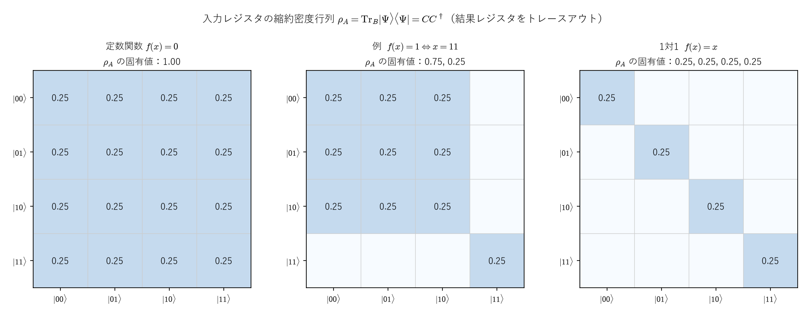
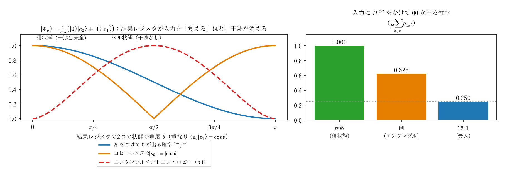

# 部分トレースと縮約密度行列 ―入力レジスタだけを見る―

> **作成** 2026-10-17　**更新** 2026-10-22
> 2つのレジスタにまたがる状態から、片方のレジスタだけの状態（縮約密度行列）を作る部分トレースの定義と性質、係数行列との関係、結果レジスタとのエンタングルメントで干渉が消える仕組み、環境を使った見方（クラウス表現）。
> 検算と図つき。

[射影演算子による測定確率のノート](measurement_projection_born_rule.md)（以下「本編」）では、関数を計算した後の状態 $|\Psi\rangle=\frac1{\sqrt N}\sum_i|x_i\rangle|f(x_i)\rangle$ について、入力レジスタを測る確率を求めました。このノートでは、同じ状況を**入力レジスタだけの状態**として表します。結果レジスタを「見ない」「無視する」ことを、数式で正確に書くのが部分トレースです。

- **Part I**：なぜ必要か。純粋状態の密度行列と、期待値 $\langle A\rangle=\operatorname{tr}(\rho A)$
- **Part II**：部分トレースの定義、成分の式、性質（基底によらない。期待値が縮約密度行列だけで決まる）
- **Part III**：本編の $|\Phi\rangle=\sum c_{x,y}|x\rangle|y\rangle$ の縮約密度行列 $\rho_A=CC^\dagger$。対角成分は確率、固有値はシュミット係数の2乗、混合状態としての見方
- **Part IV**：本編の例（4候補・正解1個）と、定数関数・1対1の関数の縮約密度行列
- **Part V**：結果レジスタが入力を「覚える」と、入力の干渉が消えること
- **Part VI**：環境を使った見方（クラウス表現）

**関連ファイル**：図は [figures/make_measurement_projection_figures.py](figures/make_measurement_projection_figures.py)（mp07、mp08）で作っていて、各図の値はスクリプトの中で本文の式と照合しています。式と数値の検算は [experiments/measurement_projection/](../../experiments/measurement_projection/README.md)（部分トレースの15件を含む）。密度行列の基本は[密度行列のノート](../05_量子力学/density_matrix_bracket_notation.md)、ノイズと量子チャネルは[ノイズのノート](../05_量子力学/noise_modeling_through_mri.md)にあります。

**記法と次元の宣言**（本編の付録A-1・A-2 と同じ流儀）：入力レジスタを系 $A$、結果レジスタを系 $B$ として、空間、ベクトル、基底を

$$
\mathcal H_A=\mathbb C^m,\qquad\mathcal H_B=\mathbb C^n,\qquad|x\rangle\in\mathcal H_A\ (x=0,\dots,m-1),\qquad|y\rangle\in\mathcal H_B\ (y=0,\dots,n-1)
$$

と宣言します（$|x\rangle,|y\rangle$ は計算基底で、正規直交）。次元の文字 $m,n$ と、基底の添字 $x,y$（本編の付録A-1 の $k,l$ にあたる）は、本編の付録A-2・付録B と同じです。合成系の状態、係数行列、演算子は

$$
|\Phi\rangle=\sum_{x=0}^{m-1}\sum_{y=0}^{n-1}c_{x,y}\,|x\rangle|y\rangle\in\mathcal H_A\otimes\mathcal H_B,\qquad\langle\Phi|\Phi\rangle=1,\qquad C=(c_{x,y})\in\mathbb C^{m\times n}
$$

です（$C$ は本編の付録B の係数行列）。この Part 以降で使う対象の大きさは、次の通りです。

| 対象 | 属する空間・写像 | 次元・大きさ |
|---|---|---|
| $\lvert\Phi\rangle$ | $\mathcal H_A\otimes\mathcal H_B$ | $mn$ |
| 係数行列 $C$ | 行が入力 $x$、列が結果 $y$ | $m\times n$ |
| $\rho=\lvert\Phi\rangle\langle\Phi\rvert$ | $\mathcal H_A\otimes\mathcal H_B\to\mathcal H_A\otimes\mathcal H_B$ | $mn\times mn$ |
| $\rho_A=\operatorname{Tr}_B\rho$ | $\mathcal H_A\to\mathcal H_A$ | $m\times m$ |
| $\rho_B=\operatorname{Tr}_A\rho$ | $\mathcal H_B\to\mathcal H_B$ | $n\times n$ |
| $X_A$、$P_x=\lvert x\rangle\langle x\rvert$ | $\mathcal H_A\to\mathcal H_A$ | $m\times m$ |
| $X_A\otimes I_n$、$M_x=P_x\otimes I_n$ | $\mathcal H_A\otimes\mathcal H_B\to\mathcal H_A\otimes\mathcal H_B$ | $mn\times mn$ |

演算子 $\rho$ の成分を、基底 $|x\rangle|y\rangle$ で $\rho_{(x,y),(x',y')}:=\langle x|\langle y|\,\rho\,|x'\rangle|y'\rangle$ と書きます。基底のラベル $x$ は、$m=4$ の例では2進文字列 $00,01,10,11$ とも書き、$0,1,2,3$ と読みます。式番号は `Part 番号-通し番号`（例：II-3）です。本編の式は「本編の (III-1)」のように書きます。

<a id="toc"></a>

## 目次

<!-- toc:start -->

- [Part I：なぜ必要か](#p1)
  - [1. 本編の結果と、残った疑問](#p1-1)
  - [2. 純粋状態の密度行列と、期待値](#p1-2)
- [Part II：部分トレース](#p2)
  - [1. 定義と成分の式](#p2-1)
  - [2. 基本的な性質](#p2-2)
  - [3. 縮約密度行列だけで、系 A についての予言が決まる](#p2-3)
- [Part III：|Phi⟩ の縮約密度行列](#p3)
  - [1. ρ\_A=CC^dagger](#p3-1)
  - [2. 対角成分は、入力が x になる確率](#p3-2)
  - [3. 固有値は、シュミット係数の2乗](#p3-3)
  - [4. 混合状態としての見方](#p3-4)
- [Part IV：例](#p4)
  - [1. 本編の例（4候補・正解1個）](#p4-1)
  - [2. 3つの関数の比較](#p4-2)
- [Part V：結果レジスタが入力を覚えると、干渉が消える](#p5)
  - [1. 入力に H^⊗ q をかけて測る](#p5-1)
  - [2. 3つの関数](#p5-2)
  - [3. 2量子ビットの模型：覚える度合いを連続的に変える](#p5-3)
- [Part VI：環境を使った見方](#p6)
- [まとめ](#summary)
- [付録A：検算の一覧](#appA)

<!-- toc:end -->

---

<a id="p1"></a>

# Part I：なぜ必要か

<!-- part-toc:start -->

**この Part の内容**

- [1. 本編の結果と、残った疑問](#p1-1)
- [2. 純粋状態の密度行列と、期待値](#p1-2)

<!-- part-toc:end -->

<a id="p1-1"></a>

## 1. 本編の結果と、残った疑問

本編の付録Bで、結果レジスタを測ると入力レジスタの状態が変わること、$|\Psi\rangle$ が一般にエンタングルしていることを見ました。しかし、次の問いには、まだ答えていません。

> 結果レジスタを**測らずに**、ただ見ない（無視する）とき、入力レジスタは、どんな状態にあるのか。入力レジスタに行うあらゆる測定の結果は、何で決まるのか。

エンタングルした状態では、入力レジスタ単独の状態ベクトル $|u\rangle$ は存在しません（積状態でないので）。それでも、入力レジスタだけについての予言は、1つの行列（縮約密度行列）で、まとめて書けます。

<a id="p1-2"></a>

## 2. 純粋状態の密度行列と、期待値

状態 $|\Phi\rangle$ に対して、演算子

$$
\rho:=|\Phi\rangle\langle\Phi|\tag{I-1}
$$

を、**密度行列**と呼びます。以降で使う用語を、先に決めておきます。

- **純粋状態**：$\rho=|\Phi\rangle\langle\Phi|$（状態ベクトルの外積。階数 $1$）。
- **混合状態**：$\rho=\sum_jp_j|\psi_j\rangle\langle\psi_j|$（$p_j\ge0$、$\sum_jp_j=1$）の形（本編の付録A-5-1 と同じ）。一般には階数が $2$ 以上です。
- **最大混合状態**：$d$ 次元の $\frac1dI$。どの基底で測っても、結果が等確率になります。
- **純度**：$\operatorname{tr}\rho^2$。純粋状態で $1$、混合しているほど小さくなります。
- **コヒーレンス**：基底 $|x\rangle$ での $\rho$ の非対角成分 $\rho_{x,x'}$（$x\neq x'$）。

演算子 $A$ の期待値は、

$$
\langle\Phi|A|\Phi\rangle=\operatorname{tr}(\rho A)\tag{I-2}
$$

と書けます。

**証明**：トレースの定義 $\operatorname{tr}X=\sum_j\langle j|X|j\rangle$（$|j\rangle$ は $\mathcal H_A\otimes\mathcal H_B$ の計算基底、$mn$ 個）から

$$
\operatorname{tr}(\rho A)=\sum_j\langle j|\Phi\rangle\langle\Phi|A|j\rangle
$$

です。数 $\langle j|\Phi\rangle$ と $\langle\Phi|A|j\rangle$ の順序を入れ替え、完全性関係 $\sum_j|j\rangle\langle j|=I$ を使うと

$$
\sum_j\langle\Phi|A|j\rangle\langle j|\Phi\rangle=\langle\Phi|A\Big(\sum_j|j\rangle\langle j|\Big)|\Phi\rangle=\langle\Phi|A|\Phi\rangle
$$

です。$\square$

なお、$\operatorname{tr}(\rho A)=\operatorname{tr}(A\rho)$ です（トレースの巡回性。本編の付録A-5-1 (4)）。以降では、この順序の入れ替えを使います。

**数値例**：1量子ビット（$m=2$ の1つの系）で $|\Phi\rangle=|+\rangle=\frac1{\sqrt2}(|0\rangle+|1\rangle)$、$A=Z=\begin{pmatrix}1&0\\0&-1\end{pmatrix}$ とします。密度行列は

$$
\rho=|+\rangle\langle+|=\frac12\begin{pmatrix}1&1\\1&1\end{pmatrix}
$$

（エルミートで、$\operatorname{tr}\rho=\langle\Phi|\Phi\rangle=1$）で、

$$
\operatorname{tr}(\rho Z)=\operatorname{tr}\Big(\frac12\begin{pmatrix}1&-1\\1&-1\end{pmatrix}\Big)=\frac12(1-1)=0,\qquad\langle+|Z|+\rangle=\frac12(1-1)=0
$$

で、(I-2) の両辺が一致します。

本編の確率 $P(x)=\langle\Phi|M_x|\Phi\rangle$（本編の Part IV §7）は、(I-2) で $A=M_x=P_x\otimes I$ とした

$$
P(x)=\operatorname{tr}\big(\rho\,(P_x\otimes I)\big)
$$

です。ボルン則（確率が $\langle\Phi|M|\Phi\rangle$）が、密度行列では $\operatorname{tr}(\rho M)$ という形になります。

---

<a id="p2"></a>

# Part II：部分トレース

<!-- part-toc:start -->

**この Part の内容**

- [1. 定義と成分の式](#p2-1)
- [2. 基本的な性質](#p2-2)
- [3. 縮約密度行列だけで、系 A についての予言が決まる](#p2-3)

<!-- part-toc:end -->

<a id="p2-1"></a>

## 1. 定義と成分の式

**定義**：合成系の演算子（$mn\times mn$ 行列）の全体から、$A$ の演算子（$m\times m$ 行列）の全体への線形写像 $\operatorname{Tr}_B$ で、積の形の演算子について

$$
\operatorname{Tr}_B(X\otimes Y)=X\,\operatorname{tr}(Y)\tag{II-1}
$$

を満たすものを、$B$ についての**部分トレース**（$B$ をトレースアウトする）と呼びます（$X\in\mathbb C^{m\times m}$ は $A$ 上、$Y\in\mathbb C^{n\times n}$ は $B$ 上の演算子）。このような写像が1つだけあることを、次の手順で確かめ、成分の式 (II-2) を導きます。

**手順1：積の形の演算子が、演算子全体の基底になる**。$|x\rangle\langle x'|\in\mathbb C^{m\times m}$ は、第 $(x,x')$ 成分だけが $1$ の行列で、$|y\rangle\langle y'|\in\mathbb C^{n\times n}$ も同様です。テンソル積の成分の定義（本編の Part III §2-d）から、

$$
\big(|x\rangle\langle x'|\otimes|y\rangle\langle y'|\big)_{(a,b),(a',b')}=\delta_{ax}\delta_{a'x'}\cdot\delta_{by}\delta_{b'y'}
$$

で、第 $(x,y),(x',y')$ 成分だけが $1$ の $mn\times mn$ 行列です。これらは、$mn\times mn$ 行列の標準的な基底（行列単位）なので、**任意の演算子 $\rho$ は**

$$
\rho=\sum_{x,y,x',y'}\rho_{(x,y),(x',y')}\;|x\rangle\langle x'|\otimes|y\rangle\langle y'|
$$

と書けます。

**手順2：線形性と (II-1) を適用する**。$\operatorname{Tr}_B$ は線形なので、(II-1) を各項に使うと

$$
\operatorname{Tr}_B\rho=\sum_{x,y,x',y'}\rho_{(x,y),(x',y')}\;|x\rangle\langle x'|\;\operatorname{tr}\big(|y\rangle\langle y'|\big)
$$

です。トレースは対角成分の和なので、基底 $|b\rangle$ で $\operatorname{tr}\big(|y\rangle\langle y'|\big)=\sum_b\langle b|y\rangle\langle y'|b\rangle=\langle y'|y\rangle=\delta_{yy'}$（正規直交性）です。したがって $y'=y$ の項だけが残り

$$
\operatorname{Tr}_B\rho=\sum_{x,x'}\Big(\sum_y\rho_{(x,y),(x',y)}\Big)|x\rangle\langle x'|,\qquad(\operatorname{Tr}_B\rho)_{x,x'}=\sum_y\rho_{(x,y),(x',y)}\tag{II-2}
$$

です。ここまでで、(II-1) を満たす線形写像は (II-2) 以外にありえない（**一意性**）ことが分かりました。

**手順3：(II-2) が (II-1) を満たす（存在）**。(II-2) で定めた写像は、成分の和なので線形です。積の形 $X\otimes Y$ の成分は $(X\otimes Y)_{(x,y),(x',y')}=X_{xx'}Y_{yy'}$ なので、(II-2) に入れると

$$
\big(\operatorname{Tr}_B(X\otimes Y)\big)_{x,x'}=\sum_yX_{xx'}Y_{yy}=X_{xx'}\sum_yY_{yy}=X_{xx'}\operatorname{tr}(Y)
$$

で、(II-1) と一致します。$\square$

**(II-2) の意味と例**：**第2・第4の添字（$B$ の添字）を同じ値にして、足す**、というのが部分トレースの計算です。$A$ をトレースアウトする $\operatorname{Tr}_A$ も同様で、$(\operatorname{Tr}_A\rho)_{y,y'}=\sum_x\rho_{(x,y),(x,y')}$ です。

例として、$m=n=2$ のベル状態 $|\Phi^+\rangle=\frac1{\sqrt2}\big(|00\rangle+|11\rangle\big)$ を考えます。$\rho=|\Phi^+\rangle\langle\Phi^+|$ でゼロでない成分は、$|\Phi^+\rangle$ の成分が $c_{0,0}=c_{1,1}=\frac1{\sqrt2}$ なので、

$$
\rho_{(0,0),(0,0)}=\rho_{(0,0),(1,1)}=\rho_{(1,1),(0,0)}=\rho_{(1,1),(1,1)}=\tfrac12
$$

の4つだけです。(II-2) で $(x,x')=(0,0)$ は $\rho_{(0,0),(0,0)}+\rho_{(0,1),(0,1)}=\frac12+0$、$(0,1)$ は $\rho_{(0,0),(1,0)}+\rho_{(0,1),(1,1)}=0+0$、$(1,0)$ も $0$、$(1,1)$ は $\rho_{(1,0),(1,0)}+\rho_{(1,1),(1,1)}=0+\frac12$ なので

$$
\operatorname{Tr}_B\rho=\begin{pmatrix}\frac12&0\\0&\frac12\end{pmatrix}=\tfrac12I_2
$$

です（Part V で、結果レジスタが入力を完全に覚えた場合の「最大混合状態」として出てきます）。

<a id="p2-2"></a>

## 2. 基本的な性質

**性質1：全体のトレースを保つ**。(II-2) の対角成分 $x=x'$ を足すと

$$
\operatorname{tr}(\operatorname{Tr}_B\rho)=\sum_x\sum_y\rho_{(x,y),(x,y)}=\operatorname{tr}\rho
$$

です。密度行列のトレース 1（確率の和が 1）が、縮約でも保たれます。

**性質2：$B$ の基底によらない**。$(x,x')$ を固定して、$B$ 上の $n\times n$ 行列 $Z$ を $Z_{y,y''}:=\rho_{(x,y),(x',y'')}$ とおくと、(II-2) は $(\operatorname{Tr}_B\rho)_{x,x'}=\sum_yZ_{yy}=\operatorname{tr}Z$ です。$B$ の別の正規直交基底 $|y'_k\rangle=\sum_yV_{yk}|y\rangle$（$V\in\mathbb C^{n\times n}$ はユニタリ行列）で同じ計算をしても、同じ値になります：

$$
\sum_k\langle y'_k|\,Z\,|y'_k\rangle=\sum_k\sum_{y,y''}V_{yk}^\ast\,V_{y''k}\,Z_{y,y''}=\sum_{y,y''}\Big(\sum_kV_{y''k}V_{yk}^\ast\Big)Z_{y,y''}=\sum_{y,y''}(VV^\dagger)_{y'',y}\,Z_{y,y''}=\sum_yZ_{y,y}
$$

（途中で、$\langle y'_k|=\sum_yV_{yk}^\ast\langle y|$ を使い、最後は $VV^\dagger=I$、つまり $(VV^\dagger)_{y'',y}=\delta_{y'',y}$ です。）

**性質3：$\rho_A$ はエルミートで、固有値が $0$ 以上**（$\rho$ が密度行列、つまりエルミートで固有値が $0$ 以上のとき）。(II-2) から、エルミート性は

$$
\big((\rho_A)_{x',x}\big)^\ast=\sum_y\big(\rho_{(x',y),(x,y)}\big)^\ast=\sum_y\rho_{(x,y),(x',y)}=(\rho_A)_{x,x'}
$$

です（$\rho$ がエルミートなので $\big(\rho_{(x',y),(x,y)}\big)^\ast=\rho_{(x,y),(x',y)}$）。固有値が $0$ 以上であることは、任意のベクトル $v=\sum_xv_x|x\rangle\in\mathcal H_A$ と各 $y$ について $|v,y\rangle:=\sum_xv_x|x\rangle|y\rangle$ とおくと

$$
\langle v|\rho_A|v\rangle=\sum_{x,x'}v_x^\ast(\rho_A)_{x,x'}v_{x'}=\sum_y\sum_{x,x'}v_x^\ast\,\rho_{(x,y),(x',y)}\,v_{x'}=\sum_y\langle v,y|\rho|v,y\rangle\ge0
$$

から分かります（各項が $\ge0$ なのは、$\rho$ の固有値が $0$ 以上だから）。$v$ が $\rho_A$ の固有ベクトル（$\rho_Av=\lambda v$）なら、$\langle v|\rho_A|v\rangle=\lambda\|v\|^2$ なので、$\lambda\ge0$ です。

<a id="p2-3"></a>

## 3. 縮約密度行列だけで、系 A についての予言が決まる

**主張**：$A$ の演算子 $X_A\in\mathbb C^{m\times m}$、合成系の演算子 $\rho\in\mathbb C^{mn\times mn}$ について

$$
\boxed{\operatorname{tr}\big[(X_A\otimes I_n)\rho\big]=\operatorname{tr}\big[X_A\,\operatorname{Tr}_B\rho\big]}\tag{II-3}
$$

が成り立ちます。

**証明の方針**：両辺は $\rho$ について線形なので、積の形の $\rho=X\otimes Y$ について確かめれば十分です。左辺には本編の付録A-1 の (A-1) と補題5 を、右辺には (II-1) を使います。

**証明**：

*(1) 積の形に絞れる理由*：両辺は $\rho$ について線形（トレースも $\operatorname{Tr}_B$ も線形）です。$\rho$ は、Part II §1 の手順1 の基底（どれも積の形）の線形結合で書けるので、基底の各項で両辺が等しければ、一般の $\rho$ でも等しくなります。そこで $\rho=X\otimes Y$（$X\in\mathbb C^{m\times m}$、$Y\in\mathbb C^{n\times n}$）とします。

*(2) 左辺*：(A-1)（$(A\otimes B)(A'\otimes B')=AA'\otimes BB'$）で $A=X_A$、$B=I_n$、$A'=X$、$B'=Y$ とすると $(X_A\otimes I_n)(X\otimes Y)=X_AX\otimes I_nY=X_AX\otimes Y$ です。補題5（$\operatorname{tr}(P\otimes Q)=\operatorname{tr}P\cdot\operatorname{tr}Q$）から

$$
\operatorname{tr}\big[X_AX\otimes Y\big]=\operatorname{tr}(X_AX)\,\operatorname{tr}(Y)
$$

*(3) 右辺*：(II-1) から $\operatorname{Tr}_B(X\otimes Y)=X\operatorname{tr}(Y)$ で、$\operatorname{tr}(Y)$ は数なので、トレースの線形性から

$$
\operatorname{tr}\big[X_A\,X\operatorname{tr}(Y)\big]=\operatorname{tr}(X_AX)\operatorname{tr}(Y)
$$

*(4) 比べる*：(2) と (3) は一致します。$\square$

**意味**：系 $A$ だけに作用する観測量 $X_A\otimes I_n$ の期待値は、**縮約密度行列 $\rho_A:=\operatorname{Tr}_B\rho$ だけで決まります**。系 $B$ を測るかどうか（測って結果を忘れても、測らなくても）は、$A$ についての予言を変えません。本編の確率 $P(x)=\langle\Phi|M_x|\Phi\rangle$ も、$X_A=P_x$ の場合にあたります。

---

<a id="p3"></a>

# Part III：$|\Phi\rangle$ の縮約密度行列

<!-- part-toc:start -->

**この Part の内容**

- [1. ρ\_A=CC^dagger](#p3-1)
- [2. 対角成分は、入力が x になる確率](#p3-2)
- [3. 固有値は、シュミット係数の2乗](#p3-3)
- [4. 混合状態としての見方](#p3-4)

<!-- part-toc:end -->

<a id="p3-1"></a>

## 1. $\rho_A=CC^\dagger$

**主張**：$\rho=|\Phi\rangle\langle\Phi|$（$|\Phi\rangle=\sum c_{x,y}|x\rangle|y\rangle$）の縮約密度行列は

$$
\boxed{\rho_A=CC^\dagger}\qquad\big((\rho_A)_{x,x'}=\textstyle\sum_yc_{x,y}\,c_{x',y}^\ast\big)\tag{III-1}
$$

$$
\rho_B=C^TC^\ast=(C^\dagger C)^T\qquad\big((\rho_B)_{y,y'}=\textstyle\sum_xc_{x,y}\,c_{x,y'}^\ast\big)\tag{III-2}
$$

です（$C^\ast$ は成分の複素共役）。

**証明**：

*(1) $\rho$ の成分*：$\rho_{(x,y),(x',y')}=\langle x|\langle y|\Phi\rangle\,\langle\Phi|x'\rangle|y'\rangle$ です。基底の正規直交性から $\langle x|\langle y|\Phi\rangle=\sum_{a,b}c_{a,b}\langle x|a\rangle\langle y|b\rangle=c_{x,y}$ で、$\langle\Phi|x'\rangle|y'\rangle$ はその複素共役 $c_{x',y'}^\ast$ なので

$$
\rho_{(x,y),(x',y')}=c_{x,y}\,c_{x',y'}^\ast
$$

*(2) 部分トレース*：(II-2) に代入して

$$
(\rho_A)_{x,x'}=\sum_y\rho_{(x,y),(x',y)}=\sum_yc_{x,y}\,c_{x',y}^\ast
$$

*(3) $CC^\dagger$ の成分*：行列の積の定義と $(C^\dagger)_{y,x'}=c_{x',y}^\ast$ から

$$
(CC^\dagger)_{x,x'}=\sum_yC_{x,y}(C^\dagger)_{y,x'}=\sum_yc_{x,y}\,c_{x',y}^\ast
$$

で、(2) と一致します。つまり (III-1) です（$CC^\dagger$ の $(x,x')$ 成分は、$C$ の第 $x$ 行と第 $x'$ 行の内積）。

*(4) $\rho_B$*：$\operatorname{Tr}_A$ について $(\rho_B)_{y,y'}=\sum_x\rho_{(x,y),(x,y')}=\sum_xc_{x,y}c_{x,y'}^\ast$ です。一方、$(C^TC^\ast)_{y,y'}=\sum_x(C^T)_{y,x}(C^\ast)_{x,y'}=\sum_xc_{x,y}c_{x,y'}^\ast$ で一致します。また $(C^\dagger C)^T=C^T(C^\dagger)^T=C^TC^\ast$（積の転置は順序が逆になり、$(C^\dagger)^T=C^\ast$）なので、$C^TC^\ast=(C^\dagger C)^T$ です。$\square$

$\rho_A=CC^\dagger$ は、エルミート（$(CC^\dagger)^\dagger=CC^\dagger$）で、任意のベクトル $v\in\mathbb C^m$ について $\langle v|CC^\dagger|v\rangle=\|C^\dagger v\|^2\ge0$ です。トレースは $\sum_{x,y}|c_{x,y}|^2=1$ です。

<a id="p3-2"></a>

## 2. 対角成分は、入力が $x$ になる確率

(III-1) の対角成分は、

$$
(\rho_A)_{x,x}=\sum_y|c_{x,y}|^2=P(x)
$$

で、本編の Part IV §3 の (IV-1) です。Part I §2 の式と (II-3) からも、

$$
P(x)=\operatorname{tr}\big[\rho(P_x\otimes I_n)\big]=\operatorname{tr}\big[P_x\rho_A\big]=\langle x|\rho_A|x\rangle
$$

と出ます。**縮約密度行列の対角成分が、入力の測定確率**で、**非対角成分**（Part V で扱うコヒーレンス）は、入力に別の基底の測定（たとえばアダマール基底）を行ったときの確率に効きます。

<a id="p3-3"></a>

## 3. 固有値は、シュミット係数の2乗

**主張**：本編の付録B-3 の特異値分解 $C=USV^\dagger$（$U\in\mathbb C^{m\times m}$、$V\in\mathbb C^{n\times n}$ はユニタリ、$S\in\mathbb R^{m\times n}$ は対角成分が特異値 $s_k$）について、$\rho_A$ の固有値は $s_k^2$（と、余った次元の $0$）、$\rho_B$ の固有値も同じ $s_k^2$ です。

**導出**：$S$ は実行列なので $S^\dagger=S^T$ です。$V^\dagger V=I_n$、$U^\dagger U=I_m$ を使うと

$$
\rho_A=CC^\dagger=USV^\dagger\,VS^TU^\dagger=U\big(SS^T\big)U^\dagger,\qquad C^\dagger C=VS^TU^\dagger\,USV^\dagger=V\big(S^TS\big)V^\dagger\tag{III-3}
$$

です。$SS^T\in\mathbb R^{m\times m}$、$S^TS\in\mathbb R^{n\times n}$ は、どちらも対角行列で、対角成分は $s_k^2$（$k=1,\dots,r$、残りは $0$）です。$U$ がユニタリなので、$\rho_A=U(SS^T)U^\dagger$ は対角化の形で、固有値は $SS^T$ の対角成分 $s_k^2$ です。$\rho_B$ は

$$
\rho_B=(C^\dagger C)^T=\big(V(S^TS)V^\dagger\big)^T=V^\ast\,(S^TS)\,V^T
$$

（積の転置は順序が逆になり、対角行列は転置しても同じ）で、$V^\ast$ もユニタリなので、固有値は同じく $s_k^2$ です。**$\rho_A$ と $\rho_B$ は、ゼロでない固有値が同じ**で、その固有値 $p_k=s_k^2$ が本編の付録B-3 の確率です。

**純度**：$\operatorname{tr}\rho_A^2$ を求めます。$\rho_A=UDU^\dagger$（$D=SS^T$）なので $\rho_A^2=UD^2U^\dagger$ で、トレースの巡回性から

$$
\operatorname{tr}\rho_A^2=\operatorname{tr}D^2=\sum_kp_k^2
$$

です。$p_k\le\max_kp_k$ なので、$\sum_kp_k^2\le(\max_kp_k)\sum_kp_k=\max_kp_k\le1$ で、等号が成り立つのは、$p$ の1つだけが $1$（ほかは $0$）のとき、つまり $C$ の階数が $1$（積状態）のときだけです。それ以外では $1$ より小さくなります。

**純度の下限**：$C$ の階数を $r$ とすると、ゼロでない $p_k$ は $r$ 個で、$m\times n$ 行列の階数は $\min(m,n)$ 以下なので $r\le\min(m,n)$ です。コーシー・シュワルツの不等式 $\big(\sum_{k=1}^r1\cdot p_k\big)^2\le r\sum_kp_k^2$ に $\sum_kp_k=1$ を使うと

$$
1\le r\sum_kp_k^2,\qquad\text{つまり}\qquad\operatorname{tr}\rho_A^2=\sum_kp_k^2\ge\frac1r\ge\frac1{\min(m,n)}
$$

です。一般の $m$ 次元の密度行列の純度の下限は $1/m$（$m$ 個が等確率。上のコーシー・シュワルツで $r=m$ とした場合）ですが、$1/m$ に届くのは $n\ge m$ のときだけです。本編の例（$m=4$、$n=2$）の下限は $\frac12$ です（ランダムな純粋状態で、数値でも確かめました。付録A）。

**エントロピー**：$S_{\mathrm{ent}}=-\sum_kp_k\log_2p_k$ は、$\rho_A$ の固有値のエントロピーです（本編の付録B-3）。積状態で $0$。

<a id="p3-4"></a>

## 4. 混合状態としての見方

**主張**：$C$ の第 $y$ 列を $\mathbf c_y:=(c_{x,y})_x\in\mathbb C^m$ とすると

$$
\rho_A=\sum_yP(y)\,|\phi_y\rangle\langle\phi_y|,\qquad|\phi_y\rangle=\frac{1}{\sqrt{P(y)}}\sum_xc_{x,y}|x\rangle\tag{III-4}
$$

です（$P(y)=\sum_x|c_{x,y}|^2$。$P(y)=0$ の $y$ は項が $0$ なので除く）。

**導出**：(III-1) の成分を、列ベクトルで書くと $(CC^\dagger)_{x,x'}=\sum_yc_{x,y}c_{x',y}^\ast=\sum_y(\mathbf c_y)_x\,(\mathbf c_y^\dagger)_{x'}$ なので、$CC^\dagger=\sum_y\mathbf c_y\mathbf c_y^\dagger$ です。$\mathbf c_y$ のノルムの2乗は $\|\mathbf c_y\|^2=\sum_x|c_{x,y}|^2=P(y)$ なので、$\mathbf c_y=\sqrt{P(y)}\,|\phi_y\rangle$（$|\phi_y\rangle$ はノルム $1$）と書けて、$\mathbf c_y\mathbf c_y^\dagger=P(y)|\phi_y\rangle\langle\phi_y|$ です。$\square$

$|\phi_y\rangle$ は、本編の付録B-2 の (B-2) の測定後の状態 $|\Phi_y\rangle=|\phi_y\rangle\otimes|y\rangle$ の、第1因子（入力レジスタの部分）で、**結果レジスタを測って $y$ が出たときの入力レジスタの状態**です。したがって、

> 結果レジスタを測って結果を**忘れた**ときの入力レジスタは、確率 $P(y)$ で状態 $|\phi_y\rangle$ にある混合状態 $\sum_yP(y)|\phi_y\rangle\langle\phi_y|$ で、これは $\rho_A$ と**一致**します。

(II-3) から、$A$ を測る確率は、$B$ を測っても測らなくても同じです。ただし、(III-4) の分解は一意ではありません。$B$ を別の基底で測ると、別の状態の混合として $\rho_A$ が書けます（同じ $\rho_A$ になる）。**$\rho_A$ という行列は同じでも、どう分解するか（何を測ったか）は決まらない**のが、混合状態の特徴です。

「結果を忘れる」ことを混合状態で表す根拠は、古典的な確率の平均です。確率 $P(y)$ で状態 $|\phi_y\rangle$ が得られる試行を何度も繰り返して、結果を記録しないとき、入力レジスタは、確率 $P(y)$ で $|\phi_y\rangle$ にある混合状態になります。

**例（ベル状態）**：$|\Phi^+\rangle=\frac1{\sqrt2}(|00\rangle+|11\rangle)$ では $C=\frac1{\sqrt2}I_2$、$\rho_A=\frac12I$ です。$B$ を $Z$ 基底（$|0\rangle,|1\rangle$）で測ると、結果 $y=0,1$ が確率 $\frac12$ ずつで、入力レジスタは $|0\rangle$、$|1\rangle$ になり

$$
\rho_A=\frac12|0\rangle\langle0|+\frac12|1\rangle\langle1|
$$

です。一方、$|\Phi^+\rangle=\frac1{\sqrt2}\big(|{+}\rangle|{+}\rangle+|{-}\rangle|{-}\rangle\big)$（$|00\rangle+|11\rangle=|{+}{+}\rangle+|{-}{-}\rangle$ から）なので、$B$ を $X$ 基底（$|\pm\rangle$）で測ると、入力レジスタは $|+\rangle$、$|-\rangle$ が確率 $\frac12$ ずつで

$$
\rho_A=\frac12|{+}\rangle\langle{+}|+\frac12|{-}\rangle\langle{-}|
$$

です。どちらの分解も、$|0\rangle\langle0|+|1\rangle\langle1|=|{+}\rangle\langle{+}|+|{-}\rangle\langle{-}|=I$ から、**同じ $\frac12I$ になります**。

---

<a id="p4"></a>

# Part IV：例

<!-- part-toc:start -->

**この Part の内容**

- [1. 本編の例（4候補・正解1個）](#p4-1)
- [2. 3つの関数の比較](#p4-2)

<!-- part-toc:end -->

<a id="p4-1"></a>

## 1. 本編の例（4候補・正解1個）

本編の Part VIII の $|\Psi\rangle=\frac12\big(|00\rangle|0\rangle+|01\rangle|0\rangle+|10\rangle|0\rangle+|11\rangle|1\rangle\big)$ の係数行列は、本編の付録B-1 の

$$
C=\frac12\begin{pmatrix}1&0\\1&0\\1&0\\0&1\end{pmatrix}
$$

です。(III-1) から、

$$
\rho_A=CC^\dagger=\frac14\begin{pmatrix}1&1&1&0\\1&1&1&0\\1&1&1&0\\0&0&0&1\end{pmatrix}
$$

です。成分は、$C$ の行 $\mathbf r_{00}=\mathbf r_{01}=\mathbf r_{10}=\frac12(1,0)$、$\mathbf r_{11}=\frac12(0,1)$ の内積 $(\rho_A)_{x,x'}=\mathbf r_x\cdot\mathbf r_{x'}^\ast$ です。例：$(\rho_A)_{00,01}=\frac12\cdot\frac12(1\cdot1+0\cdot0)=\frac14$、$(\rho_A)_{00,11}=\frac12\cdot\frac12(1\cdot0+0\cdot1)=0$、$(\rho_A)_{11,11}=\frac14(0\cdot0+1\cdot1)=\frac14$。**対角成分はすべて $\frac14$** で、入力の確率 $P(x)=\frac14$ と一致します（本編の Part VIII §6）。

**固有値と固有ベクトル**：$|11\rangle$ と他の入力の間の成分は $0$ なので、$\rho_A$ は $00,01,10$ の3行3列のブロック $\frac14J_3$（$J_3$ は全成分が $1$ の行列）と、$|11\rangle$ の $1\times1$ のブロック $\frac14$ に分かれます。$J_3v=(v_1+v_2+v_3)(1,1,1)^T$ なので、$v=(1,1,1)^T/\sqrt3$ では $J_3v=3v$（固有値 $\frac14\cdot3=\frac34$）、$v_1+v_2+v_3=0$ を満たす2次元の空間では $J_3v=0$（固有値 $0$）です。$|11\rangle$ の固有値は $\frac14$ です。

$$
\rho_A=\frac34\,|t\rangle\langle t|+\frac14\,|11\rangle\langle11|,\qquad|t\rangle=\frac{|00\rangle+|01\rangle+|10\rangle}{\sqrt3}
$$

これは (III-4) そのもので、$|t\rangle$ と $|11\rangle$ は、本編の付録B-2 の、結果レジスタを測ったときの入力の状態、$\frac34$ と $\frac14$ はその確率です。また、$C^\dagger C=C^TC=\frac14\begin{pmatrix}3&0\\0&1\end{pmatrix}$（第0列同士は $\frac14(1+1+1)$、第1列同士は $\frac14$、第0列と第1列は $0$）なので、$\rho_B=(C^\dagger C)^T=\operatorname{diag}\big(\tfrac34,\tfrac14\big)$ で、固有値は $\rho_A$ と同じです（Part III §3）。

<a id="p4-2"></a>

## 2. 3つの関数の比較

| 関数 | $\rho_A$ | 固有値 | 純度 $\operatorname{tr}\rho_A^2$ | エントロピー |
|---|---|---|---|---|
| 定数 $f(x)=0$ | 全成分 $\frac14$（階数 $1$） | $1$ | $1$（純粋状態） | $0$ bit |
| 例（$f(x)=1\Leftrightarrow x=11$） | 上の行列 | $\frac34,\ \frac14$ | $\frac{9}{16}+\frac1{16}=\frac58$ | $0.811$ bit |
| 1対1（$f(x)=x$、$n=4$） | $\frac14I_4$ | $\frac14$ が4つ | $\frac14$（$n\ge m$ なので下限 $1/m$ に届く） | $2$ bit |

例の行の純度は $\big(\tfrac34\big)^2+\big(\tfrac14\big)^2=\tfrac9{16}+\tfrac1{16}=\tfrac58$、エントロピーは $-\tfrac34\log_2\tfrac34-\tfrac14\log_2\tfrac14\approx0.311+0.5=0.811$ bit です。

- **定数関数**：結果レジスタが入力の情報を持たないので、入力レジスタは、純粋状態 $|s\rangle=\frac12\sum|x\rangle$ のままです。$\rho_A=|s\rangle\langle s|$。
- **1対1**：結果レジスタが、入力を完全に覚えているので、入力レジスタは**最大混合状態** $\frac1mI$（どの基底で測っても等確率）で、非対角成分がすべて $0$ です。



*図。入力レジスタの縮約密度行列 $\rho_A=CC^\dagger$（実部）。左：定数関数（全成分が $0.25$、固有値 $1$。純粋状態）。中：本編の例（$00,01,10$ の間に非対角成分が残り、$|11\rangle$ とは独立。固有値 $0.75,0.25$）。右：1対1（対角のみ、固有値 $0.25$ が4つ。最大混合状態）。図を描くときに、$\rho_A=CC^\dagger$ と、例の行列、固有値を式で確かめています。*

---

<a id="p5"></a>

# Part V：結果レジスタが入力を覚えると、干渉が消える

<!-- part-toc:start -->

**この Part の内容**

- [1. 入力に H^⊗ q をかけて測る](#p5-1)
- [2. 3つの関数](#p5-2)
- [3. 2量子ビットの模型：覚える度合いを連続的に変える](#p5-3)

<!-- part-toc:end -->

<a id="p5-1"></a>

## 1. 入力に $H^{\otimes q}$ をかけて測る

**記法**：入力レジスタは $q$ 量子ビットで、$m=2^q$ 次元（$\mathcal H_A=\mathbb C^m$）です。$H=\frac1{\sqrt2}\begin{pmatrix}1&1\\1&-1\end{pmatrix}$ を各量子ビットにかける操作を $H^{\otimes q}$（$m\times m$）と書き、$|0\cdots0\rangle$ は $x=0$ の基底ベクトル、$P_{0\cdots0}=|0\cdots0\rangle\langle0\cdots0|$ とします。

アダマールゲートを各量子ビットにかけてから、すべて $0$ か測る操作を考えます。

**手順1：$H^{\otimes q}|0\cdots0\rangle$**。$H|0\rangle=|+\rangle=\frac1{\sqrt2}(|0\rangle+|1\rangle)$ です。テンソル積の成分は各因子の成分の積（本編の Part III §2-c）なので、$|+\rangle^{\otimes q}$ の、ラベル $b_1\cdots b_q$ の成分は、どの $b_j$ についても $\frac1{\sqrt2}$ の $q$ 個の積で、$\big(\frac1{\sqrt2}\big)^q=\frac1{\sqrt m}$ です。したがって

$$
H^{\otimes q}|0\cdots0\rangle=\frac1{\sqrt m}\sum_x|x\rangle=:|s\rangle
$$

です。

**手順2：確率の式**。入力に $H^{\otimes q}$ をかけた状態を $|\Phi'\rangle:=\big(H^{\otimes q}\otimes I_n\big)|\Phi\rangle$ とします。これに、入力が $00\cdots0$ かどうかの測定の演算子 $M_0:=P_{0\cdots0}\otimes I_n$ を作用させたもののノルムの2乗が、確率 $p_0$ です。$M_0$ は射影演算子なので $\|M_0\Phi'\|^2=\langle\Phi'|M_0|\Phi'\rangle$（本編の Part IV §7）で、

$$
p_0=\langle\Phi|\big(H^{\otimes q}\otimes I_n\big)^\dagger\big(P_{0\cdots0}\otimes I_n\big)\big(H^{\otimes q}\otimes I_n\big)|\Phi\rangle
$$

です。$H^\dagger=H$ から、共役転置の性質（本編の付録A-1 の補題3）で $(H^{\otimes q})^\dagger=H^{\otimes q}$、$\big(H^{\otimes q}\otimes I_n\big)^\dagger=(H^{\otimes q})^\dagger\otimes I_n=H^{\otimes q}\otimes I_n$ です。混合積の公式 (A-1) を2回使うと

$$
\big(P_{0\cdots0}\otimes I_n\big)\big(H^{\otimes q}\otimes I_n\big)=P_{0\cdots0}H^{\otimes q}\otimes I_n,\qquad\big(H^{\otimes q}\otimes I_n\big)\big(P_{0\cdots0}H^{\otimes q}\otimes I_n\big)=H^{\otimes q}P_{0\cdots0}H^{\otimes q}\otimes I_n
$$

なので

$$
p_0=\langle\Phi|\big(H^{\otimes q}P_{0\cdots0}H^{\otimes q}\otimes I_n\big)|\Phi\rangle
$$

です。ここで $H^{\otimes q}P_{0\cdots0}H^{\otimes q}=\big(H^{\otimes q}|0\cdots0\rangle\big)\big(\langle0\cdots0|H^{\otimes q}\big)=|s\rangle\langle s|$（$\langle0\cdots0|H^{\otimes q}=\big(H^{\otimes q}|0\cdots0\rangle\big)^\dagger=\langle s|$）なので

$$
p_0=\langle\Phi|\big(|s\rangle\langle s|\otimes I_n\big)|\Phi\rangle\tag{V-1}
$$

です。

**手順3：(II-3) を使う**。(II-3) で $X_A=|s\rangle\langle s|$ とし、$\langle\Phi|(X_A\otimes I_n)|\Phi\rangle=\operatorname{tr}\big[(X_A\otimes I_n)\rho\big]$（(I-2)）を使うと

$$
p_0=\operatorname{tr}\big[|s\rangle\langle s|\,\rho_A\big]=\langle s|\rho_A|s\rangle=\sum_{x,x'}\frac1{\sqrt m}(\rho_A)_{x,x'}\frac1{\sqrt m}=\frac1m\sum_{x,x'}(\rho_A)_{x,x'}\tag{V-2}
$$

です。**入力レジスタに行う、この「干渉の測定」の結果は、$\rho_A$ の全成分の和（非対角成分を含む）で決まります。**

<a id="p5-2"></a>

## 2. 3つの関数

| 関数 | $\rho_A$ の全成分の和 | $p_0=\frac1m\times$ 和 |
|---|---|---|
| 定数 | $16\times\frac14=4$ | $\frac14\cdot4=1$ |
| 例 | $(9+1)\times\frac14=\frac{10}4$ | $\frac14\cdot\frac{10}{4}=\frac58$ |
| 1対1 | $\operatorname{tr}\rho_A=1$（対角のみ） | $\frac14\cdot1=\frac14$ |

（$q=2$、$m=4$ の場合です。例の「全成分の和」は、$00,01,10$ の $3\times3$ ブロックが $9$ 個の $\frac14$、$|11\rangle$ が $\frac14$ なので $(9+1)\cdot\frac14$ です。）

- 定数関数：入力は純粋状態 $|s\rangle$ のままなので、$H^{\otimes2}$ で $|00\rangle$ に戻り、$p_0=1$（干渉が完全に見える）。
- 1対1：入力は最大混合状態で、$p_0=\frac14$、つまり**単に等確率に測っているのと同じ**（干渉が見えない）。
- 本編の例：その中間の $\frac58=0.625$。

**例の手計算**（(III-4) を使います）：結果が $y=0$ の確率は $\frac34$ で、入力は $|\phi_0\rangle=\frac1{\sqrt3}(|00\rangle+|01\rangle+|10\rangle)$、$y=1$ の確率は $\frac14$ で、入力は $|\phi_1\rangle=|11\rangle$ です。$|s\rangle=\frac12(|00\rangle+|01\rangle+|10\rangle+|11\rangle)$ との重なりは $\langle s|\phi_0\rangle=\frac12\cdot\frac3{\sqrt3}=\frac{\sqrt3}2$、$\langle s|\phi_1\rangle=\frac12$ なので

$$
p_0=\sum_yP(y)\,|\langle s|\phi_y\rangle|^2=\frac34\cdot\frac34+\frac14\cdot\frac14=\frac9{16}+\frac1{16}=\frac58
$$

で、表と一致します。全体の状態 $|\Psi\rangle$ に $H^{\otimes2}\otimes I$ をかけて、入力が $00$ になる確率を直接計算しても、3つとも一致します（検算済み）。

<a id="p5-3"></a>

## 3. 2量子ビットの模型：覚える度合いを連続的に変える

**記法**：入力 1 量子ビット（$m=2$）、結果 1 量子ビット（$n=2$）で、$|e_0\rangle,|e_1\rangle\in\mathcal H_B$ は結果レジスタの規格化された2つの状態です。

$$
|\Phi_\theta\rangle=\frac1{\sqrt2}\big(|0\rangle|e_0\rangle+|1\rangle|e_1\rangle\big),\qquad|e_0\rangle=\begin{pmatrix}1\\0\end{pmatrix},\ |e_1\rangle=\begin{pmatrix}\cos\theta\\\sin\theta\end{pmatrix}
$$

とします（$\langle e_0|e_1\rangle=\cos\theta$）。「入力が $0$ なら結果は $e_0$、$1$ なら $e_1$」と、結果レジスタが入力を（不完全に）覚えています。

**$\rho_A$ を求める**：係数は $c_{0,y}=\frac{(e_0)_y}{\sqrt2}$、$c_{1,y}=\frac{(e_1)_y}{\sqrt2}$ です。(III-1) の成分を計算すると

$$
(\rho_A)_{0,0}=\sum_y|c_{0,y}|^2=\tfrac12\|e_0\|^2=\tfrac12,\qquad(\rho_A)_{1,1}=\tfrac12\|e_1\|^2=\tfrac12\ (\cos^2\theta+\sin^2\theta=1)
$$

$$
(\rho_A)_{0,1}=\sum_yc_{0,y}c_{1,y}^\ast=\tfrac12\sum_y(e_0)_y(e_1)_y^\ast=\tfrac12\langle e_1|e_0\rangle=\tfrac12\cos\theta
$$

です（$(\rho_A)_{1,0}$ は、その複素共役で $\frac12\cos\theta$）。まとめると

$$
\rho_A=\frac12\begin{pmatrix}1&\langle e_1|e_0\rangle\\\langle e_0|e_1\rangle&1\end{pmatrix}=\frac12\begin{pmatrix}1&\cos\theta\\\cos\theta&1\end{pmatrix}\tag{V-3}
$$

です。

- **コヒーレンス**（非対角成分の2倍の大きさ）は $|\cos\theta|=|\langle e_0|e_1\rangle|$：結果レジスタの2つの状態が**似ているほど**（重なりが大きいほど）、入力のコヒーレンスが残ります。
- $H$ をかけて $0$ が出る確率は、(V-2)（$m=2$、$|s\rangle=|+\rangle$）と同様に

$$
\langle+|\rho_A|+\rangle=\frac12\cdot\frac12\big(1+\cos\theta+\cos\theta+1\big)=\frac12(1+\cos\theta)
$$

です（図の青）。

- 固有値：$\rho_A=\frac12\begin{pmatrix}1&c\\c&1\end{pmatrix}$（$c=\cos\theta$）で、$(1,1)^T/\sqrt2$ に作用させると $\frac12(1+c)$ 倍、$(1,-1)^T/\sqrt2$ に作用させると $\frac12(1-c)$ 倍なので、固有値は $\frac12(1\pm c)$ です（$c<0$ では大小が入れ替わるので、一般には $\frac12(1\pm|\cos\theta|)$ と書けます）。
- $\theta=0$（$e_0=e_1$）は積状態（エントロピー $0$、干渉は完全）、$\theta=\frac\pi2$（$e_0\perp e_1$）はベル状態 $\frac1{\sqrt2}(|0\rangle|0\rangle+|1\rangle|1\rangle)$ で、$\rho_A=\frac12I$、エントロピー 1 bit、干渉なし。$\theta=\pi$ は $e_1=-e_0$ で、再び積状態（$|{-}\rangle\otimes|e_0\rangle$）です。



*左：$|\Phi_\theta\rangle$ について、$H$ の後で $0$ が出る確率（青）、コヒーレンス（橙）、エンタングルメントエントロピー（赤の破線）。結果レジスタの2つの状態が直交する $\theta=\frac\pi2$ で、コヒーレンスが $0$、エントロピーが最大になる。右：入力に $H^{\otimes2}$ をかけて $00$ が出る確率（Part V §2）。図を描くときに、(V-3) と $p_0=\frac12(1+\cos\theta)$、$0.625$ などを式で確かめています。*

**まとめると**：結果レジスタが、入力の値の違いを（直交する状態として）記録するほど、**どの値だったかが原理的に分かる**ので、入力の重ね合わせの干渉が消えます。正確には、結果レジスタの2つの状態が**直交するとき**（$\langle e_1|e_0\rangle=0$）は、異なる結果に対応する入力どうしの干渉が完全に失われ、**重なりが残るとき**は、干渉は $|\langle e_1|e_0\rangle|$ 倍に縮みます（(V-3)）。同じ結果に対応する入力どうしの干渉は残ります。

**例（干渉が残る場合）**：$f(x_1x_0)=x_0$（上位ビットは結果に関係しない）を、一様な入力に計算すると

$$
|\Psi\rangle=|{+}\rangle_{x_1}\otimes\frac{|00\rangle+|11\rangle}{\sqrt2}_{x_0B}
$$

です。結果レジスタ $B$ は下位ビット $x_0$ とエンタングルしたままですが、上位ビット $x_1$ とは積の形です。入力に $H^{\otimes2}$ をかけると分布は $(\frac12,\frac12,0,0)$ となり、上位ビットの干渉は残ります（$\rho_A=|{+}\rangle\langle{+}|_{x_1}\otimes\frac12I_2$ で、固有値は $\frac12,\frac12,0,0$、階数 $2$）。

これは、環境に情報が記録されて系のコヒーレンスが失われる**デコヒーレンス**（脱位相）と同じ仕組みで、結果レジスタが環境の役を果たしています。関数の結果を残したままだと、**結果が異なる入力どうしの干渉**を使うアルゴリズムは働きません。結果レジスタを**逆計算（アンコンピュート）**で $|0\cdots0\rangle$ に戻すと、入力は再び積状態になり、すべての入力どうしの干渉が使えます。$|\Psi\rangle=U_f\big(\frac1{\sqrt m}\sum_x|x\rangle|0\cdots0\rangle\big)$（本編の Part I）で、$U_f^\dagger U_f=I$ なので

$$
U_f^\dagger|\Psi\rangle=\frac1{\sqrt m}\sum_x|x\rangle|0\cdots0\rangle
$$

です。ただし、常にアンコンピュートが必要というわけではなく、必要かどうかは、使いたい干渉がどの入力どうしの間にあるかによります。

---

<a id="p6"></a>

# Part VI：環境を使った見方

この Part は、本編の付録A-5-3 の「環境を使った見方」（測定の場合）を、部分トレースの形でやり直すものです（記号 $K_m$ は同じものです）。この Part の $m$ は環境の基底の添字で、Part III までの次元の $m$ とは別です。

**記法と次元の宣言**：系 $S$ と環境 $E$ の空間、系の密度行列、全体のユニタリ演算子を

$$
\mathcal H_S=\mathbb C^d,\qquad\mathcal H_E=\mathbb C^{d_E},\qquad\rho_S\in\mathbb C^{d\times d},\qquad U\in\mathbb C^{dd_E\times dd_E}\ \ (\mathcal H_S\otimes\mathcal H_E\ \text{上のユニタリ})
$$

とします。$|0_E\rangle$ は環境の初期状態、$|m_E\rangle$（$m=0,\dots,d_E-1$）は環境の計算基底（正規直交）です。2つの写像を

$$
I\otimes|0_E\rangle:\mathcal H_S\to\mathcal H_S\otimes\mathcal H_E\ \ (dd_E\times d),\qquad I\otimes\langle m_E|:\mathcal H_S\otimes\mathcal H_E\to\mathcal H_S\ \ (d\times dd_E)
$$

と書きます。前者は $|\psi\rangle\mapsto|\psi\rangle\otimes|0_E\rangle$（系の状態に、環境の初期状態を付け加える）、後者は環境の因子に $\langle m_E|$ を作用させる写像です。これらを使って、

$$
K_m:=\langle m_E|U|0_E\rangle=\big(I\otimes\langle m_E|\big)\,U\,\big(I\otimes|0_E\rangle\big)\in\mathbb C^{d\times d}
$$

と定めます（系の演算子で、$\langle s|K_m|s'\rangle=\langle s|\langle m_E|\,U\,|s'\rangle|0_E\rangle$）。

**主張**：環境の初期状態を $|0_E\rangle$ として、全体をユニタリ演算子 $U$ で発展させ、環境をトレースアウトすると、系の状態は

$$
\boxed{\rho_S'=\operatorname{Tr}_E\big[U\big(\rho_S\otimes|0_E\rangle\langle0_E|\big)U^\dagger\big]=\sum_mK_m\,\rho_S\,K_m^\dagger}\tag{VI-1}
$$

になります。

**導出**：

*(1) $\operatorname{Tr}_E$ の書き方*：(II-2) を $E$ について書くと、$\operatorname{Tr}_EZ=\sum_m\big(I\otimes\langle m_E|\big)\,Z\,\big(I\otimes|m_E\rangle\big)$ です（$\langle m_E|$ は $E$ の因子にだけ作用する）。実際、$\big(I\otimes\langle m_E|\big)Z\big(I\otimes|m_E\rangle\big)$ の $(s,s')$ 成分は $\langle s|\langle m_E|\,Z\,|s'\rangle|m_E\rangle=Z_{(s,m),(s',m)}$ で、$m$ について足すと (II-2) になります。

*(2) $\rho_S\otimes|0_E\rangle\langle0_E|$ の書き換え*：次の等式が成り立ちます。

$$
\rho_S\otimes|0_E\rangle\langle0_E|=\big(I\otimes|0_E\rangle\big)\,\rho_S\,\big(I\otimes\langle0_E|\big)
$$

基底ベクトル $|s'\rangle|e\rangle$ に両辺を作用させて比べます。右辺は、右の行列から順に作用させると

$$
\big(I\otimes\langle0_E|\big)|s'\rangle|e\rangle=\langle0_E|e\rangle\,|s'\rangle\ \ \longrightarrow\ \ \langle0_E|e\rangle\,\rho_S|s'\rangle\ \ \longrightarrow\ \ \langle0_E|e\rangle\,\rho_S|s'\rangle\otimes|0_E\rangle
$$

となります（最後の矢印は $I\otimes|0_E\rangle$ の作用）。左辺は、本編の (III-1)（$(X\otimes Y)(u\otimes v)=Xu\otimes Yv$）から

$$
\big(\rho_S\otimes|0_E\rangle\langle0_E|\big)|s'\rangle|e\rangle=\rho_S|s'\rangle\otimes|0_E\rangle\langle0_E|e\rangle=\langle0_E|e\rangle\,\rho_S|s'\rangle\otimes|0_E\rangle
$$

で、右辺と一致します。すべての基底ベクトルで一致するので、行列として等しくなります。

*(3) 代入する*：$Z=U(\rho_S\otimes|0_E\rangle\langle0_E|)U^\dagger$ に (2) を代入し、(1) の左右の $\big(I\otimes\langle m_E|\big)$、$\big(I\otimes|m_E\rangle\big)$ とあわせると

$$
\operatorname{Tr}_EZ=\sum_m\Big[\big(I\otimes\langle m_E|\big)U\big(I\otimes|0_E\rangle\big)\Big]\,\rho_S\,\Big[\big(I\otimes\langle0_E|\big)U^\dagger\big(I\otimes|m_E\rangle\big)\Big]
$$

です。左の括弧は $K_m$ です。右の括弧は、$K_m$ の共役転置です：$\big[\big(I\otimes\langle m_E|\big)U\big(I\otimes|0_E\rangle\big)\big]^\dagger=\big(I\otimes\langle0_E|\big)U^\dagger\big(I\otimes|m_E\rangle\big)$（積の共役転置は順序が逆になり、$(I\otimes|0_E\rangle)^\dagger=I\otimes\langle0_E|$）。したがって

$$
\rho_S'=\sum_mK_m\,\rho_S\,K_m^\dagger
$$

で、(VI-1) です。$\square$

**トレースが保たれる条件**：(VI-1) のトレースは、トレースの巡回性から

$$
\operatorname{tr}\rho_S'=\operatorname{tr}\Big(\sum_mK_m^\dagger K_m\,\rho_S\Big)
$$

です。したがって、

$$
\sum_mK_m^\dagger K_m=I
$$

なら、任意の $\rho_S$ について $\operatorname{tr}\rho_S'=\operatorname{tr}\rho_S=1$ です（逆に、任意の $\rho_S$ で $\operatorname{tr}\rho_S'=\operatorname{tr}\rho_S$ なら、この式が成り立ちます）。この式は、$U^\dagger U=I$ と環境の完全性関係 $\sum_m|m_E\rangle\langle m_E|=I_E$ から導かれます。まず、$dd_E\times dd_E$ の行列として

$$
\big(I\otimes|m_E\rangle\big)\big(I\otimes\langle m_E|\big)=I_d\otimes|m_E\rangle\langle m_E|,\qquad\sum_mI_d\otimes|m_E\rangle\langle m_E|=I_d\otimes I_E=I_{dd_E}
$$

です。これを使うと

$$
\sum_mK_m^\dagger K_m=\big(I\otimes\langle0_E|\big)U^\dagger\Big(I_d\otimes\sum_m|m_E\rangle\langle m_E|\Big)U\big(I\otimes|0_E\rangle\big)=\big(I\otimes\langle0_E|\big)U^\dagger U\big(I\otimes|0_E\rangle\big)=I
$$

となって、成り立つことが確かめられます（本編の付録A-5-1 の (A-6) と同じ条件）。

**系だけを見ると**：ユニタリな全体の発展が、$\sum_mK_m\rho K_m^\dagger$ という、一般の（ユニタリでない）変化に見えます。この $K_m$ の組を、**クラウス表現**と呼びます。本編の付録A-5-1 の測定演算子 $K_m$ と同じものです。ノイズのノート（[noise_modeling_through_mri.md](../05_量子力学/noise_modeling_through_mri.md)）の脱分極、T1、脱位相の量子チャネルも、この形の $K_m$ の組で書けます。

**具体例：$K_m$ を計算する**：系 1 量子ビット（$d=2$）、環境 2 次元（$d_E=2$）で、系が $|x\rangle$ のとき環境にユニタリ $V_x$ をかける演算子

$$
U=|0\rangle\langle0|\otimes V_0+|1\rangle\langle1|\otimes V_1,\qquad V_x|0_E\rangle=|e_x\rangle\ \ (\|e_x\|=1)
$$

を考えます。$K_m=\langle m_E|U|0_E\rangle$ に、本編の (III-1) を各項で使うと

$$
K_m=|0\rangle\langle0|\,\langle m_E|V_0|0_E\rangle+|1\rangle\langle1|\,\langle m_E|V_1|0_E\rangle=\begin{pmatrix}\langle m_E|e_0\rangle&0\\0&\langle m_E|e_1\rangle\end{pmatrix}
$$

です。$\sum_mK_m^\dagger K_m=\mathrm{diag}\big(\sum_m|\langle m_E|e_0\rangle|^2,\ \sum_m|\langle m_E|e_1\rangle|^2\big)=I$（$\|e_x\|=1$）です。系の状態を $\rho_S=|+\rangle\langle+|=\frac12\begin{pmatrix}1&1\\1&1\end{pmatrix}$ とすると、(VI-1) の非対角成分は、環境の完全性関係 $\sum_m|m_E\rangle\langle m_E|=I_E$ を使って

$$
(\rho_S')_{0,1}=\sum_m\langle m_E|e_0\rangle\,\frac12\,\langle m_E|e_1\rangle^\ast=\frac12\sum_m\langle e_1|m_E\rangle\langle m_E|e_0\rangle=\frac12\langle e_1|e_0\rangle
$$

です（対角成分は $\frac12$ のまま）。特に $|e_0\rangle=|0_E\rangle$、$|e_1\rangle=|1_E\rangle$（直交）なら、$K_0=|0\rangle\langle0|$、$K_1=|1\rangle\langle1|$ で

$$
\rho_S'=|0\rangle\langle0|\rho_S|0\rangle\langle0|+|1\rangle\langle1|\rho_S|1\rangle\langle1|=\frac12I
$$

と、非対角成分が $0$ になります。このように、**環境が系の値を区別できるほど、系の非対角成分（コヒーレンス）の大きさが、重なり $|\langle e_1|e_0\rangle|$ 倍に縮む**ことを、**デコヒーレンス**（脱位相）と呼びます。

**Part V §3 の模型との対応**：入力 1 量子ビットを系（Part III の $\rho_A$ が、ここでの縮約密度行列 $\rho_S'$）、結果レジスタを環境（$\rho_B$ が環境の縮約密度行列）と見ます。相対位相 $\varphi$ を付けた状態

$$
|\Phi_{\theta,\varphi}\rangle=\frac1{\sqrt2}\big(|0\rangle|e_0\rangle+e^{i\varphi}|1\rangle|e_1\rangle\big)
$$

の係数は $c_{0,y}=\frac{(e_0)_y}{\sqrt2}$、$c_{1,y}=\frac{e^{i\varphi}(e_1)_y}{\sqrt2}$ なので、(III-1) から

$$
(\rho_A)_{0,1}=\sum_yc_{0,y}c_{1,y}^\ast=\frac12e^{-i\varphi}\sum_y(e_0)_y(e_1)_y^\ast=\frac12e^{-i\varphi}\langle e_1|e_0\rangle
$$

です。大きさは $\frac12|\langle e_1|e_0\rangle|$ で、$\varphi$ によらず、環境が入力の値を区別できるほど（$|\langle e_1|e_0\rangle|$ が小さいほど）小さくなります。**縮むのは大きさ**です。位相は、

$$
\arg(\rho_A)_{0,1}=-\varphi+\arg\langle e_1|e_0\rangle
$$

です（$2\pi$ の整数倍の違いを除き、$\langle e_1|e_0\rangle\neq0$ のとき）。環境の状態の重なりの位相 $\arg\langle e_1|e_0\rangle$ も混ざります。たとえば Part V §3 の模型で $\theta=\pi$ なら $e_1=-e_0$、$\langle e_1|e_0\rangle=-1$ で、$\varphi=0$ でも $(\rho_A)_{0,1}=-\frac12$ です。$e_0\perp e_1$ なら非対角成分が $0$ で、系単独からは $\varphi$ が読めません。

位相の情報は、環境に持ち出されるのではありません。相対位相 $\varphi$ は、全体の状態（系と環境の組）に保たれたままです。実際、環境単独の状態は、$(\rho_B)_{y,y'}=\sum_xc_{x,y}c_{x,y'}^\ast$ に代入して

$$
\rho_B=\frac12\Big(|e_0\rangle\langle e_0|+e^{i\varphi}e^{-i\varphi}|e_1\rangle\langle e_1|\Big)=\frac12\big(|e_0\rangle\langle e_0|+|e_1\rangle\langle e_1|\big)
$$

で、$\varphi$ に依存せず、環境だけから元の相対位相は読めません（$\rho_A$ の非対角成分の式とともに、数値で確認）。

---

<a id="summary"></a>

# まとめ

| Part | 要点 |
|---|---|
| I | 純粋状態の密度行列 $\rho=\vert\Phi\rangle\langle\Phi\vert$、期待値 $\langle A\rangle=\operatorname{tr}(\rho A)$ |
| II | 部分トレース $\operatorname{Tr}_B(X\otimes Y)=X\operatorname{tr}Y$。成分は $B$ の添字を揃えて足す。$\operatorname{tr}[(X_A\otimes I)\rho]=\operatorname{tr}[X_A\rho_A]$：$A$ についての予言は $\rho_A$ だけで決まる |
| III | $\rho_A=CC^\dagger$。対角成分が $P(x)$、固有値がシュミット係数の2乗、$\rho_A=\sum_yP(y)\vert\phi_y\rangle\langle\phi_y\vert$（結果を忘れた混合状態） |
| IV | 本編の例：$\rho_A=\frac34\vert s\rangle\langle s\vert+\frac14\vert11\rangle\langle11\vert$。定数関数は純粋、1対1は最大混合 |
| V | $p_0=\frac1m\sum\rho_{xx'}$：定数 $1$、例 $\frac58$、1対1 $\frac14$。結果レジスタが入力を覚えるほど干渉が消える（デコヒーレンスと同じ仕組み） |
| VI | $\operatorname{Tr}_E[U(\rho\otimes\vert0_E\rangle\langle0_E\vert)U^\dagger]=\sum_mK_m\rho K_m^\dagger$。系だけを見ると、ユニタリな発展が一般の変化（量子チャネル）に見える |

---

<a id="appA"></a>

# 付録A：検算の一覧

このノートの式と数値は、[experiments/measurement_projection/](../../experiments/measurement_projection/README.md) のテストと、図のスクリプトの `assert` で確かめています。

| ノートの箇所 | 確かめたこと | テスト |
|---|---|---|
| Part II §1 | $\operatorname{Tr}_B(X\otimes Y)=X\operatorname{tr}Y$、$\operatorname{Tr}_A(X\otimes Y)=\operatorname{tr}X\,Y$ | `test_partial_trace_definition_on_product_operators` |
| Part II §3 | $\operatorname{tr}[(X_A\otimes I)\rho]=\operatorname{tr}[X_A\rho_A]$ | `test_expectation_value_needs_only_the_reduced_state` |
| Part II §1、§2、Part III §1、§3、§4、Part V §1、Part VI | 行列単位 $\lvert x\rangle\langle x'\rvert\otimes\lvert y\rangle\langle y'\rvert$、ベル状態の $\operatorname{Tr}_B=\frac12I_2$、基底によらないトレース、$\rho_A=U(SS^T)U^\dagger$、$\rho_B=V^\ast(S^TS)V^T$、純度 $\ge\frac1r$、(III-4) の分解、$H^{\otimes q}\lvert0\rangle=\lvert s\rangle$ と $p_0=\frac1m\sum\rho_{xx'}$、$K_m=\langle m_E\vert U\vert0_E\rangle$ と $\rho\otimes\lvert0\rangle\langle0\rvert=(I\otimes\lvert0\rangle)\rho(I\otimes\langle0\rvert)$ | `test_partial_trace_note_derivation_steps` |
| Part III §1、§3 | $\rho_A=CC^\dagger$、$\rho_B=C^TC^\ast$、固有値がシュミット係数の2乗、トレース 1 | `test_reduced_state_is_C_Cdagger_and_CTCbar` |
| Part III §2 | $(\rho_A)_{x,x}=P(x)$ | `test_reduced_state_diagonal_is_input_probability` |
| Part IV §1 | 例の $\rho_A$、固有値 $\frac34,\frac14$、固有ベクトル、$\rho_B=\operatorname{diag}(\frac34,\frac14)$、(III-4) の分解 | `test_reduced_state_of_the_example` |
| Part IV §2 | 定数関数：純粋、1対1：$\frac14I_4$（純度 $\frac14$） | `test_constant_and_injective_functions` |
| Part V §1、§2 | $p_0=\frac1m\sum\rho_{xx'}$：$1$、$\frac58$、$\frac14$（全体に $H^{\otimes2}\otimes I$ をかけた直接計算とも一致） | `test_interference_after_hadamard_depends_on_the_result_register` |
| Part V §3 | $\vert\rho_{01}\vert=\frac12\vert\cos\theta\vert$（コヒーレンス $2\vert\rho_{01}\vert=\vert\cos\theta\vert$。$\theta$ を6通り）、$p_0=\frac12(1+\cos\theta)$、$\theta=\frac\pi2$ で $\rho_A=\frac12I$ | `test_visibility_and_environment_overlap` |
| Part V §3 | $f(x_1x_0)=x_0$ では、結果レジスタとエンタングルしたままでも、$H^{\otimes2}$ の後の分布が $(\frac12,\frac12,0,0)$（干渉が残る） | `test_interference_survives_between_inputs_with_the_same_result` |
| Part III §3 | 純粋状態の縮約で $\operatorname{tr}\rho_A^2\ge\frac1{\min(m,n)}$（$m=4,n=2$ は $\frac12$） | `test_purity_lower_bound_depends_on_the_environment_dimension` |
| Part VI | 相対位相 $\varphi$ は、環境単独の状態 $\rho_B$ に現れない | `test_relative_phase_is_not_readable_from_the_environment_alone` |
| Part VI | $(\rho_A)_{0,1}=\frac12e^{-i\varphi}\langle e_1\vert e_0\rangle$（位相は系の非対角成分に残り、大きさが縮む） | `test_relative_phase_stays_in_the_system_coherence` |
| Part VI | $\operatorname{Tr}_E[U(\rho\otimes\vert0\rangle\langle0\vert)U^\dagger]=\sum K_m\rho K_m^\dagger$ | `test_environment_picture_gives_kraus_sum` |
| Part I §2、Part III §4、Part V §2・§3、Part VI | $\operatorname{tr}(\rho Z)=\langle+\vert Z\vert+\rangle=0$（Part I の数値例）、ベル状態の縮約が $Z$ 基底でも $X$ 基底でも $\frac12I$、例の $p_0$ の手計算 $\frac58$、$f(x_1x_0)=x_0$ の $\rho_A=\lvert{+}\rangle\langle{+}\rvert\otimes\frac12I_2$、$K_m=\mathrm{diag}(\langle m_E\vert e_0\rangle,\langle m_E\vert e_1\rangle)$ と $(\rho_S')_{0,1}=\frac12\langle e_1\vert e_0\rangle$（直交なら $\frac12I$） | `test_numeric_examples_added_to_the_partial_trace_note` |
| 図 | mp07、mp08 の各値を本文の式と `assert` で照合 | `figures/make_measurement_projection_figures.py` |

```bash
uv run pytest experiments/measurement_projection -q
uv run python 研究ノート/08_量子コンピュータ/figures/make_measurement_projection_figures.py mp07 mp08
```
